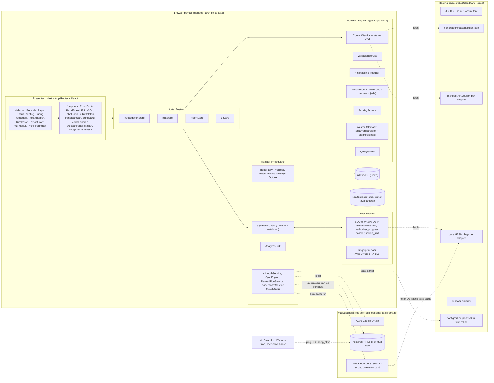
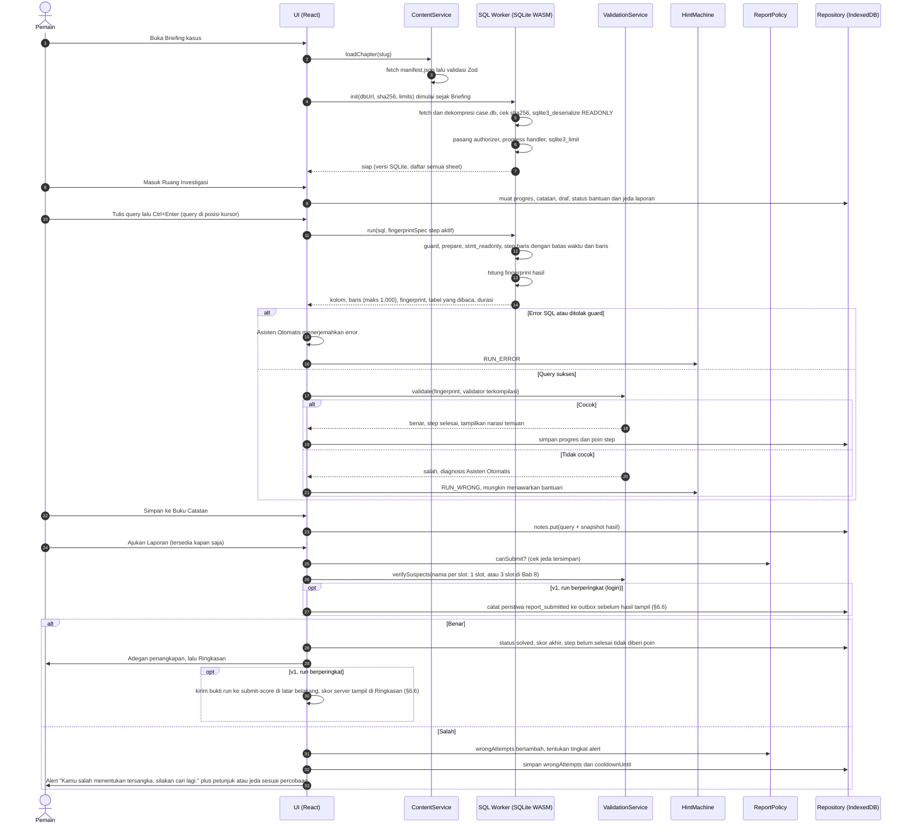
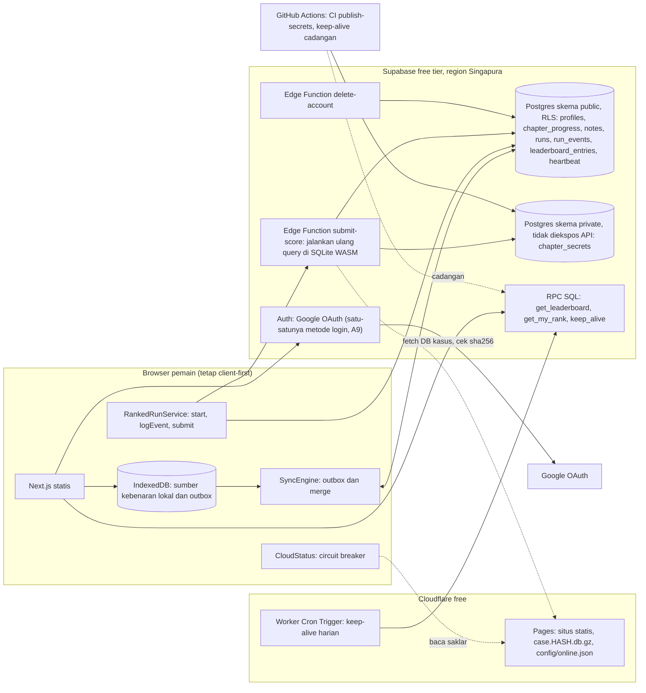
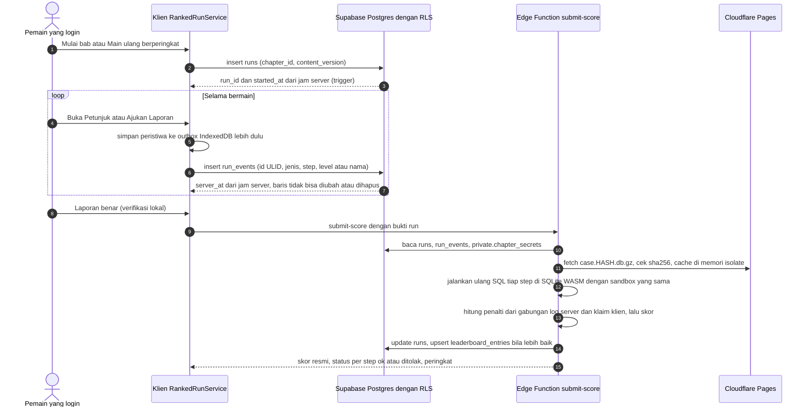
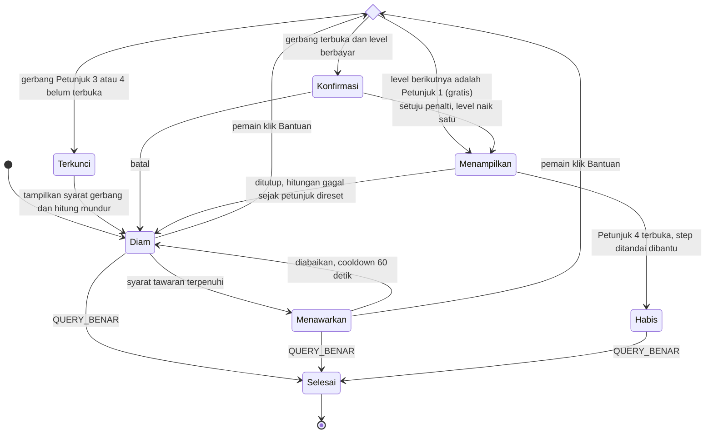

# Detektif SQL — Dokumen Arsitektur Software

> **Versi** 0.3 (draf untuk diskusi) · **Tanggal** 28 September 2026
> **Sumber kebenaran produk:** [`00-keputusan.md`](./00-keputusan.md). Bila dokumen ini bertentangan dengan file itu, **00-keputusan.md yang berlaku**. Rujukan lain: [`01-riset.md`](./01-riset.md) (riset & konsep chapter) dan [`03-design.md`](./03-design.md) (desain visual & layar).
> **Cakupan**: arsitektur teknis MVP → v1 → v2, yaitu *bagaimana* game dibangun.
> **Konvensi bahasa**: teks dokumen berbahasa Indonesia; istilah teknis yang lazim dibiarkan dalam bahasa Inggris.

**Perubahan v0.2 (menyelaraskan dengan 00-keputusan.md):**

- Semua sheet terbuka sejak awal (A5).
- Bantuan mengikuti B1: 4 level dengan penalti 0/10/30/60%, ditambah Asisten Otomatis & Buku Saku yang gratis.
- Laporan berisi nama saja, tombol selalu tersedia, dan salah tuduh ditangani bertahap dengan jeda (A4, B2).
- Nama pelaku wajib unik dan diuji saat build.
- Contoh Bab 1 kini "Raibnya Batik Tulis Sang Maestro" berlatar Wiralaga (B3, B4).
- Desktop-first ≥1024 px (A2).
- Gratis penuh dengan biaya operasional ≈ Rp0 (A3).
- Target pemain dewasa, sehingga mode kelas turun ke v2 untuk dosen (A1).

**Perubahan v0.3 (menjawab D1–D3 lewat A6–A8 dan B6–B8):**

- **Laporan Bab 8 = 3 slot** (A6, B7): Dalang harus tepat di slotnya, Perantara 1 & 2 boleh tertukar, semua harus benar. Tidak ada umpan balik jumlah nama benar; opsi `partialFeedback` dan `slotMatching` global dihapus, diganti `group` per slot (§4.3, §6.5). Build menguji keunikan ketiga nama dan memastikan ketiganya orang yang berbeda (§4.2).
- **Akun & leaderboard pasti di v1** (A7, B8), tidak lagi bersyarat. Main tetap tanpa login; login Google saja (Supabase Auth, A9); sinkronisasi progres & Buku Catatan; leaderboard per bab dengan tab "Tanpa Bantuan"; skor divalidasi ulang di Edge Function; nama tampilan opt-in; RLS di semua tabel; keep-alive terjadwal gratis; degradasi mulus tanpa upgrade berbayar (§3.6, §6.6, §9.5–§9.7, §11, §12.7, §13.2).
- **Tema gelap** (A8, B6): field `violence` + `contentWarning` di metadata chapter, badge "Tema Dewasa" di kartu kasus & briefing, aturan build kurva intensitas (§4.3, §4.4, §4.6).
- Batas free tier Supabase, Cloudflare, dan GitHub Actions dicek ulang pada **28 September 2026** (§12.7, §15.1).

---

## Daftar isi

0. [Ringkasan eksekutif & keputusan kunci](#0-ringkasan-eksekutif--keputusan-kunci)
1. [Ringkasan & prinsip](#1-ringkasan--prinsip)
2. [Tech stack](#2-tech-stack)
3. [Arsitektur & alur data](#3-arsitektur--alur-data)
4. [Format konten chapter (content-as-data)](#4-format-konten-chapter-content-as-data)
5. [Sandbox & keamanan query](#5-sandbox--keamanan-query)
6. [Validasi jawaban](#6-validasi-jawaban)
7. [Sistem bantuan bertingkat](#7-sistem-bantuan-bertingkat)
8. [Buku catatan detektif (simpan hasil query)](#8-buku-catatan-detektif-simpan-hasil-query)
9. [Progres & skor](#9-progres--skor)
10. [Struktur folder proyek](#10-struktur-folder-proyek)
11. [Rute & halaman](#11-rute--halaman)
12. [Performa, aksesibilitas, i18n, testing, deployment, analitik, biaya](#12-performa-aksesibilitas-i18n-testing-deployment-analitik-biaya)
13. [Roadmap](#13-roadmap)
14. [Risiko & keputusan terbuka](#14-risiko--keputusan-terbuka)
15. [Lampiran: sumber & glosarium](#15-lampiran-sumber--glosarium)

---

## 0. Ringkasan eksekutif & keputusan kunci

Detektif SQL adalah game web **client-first dan gratis penuh**. Database kasus, eksekusi SQL, validasi, dan penyimpanan progres semuanya berjalan di browser pemain. Frontend dirilis sebagai **situs statis** (tanpa server aplikasi), sehingga:

- **biaya operasional ≈ Rp0** (hosting free tier);
- query terasa instan karena tidak ada round-trip jaringan;
- game tetap bisa dimainkan tanpa akun.

**Akun, sinkronisasi, dan leaderboard dibangun di v1** (A7, B8) di atas **Supabase free tier**. Login bersifat opsional bagi pemain: game tetap bisa dimainkan penuh tanpa akun, dengan progres di IndexedDB. Backend ditambahkan lewat antarmuka (*port*) yang sudah disiapkan sejak MVP, sehingga inti game tidak perlu ditulis ulang. Bila Supabase dijeda atau kuotanya habis, fitur online mati sementara dan game tetap berjalan offline. Tidak ada upgrade berbayar.

Menambah chapter baru = menambah **satu folder konten** (YAML + SQL + Markdown). Folder itu divalidasi, dibangun menjadi file database, dan **diuji otomatis** saat build, termasuk uji keunikan nama pelaku. Tidak ada perubahan kode.

| ID | Keputusan | Alasan singkat |
|---|---|---|
| ADR-01 | **Client-first, frontend statis** (Next.js `output: 'export'`) | Biaya ≈ Rp0, latensi query ≈ 0, skala gratis di CDN |
| ADR-02 | **SQLite WASM resmi** (`@sqlite.org/sqlite-wasm`) di **Web Worker** | ±400 KB gzip; window function & CTE lengkap; mengekspos `sqlite3_set_authorizer`, `sqlite3_progress_handler`, `sqlite3_stmt_readonly`, `sqlite3_limit` untuk sandbox |
| ADR-03 | **Next.js 16 + React 19 + TypeScript strict + Tailwind v4 + shadcn/ui** | Ekosistem besar, routing file-based, pre-render halaman publik |
| ADR-04 | **Konten sebagai data**: `chapter.yaml` + `schema.sql` + `seed` + `story/*.md` + `tests.yaml`, dikompilasi menjadi `manifest.json` + `case.db` | Penulis kasus tidak menyentuh kode; setiap chapter teruji otomatis |
| ADR-05 | **Validasi berbasis hasil** (kanonisasi result set → SHA-256 *fingerprint*), bukan mencocokkan teks query | Banyak query benar dengan bentuk berbeda; query kunci tidak dikirim ke browser |
| ADR-06 | **IndexedDB (Dexie)** sebagai sumber kebenaran lokal untuk progres & catatan; **Supabase free tier** (v1) di balik interface repository untuk sinkronisasi | MVP 100% lokal tanpa akun; v1 menambah sinkronisasi tanpa mengubah domain |
| ADR-07 | **CodeMirror 6** (editor), **TanStack Table + Virtual** (hasil), **Motion** (animasi, MVP) → **Rive** (adegan penangkapan, v1), **Zustand** (state) | Ringan dan aksesibel |
| ADR-08 | **Kode & kunci skema: bahasa Inggris. Teks tampil, nama tabel/kolom SQL, dan URL: bahasa Indonesia** | Kode mudah dirawat; pengalaman pemain 100% Indonesia |
| ADR-09 | **Semua sheet terbuka sejak awal chapter** (A5) | Authorizer hanya memblokir `sqlite_*` dan operasi non-baca; autocomplete memuat semua sheet |
| ADR-10 | **Desktop-first, MVP ≥1024 px** (A2) | Menulis SQL paling nyaman di laptop/PC; layar <1024 px menampilkan anjuran + "Tetap Lanjutkan" |
| ADR-11 | **Gratis penuh, tanpa pembayaran/iklan** (A3) | Semua layanan dipilih agar muat di free tier (§12.7) |
| ADR-12 | **Akun opsional di v1: Supabase Auth (Google saja), tanpa akun anonim** (A7, A9, B8) | Pemain tanpa login tidak memakan kuota MAU; login hanya untuk sinkronisasi & leaderboard |
| ADR-13 | **Skor leaderboard dihitung ulang di server**: Edge Function `submit-score` menjalankan ulang query pemain dengan SQLite WASM + sandbox yang sama, lalu menerapkan penalti dari log peristiwa *append-only* (§6.6) | Angka skor dari browser tidak pernah dipercaya; kunci jawaban teks hanya ada di skema `private` server |
| ADR-14 | **Slot laporan dengan `group`** (B7): slot tanpa group harus tepat, slot satu group boleh tertukar; hasil semua-atau-tidak tanpa jumlah benar | Satu model untuk Bab 1–7 (1 slot) dan Bab 8 (Dalang + 2 Perantara) |
| ADR-15 | **Label konten di metadata chapter** (`violence` + `contentWarning`, B6), divalidasi saat build | Badge "Tema Dewasa" konsisten di kartu kasus & briefing tanpa kode per bab |

---

## 1. Ringkasan & prinsip

### 1.1 Konteks produk

- **Target pemain (A1):** mahasiswa, calon data analyst, dan gamer penyuka misteri/puzzle. Nada cerita dewasa, lebih tajam, dan penuh twist.
- **Latar (B3):** kota fiktif **Wiralaga** beserta distrik dan kelurahan fiktifnya. Pemain bekerja di instansi fiktif **Divisi Investigasi Data (DID)** bersama **Bu Laras Wibisono** (Kepala Unit) dan **Gilang** (Analis Data).
- **Tema (A8, B6):** Bab 1–3 kejahatan non-kekerasan; intensitas naik mulai Bab 4; kekerasan (termasuk pembunuhan) boleh mulai Bab 5 dan selalu terjadi di luar layar. Bab dengan kekerasan diberi badge **"Tema Dewasa"** + keterangan satu baris di kartu kasus dan briefing.
- **Struktur game:** setiap **chapter** adalah satu kasus dengan database sendiri. Semua **sheet** (tabel) chapter terbuka sejak awal: penduduk, CCTV, transaksi bank, log telepon, dan sebagainya. Chapter berisi **step** bertahap, mulai dari `SELECT` sederhana sampai JOIN, subquery, `GROUP BY/HAVING`, window function, dan CTE. Delapan bab direncanakan (B4); **MVP = Bab 1–3**.
- **Alat bantu pemain:** pemain bisa menyimpan hasil query ke **buku catatan**, memakai **Asisten Otomatis** dan **Buku Saku SQL** secara gratis, serta membuka **4 level petunjuk** (B1).
- **Laporan polisi (A4, B2):** tombol **"Ajukan Laporan"** selalu tersedia dan formulirnya hanya berisi **Nomor Kasus** (terisi otomatis) dan **Nama Tersangka**.
  - Jika benar, animasi penangkapan diputar dan chapter selesai.
  - Jika salah, pemain mendapat alert bertahap, dimulai dengan *"Kamu salah menentukan tersangka, silakan cari lagi."*
  - **Bab 8 (A6, B7)** memakai 3 field: **Dalang**, **Perantara 1**, **Perantara 2**. Laporan benar hanya bila ketiganya benar.
- **Akun (v1, A7, B8):** opsional. Tanpa login, progres & Buku Catatan tersimpan di browser. Dengan login Google (A9), progres & catatan tersinkron antar-perangkat dan pemain bisa ikut **leaderboard per bab** (skor, lalu waktu) dengan tab **"Tanpa Bantuan"** (tidak membuka petunjuk apa pun, termasuk Petunjuk 1; Asisten Otomatis & Buku Saku tidak dihitung, B8).

### 1.2 Prinsip arsitektur

| # | Prinsip | Konsekuensi teknis |
|---|---|---|
| P1 | **Client-first & statis** | Tidak ada server aplikasi di MVP. Semua aset (JS, wasm, DB kasus) di CDN. |
| P2 | **Konten adalah data** | Chapter = folder. Kode tidak boleh berisi `if (chapter === 'ch01')`. Perilaku khusus lewat *validator kustom* yang terdaftar di registry dan dirujuk dengan nama dari konten. |
| P3 | **Aman secara default** | Sandbox berlapis: guard teks → authorizer SQLite → DB read-only → batas waktu/baris/memori → watchdog Worker. Markdown konten dirender tanpa HTML mentah. |
| P4 | **Deterministik** | DB kasus read-only dan seed tetap. Query yang sama selalu menghasilkan hasil yang sama di browser mana pun maupun di server. Ini penting untuk validasi & snapshot catatan. |
| P5 | **Ports & adapters** | Domain (validator, bantuan, skor, konten) ditulis dalam TypeScript murni tanpa React/DOM, sehingga bisa diuji di Node dan dipakai ulang di server. Infrastruktur diakses lewat interface. |
| P6 | **Ramah pemula, Indonesia-first** | Error SQL diterjemahkan ke bahasa Indonesia yang ramah (Asisten Otomatis). Nama tabel/kolom berbahasa Indonesia agar mudah dibedakan dari *keyword* SQL. Buku Saku menjelaskan beda dialek sebagai jembatan ke PostgreSQL/MySQL di dunia kerja. |
| P7 | **Konten teruji** | Setiap chapter punya `tests.yaml`. Build gagal bila konten rusak atau nama pelaku tidak unik. |
| P8 | **Biaya ≈ Rp0** | Setiap layanan harus punya free tier yang cukup (§12.7). Game tetap berfungsi penuh secara lokal bila layanan opsional (analitik, backend) mati atau kuotanya habis. |
| P9 | **Mudah diperluas** | Titik ekstensi eksplisit: registry validator, registry engine (`sqlite` → `postgres`), `ContentSource` (file statis → Supabase Storage untuk chapter buatan dosen di v2), feature flag. |

### 1.3 Di luar cakupan MVP (*non-goals*)

- Akun, sinkronisasi cloud, dan leaderboard: **bukan MVP**, dijadwalkan pasti di **v1** (A7, B8).
- **Login wajib** (tidak akan pernah: main selalu bisa tanpa akun, B8).
- **Paket berbayar layanan apa pun**, termasuk upgrade Supabase Pro saat kuota habis (B8, A3).
- Mode kelas/dosen dan editor chapter: v2.
- Tata letak khusus HP/tablet: pasca-v1, opsional.
- Multiplayer.
- Bahasa selain Indonesia.
- **Monetisasi apa pun** (tidak ada paywall, iklan, pembayaran, maupun lisensi institusi).

---

## 2. Tech stack

### 2.1 Ringkasan rekomendasi

| Lapisan | Pilihan | Alternatif yang dipertimbangkan | Alasan |
|---|---|---|---|
| Framework | **Next.js 16 (App Router)**, `output: 'export'` | Vite + React Router/TanStack Router (SPA), Astro | Routing file-based; pre-render halaman publik (Beranda, Papan Kasus); `generateStaticParams` cocok dengan katalog chapter |
| Bahasa | **TypeScript strict** | — | Skema konten, validator, dan protokol Worker sangat diuntungkan oleh tipe |
| UI | **React 19 + Tailwind CSS v4 + shadcn/ui (Radix)** | Chakra, MUI | Komponen aksesibel (Dialog, Tabs, Tooltip), bundle kecil, kode komponen dimiliki sendiri |
| Mesin SQL | **SQLite WASM resmi** dalam Web Worker (RPC via Comlink) | sql.js, PGlite, DuckDB-WASM | Lihat §2.2 |
| Editor SQL | **CodeMirror 6** + `@codemirror/lang-sql` (dialek SQLite + autocomplete semua sheet) | Monaco | Lihat §2.3 |
| Tabel hasil | **TanStack Table v9 + TanStack Virtual** | AG Grid Community, Glide Data Grid | Headless, virtualisasi baris, semantik `<table>` terjaga untuk screen reader |
| Animasi | **Motion** (`motion/react`) untuk UI & adegan MVP → **Rive** untuk adegan penangkapan (v1) | Lottie (dotLottie), CSS murni | Lihat §2.4 |
| State | **Zustand v5** (state sesi & UI) + **Dexie `useLiveQuery`** (data tersimpan) | Redux Toolkit, Jotai, XState | Sederhana; mesin bantuan ditulis sebagai *reducer* murni |
| Penyimpanan lokal | **IndexedDB via Dexie 4** | localStorage, idb-keyval | Kuota besar, query berindeks, migrasi skema bawaan |
| Backend (v1) | **Supabase free tier**: Auth (Google OAuth saja), Postgres + RLS, RPC SQL, Edge Functions (Deno) | Firebase Spark, PocketBase, Cloudflare Workers + D1 | Auth + RLS siap pakai; Edge Function punya 2 detik CPU per request (cukup untuk menjalankan ulang query, §6.6), sedangkan Workers Free hanya 10 ms; free tier cukup untuk skala awal (§12.7) |
| Keep-alive (v1) | **Cloudflare Workers Cron Trigger** (utama) + **GitHub Actions `schedule`** (cadangan) | Layanan uptime pihak ketiga | Gratis; Worker cron tidak ikut mati bila repo sepi (jadwal GitHub Actions di repo publik nonaktif setelah 60 hari tanpa aktivitas) |
| Validasi skema konten | **Zod 4** + parser `yaml` | JSON Schema + Ajv | Satu sumber kebenaran untuk tipe TS & validasi runtime |
| Markdown cerita | **react-markdown** (tanpa HTML mentah) + `rehype-sanitize` | MDX | Aman untuk konten buatan dosen (v2); MDX bisa mengeksekusi kode |
| i18n | **next-intl** (tanpa routing locale, default `id-ID`) | Kamus TS sederhana | Pluralisasi ICU & format angka/tanggal |
| PWA/offline (v1) | **Serwist** (`@serwist/next`) | Workbox manual | Cache wasm, manifest, dan DB chapter yang sudah dibuka |
| Testing | **Vitest 5**, **fast-check**, **Playwright 1.6x**, **@axe-core/playwright** | Jest, Cypress | Lihat §12.4 |
| Observability | **Sentry** (Developer, gratis) + **Umami Cloud** (Hobby, gratis, cookieless) | GA4, PostHog | Gratis, ramah privasi (UU PDP) |
| Hosting | **Cloudflare Pages** (free) | Vercel Hobby, Netlify, GitHub Pages | Bandwidth statis tidak dibatasi di free tier (§12.5) |

### 2.2 Mesin SQL di browser — perbandingan

Ukuran di bawah diukur langsung dari paket npm pada 28 September 2026 (gzip level 9).

| Kriteria | **SQLite WASM resmi** | sql.js | PGlite | DuckDB-WASM |
|---|---|---|---|---|
| Versi dicek | `@sqlite.org/sqlite-wasm` 3.53.4-build1 | 1.13.0 (SQLite 3.49) | `@electric-sql/pglite` 0.5.8 (Postgres) | — |
| Ukuran wasm (mentah → gzip) | 869 KB → **402 KB** | 660 KB → **322 KB** | wasm 10,1 MB → 3,4 MB **+** data 6,3 MB → 1,9 MB (±**5,3 MB** total) | beberapa MB |
| Window function | Ya (sejak 3.25) | Ya | Ya | Ya |
| CTE & `WITH RECURSIVE` | Ya | Ya | Ya | Ya |
| `FILTER`, `NULLS FIRST/LAST`, `RIGHT/FULL JOIN` | Ya (3.30 / 3.39+) | Ya | Ya | Ya |
| Tipe tanggal | `TEXT` ISO-8601 + `date()`, `strftime()` | sama | `DATE`, `TIMESTAMP`, `INTERVAL` asli | asli |
| Hook sandbox | **Ya**: authorizer, progress handler, `stmt_readonly`, `sqlite3_limit`, `deserialize(READONLY)` terekspos di `capi` | **Tidak** di API publik (hanya `exec`, `prepare`, `create_function`, `updateHook`) | Terbatas (read-only via transaksi/role; timeout perlu diverifikasi) | Terbatas |
| Waktu inisialisasi | Cepat (puluhan ms + deserialize DB) | Cepat | Lebih lambat (ratusan ms – detik) | Sedang |
| Pemelihara | Tim inti SQLite | Komunitas | ElectricSQL | DuckDB Labs |
| Dialek bagi data analyst | Mayoritas sintaks `SELECT` portabel; beda di fungsi tanggal & sebagian fungsi string | sama | PostgreSQL, standar industri | Mirip Postgres |

**Keputusan: SQLite WASM resmi**, dengan empat alasan:

1. **Sandbox yang benar.** Authorizer dan progress handler memungkinkan penolakan non-`SELECT` di level mesin serta penghentian query yang terlalu lama. sql.js tidak mengeksposnya.
2. **Ukuran.** ±400 KB gzip vs ±5,3 MB untuk PGlite.
3. **Fitur SQL cukup** untuk seluruh 8 bab: window function (Bab 7), CTE rekursif (Bab 8), `FILTER`, `FULL JOIN`.
4. **Pemeliharaan resmi** oleh tim SQLite.

**Jembatan ke dialek dunia kerja (A1).** Target pemain akan memakai PostgreSQL, MySQL, atau BigQuery di pekerjaan. Karena itu:

- **Buku Saku SQL** memuat "catatan dialek" per konsep, mis. `strftime('%Y', tanggal)` (SQLite) ≈ `EXTRACT(YEAR FROM tanggal)` (PostgreSQL) ≈ `YEAR(tanggal)` (MySQL).
- Asisten Otomatis menyarankan padanan saat pemain memakai fungsi dialek lain.
- Kurikulum menghindari fungsi khusus SQLite, kecuali fungsi tanggal.

**PGlite tetap opsi v2.** Interface `SqlEngine` dan field `engine: 'sqlite' | 'postgres'` per chapter sudah disiapkan. PGlite hanya di-*lazy load* untuk chapter yang memintanya, bila kelak ada jalur "SQL untuk Analis Data (PostgreSQL)".

**Ukuran DB per chapter.** Riset (01-riset §5.2) memperkirakan tabel hingga 100.000–200.000 baris di Bab 7–8.

- DB dikirim **terkompresi gzip** (`case.<hash>.db.gz`) dan didekompresi di Worker dengan `DecompressionStream('gzip')`.
- Budget: ≤ 2 MB mentah untuk Bab 1–3, dan ≤ 15 MB mentah (±3–4 MB terkompresi) untuk bab besar.
- Alternatif untuk bab besar: kirim generator ber-seed lalu bangun DB di Worker (dievaluasi saat Bab 7–8).

### 2.3 Editor SQL: CodeMirror 6 vs Monaco

| Kriteria | **CodeMirror 6** | Monaco |
|---|---|---|
| Ukuran | Modular; inti + lang-sql ±150–200 KB gzip | ±2–5 MB, sulit di-*tree-shake* |
| Autocomplete skema | `sql({ dialect: SQLite, schema, upperCaseKeywords: true })`; skema bisa memuat deskripsi kolom | Perlu provider sendiri |
| Aksesibilitas | Baik (contenteditable, dukungan screen reader) | Cukup |
| Integrasi Next.js | Mudah (`@uiw/react-codemirror` atau langsung) | Perlu loader & konfigurasi worker |
| Layar sentuh | Didukung (berguna bila tata letak mobile dibuat pasca-v1) | Lemah |

**Keputusan: CodeMirror 6.** Fitur MVP:

- highlight SQL;
- autocomplete **semua sheet chapter** beserta kolomnya, dengan deskripsi dari manifest;
- snippet (`SELECT … FROM … WHERE …`);
- komentar `--`;
- penanda posisi error (via `sqlite3_error_offset`);
- riwayat query (`Ctrl+↑/↓`);
- **editor boleh berisi beberapa query**: `Ctrl/Cmd+Enter` menjalankan query di posisi kursor atau teks yang diseleksi, sehingga Worker tetap hanya menerima satu statement.

Autocomplete dibuat tidak agresif: muncul setelah 2 karakter atau `Ctrl+Space`.

### 2.4 Animasi

| Pilihan | Cocok untuk | Catatan |
|---|---|---|
| **Motion** (dulu Framer Motion) | Transisi panel, kartu step, stempel "DITANGKAP", adegan penangkapan MVP (timeline di 03-design §4.7) | Satu timeline yang bisa dilewati; mendukung `prefers-reduced-motion` |
| **Rive** | Adegan penangkapan interaktif (v1) | File `.riv` sangat kecil, tapi runtime-nya WASM (ratusan KB), jadi di-*lazy load* hanya di rute penangkapan. Butuh animator Rive. |
| Lottie (dotLottie) | Animasi dekoratif dari After Effects | Interaktivitas terbatas; JSON bisa besar |

**Keputusan:** MVP memakai Motion + ilustrasi berlapis. Rive dipakai di v1 bila tersedia animator.

### 2.5 State & penyimpanan

- **Zustand**:
  - `investigationStore`: chapter aktif, step aktif, teks editor per step, hasil terakhir, status run.
  - `hintStore`: mesin bantuan per step.
  - `reportStore`: status formulir laporan & sisa jeda.
  - `uiStore`: panel, ukuran panel, status layar anjuran desktop.

  Hasil query besar **tidak** di-*persist*.
- **Dexie/IndexedDB**: progres (termasuk penalti bantuan & jeda laporan yang **tahan reload**), catatan, riwayat query, draf editor, pengaturan.
- **localStorage**: hanya tema, "kurangi animasi", dan pilihan "Tetap Lanjutkan" di layar anjuran desktop. Ketiganya harus dibaca sinkron sebelum hydration. Mulai v1 ditambah sesi Supabase Auth (penyimpanan bawaan `supabase-js`, termasuk *code verifier* PKCE).
- **`navigator.storage.persist()`** diminta setelah step pertama selesai. Bila storage tidak tersedia (mode private), tampilkan peringatan jelas (01-riset §7).
- **Backend v1 (A7, B8)**: Supabase free tier. **Tidak ada akun anonim**: pemain tanpa login hanya punya `playerId` lokal dan tidak menyentuh server sama sekali. Login Google mengaktifkan sinkronisasi (§9.5) dan run berperingkat (§6.6).

### 2.6 Versi acuan (dicek 28 September 2026)

| Paket | Versi | Paket | Versi |
|---|---|---|---|
| next | 16.3.x | @sqlite.org/sqlite-wasm | 3.53.4-build1 |
| react | 19.3 | @codemirror/lang-sql | 6.10 |
| typescript | 7.0 (atau 5.9 bila tooling belum siap) | @tanstack/react-table | 9.2 |
| tailwindcss | 4.3 | @tanstack/react-virtual | 3.14 |
| zustand | 5.0 | motion | 13.4 |
| dexie / dexie-react-hooks | 4.4 | zod | 4.6 |
| next-intl | 4.14 | comlink | 4.4 |
| @supabase/supabase-js (v1) | 2.117 | @rive-app/react-canvas (v1) | 4.35 |
| vitest | 5.0 | @playwright/test | 1.63 |
| @serwist/next (v1) | 9.5 | @sentry/nextjs | 11.0 |
| supabase CLI (v1) | 2.118 (≥ 2.7 untuk `static_files` Edge Function) | wrangler (v1, keep-alive) | 4.142 |

> **Catatan spike:** integrasi `@sqlite.org/sqlite-wasm` dengan bundler Next.js (Turbopack) perlu dibuktikan di minggu pertama (lokasi `sqlite3.wasm`, Worker ESM). Rencana cadangan: salin `sqlite3.wasm` ke `public/` saat build dan arahkan dengan `locateFile`. Header COOP/COEP **tidak** diperlukan karena kita tidak memakai OPFS.

---

## 3. Arsitektur & alur data

### 3.1 Lapisan

| Lapisan | Isi | Boleh bergantung pada |
|---|---|---|
| **Presentasi** (`src/app`, `src/features/*/components`) | Halaman Next.js, komponen React, animasi | State, domain (tipe), UI kit |
| **State aplikasi** (`src/stores`, `src/features/*/hooks`) | Store Zustand, hook yang mengorkestrasi use case | Domain, port |
| **Domain / engine** (`src/engine`) | Tipe konten, kanonisasi & validator, mesin bantuan, skor, aturan laporan, penerjemah error, guard query. **TS murni, tanpa React/DOM** | — (hanya utilitas) |
| **Adapter infrastruktur** (`src/infra`) | Klien Worker SQL, repository Dexie, sumber konten, analitik, Supabase (v1) | Domain (mengimplementasikan port) |
| **Worker** (`src/infra/sql/sqlite.worker.ts`) | SQLite WASM, eksekusi query, instrumentasi authorizer, fingerprint | Domain (kanonisasi) |

### 3.2 Diagram komponen



### 3.3 Alur utama: dari memuat chapter sampai laporan polisi



### 3.4 Kontrak Worker

Worker diakses lewat Comlink (RPC berbasis `postMessage`).

```ts
// src/engine/sql/types.ts
export type Cell = string | number | bigint | null | Uint8Array;

export interface QueryLimits {
  timeoutMs: number;           // default 2000 (progress handler)
  watchdogMs: number;          // default 5000 (main thread → terminate Worker)
  maxSqlLength: number;        // default 5000 karakter
  maxRowsDisplay: number;      // default 1000 baris dikirim ke UI (bisa diturunkan per chapter)
  maxRowsValidate: number;     // default 10000 baris diproses untuk fingerprint
  maxValueBytes: number;       // default 1_000_000 (SQLITE_LIMIT_LENGTH)
  maxCellCharsDisplay: number; // default 500
}

export interface RunRequest {
  sql: string;                              // SATU statement (editor memilih query di posisi kursor)
  purpose: 'player' | 'peek' | 'internal';  // 'peek' = intip 5 baris sheet, tidak dihitung percobaan
  fingerprint?: FingerprintSpec;            // diturunkan dari validator step aktif
}

export interface RunResult {
  columns: { name: string; declType: string | null }[];
  rows: Cell[][];                 // ≤ maxRowsDisplay
  totalRows: number;              // ≤ maxRowsValidate
  truncated: boolean;
  overValidateCap: boolean;       // hasil > maxRowsValidate (tidak divalidasi)
  durationMs: number;
  tablesRead: string[];           // dari authorizer (SQLITE_READ)
  functionsUsed: string[];        // dari authorizer (SQLITE_FUNCTION)
  fingerprints?: ResultFingerprints;
}

export type EngineErrorCode =
  | 'GUARD_REJECTED'   // bukan SELECT/WITH/VALUES, lebih dari satu statement, terlalu panjang
  | 'NOT_AUTHORIZED'   // ditolak authorizer (tulis, PRAGMA, ATTACH, sqlite_*)
  | 'SQL_ERROR'        // error sintaks/semantik dari SQLite
  | 'TIMEOUT'          // SQLITE_INTERRUPT dari progress handler
  | 'ENGINE_CRASH';    // Worker di-terminate watchdog / out of memory

export interface EngineError {
  code: EngineErrorCode;
  sqliteCode?: number;
  rawMessage: string;   // pesan asli (tombol "Detail teknis")
  offset?: number;      // posisi karakter error (sqlite3_error_offset)
}

export interface SqlEngine {
  init(opts: { dbUrl: string; sha256: string; limits: QueryLimits }): Promise<{ sqliteVersion: string; tables: string[] }>;
  run(req: RunRequest): Promise<{ ok: true; result: RunResult } | { ok: false; error: EngineError }>;
  reset(): Promise<void>;                     // deserialize ulang dari byte asli
  dispose(): void;
}
```

### 3.5 Port (interface) untuk ekstensi

```ts
// src/engine/ports.ts
export interface ContentSource {                 // MVP: StaticContentSource (fetch /generated)
  listChapters(): Promise<ChapterSummary[]>;     // v2: SupabaseContentSource (chapter buatan dosen)
  getManifest(chapterId: ChapterId): Promise<ChapterManifest>;
}
export interface ValidationService {             // selalu lokal saat bermain (offline-first)
  validateStep(stepId: StepId, fp: ResultFingerprints, meta: RunMeta): Promise<StepVerdict>;
  verifySuspects(chapterId: ChapterId, names: string[]): Promise<SuspectVerdict>;   // satu nama per slot (§6.5)
}
export interface ProgressRepository { get(id: ChapterId): Promise<ChapterProgress | undefined>; put(p: ChapterProgress): Promise<void>; list(): Promise<ChapterProgress[]>; }
export interface NotesRepository { list(chapterId?: ChapterId): Promise<DetectiveNote[]>; put(n: DetectiveNote): Promise<void>; softDelete(id: string): Promise<void>; }

// ── v1 (A7, B8). Implementasi MVP: Noop* (semua mengembalikan "offline"), jadi UI tidak perlu cabang khusus.
export interface AuthService {
  current(): Promise<Player | null>;
  signInWithGoogle(): Promise<void>;                    // redirect OAuth (PKCE) → /masuk?code=…
  signOut(opts: { wipeLocal: boolean }): Promise<void>;
  onChange(cb: (p: Player | null) => void): () => void;
}
export interface SyncService { syncNow(): Promise<SyncReport>; status(): SyncStatus; }
export interface RankedRunService {                     // §6.6
  start(chapterId: ChapterId, contentVersion: string): Promise<RankedRun | null>;   // null bila offline/nonaktif
  logEvent(runId: string, e: RunEvent): Promise<void>;  // outbox dulu, lalu kirim
  submit(runId: string): Promise<ScoreVerdict | 'queued'>;
}
export interface LeaderboardService {
  top(chapterId: ChapterId, board: 'umum' | 'tanpa-bantuan', page: number): Promise<LeaderboardRow[]>;
  myRank(chapterId: ChapterId, board: 'umum' | 'tanpa-bantuan'): Promise<MyRank | null>;
}
export interface CloudStatus { current(): 'ok' | 'degraded' | 'offline' | 'disabled'; subscribe(cb: (s: string) => void): () => void; }
export interface AnalyticsSink { track(event: AnalyticsEvent): void; }
```

Implementasi dipilih di satu tempat (`src/infra/container.ts`) berdasarkan konfigurasi atau feature flag. Validasi selama bermain **selalu lokal**; server hanya menghitung ulang skor untuk leaderboard (§6.6), sehingga game tetap jalan penuh saat offline.

### 3.6 Arsitektur v1 dengan backend (A7, B8)



| Komponen | Tugas | Kuota free tier yang terpakai |
|---|---|---|
| Supabase Auth | Login Google (OAuth PKCE) saja (A9) | MAU (50.000/bulan); tidak mengirim email |
| PostgREST + RLS | Sinkronisasi `chapter_progress` & `notes`, membuat `runs`, mencatat `run_events` | Ukuran DB (500 MB), egress (5 GB); jumlah request API tidak dibatasi |
| RPC SQL (`security definer`) | `get_leaderboard`, `get_my_rank` (hanya kolom publik dari pemain yang opt-in), `keep_alive` | Sama dengan di atas |
| Edge Function `submit-score` | Menjalankan ulang query pemain & menghitung skor resmi (§6.6) | 500.000 invokasi/bulan; 2 detik CPU & 256 MB per request |
| Edge Function `delete-account` | Menghapus akun & semua baris milik pemain (UU PDP) | Invokasi (sangat jarang) |
| Cloudflare Worker cron | Ping `keep_alive` harian agar proyek tidak dijeda (§9.7) | 5 cron trigger/akun, 100.000 request/hari |
| `config/online.json` di Pages | Saklar manual fitur online (auth, sync, leaderboard) tanpa redeploy kode | Aset statis, tidak dibatasi |

**Aturan v1:**

1. **Lokal tetap sumber kebenaran.** Bermain, validasi step, bantuan, laporan, dan skor lokal tidak pernah menunggu server.
2. **Tanpa akun anonim.** Pemain yang tidak login tidak membuat baris apa pun di server dan tidak dihitung MAU.
3. **RLS aktif di semua tabel** skema `public` (§9.6). Tabel rahasia berada di skema `private` yang tidak diekspos PostgREST.
4. **Kunci `service_role` hanya ada di secret Edge Function**, dan string koneksi DB hanya di secret GitHub Actions (untuk `publish-secrets`). Frontend hanya membawa `anon key`.
5. **Bila Supabase dijeda atau kuotanya habis**, fitur online mati sementara dan game tetap berjalan offline (§9.7). Tidak ada upgrade berbayar.

---

## 4. Format konten chapter (content-as-data)

### 4.1 Struktur folder konten

```
content/
├─ policy.yaml                                # kebijakan konten global, mis. violenceFromOrder: 5 (B6)
└─ chapters/
   ├─ _template/                              # disalin oleh `pnpm content:new`
   ├─ 01-raibnya-batik-tulis-sang-maestro/
   │  ├─ chapter.yaml                         # metadata, step, petunjuk, validator, laporan
   │  ├─ schema.sql                           # DDL semua sheet
   │  ├─ seed/
   │  │  ├─ 01_laporan_kejadian.sql           # INSERT ... (atau .csv per tabel)
   │  │  ├─ 02_penduduk.sql
   │  │  └─ ...
   │  ├─ story/
   │  │  ├─ briefing.md
   │  │  ├─ langkah-1.md ... langkah-N.md
   │  │  └─ epilog.md
   │  ├─ assets/                              # potret tokoh, denah TKP (webp/avif)
   │  └─ tests.yaml                           # uji konten (TIDAK dikirim ke pemain)
   └─ 02-.../
```

Aturan: nama folder `NN-slug`; `id` chapter = `chNN-slug` dan **tidak boleh berubah** setelah rilis.

### 4.2 Pipeline build konten

```mermaid
flowchart LR
  Y["chapter.yaml"] --> B["scripts/build-content.ts"]
  Q["schema.sql + seed/*.sql atau *.csv"] --> B
  M["story/*.md"] --> B
  T["tests.yaml"] --> B
  B --> S1["Tahap 1: parse YAML, validasi Zod, cek referensi (stepId, tabel, file)"]
  S1 --> S2["Tahap 2: bangun DB dengan SQLite WASM di Node (engine sama dengan browser)"]
  S2 --> S3["Tahap 3: introspeksi PRAGMA table_info, cocokkan dengan metadata sheet"]
  S3 --> S4["Tahap 4: jalankan query kunci setiap step, hitung fingerprint"]
  S4 --> S5["Tahap 5: jalankan tests.yaml (query benar lolos, query salah gagal, jebakan terdeteksi, Petunjuk 4 lolos)"]
  S5 --> S6["Tahap 6: uji keunikan nama di SEMUA slot laporan, slot berbeda = orang berbeda, nama di catatan salah tuduh ada di data"]
  S6 --> S6b["Tahap 6b: aturan label konten: violence dan contentWarning"]
  S6b --> S7["Tahap 7: hash jawaban, samarkan Petunjuk 4, kompres DB"]
  S7 --> O["public/generated/chapters/ID/manifest.HASH.json + case.HASH.db.gz"]
  O --> K["public/generated/chapters/index.json (katalog)"]
  S7 --> SS[".secrets/chapters/ID.json: validator server + nama jawaban teks (v1, TIDAK di public, di-.gitignore)"]
```



Poin penting:

- **Engine build = engine runtime.** Build memakai `@sqlite.org/sqlite-wasm` versi yang sama di Node, sehingga fingerprint build pasti cocok dengan runtime.
- **Uji keunikan pelaku (wajib, B2 + B7).** Untuk setiap nama jawaban di **setiap slot** laporan (termasuk alias di `answers`), build mengumpulkan semua pasangan (kunci identitas, nama) dari sumber identitas yang dideklarasikan chapter (`report.identity`, mis. `penduduk.nik/nama`, `buku_tamu.nik/nama`). Nama lalu dinormalisasi dengan fungsi yang sama dengan runtime (§6.5). **Build gagal** bila:
  1. nama jawaban ternormalisasi cocok dengan **0 atau lebih dari 1** kunci identitas;
  2. dua slot menunjuk **kunci identitas yang sama** (mis. Dalang juga ditulis sebagai Perantara). Di Bab 8, ketiga nama harus tiga orang berbeda;
  3. nama jawaban satu slot ternormalisasi sama dengan nama jawaban slot lain;
  4. nama di `wrongSuspectNotes` tidak ada di data, `slot` pada catatan merujuk slot yang tidak ada, atau catatan **tanpa** `slot` ditulis untuk nama jawaban (catatan itu akan menyebut orang yang benar sebagai keliru);
  5. chapter dengan lebih dari 1 slot tidak punya `misplacedNote` (§4.3).
  - Nama mirip (mis. "Budi Santoso" vs "Budi Santosa") tetap diizinkan karena itu red herring yang sah.
  - Fixture uji negatif di `tests/content/`: nama Perantara diduplikasi dengan NIK lain → build gagal; Dalang = Perantara → build gagal; slot tanpa pasangan `group` → build gagal.
- **Aturan label konten (B6).** `violence: 'offscreen'` mewajibkan `contentWarning` dan hanya boleh untuk `order ≥ 5`. `contentWarning` tanpa `violence: 'offscreen'` ditolak. Batas angka bab dibaca dari konfigurasi kebijakan konten global (`content/policy.yaml`), bukan dari kode per chapter (P2).
- **Yang tidak dikirim ke pemain:** teks query kunci, teks query jebakan, `tests.yaml`, nama tersangka, dan nama di catatan salah tuduh. Yang dikirim hanya hash-nya.
- **Rahasia server (v1).** Build menulis `.secrets/chapters/<id>.json` (di-.gitignore, tidak pernah masuk `public/`) berisi validator terkompilasi versi server, nama jawaban ternormalisasi per slot, `ScoringSpec`, serta URL + sha256 `case.db`. CI di branch `main` mengunggahnya ke tabel `private.chapter_secrets` lewat `pnpm content:publish-secrets` (§6.6).
- **Nama file berisi hash konten** (`case.3f9a1c.db.gz`) agar bisa di-cache `immutable`.
- Perintah: `pnpm content:build` (dipanggil otomatis oleh `prebuild`), `pnpm content:verify` (CI), `pnpm content:new <slug>`.

### 4.3 Skema TypeScript — sumber (yang ditulis penulis konten)

```ts
// src/engine/content/types.ts
export const CONTENT_FORMAT_VERSION = 1 as const;

export type ChapterId = string;          // 'ch01-raibnya-batik-tulis-sang-maestro' — stabil selamanya
export type StepId = string;             // 'pintu-samping' — stabil, unik dalam chapter
export type EngineKind = 'sqlite' | 'postgres';
export type Difficulty = 'pemula' | 'menengah' | 'mahir';

export type SqlConcept =
  | 'select' | 'where' | 'order-by' | 'limit' | 'distinct' | 'like' | 'in' | 'between'
  | 'null' | 'string-fn' | 'aggregate' | 'group-by' | 'having' | 'join' | 'left-join'
  | 'self-join' | 'subquery' | 'correlated-subquery' | 'exists' | 'set-ops'
  | 'case' | 'date-time' | 'cte' | 'recursive-cte' | 'window';

/** Markdown inline, atau rujukan ke file .md relatif terhadap folder chapter. */
export type RichText = string | { file: string };

// ───────────────────────── Chapter ─────────────────────────
export interface Chapter {
  formatVersion: typeof CONTENT_FORMAT_VERSION;
  id: ChapterId;
  slug: string;                     // URL: /kasus/raibnya-batik-tulis-sang-maestro
  order: number;                    // nomor bab; Bab N+1 terbuka setelah Bab N selesai (B4)
  version: string;                  // semver ISI chapter
  locale: 'id-ID';
  title: string;
  tagline: string;
  synopsis: string;
  difficulty: Difficulty;
  estimatedMinutes: number;
  concepts: SqlConcept[];
  engine: EngineKind;               // MVP: selalu 'sqlite'
  cover?: string;
  violence: 'none' | 'offscreen';   // B6: kekerasan selalu di luar layar; 'offscreen' hanya untuk order ≥ 5
  contentWarning?: ContentWarning;  // B6: WAJIB bila violence = 'offscreen', dilarang bila 'none'
  unlock?: { afterChapters?: ChapterId[] };   // default: bab sebelumnya
  setting: { city: 'Wiralaga'; district: string; date: string; timezone?: 'WIB' | 'WITA' | 'WIT' };
  characters: Character[];          // JANGAN cantumkan pelaku asli di sini
  database: DatabaseSpec;
  display?: { maxRows?: number };   // batas baris tampil (default 1000)
  briefing: RichText;
  steps: Step[];                    // urut dari mudah ke sulit
  report: ReportSpec;
  scoring?: Partial<ScoringSpec>;   // override default global (jarang dipakai)
  credits?: { writers: string[]; artists?: string[]; reviewers?: string[] };
}

export interface Character { id: string; name: string; role: string; portrait?: string }

/** Label konten (B6). Tampil sebagai badge di kartu kasus (Papan Kasus) dan di kepala Briefing. */
export interface ContentWarning {
  label: 'Tema Dewasa';             // satu-satunya label saat ini; union dibiarkan agar mudah ditambah
  note: string;                     // SATU baris, 8–80 karakter, tanpa Markdown, mis. "Mengandung pembunuhan." (teks per bab: tabel B4)
}

// ───────────────────────── Database / sheet ─────────────────────────
// Semua sheet terbuka sejak awal chapter (A5): tidak ada field "reveal".
export interface DatabaseSpec {
  schema: string;                   // 'schema.sql'
  seed: string[];                   // ['seed/01_laporan_kejadian.sql', 'seed/penduduk.csv', ...]
  tables: TableMeta[];              // metadata panel sheet & autocomplete
}

export interface TableMeta {
  name: string;                     // nama tabel SQL (snake_case Indonesia)
  label: string;                    // label sheet di UI, mis. 'Buku Tamu Digital'
  icon?: 'dokumen' | 'orang' | 'kendaraan' | 'kamera' | 'bank' | 'telepon' | 'peta' | 'buku';
  description: string;
  columns: ColumnMeta[];
}

export interface ColumnMeta {
  name: string;
  type: 'INTEGER' | 'REAL' | 'TEXT' | 'NUMERIC' | 'BLOB';
  description: string;
  example?: string;
  key?: 'PK' | 'FK';
  references?: string;              // 'penduduk.nik'
}

// ───────────────────────── Step ─────────────────────────
// Poin TIDAK ditulis per step: skor maksimum chapter (1.000) dibagi rata ke step (B5).
export interface Step {
  id: StepId;
  title: string;
  story: RichText;
  objective: string;                // instruksi tugas yang eksplisit & terukur
  concepts: SqlConcept[];
  relatedTables: string[];          // dipakai diagnosis Asisten Otomatis
  starterSql?: string;
  validator: Validator;
  feedback?: FeedbackSpec;
  hints: [Hint, Hint, Hint, Hint];  // tepat 4: direction, tables, skeleton, solution (B1)
  onComplete?: RichText;            // narasi "temuan" setelah berhasil
  suggestNote?: { title: string; tags?: string[] };
  replaces?: StepId[];              // ID lama bila step diganti nama (migrasi progres)
}

// ───────────────────────── Petunjuk (B1) ─────────────────────────
export type HintLevel = 1 | 2 | 3 | 4;

export interface Hint {
  level: HintLevel;
  kind: 'direction'   // 1 · Arah: tanpa menyebut sintaks            · gratis
      | 'tables'      // 2 · Sheet & Kolom                            · −10% kumulatif
      | 'skeleton'    // 3 · Kerangka dengan bagian kosong            · −30% kumulatif
      | 'solution';   // 4 · Query Lengkap + penjelasan per baris     · −60% kumulatif, step "dibantu"
  body: RichText;
  insertSql?: string;               // tombol "Sisipkan ke editor" (level 3–4)
  offer?: Partial<HintOfferTrigger>;// override kapan petunjuk ini DITAWARKAN (bukan kapan boleh dibuka)
}

/** Kapan tombol Bantuan berdenyut menawarkan petunjuk berikutnya. Tidak pernah membuka otomatis. */
export interface HintOfferTrigger {
  minFailedRuns: number;
  minConsecutiveErrors: number;
  idleSeconds: number;
  minSecondsOnStep: number;
}

// ───────────────────────── Validator ─────────────────────────
export interface NormalizeOptions {
  rowOrder: 'any' | 'exact';        // 'exact' untuk step yang mengajarkan ORDER BY
  columnOrder: 'any' | 'exact';
  columnNames: 'ignore' | 'exact';  // 'exact' bila step meminta alias tertentu
  caseSensitive: boolean;           // default false
  trimText: boolean;                // default true
  decimals: number;                 // default 6
}

export type Validator =
  /** Hasil sama persis (setelah normalisasi) dengan hasil query kunci. */
  | { type: 'resultEquals'; solution: string; options?: Partial<NormalizeOptions> }
  /** Ada SATU kolom di hasil pemain yang himpunan nilainya = kolom `column` dari query kunci. Kolom lain bebas. */
  | { type: 'keyColumn'; solution: string; column: string;
      compare?: 'set' | 'multiset'; ignoreNulls?: boolean;
      options?: Partial<Pick<NormalizeOptions, 'caseSensitive' | 'trimText' | 'decimals'>> }
  /** Gula sintaks: hasil 1 baris × 1 kolom. Dikompilasi menjadi resultEquals. */
  | { type: 'singleValue'; solution: string; decimals?: number }
  /** Syarat bentuk query (token + instrumentasi authorizer). */
  | { type: 'queryUses'; require?: SqlConcept[]; forbid?: SqlConcept[];
      requireTables?: string[]; severity: 'block' | 'suggest'; message: string }
  | { type: 'all'; of: Validator[] }
  | { type: 'any'; of: Validator[] }
  | { type: 'custom'; name: string; params?: Record<string, unknown> };

/** Bahan diagnosis Asisten Otomatis (gratis) saat hasil belum cocok. */
export interface FeedbackSpec {
  rowCount?: 'none' | 'relative' | 'exact';   // default 'relative': "target jauh lebih sedikit"
  columnCount?: boolean;                      // "Hasilmu 1 kolom, seharusnya 3"
  mistakes?: { sql: string; message: string }[];  // jebakan yang diantisipasi → pesan khusus
}

// ───────────────────────── Laporan polisi (A4, A6, B2, B7) ─────────────────────────
// Hasil laporan SELALU semua-atau-tidak. Tidak ada opsi umpan balik jumlah nama benar (B7).
export interface ReportSpec {
  /**
   * Slot nama, 1–3 slot, urut sesuai tampilan formulir.
   * Bab 1–7: tepat 1 slot ('tersangka').
   * Bab 8 (B7): 'dalang' (tanpa group → harus tepat di slot ini)
   *           + 'perantara-1' & 'perantara-2' (group 'perantara' → boleh tertukar).
   */
  suspects: SuspectSlot[];
  /** Sumber identitas untuk uji keunikan saat build. */
  identity: { table: string; key: string; name: string }[];
  /** Cek "nama tidak ada di data" (bukan autocomplete; tidak dihitung salah tuduh). */
  lookup?: { table: string; column: string };
  /**
   * Petunjuk evaluatif untuk salah tuduh ke-2 dan seterusnya, per orang yang dituduh.
   * `slot` opsional: catatan hanya berlaku bila nama itu ditulis di slot tersebut
   * (dipakai untuk orang yang terlibat tetapi ditulis di slot yang keliru).
   */
  wrongSuspectNotes?: { name: string; note: string; slot?: string }[];
  defaultWrongNote: string;
  /** Wajib bila > 1 slot: catatan umum untuk nama jawaban yang ditulis di slot yang keliru. */
  misplacedNote?: string;
  arrest: { scene: string; suspectPortrait?: string; epilogue: RichText };
}

export interface SuspectSlot {
  id: string;                       // 'tersangka' | 'dalang' | 'perantara-1' | 'perantara-2'
  label: string;                    // 'Nama Tersangka' | 'Dalang' | 'Perantara 1' | 'Perantara 2'
  /** Slot dengan group sama saling dipertukarkan (dicocokkan tanpa urutan). Tanpa group = posisi tetap.
   *  Aturan build: setiap group berisi ≥ 2 slot. */
  group?: string;
  answers: string[];                // HANYA di sumber; di-hash saat build; biasanya 1 nama (alias boleh)
}

// ───────────────────────── Skor (B2, B5) ─────────────────────────
export interface ScoringSpec {
  maxScore: number;                                // default 1000, dibagi rata ke step
  hintPenaltyPct: [0, number, number, number];     // kumulatif per level 1..4, default [0, 10, 30, 60]
  hintGate: { afterFailedRuns: number; orAfterSeconds: number };  // untuk Petunjuk 3 & 4, default {1, 120}
  wrongReportPenaltyPct: number;                   // default 10 (% dari maxScore per salah tuduh)
  wrongReportCooldownFromAttempt: number;          // default 3 (salah ke-3 dst.)
  wrongReportCooldownSeconds: number;              // default 60
  starsThresholdPct: [number, number, number];     // default [0, 70, 90]
}
```

### 4.4 Skema TypeScript — manifest terkompilasi (yang dikirim ke browser)

```ts
// src/engine/content/manifest.ts
export interface ChapterSummary {                 // isi generated/chapters/index.json
  id: ChapterId; slug: string; order: number; version: string;
  title: string; tagline: string; difficulty: Difficulty; estimatedMinutes: number;
  concepts: SqlConcept[]; cover?: string; unlock?: { afterChapters?: ChapterId[] };
  contentWarning?: ContentWarning;  // badge "Tema Dewasa" di kartu kasus tanpa memuat manifest (B6)
  manifestUrl: string;
}
// ChapterManifest mewarisi `violence` & `contentWarning` dari Chapter → badge yang sama di Briefing.

export interface ChapterManifest
  extends Omit<Chapter, 'database' | 'steps' | 'report' | 'briefing' | 'scoring'> {
  build: { contentHash: string; builtAt: string; sqliteVersion: string; salt: string };
  database: { url: string; compressed: 'gzip' | null; bytes: number; sha256: string; tables: TableMeta[] };
  briefing: string;
  scoring: ScoringSpec;             // default + override sudah digabung
  steps: CompiledStep[];            // poin per step sudah dihitung (1000 dibagi rata)
  report: CompiledReport;
}

export interface CompiledStep
  extends Omit<Step, 'validator' | 'feedback' | 'hints' | 'story' | 'onComplete'> {
  points: number;                   // hasil pembagian rata, jumlah seluruh step = maxScore
  story: string;
  onComplete?: string;
  validator: CompiledValidator;
  feedback: {
    rowCount: 'none' | 'relative' | 'exact';
    expectedRows?: number;          // untuk diagnosis relatif/eksak
    expectedColumns?: number;
    mistakes: { fingerprint: string; message: string }[];
  };
  hints: CompiledHint[];
}

export type CompiledValidator =
  | { type: 'resultEquals'; fingerprint: string; unorderedFingerprint?: string; options: NormalizeOptions }
  | { type: 'keyColumn'; fingerprint: string; compare: 'set' | 'multiset'; ignoreNulls: boolean;
      options: Pick<NormalizeOptions, 'caseSensitive' | 'trimText' | 'decimals'> }
  | { type: 'queryUses'; require: SqlConcept[]; forbid: SqlConcept[]; requireTables: string[];
      severity: 'block' | 'suggest'; message: string }
  | { type: 'all' | 'any'; of: CompiledValidator[] }
  | { type: 'custom'; name: string; params?: Record<string, unknown> };
// unorderedFingerprint: hanya untuk rowOrder 'exact' → "Barisnya sudah benar, urutannya belum."

export interface CompiledHint {
  level: HintLevel;
  kind: Hint['kind'];
  penaltyPct: number;               // kumulatif: 0, 10, 30, 60
  offer: HintOfferTrigger;
  body: string;                     // level 4: disamarkan (lihat §6.5)
  insertSql?: string;               // level 4: disamarkan
  obfuscated: boolean;
}

export interface CompiledReport {
  suspects: { id: string; label: string; group?: string; hashes: string[] }[];
  lookup?: { table: string; column: string };
  /** Kunci: hash nama tertuduh, atau `${slotId}|${hash}` untuk catatan khusus slot. */
  wrongNotes: Record<string, string /* petunjuk evaluatif */>;
  defaultWrongNote: string;
  misplacedNote?: string;           // ada bila > 1 slot
  arrest: { scene: string; suspectPortrait?: string; epilogue: string };
}
// Sengaja TIDAK ada field jumlah-benar atau mode umpan balik parsial (B7).
```

### 4.5 Contoh: Bab 1 — "Raibnya Batik Tulis Sang Maestro" (versi mini 4 step)

> **Versi penuh Bab 1 memiliki 7 step** (01-riset §5.4; 00-keputusan B4) dengan konsep `SELECT *`, pilih kolom, `LIMIT`, `WHERE`, `AND/OR`, dan `ORDER BY`, serta dataset lebih besar (±1.200 baris buku tamu, ±2.000 penduduk). Contoh mini di bawah memadatkannya menjadi 4 step untuk menunjukkan format konten, validator, dan uji build secara utuh.

**Premis.** Sabtu malam, 13 Juni 2026, sehari sebelum pameran, kain batik tulis *"Sekar Jagad Wiralaga"* karya maestro fiktif Eyang Wirasmi hilang dari **Galeri Sekar Arum**, Distrik Kota Lama, **Wiralaga**. CCTV mati 40 menit (21.00–21.40), dan buku tamu digital mencatat semua orang yang keluar-masuk. Pemain bergabung dengan **Divisi Investigasi Data (DID)**; Bu Laras memberi briefing, sementara Gilang menulis petunjuk.

| # | Step (`id`) | Konsep | Tujuan | Validator | Poin |
|---|---|---|---|---|---|
| 1 | `laporan-galeri` | `SELECT *`, `WHERE`, `AND` | Tampilkan semua kolom laporan di Galeri Sekar Arum tanggal 13 Juni 2026 | `resultEquals` | 250 |
| 2 | `pintu-samping` | `WHERE` + rentang (`BETWEEN` atau `>=`/`<=`), pilih kolom | Siapa keluar lewat pintu samping pukul 21:00–21:40? (nama, nik, jam_keluar) | `keyColumn: nik` (himpunan) | 250 |
| 3 | `terakhir-keluar` | `ORDER BY … DESC`, `LIMIT` | 3 orang yang paling akhir keluar, urut dari yang paling akhir | `resultEquals` (`rowOrder: exact`) | 250 |
| 4 | `dua-budi` | `WHERE` dengan NIK (`IN` atau `OR`) | Bedakan "Budi Santoso" dan "Budi Santosa" di sheet pegawai | `keyColumn: nama` (himpunan) | 250 |
| — | Laporan Polisi | — | Nama tersangka (tombol tersedia sejak awal) | hash nama | — |

**Twist & red herring (mengikuti B2: nama pelaku unik, red herring memakai nama mirip):**

- **Budi Santoso** adalah kurir ekspedisi yang hanya lima menit di dalam untuk mengantar paket.
- **Budi Santosa** adalah staf gudang galeri yang seharusnya libur setiap Sabtu. Ia **pelaku**.
- Pemain belajar bahwa nama bisa mirip, sedangkan **NIK** selalu unik.
- Pengecoh lain di data:
  - Joko keluar lewat pintu samping di jam yang sama, tetapi pada **tanggal 12**.
  - Dimas keluar pukul 21:36 lewat pintu **depan**.
  - Maria keluar lewat pintu samping pukul **21:45**, setelah CCTV menyala.
  - Budi Hartanto, pegawai lain yang juga libur Sabtu, menjebak query `WHERE hari_libur = 'Sabtu'`.

#### `schema.sql`

```sql
-- Bab 1 — Raibnya Batik Tulis Sang Maestro (contoh mini 4 step)
-- Latar: Kota Wiralaga (fiktif). Semua data FIKTIF. NIK berawalan 99.

CREATE TABLE laporan_kejadian (
  id          INTEGER PRIMARY KEY,
  tanggal     TEXT NOT NULL,                 -- 'YYYY-MM-DD'
  distrik     TEXT NOT NULL,
  lokasi      TEXT NOT NULL,
  jenis       TEXT NOT NULL,
  keterangan  TEXT NOT NULL
);

CREATE TABLE penduduk (
  nik            TEXT PRIMARY KEY,           -- 16 digit, fiktif (awalan 99)
  nama           TEXT NOT NULL,
  jenis_kelamin  TEXT NOT NULL CHECK (jenis_kelamin IN ('L', 'P')),
  tanggal_lahir  TEXT NOT NULL,              -- 'YYYY-MM-DD'
  pekerjaan      TEXT,
  alamat         TEXT,
  kelurahan      TEXT NOT NULL
);

CREATE TABLE buku_tamu (
  id          INTEGER PRIMARY KEY,
  tanggal     TEXT NOT NULL,                 -- 'YYYY-MM-DD'
  nama        TEXT NOT NULL,
  nik         TEXT NOT NULL REFERENCES penduduk(nik),
  keperluan   TEXT NOT NULL,
  jam_masuk   TEXT NOT NULL,                 -- 'HH:MM' (WIB)
  jam_keluar  TEXT NOT NULL,                 -- 'HH:MM' (WIB)
  pintu       TEXT NOT NULL CHECK (pintu IN ('depan', 'samping'))   -- pintu keluar
);

CREATE TABLE pegawai_galeri (
  nik         TEXT PRIMARY KEY REFERENCES penduduk(nik),
  nama        TEXT NOT NULL,
  jabatan     TEXT NOT NULL,
  hari_libur  TEXT NOT NULL                  -- 'Senin' ... 'Minggu'
);
```

#### `seed/*.sql` (digabung di sini agar ringkas)

```sql
INSERT INTO laporan_kejadian (id, tanggal, distrik, lokasi, jenis, keterangan) VALUES
  (1, '2026-06-12', 'Kota Lama', 'Galeri Sekar Arum',       'Lain-lain',  'Pemasangan panel pameran selesai. Semua koleksi lengkap.'),
  (2, '2026-06-13', 'Kota Lama', 'Galeri Sekar Arum',       'Pencurian',  'Kain batik tulis "Sekar Jagad Wiralaga" karya maestro Eyang Wirasmi hilang dari ruang koleksi. CCTV mati pukul 21.00-21.40. Saksi melihat seseorang keluar lewat pintu samping.'),
  (3, '2026-06-13', 'Pelabuhan', 'Pasar Ikan Tanjung Wira', 'Pencopetan', 'Dompet pengunjung pasar malam hilang.'),
  (4, '2026-06-13', 'Kota Lama', 'Jl. Cempaka',             'Kecelakaan', 'Motor kurir tergelincir di depan galeri. Tidak ada korban luka.'),
  (5, '2026-06-14', 'Kota Lama', 'Galeri Sekar Arum',       'Lain-lain',  'Pameran tetap dibuka tanpa karya utama.');

INSERT INTO penduduk (nik, nama, jenis_kelamin, tanggal_lahir, pekerjaan, alamat, kelurahan) VALUES
  ('9971020301880001', 'Budi Santoso',             'L', '1988-01-03', 'Kurir Kilat Wira Express', 'Jl. Nangka No. 4',    'Tanjung Wira'),
  ('9971020502900002', 'Budi Santosa',             'L', '1990-02-05', 'Staf Gudang Galeri',       'Jl. Randu No. 17',    'Bukit Randu'),
  ('9971021003850003', 'Rahmat Hidayat',           'L', '1985-03-10', 'Satpam Galeri',            'Jl. Melati No. 2',    'Sekar Melati'),
  ('9971021204920004', 'Siti Marlina',             'P', '1992-04-12', 'Petugas Kebersihan',       'Jl. Kenanga No. 9',   'Kembang Arum'),
  ('9971021505870005', 'Maria Fransiska Lamanepa', 'P', '1987-05-15', 'Kurator Galeri',           'Jl. Cempaka No. 30',  'Kembang Arum'),
  ('9971021806940006', 'Dimas Aditya',             'L', '1994-06-18', 'Fotografer Lepas',         'Jl. Pelabuhan No. 3', 'Tanjung Wira'),
  ('9971022007830007', 'Yosef Manurung',           'L', '1983-07-20', 'Teknisi CCTV',             'Jl. Pasir No. 21',    'Pasir Luhur'),
  ('9971022208990008', 'Ni Komang Ayu Lestari',    'P', '1999-08-22', 'Mahasiswi',                'Jl. Kenari No. 6',    'Sekar Melati'),
  ('9971022509860009', 'Andi Pratama',             'L', '1986-09-25', 'Kolektor Kain',            'Jl. Bakau No. 11',    'Pasir Luhur'),
  ('9971022810890010', 'Joko Priyanto',            'L', '1989-10-28', 'Staf Gudang Galeri',       'Jl. Randu No. 5',     'Bukit Randu'),
  ('9971023011910011', 'Budi Hartanto',            'L', '1991-11-30', 'Staf Administrasi Galeri', 'Jl. Cempaka No. 8',   'Kembang Arum');

INSERT INTO buku_tamu (id, tanggal, nama, nik, keperluan, jam_masuk, jam_keluar, pintu) VALUES
  (1,  '2026-06-12', 'Joko Priyanto',            '9971022810890010', 'Kerja',        '08:00', '21:10', 'samping'),
  (2,  '2026-06-12', 'Budi Santosa',             '9971020502900002', 'Kerja',        '08:00', '17:05', 'samping'),
  (3,  '2026-06-13', 'Ni Komang Ayu Lestari',    '9971022208990008', 'Kunjungan',    '17:30', '19:10', 'depan'),
  (4,  '2026-06-13', 'Andi Pratama',             '9971022509860009', 'Kunjungan',    '18:45', '20:30', 'depan'),
  (5,  '2026-06-13', 'Yosef Manurung',           '9971022007830007', 'Servis CCTV',  '19:30', '20:55', 'samping'),
  (6,  '2026-06-13', 'Siti Marlina',             '9971021204920004', 'Kerja',        '13:00', '21:15', 'samping'),
  (7,  '2026-06-13', 'Budi Santoso',             '9971020301880001', 'Antar paket',  '21:22', '21:27', 'samping'),
  (8,  '2026-06-13', 'Rahmat Hidayat',           '9971021003850003', 'Kerja',        '18:00', '21:33', 'samping'),
  (9,  '2026-06-13', 'Dimas Aditya',             '9971021806940006', 'Foto pameran', '19:00', '21:36', 'depan'),
  (10, '2026-06-13', 'Budi Santosa',             '9971020502900002', 'Ambil barang', '20:48', '21:38', 'samping'),
  (11, '2026-06-13', 'Maria Fransiska Lamanepa', '9971021505870005', 'Kerja',        '10:00', '21:45', 'samping');

INSERT INTO pegawai_galeri (nik, nama, jabatan, hari_libur) VALUES
  ('9971020502900002', 'Budi Santosa',             'Staf Gudang',        'Sabtu'),
  ('9971021003850003', 'Rahmat Hidayat',           'Satpam',             'Senin'),
  ('9971021204920004', 'Siti Marlina',             'Petugas Kebersihan', 'Minggu'),
  ('9971021505870005', 'Maria Fransiska Lamanepa', 'Kurator',            'Senin'),
  ('9971022810890010', 'Joko Priyanto',            'Staf Gudang',        'Minggu'),
  ('9971023011910011', 'Budi Hartanto',            'Staf Administrasi',  'Sabtu');
```

#### `chapter.yaml`

```yaml
formatVersion: 1
id: ch01-raibnya-batik-tulis-sang-maestro
slug: raibnya-batik-tulis-sang-maestro
order: 1
version: 1.0.0
locale: id-ID
title: "Raibnya Batik Tulis Sang Maestro"
tagline: "CCTV mati 40 menit. Buku tamu mencatat segalanya."
synopsis: >
  Sehari sebelum pameran, kain batik tulis "Sekar Jagad Wiralaga" karya maestro Eyang Wirasmi
  hilang dari Galeri Sekar Arum, Distrik Kota Lama, Wiralaga. CCTV sempat mati 40 menit.
  Buku tamu digital mencatat semua yang masuk dan keluar.
difficulty: pemula
estimatedMinutes: 15              # versi mini; versi penuh 7 step ±25 menit
concepts: [select, where, between, order-by, limit, in]
engine: sqlite
violence: none                    # Bab 1–3 non-kekerasan (B6) → tanpa contentWarning
setting: { city: Wiralaga, district: "Kota Lama", date: "2026-06-13", timezone: WIB }
characters:
  - { id: laras, name: "Bu Laras Wibisono", role: "Kepala Unit, Divisi Investigasi Data" }
  - { id: gilang, name: "Gilang", role: "Analis Data; menulis petunjuk di panel Bantuan" }

database:
  schema: schema.sql
  seed:
    - seed/01_laporan_kejadian.sql
    - seed/02_penduduk.sql
    - seed/03_buku_tamu.sql
    - seed/04_pegawai_galeri.sql
  tables:                         # semua sheet terbuka sejak awal (A5)
    - name: laporan_kejadian
      label: "Laporan Kejadian"
      icon: dokumen
      description: "Semua laporan yang masuk ke DID."
      columns:
        - { name: id, type: INTEGER, key: PK, description: "Nomor laporan" }
        - { name: tanggal, type: TEXT, description: "Tanggal kejadian (YYYY-MM-DD)", example: "2026-06-13" }
        - { name: distrik, type: TEXT, description: "Distrik di Wiralaga", example: "Kota Lama" }
        - { name: lokasi, type: TEXT, description: "Lokasi kejadian", example: "Galeri Sekar Arum" }
        - { name: jenis, type: TEXT, description: "Jenis kejadian", example: "Pencurian" }
        - { name: keterangan, type: TEXT, description: "Uraian singkat kejadian" }
    - name: buku_tamu
      label: "Buku Tamu Digital"
      icon: buku
      description: "Catatan setiap orang yang masuk dan keluar Galeri Sekar Arum."
      columns:
        - { name: id, type: INTEGER, key: PK, description: "Nomor catatan" }
        - { name: tanggal, type: TEXT, description: "YYYY-MM-DD" }
        - { name: nama, type: TEXT, description: "Nama sesuai KTP" }
        - { name: nik, type: TEXT, key: FK, references: penduduk.nik, description: "NIK (unik per orang)" }
        - { name: keperluan, type: TEXT, description: "Keperluan kunjungan" }
        - { name: jam_masuk, type: TEXT, description: "Jam masuk (HH:MM, WIB)", example: "20:48" }
        - { name: jam_keluar, type: TEXT, description: "Jam keluar (HH:MM, WIB)", example: "21:38" }
        - { name: pintu, type: TEXT, description: "Pintu keluar: 'depan' atau 'samping'" }
    - name: pegawai_galeri
      label: "Pegawai Galeri"
      icon: orang
      description: "Daftar pegawai Galeri Sekar Arum beserta hari liburnya."
      columns:
        - { name: nik, type: TEXT, key: PK, references: penduduk.nik, description: "NIK pegawai" }
        - { name: nama, type: TEXT, description: "Nama pegawai" }
        - { name: jabatan, type: TEXT, description: "Jabatan" }
        - { name: hari_libur, type: TEXT, description: "Hari libur mingguan", example: "Sabtu" }
    - name: penduduk
      label: "Data Penduduk"
      icon: orang
      description: "Data kependudukan Kota Wiralaga (fiktif)."
      columns:
        - { name: nik, type: TEXT, key: PK, description: "Nomor Induk Kependudukan (fiktif)" }
        - { name: nama, type: TEXT, description: "Nama lengkap" }
        - { name: jenis_kelamin, type: TEXT, description: "'L' atau 'P'" }
        - { name: tanggal_lahir, type: TEXT, description: "YYYY-MM-DD" }
        - { name: pekerjaan, type: TEXT, description: "Pekerjaan" }
        - { name: alamat, type: TEXT, description: "Alamat" }
        - { name: kelurahan, type: TEXT, description: "Kelurahan di Wiralaga" }

briefing: { file: story/briefing.md }

steps:
  - id: laporan-galeri
    title: "Buka arsip laporan"
    story: { file: story/langkah-1.md }
    objective: >
      Tampilkan SEMUA kolom laporan kejadian di lokasi 'Galeri Sekar Arum'
      pada tanggal 13 Juni 2026.
    concepts: [select, where]
    relatedTables: [laporan_kejadian]
    starterSql: "SELECT * FROM laporan_kejadian LIMIT 10;"
    validator:
      type: resultEquals
      solution: |
        SELECT * FROM laporan_kejadian
        WHERE lokasi = 'Galeri Sekar Arum' AND tanggal = '2026-06-13';
      options: { rowOrder: any, columnOrder: any, columnNames: ignore }
    feedback:
      rowCount: relative
      columnCount: true
      mistakes:
        - sql: "SELECT * FROM laporan_kejadian WHERE tanggal = '2026-06-13'"
          message: "Ada laporan dari lokasi lain yang ikut tampil. Tambahkan syarat lokasi dengan AND."
    hints:
      - level: 1
        kind: direction
        body: "Cukup satu sheet. Saring barisnya dengan dua syarat sekaligus: tempat dan hari kejadian."
      - level: 2
        kind: tables
        body: "Sheet `laporan_kejadian`, kolom `lokasi` dan `tanggal`. Format tanggal: `'YYYY-MM-DD'`."
      - level: 3
        kind: skeleton
        body: "Lengkapi bagian yang kosong:"
        insertSql: |
          SELECT *
          FROM laporan_kejadian
          WHERE lokasi = '____'
            AND tanggal = '____';
      - level: 4
        kind: solution
        body: |
          - `SELECT *` → ambil semua kolom.
          - `FROM laporan_kejadian` → dari sheet laporan.
          - `WHERE lokasi = ...` → hanya baris di galeri.
          - `AND tanggal = ...` → dan hanya pada hari kejadian. Kedua syarat harus benar.
        insertSql: |
          SELECT *
          FROM laporan_kejadian
          WHERE lokasi = 'Galeri Sekar Arum'
            AND tanggal = '2026-06-13';
    onComplete: "CCTV mati pukul 21.00–21.40, dan saksi melihat seseorang keluar lewat pintu samping. Gilang membuka buku tamu digital."
    suggestNote: { title: "Laporan pencurian galeri", tags: [laporan] }

  - id: pintu-samping
    title: "Pintu samping"
    story: { file: story/langkah-2.md }
    objective: >
      Siapa saja yang KELUAR lewat pintu 'samping' antara pukul 21:00 dan 21:40
      pada 13 Juni 2026? Tampilkan nama, nik, dan jam_keluar.
    concepts: [where, between]
    relatedTables: [buku_tamu]
    validator:
      type: keyColumn
      column: nik
      compare: set
      solution: |
        SELECT nama, nik, jam_keluar
        FROM buku_tamu
        WHERE tanggal = '2026-06-13'
          AND pintu = 'samping'
          AND jam_keluar BETWEEN '21:00' AND '21:40';
    feedback:
      rowCount: relative
      mistakes:
        - sql: "SELECT nama, nik, jam_keluar FROM buku_tamu WHERE pintu = 'samping' AND jam_keluar BETWEEN '21:00' AND '21:40'"
          message: "Ada catatan dari hari lain yang ikut terbawa. Saring juga tanggalnya."
        - sql: "SELECT nama, nik, jam_keluar FROM buku_tamu WHERE tanggal = '2026-06-13' AND jam_keluar BETWEEN '21:00' AND '21:40'"
          message: "Saksi melihat pelaku keluar lewat pintu samping, bukan pintu depan."
    hints:
      - level: 1
        kind: direction
        body: "Tiga fakta dari laporan: hari kejadian, pintu yang dipakai, dan 40 menit saat CCTV mati."
      - level: 2
        kind: tables
        body: "Sheet `buku_tamu`: kolom `tanggal`, `pintu`, dan `jam_keluar` (format `'HH:MM'`)."
      - level: 3
        kind: skeleton
        body: "Lengkapi:"
        insertSql: |
          SELECT nama, nik, jam_keluar
          FROM buku_tamu
          WHERE tanggal = '____'
            AND pintu = '____'
            AND jam_keluar BETWEEN '____' AND '____';
      - level: 4
        kind: solution
        body: |
          - Tiga syarat digabung dengan `AND`.
          - `BETWEEN '21:00' AND '21:40'` mencakup kedua batas.
          - Teks jam berformat `'HH:MM'` bisa dibandingkan langsung.
        insertSql: |
          SELECT nama, nik, jam_keluar
          FROM buku_tamu
          WHERE tanggal = '2026-06-13'
            AND pintu = 'samping'
            AND jam_keluar BETWEEN '21:00' AND '21:40';
    onComplete: "Empat orang. Dua di antaranya bernama hampir sama. Ingat: nama bisa mirip, tapi NIK selalu unik."
    suggestNote: { title: "Keluar lewat pintu samping 21:00–21:40", tags: [bukti] }

  - id: terakhir-keluar
    title: "Yang terakhir keluar"
    story: { file: story/langkah-3.md }
    objective: >
      Dari orang-orang tadi, tampilkan 3 orang yang PALING AKHIR keluar,
      diurutkan dari yang paling akhir. Kolom: nama, nik, jam_keluar.
    concepts: [order-by, limit]
    relatedTables: [buku_tamu]
    validator:
      type: resultEquals
      solution: |
        SELECT nama, nik, jam_keluar
        FROM buku_tamu
        WHERE tanggal = '2026-06-13'
          AND pintu = 'samping'
          AND jam_keluar BETWEEN '21:00' AND '21:40'
        ORDER BY jam_keluar DESC
        LIMIT 3;
      options: { rowOrder: exact, columnOrder: any, columnNames: ignore }
    feedback:
      rowCount: exact
      columnCount: true
      mistakes:
        - sql: "SELECT nama, nik, jam_keluar FROM buku_tamu WHERE tanggal = '2026-06-13' AND pintu = 'samping' AND jam_keluar BETWEEN '21:00' AND '21:40' ORDER BY jam_keluar ASC LIMIT 3"
          message: "Itu tiga orang yang paling AWAL keluar. Balik urutannya dengan DESC."
        - sql: "SELECT nama, nik, jam_keluar FROM buku_tamu WHERE tanggal = '2026-06-13' AND pintu = 'samping' ORDER BY jam_keluar DESC LIMIT 3"
          message: "Maria keluar pukul 21:45, setelah CCTV menyala lagi. Pertahankan batas jam 21:00–21:40."
    hints:
      - level: 1
        kind: direction
        body: "Pakai query langkah sebelumnya, lalu urutkan dan ambil beberapa baris teratas."
      - level: 2
        kind: tables
        body: "Tetap di `buku_tamu`. Urutkan berdasarkan `jam_keluar`, dari besar ke kecil."
      - level: 3
        kind: skeleton
        body: "Tambahkan dua baris ini di akhir query langkah 2:"
        insertSql: |
          ORDER BY ____ ____
          LIMIT ____;
      - level: 4
        kind: solution
        body: |
          - `ORDER BY jam_keluar DESC` → yang paling akhir keluar ada di atas.
          - `LIMIT 3` → ambil tiga baris pertama saja.
        insertSql: |
          SELECT nama, nik, jam_keluar
          FROM buku_tamu
          WHERE tanggal = '2026-06-13'
            AND pintu = 'samping'
            AND jam_keluar BETWEEN '21:00' AND '21:40'
          ORDER BY jam_keluar DESC
          LIMIT 3;
    onComplete: "Budi Santosa keluar paling akhir, dua menit sebelum CCTV menyala. Budi Santoso ada di urutan ketiga. Dua Budi, dua NIK."
    suggestNote: { title: "Tiga orang terakhir keluar", tags: [tersangka] }

  - id: dua-budi
    title: "Dua Budi"
    story: { file: story/langkah-4.md }
    objective: >
      Periksa kedua Budi di sheet pegawai_galeri memakai NIK dari langkah sebelumnya.
      Tampilkan nama, jabatan, dan hari_libur.
    concepts: [where, in]
    relatedTables: [pegawai_galeri, buku_tamu]
    validator:
      type: keyColumn
      column: nama
      compare: set
      solution: |
        SELECT nama, jabatan, hari_libur
        FROM pegawai_galeri
        WHERE nik IN ('9971020301880001', '9971020502900002');
    feedback:
      rowCount: relative
      mistakes:
        - sql: "SELECT nama, jabatan, hari_libur FROM pegawai_galeri WHERE hari_libur = 'Sabtu'"
          message: "Ada dua pegawai yang libur hari Sabtu. Fokus pada dua Budi dari buku tamu, pakai NIK mereka."
    hints:
      - level: 1
        kind: direction
        body: "Nama bisa menipu. Cari kedua orang itu memakai identitas yang pasti unik."
      - level: 2
        kind: tables
        body: "Salin kedua `nik` dari hasil langkah 3, lalu cari di sheet `pegawai_galeri`."
      - level: 3
        kind: skeleton
        body: "Lengkapi dengan dua NIK:"
        insertSql: |
          SELECT nama, jabatan, hari_libur
          FROM pegawai_galeri
          WHERE nik IN ('____', '____');
      - level: 4
        kind: solution
        body: |
          - `WHERE nik IN (...)` → cocokkan beberapa nilai sekaligus.
          - Sama dengan `nik = '…' OR nik = '…'`.
          - Hanya satu Budi yang muncul di sheet pegawai.
        insertSql: |
          SELECT nama, jabatan, hari_libur
          FROM pegawai_galeri
          WHERE nik IN ('9971020301880001', '9971020502900002');
    onComplete: "Hanya satu Budi yang bekerja di galeri, dan jadwalnya mengatakan ia libur setiap Sabtu. Malam itu hari Sabtu."
    suggestNote: { title: "Pegawai yang seharusnya libur", tags: [tersangka, bukti] }

report:
  suspects:
    - id: tersangka
      label: "Nama Tersangka"
      answers: ["Budi Santosa"]       # di-hash saat build; tidak dikirim sebagai teks
  identity:                           # sumber uji keunikan nama pelaku (build gagal bila tidak unik)
    - { table: penduduk, key: nik, name: nama }
    - { table: buku_tamu, key: nik, name: nama }
    - { table: pegawai_galeri, key: nik, name: nama }
  lookup: { table: penduduk, column: nama }
  wrongSuspectNotes:                  # nama di-hash saat build; catatan tampil di salah tuduh ke-2 dst.
    - { name: "Budi Santoso", note: "Budi Santoso bukan pegawai galeri. Ia kurir yang hanya lima menit di dalam untuk mengantar paket." }
    - { name: "Rahmat Hidayat", note: "Rahmat satpam yang memang bertugas malam itu. Keluar lewat pintu samping adalah bagian dari patrolinya." }
    - { name: "Siti Marlina", note: "Siti bertugas sesuai jadwal; hari liburnya Minggu. Kehadirannya malam itu wajar." }
    - { name: "Maria Fransiska Lamanepa", note: "Maria keluar pukul 21:45, setelah CCTV kembali menyala. Rekamannya bersih." }
    - { name: "Dimas Aditya", note: "Dimas keluar lewat pintu depan, bukan pintu samping yang dilihat saksi." }
    - { name: "Joko Priyanto", note: "Joko tidak ada di galeri pada 13 Juni. Catatan pintu sampingnya dari hari sebelumnya." }
  defaultWrongNote: "Orang ini tidak cocok dengan fakta kunci: pintu samping, pukul 21:00–21:40, dan akses ke ruang koleksi."
  arrest:
    scene: penangkapan-galeri-malam
    suspectPortrait: assets/tersangka.webp    # nama file netral, tidak membocorkan jawaban
    epilogue: { file: story/epilog.md }
# scoring tidak ditulis: memakai default global (maxScore 1000 → 250 per step; penalti 0/10/30/60)
```

#### `story/briefing.md` (cuplikan)

```markdown
**Wiralaga, Sabtu 13 Juni 2026 — 23.10 WIB**

Bu Laras meletakkan map tipis di mejamu. "Selamat datang di DID. Besok pagi Galeri Sekar Arum
membuka pameran terbesar tahun ini, tanpa karya utamanya. *Sekar Jagad Wiralaga* hilang malam ini."

Ia mengetuk layar. "Kamu tidak perlu ke TKP. Semua jejaknya ada di data. Buka arsip laporan dulu."

Dari meja sebelah, Gilang mengangkat headset. "Kalau buntu, panggil aku. Petunjuk pertama gratis."
```

#### `tests.yaml` (uji konten, tidak dikirim ke pemain)

```yaml
steps:
  laporan-galeri:
    pass:
      - "SELECT * FROM laporan_kejadian WHERE tanggal = '2026-06-13' AND lokasi = 'Galeri Sekar Arum'"
      - "select keterangan, jenis, lokasi, distrik, tanggal, id from laporan_kejadian where lokasi like 'galeri sekar arum' and tanggal = '2026-06-13'"
    fail:
      - "SELECT * FROM laporan_kejadian WHERE lokasi = 'Galeri Sekar Arum'"
      - "SELECT * FROM laporan_kejadian WHERE tanggal = '2026-06-13'"
      - "SELECT keterangan FROM laporan_kejadian WHERE lokasi = 'Galeri Sekar Arum' AND tanggal = '2026-06-13'"
    expectMistake:
      - { sql: "SELECT * FROM laporan_kejadian WHERE tanggal = '2026-06-13'", mistake: 0 }
  pintu-samping:
    pass:
      - "SELECT * FROM buku_tamu WHERE tanggal = '2026-06-13' AND pintu = 'samping' AND jam_keluar >= '21:00' AND jam_keluar <= '21:40'"
      - "SELECT nik FROM buku_tamu WHERE pintu = 'samping' AND tanggal = '2026-06-13' AND jam_keluar > '21:00' AND jam_keluar < '21:40' ORDER BY jam_keluar"
    fail:
      - "SELECT nama, nik, jam_keluar FROM buku_tamu WHERE pintu = 'samping' AND jam_keluar BETWEEN '21:00' AND '21:40'"
      - "SELECT nama, nik, jam_keluar FROM buku_tamu WHERE tanggal = '2026-06-13' AND jam_keluar BETWEEN '21:00' AND '21:40'"
      - "SELECT nama, nik, jam_keluar FROM buku_tamu WHERE tanggal = '2026-06-13' AND pintu = 'samping'"
      - "SELECT nama, jam_keluar FROM buku_tamu WHERE tanggal = '2026-06-13' AND pintu = 'samping' AND jam_keluar BETWEEN '21:00' AND '21:40'"
  terakhir-keluar:
    pass:
      - "SELECT jam_keluar, nama, nik FROM buku_tamu WHERE pintu = 'samping' AND tanggal = '2026-06-13' AND jam_keluar >= '21:00' AND jam_keluar <= '21:40' ORDER BY jam_keluar DESC LIMIT 3"
      - "SELECT nama AS tersangka, nik, jam_keluar AS keluar FROM buku_tamu WHERE tanggal = '2026-06-13' AND pintu = 'samping' AND jam_keluar BETWEEN '21:00' AND '21:40' ORDER BY 3 DESC LIMIT 3"
    fail:
      - "SELECT nama, nik, jam_keluar FROM buku_tamu WHERE tanggal = '2026-06-13' AND pintu = 'samping' AND jam_keluar BETWEEN '21:00' AND '21:40' ORDER BY jam_keluar ASC LIMIT 3"
      - "SELECT nama, nik, jam_keluar FROM buku_tamu WHERE tanggal = '2026-06-13' AND pintu = 'samping' ORDER BY jam_keluar DESC LIMIT 3"
      - "SELECT nama, nik, jam_keluar FROM buku_tamu WHERE tanggal = '2026-06-13' AND jam_keluar BETWEEN '21:00' AND '21:40' ORDER BY jam_keluar DESC LIMIT 3"
      - "SELECT nama, nik, jam_keluar FROM buku_tamu WHERE tanggal = '2026-06-13' AND pintu = 'samping' AND jam_keluar BETWEEN '21:00' AND '21:40'"
    expectOrderOnly:                # baris benar, urutan salah → "Barisnya sudah benar, urutannya belum."
      - "SELECT * FROM (SELECT nama, nik, jam_keluar FROM buku_tamu WHERE tanggal = '2026-06-13' AND pintu = 'samping' AND jam_keluar BETWEEN '21:00' AND '21:40' ORDER BY jam_keluar DESC LIMIT 3) ORDER BY jam_keluar ASC"
  dua-budi:
    pass:
      - "SELECT * FROM pegawai_galeri WHERE nik = '9971020502900002'"
      - "SELECT nama, jabatan, hari_libur FROM pegawai_galeri WHERE nik = '9971020301880001' OR nik = '9971020502900002'"
    fail:
      - "SELECT nama, jabatan, hari_libur FROM pegawai_galeri"
      - "SELECT nama, jabatan, hari_libur FROM pegawai_galeri WHERE hari_libur = 'Sabtu'"
      - "SELECT nama, jabatan, hari_libur FROM pegawai_galeri WHERE nama = 'Budi Santoso'"
report:
  pass: ["Budi Santosa", "  budi   SANTOSA ", "Pak Budi Santosa", "Budi Santosa."]
  fail: ["Budi Santoso", "Budi", "Rahmat Hidayat", "Budi Hartanto", "Santosa"]
```

#### Hasil uji (dijalankan 28 September 2026, SQLite 3.49.1)

Semua query di atas dijalankan terhadap DDL + seed ini dengan kanonisasi dan fingerprint yang sama dengan §6.2. Kalender juga dicek: 13 Juni 2026 memang hari Sabtu.

| Uji | Hasil |
|---|---|
| 4 query kunci | Menghasilkan 1 / 4 / 3 / 1 baris sesuai desain |
| 8 query alternatif benar (`pass`), termasuk urutan kolom berbeda, `LIKE`, `>=`/`<=`, alias, `ORDER BY 3`, `OR` | **8/8 lolos** |
| 14 query salah (`fail`) | **14/14 ditolak** |
| 6 query jebakan (`mistakes`) | Fingerprint berbeda satu sama lain dan dari kunci, jadi pesan khusus bisa dipetakan tanpa bentrok |
| Uji "urutan saja salah" (step 3) | Fingerprint berurut berbeda, fingerprint tak-berurut sama → Asisten bisa berkata "urutannya belum" |
| Laporan: 4 variasi nama benar | **4/4 cocok** dengan hash |
| Laporan: 5 nama salah (termasuk "Budi Santoso", "Budi", "Budi Hartanto") | **5/5 ditolak** |
| Keunikan pelaku (3 sumber identitas) | "Budi Santosa" → tepat **1 NIK** (lolos). Semua nama penduduk unik setelah normalisasi. |
| Uji negatif keunikan (sisipkan "Budi  SANTOSA" dengan NIK lain) | Terdeteksi 2 NIK → **build gagal** sesuai aturan |
| Nama di `wrongSuspectNotes` | Semua ada di `penduduk` |

#### Potongan Bab 8 — laporan 3 slot & label konten (A6, A8, B6, B7)

> Nama tersangka dan catatan di bawah **ilustratif** untuk menunjukkan format; isi final mengikuti cerita Bab 8. Teks `contentWarning` diambil dari tabel B4.

```yaml
# content/chapters/08-sang-dalang/chapter.yaml (potongan)
id: ch08-sang-dalang
order: 8
violence: offscreen                               # B6: boleh mulai Bab 5, selalu di luar layar
contentWarning: { label: "Tema Dewasa", note: "Mengandung beberapa pembunuhan dan kejahatan terorganisasi." }   # teks dari B4

report:
  suspects:
    - { id: dalang,      label: "Dalang",                          answers: ["Surya Adiwinata"] }
    - { id: perantara-1, label: "Perantara 1", group: perantara,   answers: ["Rini Kusumawardani"] }
    - { id: perantara-2, label: "Perantara 2", group: perantara,   answers: ["Yosef Bria"] }
  identity:
    - { table: penduduk, key: nik, name: nama }
    - { table: pelanggan_telepon, key: nik, name: nama_terdaftar }
  lookup: { table: penduduk, column: nama }
  wrongSuspectNotes:
    - { name: "Rini Kusumawardani", slot: dalang,
        note: "Rini meneruskan perintah, tapi log telepon menunjukkan ia selalu menerima instruksi lebih dulu." }
    - { name: "Teguh Prasetyo", note: "Teguh hanya kurir. Ia tidak pernah menelepon siapa pun di rantai itu." }
  misplacedNote: "Orang ini memang muncul di rantai perintah, tapi perannya bukan yang kamu tulis."
  defaultWrongNote: "Orang ini tidak ada di rantai panggilan yang menghubungkan ketiga kasus."
```

```yaml
# content/chapters/08-sang-dalang/tests.yaml (potongan)
report:
  pass:
    - ["Surya Adiwinata", "Rini Kusumawardani", "Yosef Bria"]
    - ["pak surya adiwinata", "Yosef Bria", "Rini Kusumawardani"]   # Perantara tertukar → tetap benar
  fail:
    - ["Rini Kusumawardani", "Surya Adiwinata", "Yosef Bria"]       # Dalang ditulis di slot Perantara
    - ["Surya Adiwinata", "Rini Kusumawardani", "Teguh Prasetyo"]   # satu Perantara keliru
    - ["Teguh Prasetyo", "Rini Kusumawardani", "Yosef Bria"]        # Dalang keliru
  rejectedByForm:                                                   # ditolak formulir, BUKAN salah tuduh
    - ["Surya Adiwinata", "Rini Kusumawardani", "rini kusumawardani"]   # nama ganda
    - ["Surya Adiwinata", "", "Yosef Bria"]                             # field kosong
```

Selain pass/fail, build memeriksa bahwa untuk **setiap** input `fail`, `SuspectVerdict` tidak memuat informasi jumlah nama benar dan catatan yang dipilih selalu membahas **salah satu nama yang keliru**, tidak pernah nama yang sudah benar di slotnya.

### 4.6 Aturan penulisan konten (ringkas)

1. **Latar Wiralaga (B3).** Semua kejadian terjadi di kota fiktif Wiralaga dengan distrik/kelurahan fiktif. Jangan memakai kota nyata sebagai lokasi kejahatan. Merek dan instansi juga fiktif (mis. "Kilat Wira Express", "Bank Nusa Wiralaga").
2. **Instansi & tokoh.** Gunakan **Divisi Investigasi Data (DID)**, Bu Laras Wibisono, dan Gilang. **Dilarang** memakai lambang, nama, atau **pangkat resmi kepolisian** (lihat 03-design §1.5).
3. **Semua data fiktif.** NIK berawalan `99`, nomor telepon memakai pola yang jelas fiktif, tanpa nama tokoh publik.
4. **Nama pelaku wajib unik (B2, B7)** di seluruh dataset chapter, dan ini diuji saat build (§4.2). Berlaku untuk **setiap** slot laporan: di Bab 8, Dalang, Perantara 1, dan Perantara 2 masing-masing unik dan merupakan tiga orang berbeda. Red herring memakai nama **mirip** ("Budi Santoso" vs "Budi Santosa"), **bukan identik**. Deklarasikan semua tabel yang memuat pasangan identitas–nama di `report.identity`.
5. **Sensitivitas SARA.** Variasikan latar daerah, suku, dan agama untuk semua peran lintas chapter. Jangan mengaitkan kejahatan dengan kelompok tertentu. Setiap chapter direview sensitivitasnya.
6. **Nada dewasa & tema gelap (A1, A8, B6).**
   - Kurva intensitas: Bab 1–3 non-kekerasan (`violence: none`); intensitas naik mulai Bab 4; kekerasan termasuk pembunuhan boleh mulai Bab 5 (`violence: offscreen`, ditegakkan build); Bab 8 puncak tergelap.
   - Kekerasan **selalu di luar layar**: diceritakan lewat data, laporan, dan dialog. Tidak ada gore atau jenazah di ilustrasi maupun animasi; adegan penangkapan tetap sama.
   - **Batas mutlak**: kekerasan seksual, kekerasan terhadap anak, bunuh diri sebagai alat plot, konflik SARA, serta tokoh, tempat, atau peristiwa nyata. Ini tidak bisa diuji otomatis, jadi masuk checklist review sensitivitas yang wajib ditandatangani reviewer (`credits.reviewers`) sebelum rilis.
   - Bab dengan kekerasan wajib punya `contentWarning` (`label: "Tema Dewasa"` + `note` satu baris, mis. "Mengandung pembunuhan").
7. **Tujuan step harus eksplisit & terukur.** Sebutkan kolom yang diminta bila memakai `resultEquals`. Gunakan `keyColumn` bila yang penting hanya "daftar X".
8. **Setiap step wajib memiliki:**
   - 4 petunjuk sesuai B1;
   - minimal 2 query `pass` alternatif dan 1 `fail`;
   - minimal 1 `mistakes` untuk jebakan utama;
   - `wrongSuspectNotes` untuk setiap red herring utama.
9. **Semua sheet terbuka sejak awal (A5).** Cerita tidak boleh bergantung pada pembukaan sheet bertahap; arahkan pemain lewat tujuan step dan petunjuk.
10. **ID stabil.** Jangan mengubah `id` chapter/step setelah rilis; gunakan `replaces` bila terpaksa.
11. **Ukuran DB:** ≤ 2 MB mentah untuk Bab 1–3. Data pengisi boleh dibangkitkan dengan `@faker-js/faker` locale `id_ID` + seed tetap, lalu hasilnya di-commit.

### 4.7 Daftar bab (acuan 00-keputusan B4)

| Bab | Judul | Konsep SQL | Step | Rilis | Badge "Tema Dewasa" (`contentWarning.note`, B4) |
|---|---|---|---|---|---|
| 1 | Raibnya Batik Tulis Sang Maestro | SELECT, WHERE, ORDER BY, LIMIT | 7 | MVP | — |
| 2 | Kurir Hantu di Gerbang Tol | LIKE, IN, BETWEEN, IS NULL, DISTINCT, fungsi string | 8 | MVP | — |
| 3 | Sambal Juara yang Dicuri | INNER JOIN 2–3 tabel | 8 | MVP | — |
| 4 | Bantuan Banjir yang Tak Pernah Sampai | Agregasi, GROUP BY, HAVING | 9 | v1 | — (lebih gelap, tanpa kekerasan: `violence: none`) |
| 5 | Alibi Palsu di Kos Mawar | Subquery, NOT EXISTS, anti-join, UNION/EXCEPT | 9 | v1 | "Mengandung pembunuhan." |
| 6 | Selisih Satu Jam di Pelabuhan | CASE, fungsi tanggal, CTE | 10 | v1 | "Mengandung pembunuhan dan penyelundupan." |
| 7 | Rekening Bayangan Pinjol Gelap | Window function | 10 | v2 | "Mengandung pembunuhan dan teror penagihan utang." |
| 8 | Sang Dalang | Self-join, multi-CTE, recursive CTE | 12 | v2 (laporan 3 slot: Dalang + 2 Perantara, B7) | "Mengandung beberapa pembunuhan dan kejahatan terorganisasi." |

Bab terbuka berurutan: Bab N+1 terbuka setelah Bab N selesai. Bab 5–8 memuat kekerasan di luar layar (B6). Badge mengikuti kolom B4 di atas dan ditulis di `chapter.yaml` tiap bab (`violence: offscreen` + `contentWarning`), bukan diturunkan dari nomor bab di kode.

---

## 5. Sandbox & keamanan query

### 5.1 Model ancaman

DB kasus hidup **di browser pemain sendiri**, dan pemain selalu bisa membuka devtools. Karena itu tujuan sandbox di MVP adalah **integritas pengalaman bermain & stabilitas**, bukan melindungi rahasia server.

| Ancaman | Dampak | Kendali |
|---|---|---|
| Pemain menjalankan `DROP/UPDATE/DELETE` | DB kasus rusak, step tidak bisa divalidasi | Guard teks, authorizer, DB `READONLY`, `PRAGMA query_only` |
| Query tak berujung (CTE rekursif tanpa batas, CROSS JOIN raksasa) | Tab membeku | Progress handler (timeout), batas baris, watchdog Worker |
| Bom memori (`zeroblob(1e9)`, `printf` raksasa) | Tab crash | `SQLITE_LIMIT_LENGTH`, `PRAGMA hard_heap_limit`, Worker terpisah |
| `ATTACH`, `load_extension`, `PRAGMA` | Akses fitur di luar sandbox | Authorizer menolak, `SQLITE_LIMIT_ATTACHED = 0`, ekstensi tidak tersedia di wasm |
| Membaca `sqlite_schema`/`sqlite_master` | Tidak berbahaya, tapi mengalihkan dari panel Sheet | Authorizer menolak `sqlite_*` dengan pesan ramah |
| XSS dari isi data/konten (terutama chapter buatan dosen di v2) | Pencurian sesi (bila ada akun) | Sel hasil dirender sebagai teks, Markdown tanpa HTML mentah, CSP |
| Melihat jawaban di bundle | Curang (single player: dampak kecil) | Fingerprint/hash, penyamaran Petunjuk 4 |
| **(v1) Memalsukan skor leaderboard** (kirim angka, lewati step, menyembunyikan petunjuk/salah tuduh) | Leaderboard tidak adil | Skor dihitung ulang server dari query yang dijalankan ulang + log peristiwa *append-only* (§6.6); angka skor dari klien diabaikan |
| **(v1) Query pemain dijalankan di server** | Ini baru benar-benar berbahaya | Edge Function menjalankan SQLite WASM dengan sandbox yang sama + anggaran CPU 300 ms per query + rate limit; **tidak pernah** di Postgres produksi |
| **(v1) Membaca data pemain lain / tabel rahasia** | Kebocoran data & jawaban | RLS di semua tabel `public`; `chapter_secrets` di skema `private` yang tidak diekspos; RPC leaderboard hanya mengembalikan kolom publik pemain yang opt-in (§9.6) |

### 5.2 Lapisan pertahanan

1. **QueryGuard (teks, main thread).** Editor mengambil **satu** query di posisi kursor atau teks yang diseleksi. Tokenizer ringan membuang komentar dan string literal, lalu memeriksa:
   - panjang ≤ 5.000 karakter;
   - **hanya satu statement**;
   - kata pertama `SELECT`, `WITH`, atau `VALUES`;
   - kata terlarang di luar string ditolak lebih awal dengan pesan ramah: `INSERT`, `UPDATE`, `DELETE`, `REPLACE`, `DROP`, `CREATE`, `ALTER`, `ATTACH`, `DETACH`, `PRAGMA`, `VACUUM`, `REINDEX`, `ANALYZE`, `BEGIN`, `COMMIT`, `ROLLBACK`, `SAVEPOINT`, `RELEASE`, `EXPLAIN`.

   Lapisan ini **hanya untuk UX**. Keamanan sebenarnya ada di lapisan 2–4, karena `WITH x AS (...) DELETE ...` valid di SQLite.
2. **Authorizer SQLite (`sqlite3_set_authorizer`).** *Whitelist* aksi: `SQLITE_SELECT`, `SQLITE_READ`, `SQLITE_FUNCTION`, `SQLITE_RECURSIVE`. Semua aksi lain → `SQLITE_DENY`.
   - Untuk `SQLITE_READ`, hanya tabel `sqlite_*` yang ditolak. **Semua sheet chapter boleh dibaca sejak awal (A5).**
   - Authorizer sekaligus **mencatat tabel & fungsi yang dipakai** untuk validator `queryUses`, diagnosis Asisten Otomatis ("kamu belum memakai sheet X"), dan analitik.
3. **Pemeriksaan statement.** `sqlite3_stmt_readonly(stmt)` harus benar.
4. **DB read-only.**
   - Byte `case.db` dimuat dengan `sqlite3_deserialize(..., SQLITE_DESERIALIZE_READONLY)`.
   - Ditambah `PRAGMA query_only = 1` (diset aplikasi sebelum authorizer dipasang) dan `SQLITE_DBCONFIG_DEFENSIVE = 1`.
   - `SQLITE_DBCONFIG_DQS_DML = 0` membuat kutip ganda tidak lagi dianggap string. Ini mengajarkan SQL standar yang sama dengan PostgreSQL.
5. **Batas sumber daya.**
   - `sqlite3_progress_handler` memeriksa tenggat 2 detik setiap 1.000 instruksi VM → `SQLITE_INTERRUPT`.
   - `sqlite3_limit` untuk `SQL_LENGTH`, `LENGTH`, `ATTACHED = 0`, `COMPOUND_SELECT`, dan `EXPR_DEPTH`.
   - `PRAGMA hard_heap_limit`.
   - Batas baris tampil 1.000 dan validasi 10.000.
6. **Isolasi Worker + watchdog.** Bila Worker tidak merespons dalam 5 detik, main thread memanggil `worker.terminate()`, membuat Worker baru, dan memuat ulang DB dari byte yang sudah di-cache. Pemain melihat pesan "Mesin query dimulai ulang".
7. **Reset.** Menu menyediakan "Muat ulang database kasus".

### 5.3 Kode ilustratif Worker

> Ilustrasi arsitektur. Nama API mengikuti `capi` di `@sqlite.org/sqlite-wasm` 3.53.x (semua fungsi di bawah ada di file tipe paket tersebut). Detail alokasi memori `deserialize` diverifikasi saat spike.

```ts
// src/infra/sql/sqlite.worker.ts
import sqlite3InitModule from '@sqlite.org/sqlite-wasm';
import * as Comlink from 'comlink';
import { computeFingerprints } from '@/engine/validation/fingerprint';

const sqlite3 = await sqlite3InitModule();
const { capi, wasm } = sqlite3;

let db: InstanceType<typeof sqlite3.oo1.DB>;
let dbBytes: Uint8Array;
let limits: QueryLimits;
let deadline = 0;
const ctx = { tablesRead: new Set<string>(), fns: new Set<string>(), trusted: false };

const ALLOWED = new Set([capi.SQLITE_SELECT, capi.SQLITE_READ, capi.SQLITE_FUNCTION, capi.SQLITE_RECURSIVE]);

function authorize(_: number, action: number, a1: string | 0, a2: string | 0): number {
  if (ctx.trusted) return capi.SQLITE_OK;                    // query internal aplikasi (mis. cek nama)
  if (!ALLOWED.has(action)) return capi.SQLITE_DENY;         // tulis, PRAGMA, ATTACH, transaksi, ...
  if (action === capi.SQLITE_READ && a1) {
    const table = String(a1);
    if (table.startsWith('sqlite_')) return capi.SQLITE_DENY; // semua sheet chapter boleh dibaca (A5)
    ctx.tablesRead.add(table);
  }
  if (action === capi.SQLITE_FUNCTION && a2) ctx.fns.add(String(a2).toLowerCase());
  return capi.SQLITE_OK;
}

function openFromBytes() {
  db?.close();
  db = new sqlite3.oo1.DB(':memory:', 'c');
  const p = wasm.allocFromTypedArray(dbBytes);
  db.checkRc(capi.sqlite3_deserialize(db.pointer!, 'main', p, dbBytes.byteLength, dbBytes.byteLength,
    capi.SQLITE_DESERIALIZE_FREEONCLOSE | capi.SQLITE_DESERIALIZE_READONLY));
  capi.sqlite3_db_config(db.pointer!, capi.SQLITE_DBCONFIG_DEFENSIVE, 1, 0);
  capi.sqlite3_db_config(db.pointer!, capi.SQLITE_DBCONFIG_DQS_DML, 0, 0);
  capi.sqlite3_limit(db.pointer!, capi.SQLITE_LIMIT_SQL_LENGTH, limits.maxSqlLength);
  capi.sqlite3_limit(db.pointer!, capi.SQLITE_LIMIT_LENGTH, limits.maxValueBytes);
  capi.sqlite3_limit(db.pointer!, capi.SQLITE_LIMIT_ATTACHED, 0);
  db.exec('PRAGMA query_only = 1; PRAGMA hard_heap_limit = 67108864;');
  capi.sqlite3_progress_handler(db.pointer!, 1000, () => (performance.now() > deadline ? 1 : 0), 0);
  capi.sqlite3_set_authorizer(db.pointer!, authorize, 0);
}

async function fetchDb(url: string): Promise<Uint8Array> {
  const res = await fetch(url);
  const body = url.endsWith('.gz') ? res.body!.pipeThrough(new DecompressionStream('gzip')) : res.body!;
  return new Uint8Array(await new Response(body).arrayBuffer());
}

const api: SqlEngine = {
  async init(opts) {
    limits = opts.limits;
    dbBytes = await fetchDb(opts.dbUrl);
    await assertSha256(dbBytes, opts.sha256);
    openFromBytes();
    return { sqliteVersion: capi.sqlite3_libversion(), tables: listTables() };
  },
  async run({ sql, fingerprint }) {
    ctx.tablesRead.clear(); ctx.fns.clear();
    deadline = performance.now() + limits.timeoutMs;
    const t0 = performance.now();
    let stmt;
    try {
      stmt = db.prepare(sql);
      if (!capi.sqlite3_stmt_readonly(stmt.pointer!)) return fail('NOT_AUTHORIZED', 'statement is not read-only');
      const columns = stmt.getColumnNames().map((name, i) => ({ name, declType: capi.sqlite3_column_decltype(stmt!.pointer!, i) }));
      const all: Cell[][] = [];
      let total = 0, overCap = false;
      while (stmt.step()) {
        if (++total > limits.maxRowsValidate) { overCap = true; break; }
        all.push(stmt.get([]) as Cell[]);
      }
      const fingerprints = fingerprint && !overCap ? await computeFingerprints(columns, all, fingerprint) : undefined;
      return { ok: true, result: {
        columns, rows: all.slice(0, limits.maxRowsDisplay), totalRows: total,
        truncated: total > limits.maxRowsDisplay, overValidateCap: overCap,
        durationMs: performance.now() - t0, tablesRead: [...ctx.tablesRead], functionsUsed: [...ctx.fns], fingerprints,
      } };
    } catch (e) {
      return fail(classify(e), String((e as Error).message), capi.sqlite3_error_offset(db.pointer!));
    } finally {
      stmt?.finalize();
    }
  },
  async reset() { openFromBytes(); },
  dispose() { db?.close(); },
};
Comlink.expose(api);
```

### 5.4 Batas default

| Batas | Nilai | Pesan bila terlampaui |
|---|---|---|
| Panjang query | 5.000 karakter | "Query-mu terlalu panjang (maks 5.000 karakter)." |
| Waktu eksekusi | 2 detik (interrupt), watchdog 5 detik | "Query terlalu lama dan dihentikan. Periksa JOIN tanpa `ON` atau CTE rekursif tanpa batas." |
| Baris ditampilkan | 1.000 (bisa diturunkan per chapter lewat `display.maxRows`; riset menyarankan ±100 untuk bab tertentu agar pemain terdorong memfilter) | Banner: "Menampilkan 1.000 dari 4.213 baris." |
| Baris divalidasi | 10.000 | "Hasil terlalu besar untuk diperiksa (lebih dari 10.000 baris). Persempit query-mu." |
| Panjang nilai | 1 MB | "Nilai yang dihasilkan terlalu besar." |
| Memori heap SQLite | 64 MB | "Query memakai terlalu banyak memori." |
| Teks sel di UI | 500 karakter (sisanya lewat "lihat penuh") | — |

### 5.5 Terjemahan pesan error (bagian dari Asisten Otomatis)

`SqlErrorTranslator` berisi daftar pola (regex) → templat pesan + saran. Saran nama memakai jarak Levenshtein terhadap **semua sheet dan kolom chapter**. Pesan asli tetap bisa dilihat lewat "Detail teknis".

| Pola pesan SQLite | Pesan untuk pemain |
|---|---|
| `no such table: X` | "Sheet **X** tidak ada di berkas kasus ini. Sheet yang tersedia: …. Mungkin maksudmu **Y**?" |
| `no such column: X` | "Kolom **X** tidak ditemukan. Mungkin maksudmu **Y**?" Jika X mirip nilai data (mis. `"samping"`): "Untuk teks, gunakan kutip tunggal: `'samping'`." |
| `ambiguous column name: X` | "Kolom **X** ada di lebih dari satu sheet. Tulis lengkap dengan alias, misalnya `b.X`." |
| `near "X": syntax error` | "Ada salah tulis di sekitar **X**. Cek koma, tanda kutip, dan urutan klausa: SELECT → FROM → JOIN → WHERE → GROUP BY → HAVING → ORDER BY → LIMIT." (posisi ditandai di editor) |
| `incomplete input` | "Query-mu belum selesai. Mungkin ada kurung atau tanda kutip yang belum ditutup." |
| `unrecognized token: "X"` | "Ada karakter yang tidak dikenali: **X**. Teks harus diapit kutip tunggal '…'." |
| `no such function: X` | "Fungsi **X** tidak tersedia di SQLite." + padanan dari Buku Saku: `NOW` → `datetime('now')`, `YEAR(k)` → `strftime('%Y', k)`, `EXTRACT` → `strftime`, `DATE_FORMAT` → `strftime`, `LEN` → `length`, `ISNULL` → `IFNULL`/`COALESCE`, `ILIKE` → `LIKE` (sudah tidak peka huruf besar-kecil untuk huruf latin) |
| `misuse of aggregate: X()` | "Fungsi agregat **X()** tidak boleh dipakai di WHERE. Gunakan HAVING setelah GROUP BY." |
| `misuse of window function X()` | "Window function hanya boleh di SELECT atau ORDER BY, bukan di WHERE. Bungkus dengan subquery atau CTE." |
| `sub-select returns N columns - expected 1` | "Subquery di dalam `IN (…)` hanya boleh mengembalikan 1 kolom, tapi punyamu mengembalikan N." |
| `SELECTs to the left and right of UNION do not have the same number of result columns` | "Jumlah kolom di kedua sisi UNION harus sama." |
| `ORDER BY term out of range` | "Nomor kolom di ORDER BY melebihi jumlah kolom hasil." |
| `circular reference: X` | "CTE **X** merujuk dirinya sendiri. Untuk itu, gunakan `WITH RECURSIVE`." |
| `interrupted` | (lihat batas waktu di §5.4) |
| `not authorized` / `access to sqlite_… is prohibited` / `attempt to write a readonly database` | "Detektif hanya boleh **membaca** barang bukti. Gunakan SELECT atau WITH." / "Struktur tabel bisa dilihat di panel Sheet." |
| (guard) lebih dari satu statement | "Jalankan satu query saja setiap kali. Letakkan kursor di query yang ingin dijalankan." |
| (lainnya) | "SQLite berkata: …" + tautan ke Buku Saku |

### 5.6 Keamanan aplikasi umum

- Markdown cerita dirender dengan `react-markdown` **tanpa** HTML mentah.
- **CSP** via header (§12.5): `script-src 'self' 'wasm-unsafe-eval'`, `worker-src 'self' blob:`, `frame-ancestors 'none'`.
- Audit dependensi (`pnpm audit`, Renovate/Dependabot) dengan lockfile terkunci.
- v1: Supabase **RLS wajib** di semua tabel (dicek otomatis di CI, §9.6); kunci `service_role` hanya di secret Edge Function; `connect-src` CSP dipersempit ke URL proyek Supabase (`https://<ref>.supabase.co`).

---

## 6. Validasi jawaban

### 6.1 Mengapa berbasis hasil, bukan teks query

Satu pertanyaan bisa dijawab dengan banyak bentuk query: `BETWEEN` vs `>=`/`<=`, JOIN vs subquery, urutan kolom dan alias berbeda. Karena itu yang dibandingkan adalah **hasil** yang sudah dinormalisasi. DB bersifat deterministik, sehingga hasil query kunci cukup dihitung sekali saat build dan disimpan sebagai **fingerprint**. Query kunci tidak perlu dikirim ke browser.

### 6.2 Kanonisasi & fingerprint

```ts
// src/engine/validation/canonical.ts
// Hanya teks angka yang "aman" yang disamakan dengan angka: tanpa nol di depan & ≤ 15 digit.
// NIK (16 digit, di atas 2^53), nomor HP ('0812…'), dan jam ('21:38') tetap diperlakukan sebagai teks.
const SAFE_NUMERIC = /^-?(0|[1-9]\d{0,14})(\.\d+)?$/;

export function normCell(v: Cell, o: NormalizeOptions): string {
  if (v === null) return '␀';                                   // penanda NULL
  if (v instanceof Uint8Array) return 'x' + toHex(v);
  if (typeof v === 'string' && SAFE_NUMERIC.test(v.trim())) v = Number(v); // '75000000' ≡ 75000000
  if (typeof v === 'number' || typeof v === 'bigint') return normNumber(v, o.decimals); // 3.0 ≡ 3
  let s = v.normalize('NFC');
  if (o.trimText) s = s.trim();
  if (!o.caseSensitive) s = s.toLocaleLowerCase('id-ID');
  return s;
}

export function canonicalResult(cols: string[], rows: Cell[][], o: NormalizeOptions): string {
  let names = cols.map((c) => c.toLowerCase());
  let data = rows.map((r) => r.map((v) => normCell(v, o)));
  if (o.columnOrder === 'any') {
    // Urutkan kolom berdasarkan "tanda tangan" isinya (multiset nilai [+ nama bila exact]).
    const sig = (j: number) => (o.columnNames === 'exact' ? names[j] + '\u0001' : '') +
      data.map((r) => r[j]).sort().join('\u0002');
    const idx = names.map((_, j) => j).sort((a, b) => cmp(sig(a), sig(b)));
    names = idx.map((j) => names[j]);
    data = data.map((r) => idx.map((j) => r[j]));
  }
  if (o.rowOrder === 'any') data.sort((a, b) => cmp(JSON.stringify(a), JSON.stringify(b)));
  return JSON.stringify({ n: names.length, c: o.columnNames === 'exact' ? names : undefined, r: data });
}

// fingerprint = SHA-256( salt | stepId | kanonik ) — salt per chapter; stepId mencegah fingerprint dipakai lintas step
export const fingerprintOf = (salt: string, stepId: string, canonical: string) =>
  sha256Hex(`${salt}|${stepId}|${canonical}`);
```

- **`keyColumn`**: untuk setiap kolom di hasil pemain, hitung `sha256(salt|stepId|JSON(nilai ternormalisasi, di-unique bila 'set', diurutkan, NULL dibuang bila ignoreNulls))`. Lolos bila **salah satu** kolom cocok. Kolom tambahan boleh ada.
- **`rowOrder: 'exact'`**: build juga menyimpan `unorderedFingerprint`. Bila baris pemain benar tetapi urutannya salah, Asisten Otomatis menjawab "Barisnya sudah benar, urutannya belum."
- **Fingerprint dihitung di Worker**, dekat dengan data. **Perbandingan** dilakukan di `ValidationService`, yang bisa diganti versi server.
- **Uji properti (fast-check):** mengacak urutan baris/kolom atau mengubah kapitalisasi → fingerprint sama sesuai opsi; mengubah satu nilai → fingerprint berbeda.

### 6.3 Jenis validator & kapan dipakai

| Validator | Dipakai saat | Contoh |
|---|---|---|
| `resultEquals` | Hasil harus tepat | Bab 1 step 1 & 3 |
| `keyColumn` | Yang penting daftar entitas; kolom lain bebas | Bab 1 step 2 (`nik`) & 4 (`nama`) |
| `singleValue` | Jawaban berupa satu angka | "Berapa transfer di atas 10 juta?" |
| `queryUses` (`suggest`) | Mendorong konsep tanpa memblokir | "Benar! Coba juga versi dengan JOIN." |
| `queryUses` (`block`) | Step yang **mengajarkan** konsep tertentu | Step window function wajib memakai `OVER` (Bab 7) |
| `all` / `any` | Kombinasi | `all: [resultEquals, queryUses(window)]` |
| `custom` | Kasus khusus | Didaftarkan di `src/engine/validation/custom/` |

Deteksi konsep untuk `queryUses` memakai tokenizer ditambah data authorizer, sehingga tidak perlu parser SQL penuh.

### 6.4 Asisten Otomatis: diagnosis saat hasil belum cocok (gratis, B1)

Validasi berjalan **otomatis setiap kali query sukses dijalankan**. Jawaban salah **tidak** mengurangi skor (B5). Bila belum cocok, Asisten Otomatis memeriksa hal-hal berikut secara berurutan:

1. **Jebakan yang diantisipasi** (`mistakes`): pesan khusus penulis.
2. **Urutan saja yang salah** (`unorderedFingerprint`): "Barisnya sudah benar, urutannya belum."
3. **Jumlah baris**:
   - relatif (default): "Hasilmu 1.204 baris; target jauh lebih sedikit." / "… sedikit lebih banyak." / "… lebih sedikit.";
   - eksak bila konten mengizinkan.
4. **Jumlah kolom**: "Hasilmu 1 kolom, seharusnya 3."
5. **Sheet yang belum disentuh** (authorizer vs `relatedTables`): "Kamu belum memakai sheet `pegawai_galeri`."
6. **Peringatan umum**:
   - 0 baris → "Ingat, `=` peka huruf besar-kecil; coba `LIKE`";
   - dugaan hasil kartesian → "Sepertinya ada JOIN tanpa `ON`";
   - `= NULL` → "gunakan `IS NULL`";
   - format tanggal/jam lain dari data.
7. **Default**: "Belum tepat. Periksa lagi syarat di tujuan langkah ini."

### 6.5 Validasi tersangka (laporan polisi, A4 + A6 + B2 + B7)

```ts
// src/engine/validation/suspect.ts
const HONORIFICS = /\b(bapak|bpk|pak|ibu|bu|sdr|sdri|saudara|saudari|tuan|nyonya|ny)\b/g;

export function normalizeName(input: string): string {
  return input
    .normalize('NFKD').replace(/\p{M}/gu, '')        // buang diakritik
    .toLocaleLowerCase('id-ID')
    .replace(/[^\p{L}\p{N}\s]/gu, ' ')                // tanda baca → spasi
    .replace(HONORIFICS, ' ')                         // sapaan umum
    .replace(/\s+/g, ' ')
    .trim();
}

const hashName = (chapterId: string, n: string) => sha256Hex(`detektif-sql|${chapterId}|tersangka|${n}`);

/** Hasil laporan. Sengaja TIDAK memuat jumlah atau indeks nama yang benar (B7). */
export interface SuspectVerdict {
  correct: boolean;                 // semua-atau-tidak
  wrongNote?: string;               // dipakai UI hanya mulai salah ke-2 (ReportPolicy)
}

/**
 * Bab 1–7: 1 slot. Bab 8: 'dalang' (tanpa group → posisi tetap) + 'perantara-1/2' (group → boleh tertukar).
 * Formulir sudah menolak field kosong & nama ganda sebelum fungsi ini dipanggil.
 */
export async function verifySuspectsLocal(m: ChapterManifest, inputs: string[]): Promise<SuspectVerdict> {
  const slots = m.report.suspects;
  if (inputs.length !== slots.length) throw new Error('jumlah input harus sama dengan jumlah slot');
  const hashes = await Promise.all(inputs.map((s) => hashName(m.id, normalizeName(s))));

  const wrong: number[] = [];                                    // indeks slot yang isinya keliru
  slots.forEach((s, i) => { if (!s.group && !s.hashes.includes(hashes[i])) wrong.push(i); });
  for (const g of new Set(slots.flatMap((s) => (s.group ? [s.group] : [])))) {
    const idx = slots.flatMap((s, i) => (s.group === g ? [i] : []));
    wrong.push(...unmatchedInGroup(idx, slots, hashes));         // pencocokan satu-satu tanpa urutan (≤ 3 slot)
  }
  if (wrong.length === 0) return { correct: true };

  // Nama yang dibahas di salah ke-2 dipilih deterministik dari hash SELURUH input, bukan dari urutan slot,
  // supaya catatan tentang seorang Perantara tidak membocorkan bahwa Dalang sudah benar.
  const seed = parseInt((await sha256Hex(hashes.join('|'))).slice(0, 8), 16);
  const i = wrong[seed % wrong.length];
  const h = hashes[i];
  const involvedElsewhere = slots.some((s, k) => k !== i && s.hashes.includes(h));
  return {
    correct: false,
    wrongNote: m.report.wrongNotes[`${slots[i].id}|${h}`]          // catatan khusus slot
      ?? (involvedElsewhere ? m.report.misplacedNote : undefined)  // orang terlibat, slot keliru
      ?? m.report.wrongNotes[h]
      ?? m.report.defaultWrongNote,
  };
}
```

**Formulir (B2, B7).** Formulir berisi **Nomor Kasus** (otomatis, mis. `01/DID/VI/2026`) dan satu field per slot: **Nama Tersangka** untuk Bab 1–7, atau **Dalang**, **Perantara 1**, dan **Perantara 2** untuk Bab 8. Label field diambil dari `report.suspects`, bukan di-hardcode. Semua field **tanpa autocomplete** (`autocomplete="off"`, tanpa datalist) agar daftar kandidat tidak bocor. Tombol **"Ajukan Laporan"** selalu tersedia di Ruang Investigasi.

**Alur saat laporan diajukan:**

1. **Masih dalam jeda?** Bila `now < cooldownUntil` (tersimpan di IndexedDB, jadi **tahan reload**), tombol nonaktif dengan hitung mundur "Kamu bisa melapor lagi dalam 0:42."
2. **Input kosong** → "Nama tersangka wajib diisi." Pada formulir 3 slot, setiap field wajib diisi dan nama yang sama (setelah normalisasi) tidak boleh ditulis dua kali: "Satu orang hanya boleh ditulis sekali." Keduanya ditolak formulir dan **tidak** dihitung salah tuduh.
3. **Nama tidak ada di data** (`lookup`, opsional). Worker menjalankan query internal (mode `trusted`) `SELECT DISTINCT nama FROM penduduk`, lalu nama dinormalisasi di JS. Pesan: "Nama ini tidak ditemukan di data penduduk. Periksa ejaannya." Ini **tidak** dihitung salah tuduh dan tidak membocorkan jawaban, hanya memastikan keberadaan nama.
4. **Benar**: status `solved`, skor akhir dihitung (step yang belum selesai bernilai 0), lalu rute penangkapan. Nama yang **diketik pemain** (dirapikan kapitalisasinya) dipakai di adegan, sehingga nama pelaku tidak perlu ada di bundle dalam bentuk teks.
5. **Salah**: `wrongAttempts++`, penalti −10% skor maksimum (skor tidak di bawah 0), lalu alert bertahap:

| Salah ke- | Alert (`role="alertdialog"`) |
|---|---|
| 1 | **"Kamu salah menentukan tersangka, silakan cari lagi."** |
| 2 | Teks yang sama + **petunjuk evaluatif** tentang orang yang dituduh (Bab 8: tentang **satu** nama yang keliru), diambil dari `wrongNotes`, `misplacedNote`, atau `defaultWrongNote` (mis. "Dimas keluar lewat pintu depan, bukan pintu samping yang dilihat saksi.") |
| 3 dst. | Teks yang sama + petunjuk evaluatif + **jeda 60 detik** (`cooldownUntil = now + 60 s`, disimpan sebelum alert tampil) |

Aturan ini diimplementasikan sebagai fungsi murni `ReportPolicy.onWrong(progress, now, scoring) → { alertLevel, cooldownUntil, penalty }` sehingga mudah diuji.

**Laporan 3 nama di Bab 8 (A6, B7).** Model slot yang sama dipakai untuk semua bab; Bab 8 hanya berbeda di `chapter.yaml` (contoh di §4.5):

| Aturan (B7) | Penegakan |
|---|---|
| 3 field: Dalang, Perantara 1, Perantara 2 | `report.suspects` berisi 3 slot; formulir merender field dari daftar slot |
| Slot Dalang harus tepat | Slot `dalang` tanpa `group` → dicocokkan per posisi |
| Dua Perantara boleh dalam urutan apa pun | Slot `perantara-1` & `perantara-2` dengan `group: perantara` → dicocokkan tanpa urutan |
| Benar hanya bila ketiganya benar | `SuspectVerdict.correct` semua-atau-tidak |
| Salah ke-1 tidak memberi tahu berapa nama yang benar | `SuspectVerdict` tidak punya field jumlah/indeks benar; alert salah ke-1 hanya teks literal B2 |
| Petunjuk evaluatif di salah ke-2 membahas satu nama yang keliru | Satu nama keliru dipilih deterministik dari hash seluruh input (bukan urutan slot); nama yang terlibat tetapi ditulis di slot keliru memakai catatan khusus slot atau `misplacedNote` |
| Aturan salah tuduh bertahap B2 tetap berlaku | Satu pengajuan salah = satu penalti −10% dan satu hitungan salah tuduh, berapa pun nama yang keliru; jeda 60 detik mulai salah ke-3 |
| Tiap nama wajib unik di dataset | Uji build §4.2 untuk setiap slot, dan ketiga slot harus tiga orang berbeda |

Adegan penangkapan Bab 8 memakai ketiga nama yang diketik pemain, sehingga nama jawaban tetap tidak perlu ada di bundle dalam bentuk teks.

**Keterbatasan yang diakui secara jujur.** Hash di client **hanya mencegah intip kasual**. Kandidat nama sedikit (semua ada di tabel `penduduk`), jadi siapa pun bisa menghash semua nama dan menemukan yang cocok. Hash lambat pun tidak mengubah hal ini secara berarti. Hal yang sama berlaku untuk fingerprint step dan Petunjuk 4, yang hanya disamarkan dengan XOR + base64 memakai salt chapter. Untuk mode **single player** ini dapat diterima. Untuk leaderboard (v1), server **tidak** memakai hash klien: nama jawaban teks dan validator versi server hanya ada di `private.chapter_secrets` (§6.6).

### 6.6 Validasi skor di server untuk leaderboard (v1, A7 + B8)

**Tujuan & batas yang jujur.** Seluruh konten kasus ada di browser, jadi pemain yang bertekad tetap bisa menemukan jawaban lewat devtools (§6.5). Validasi server **tidak** mencoba membuktikan bahwa pemain berpikir sendiri. Yang dijamin:

1. skor di leaderboard **selalu dihitung server**, tidak pernah angka dari browser;
2. setiap step yang diberi poin dibuktikan dengan **query yang benar-benar menghasilkan jawaban** saat dijalankan ulang di server;
3. penalti bantuan & salah tuduh yang sudah **tercatat di server** tidak bisa dihapus atau dikurangi;
4. kunci jawaban (query kunci & nama pelaku dalam teks) **tidak pernah** dikirim ke klien, termasuk lewat respons server.

Leaderboard ini tanpa hadiah, sehingga tingkat perlindungan ini sepadan dengan biaya Rp0.

#### Run berperingkat

Entri leaderboard hanya berasal dari **run berperingkat**: satu percobaan menamatkan satu bab yang **dimulai saat pemain login dan online**.



- Pemain yang memulai bab **sebelum** login, atau saat offline, tetap bermain normal, tetapi run itu **tidak berperingkat**. Ringkasan menampilkan ajakan "Main ulang berperingkat untuk masuk papan peringkat".
- Offline di tengah run berperingkat diperbolehkan: peristiwa menunggu di outbox dan dikirim saat online. Run tetap sah (lihat aturan penalti di bawah).
- Satu pemain boleh punya banyak run; leaderboard menyimpan hasil **terbaik** per pemain per papan.

#### Apa yang dikirim klien

```ts
// src/engine/ranked/types.ts — dipakai bersama oleh klien & Edge Function (P5)
export type RunEvent =
  | { id: string /* ULID */; kind: 'hint_opened'; stepId: StepId; level: HintLevel; clientAt: number }
  | { id: string; kind: 'report_submitted'; names: string[] /* 1 atau 3, urut slot */; clientAt: number };

export interface ScoreSubmission {
  runId: string;
  chapterId: ChapterId;
  contentVersion: string;
  steps: { stepId: StepId; sql: string /* ≤ 5.000 karakter */; hintsRevealed: 0 | 1 | 2 | 3 | 4 }[]; // step selesai saja
  events: RunEvent[];               // log lokal lengkap, termasuk yang sudah terkirim (dedup per id)
  clientActiveMs: number;           // hanya informasi; TIDAK dipakai untuk peringkat
  appVersion: string;
}
```

Yang **tidak** dikirim: angka skor, poin per step, bintang, maupun hash jawaban. Server menghitung semuanya sendiri.

#### Bagaimana server memverifikasi

`submit-score` (Deno, memakai `service_role`) menjalankan langkah berikut. Semua logika hitung memakai modul `engine/validation`, `engine/report`, `engine/scoring`, dan `engine/ranked` yang sama dengan klien (P5), sehingga bisa diuji di Node.

1. **Kepemilikan & status.** JWT → `user_id`. `run_id` harus milik pemain dan berstatus `started`; `chapter_id` dan `content_version` harus ada di `private.chapter_secrets`. Batas 20 pengiriman/jam/pemain (dihitung dari tabel `runs`).
2. **Muat rahasia & DB.** Ambil validator versi server, nama jawaban per slot (teks ternormalisasi), `ScoringSpec`, dan `minRankedSeconds` dari `private.chapter_secrets`. Unduh `case.<hash>.db.gz` dari Cloudflare Pages (publik, sama persis dengan yang dipakai pemain), cocokkan sha256, lalu simpan di memori isolate untuk request berikutnya.
3. **Jalankan ulang setiap step.** SQL pemain dijalankan di SQLite WASM dengan sandbox identik §5 (guard, authorizer, READONLY, `stmt_readonly`, batas baris). Anggaran CPU diperketat karena batas platform 2 detik CPU per request: **300 ms per query** dan ±1,2 detik per request. Fingerprint dicocokkan dengan validator server. Step yang gagal atau tidak dikirim bernilai 0.
   - Bila anggaran habis sebelum semua step selesai, hasil yang sudah diverifikasi disimpan di `runs.verdicts` dan respons `continue` meminta klien memanggil lagi. Pemanggilan bersifat **idempoten**.
4. **Penalti bantuan.** Untuk setiap step: `hintsRevealed = max(klaim klien, level 'hint_opened' tertinggi untuk step itu di log server ∪ events klien)`. Penalti dihitung dengan rumus §9.2. Menurunkan klaim tidak berpengaruh karena yang dipakai nilai maksimum.
5. **Salah tuduh.** Semua peristiwa `report_submitted` (log server ∪ events klien, dedup per `id`, diurutkan menurut `server_at`, lalu `clientAt`) dicek ulang di server dengan `normalizeName` + aturan slot §6.5 terhadap **nama jawaban teks** di `chapter_secrets`, bukan hash klien.
   - Laporan **terakhir** harus benar; bila tidak, run ditolak.
   - `wrongReports` = jumlah laporan keliru sebelum laporan benar; penalti `wrongReports × 10% × maxScore` (B2).
   - Jeda 60 detik diperiksa memakai `server_at`: laporan yang tercatat di dalam masa jeda membuat run ditandai `flagged`.
6. **Skor & waktu.** `skor = max(0, Σ poinStep − penaltiLaporan)` (§9.2). **Waktu** untuk penentu seri = `solved_at − started_at` menurut **jam server**, dengan `solved_at` = `server_at` laporan benar (atau waktu `submit-score` bila laporan benar belum sempat tercatat). `clientActiveMs` tidak dipakai. Waktu aktif lokal tetap tampil di Ringkasan (B5).
7. **Pemeriksaan kewajaran.** Run ditandai `flagged` (disembunyikan dari papan publik sampai direview manual) bila, mis., waktunya di bawah `minRankedSeconds` bab itu (diambil dari data playtest) atau `clientAt` peristiwa tidak monoton.
8. **Simpan & jawab.** `runs` diperbarui (skor, waktu, `no_hints`, status). `leaderboard_entries` di-*upsert* bila lebih baik untuk papan **Umum**, dan juga untuk papan **Tanpa Bantuan** bila semua step `hintsRevealed = 0` menurut log server maupun klaim klien. Definisi B8: tidak membuka petunjuk apa pun, termasuk Petunjuk 1 yang gratis. Asisten Otomatis dan Buku Saku SQL tidak dihitung sebagai bantuan, sehingga tidak dicatat sebagai peristiwa. Respons hanya berisi skor resmi, status per step (`ok`/`ditolak`), status run, dan peringkat.

**Kenapa penalti tidak bisa disembunyikan setelah tercatat.** `run_events` bersifat *append-only*: RLS hanya mengizinkan `insert` (tanpa `update`/`delete`), trigger mengisi `server_at = now()`, dan insert ditolak bila run sudah disubmit. Klien menulis peristiwa ke outbox **sebelum** isi petunjuk atau hasil laporan tampil, lalu langsung mengirimnya bila online. Celah yang tersisa, yaitu pemain sengaja memutus jaringan lalu menghapus outbox, setara dengan celah "membaca jawaban di devtools" dan diterima untuk leaderboard tanpa hadiah. Mitigasinya: pemeriksaan kewajaran, moderasi (`hidden`), dan pelaporan oleh pemain.

**Bagaimana kunci jawaban tidak bocor ke klien.**

- Query kunci dan nama pelaku dalam teks tidak pernah masuk `public/` maupun bundle (§4.2). Klien hanya menerima fingerprint & hash bergaram.
- Versi server tersimpan di `private.chapter_secrets`. Skema `private` **tidak diekspos** PostgREST (tanpa `usage` untuk `anon`/`authenticated`), tabelnya tetap RLS aktif tanpa policy, dan hanya dibaca Edge Function dengan `service_role`.
- Respons `submit-score` tidak pernah memuat query kunci, nama jawaban, fingerprint, atau petunjuk slot mana yang benar. Step yang ditolak hanya diberi status `ditolak`.
- `publish-secrets` berjalan di CI branch `main` dengan string koneksi DB dari secret GitHub Actions, bukan dari frontend.

**Anggaran kuota.** Satu run berperingkat ≈ 1–2 invokasi Edge Function + 5–30 insert kecil. 10.000 run/bulan ≈ 20.000 invokasi, sekitar 4% dari kuota 500.000.

**Spike v1 (B0).** Pastikan `@sqlite.org/sqlite-wasm` berjalan di runtime Deno Supabase (wasm dibundel lewat `static_files`, CLI ≥ 2.7) dan ukur CPU untuk init + deserialize + query. Cadangan bila gagal: memuat `sqlite3.wasm` sebagai berkas statis lewat `locateFile`. Alternatif terakhir: verifikasi dijalankan GitHub Actions terjadwal (run berstatus `pending` diproses tiap 15 menit), sehingga papan tertunda tetapi tetap gratis.

---

## 7. Sistem bantuan bertingkat

### 7.1 Tangga bantuan (00-keputusan B1)

| Level | Nama | Isi | Biaya (kumulatif, dari poin step itu) | Kapan bisa dibuka |
|---|---|---|---|---|
| — | **Asisten Otomatis** | Error SQL diterjemahkan (§5.5) + diagnosis hasil (§6.4) | **Gratis**, selalu aktif | Otomatis |
| — | **Buku Saku SQL** | Kamus sintaks + contoh 1 baris + **catatan beda dialek SQLite vs PostgreSQL/MySQL** | **Gratis** | Kapan saja |
| 1 | **Arah** | Arah investigasi tanpa menyebut sintaks | **Gratis** | Kapan saja |
| 2 | **Sheet & Kolom** | Sheet dan kolom mana yang relevan | **−10%** | Setelah Petunjuk 1 dibuka |
| 3 | **Kerangka** | Kerangka query dengan bagian kosong + "Sisipkan ke editor" | **−30%** | Setelah Petunjuk 2 **+ (1 query gagal atau 2 menit)** |
| 4 | **Query Lengkap** | Query jawaban + penjelasan per baris; step ditandai **"dibantu"** | **−60%** | Setelah Petunjuk 3 **+ (1 query gagal atau 2 menit)** |

**Aturan:**

- Level dibuka **berurutan**.
- Petunjuk berbayar (2–4) butuh **konfirmasi** yang menampilkan poin tersisa, mis. "Buka Petunjuk 3? Poin langkah ini menjadi maks. 175."
- Petunjuk yang sudah dibuka bisa dibaca ulang gratis.
- Gilang menjadi "penulis" petunjuk di panel Bantuan (03-design §1.5).
- **Penalti tidak bisa di-reset dengan reload**: level yang dibuka dan waktu pembukaannya disimpan di IndexedDB. Pada run berperingkat (v1), pembukaan setiap level juga dicatat ke `run_events` **sebelum** isi petunjuk tampil (§6.6).
- **"Tantangan Kembar"** (mengembalikan poin setelah Petunjuk 4) ditunda ke v1.

### 7.2 Gerbang (*gate*) vs tawaran (*offer*)

Ada dua mekanisme yang sengaja dipisah:

- **Gerbang** menentukan kapan sebuah level **boleh** dibuka.
  - Petunjuk 1 selalu boleh; Petunjuk 2 boleh setelah Petunjuk 1 dibuka.
  - Petunjuk 3/4 boleh bila level sebelumnya sudah dibuka **dan** (≥ 1 query gagal sejak level itu dibuka **atau** ≥ 120 detik sejak level itu dibuka).
  - Kedua nilai disimpan (`failedSinceLastHint`, `hintOpenedAt[]`), sehingga reload tidak mereset gerbang.
  - Selama terkunci, tombol menampilkan "Coba 1 query lagi atau tunggu 1:24."
- **Tawaran** menentukan kapan tombol Bantuan **berdenyut** dan muncul *toast* "Gilang: Butuh petunjuk?". Tawaran **tidak pernah membuka petunjuk sendiri** (B1). Tawaran hanya muncul bila gerbang level berikutnya sudah terbuka.

| Tawaran untuk | Syarat (salah satu) **dan** sudah ≥ `minSecondsOnStep` (default 90 detik) di step |
|---|---|
| Petunjuk 1 | ≥ 2 query salah **atau** ≥ 3 error beruntun **atau** idle ≥ 60 detik |
| Petunjuk 2 | ≥ 2 query salah sejak Petunjuk 1 **atau** idle ≥ 90 detik |
| Petunjuk 3 | Gerbang terbuka **dan** (≥ 2 query salah sejak Petunjuk 2 **atau** idle ≥ 120 detik) |
| Petunjuk 4 | Gerbang terbuka **dan** (≥ 3 query salah sejak Petunjuk 3 **atau** ≥ 8 menit di step) |

"Query salah" = query sukses yang tidak lolos validator. Run dari "Intip sheet" (`purpose: 'peek'`) tidak dihitung. Idle = tidak ada ketikan maupun run; timer tawaran dijeda saat tab tidak aktif. Timer gerbang memakai timestamp tersimpan.

### 7.3 State machine



### 7.4 Implementasi

```ts
// src/engine/hints/machine.ts
export type HintLevelOpened = 0 | 1 | 2 | 3 | 4;   // jumlah petunjuk yang sudah dibuka

export interface HintState {
  status: 'idle' | 'offering' | 'confirming' | 'locked' | 'showing' | 'exhausted' | 'done';
  revealed: HintLevelOpened;          // dipersist sebagai StepProgress.hintsRevealed
  hintOpenedAt: number[];             // timestamp per level (dipersist) → gerbang 2 menit tahan reload
  failedSinceLastHint: number;        // dipersist → gerbang "1 query gagal"
  consecutiveErrors: number;
  stepStartedAt: number;
  lastActivityAt: number;
  offerCooldownUntil: number;
}

export type HintEvent =
  | { type: 'RUN_WRONG'; at: number } | { type: 'RUN_ERROR'; at: number } | { type: 'RUN_CORRECT' }
  | { type: 'ACTIVITY'; at: number } | { type: 'TICK'; now: number }
  | { type: 'REQUEST'; now: number } | { type: 'CONFIRM'; now: number } | { type: 'CANCEL' } | { type: 'CLOSE' };

export function isGateOpen(s: HintState, next: HintLevel, now: number, gate: ScoringSpec['hintGate']): boolean {
  if (next === 1) return true;
  if (next === 2) return s.revealed >= 1;
  const prevOpenedAt = s.hintOpenedAt[next - 2];              // waktu level sebelumnya dibuka
  return s.revealed >= next - 1 &&
    (s.failedSinceLastHint >= gate.afterFailedRuns || now - prevOpenedAt >= gate.orAfterSeconds * 1000);
}

export function hintReducer(s: HintState, e: HintEvent, hints: CompiledHint[], scoring: ScoringSpec): HintState { /* ... */ }
export function shouldOffer(s: HintState, now: number, hints: CompiledHint[], scoring: ScoringSpec): boolean { /* ... */ }
```

---

## 8. Buku catatan detektif (simpan hasil query)

### 8.1 Model data

```ts
// src/engine/notes/types.ts
export interface DetectiveNote {
  id: string;                     // ULID: urut waktu, aman untuk sinkronisasi
  chapterId: ChapterId;
  stepId?: StepId;
  title: string;                  // default: judul saran step, atau "Catatan 21.38"
  body?: string;                  // catatan bebas (Markdown ringan), maks 2.000 karakter
  sql: string;                    // maks 5.000 karakter
  snapshot: ResultSnapshot | null;
  tags: string[];                 // maks 8 tag, masing-masing ≤ 24 karakter, huruf kecil
  pinned: boolean;
  source: 'manual' | 'suggested';
  contentVersion: string;
  createdAt: number;
  updatedAt: number;
  deletedAt?: number;             // soft delete (undo & sinkronisasi)
}

export interface ResultSnapshot {
  columns: { name: string; declType: string | null }[];
  rows: (string | number | null)[][];   // bigint → string, blob → '[BLOB n byte]'
  totalRows: number;
  truncated: boolean;
  capturedAt: number;
  approxBytes: number;
}
```

### 8.2 Batas ukuran

| Batas | Nilai | Alasan |
|---|---|---|
| Baris snapshot | 200 | Cukup sebagai bukti; karena DB deterministik, "Jalankan ulang" selalu bisa menampilkan hasil penuh |
| Kolom snapshot | 20 | — |
| Teks per sel | 500 karakter | — |
| Ukuran per catatan | 64 KB | Snapshot dipangkas otomatis |
| Catatan per chapter | 300 | Mencegah spam |
| Total penyimpanan catatan | ±20 MB (peringatan di Pengaturan) | Hemat kuota browser |

### 8.3 UX

- Tombol **"Simpan ke catatan"** di bar tabel hasil (`Ctrl/Cmd+S`) membuka dialog kecil berisi judul (terisi otomatis), tag (saran: `tersangka`, `bukti`, `alibi`, `laporan`), dan catatan bebas.
- Setelah step selesai, muncul **tawaran** menyimpan hasil (`suggestNote`).
- Panel **Buku Catatan** di Ruang Investigasi menyediakan:
  - daftar per chapter, pencarian judul/tag, dan pin;
  - detail catatan: query + snapshot + "Jalankan ulang" + "Salin ke editor";
  - hapus dengan *undo*.
- Halaman `/catatan` untuk melihat catatan lintas chapter (tab "Buku Catatan" di top bar, 03-design §3.13).
- Catatan tidak dilampirkan ke laporan, karena laporan hanya berisi nama (A4). Catatan adalah alat berpikir pemain.

### 8.4 Ekspor & impor

| Format | Isi | Catatan |
|---|---|---|
| CSV (per catatan) | Snapshot | UTF-8 dengan BOM; pemisah `,` atau **`;` (Excel berlocale Indonesia memakai titik koma)** |
| Salin sebagai TSV | Snapshot | Tempel langsung ke Google Sheets/Excel |
| `.sql` (log ala Fiftyville) | Semua query catatan + komentar judul/tag | Sesuai temuan riset (01-riset §7) |
| Markdown (seluruh buku) | Judul, tag, query, tabel ≤ 50 baris | "Berkas Investigasi" untuk dibagikan |
| JSON (backup) | Semua catatan + metadata | Impor = *merge* per `id` (LWW `updatedAt`) |

### 8.5 Riwayat query vs catatan

- **Riwayat** dicatat otomatis: 100 run terakhir per chapter berisi SQL, status, jumlah baris, dan waktu, tanpa snapshot. Bisa dijelajahi dengan `Ctrl+↑/↓` di editor.
- **Catatan** dibuat secara sadar oleh pemain dan menyimpan snapshot.
- Keduanya disimpan di tabel terpisah.

---

## 9. Progres & skor

### 9.1 Model data

```ts
// src/engine/progress/types.ts
export const SAVE_SCHEMA_VERSION = 1;

export interface ChapterProgress {
  chapterId: ChapterId;
  contentVersion: string;
  status: 'locked' | 'available' | 'in-progress' | 'solved';
  currentStepId: StepId | null;
  steps: Record<StepId, StepProgress>;
  report: {
    attempts: number;
    wrongAttempts: number;
    cooldownUntil?: number;                  // epoch ms; jeda salah tuduh ke-3 dst., tahan reload
    lastWrongHash?: string;                  // untuk analitik & petunjuk evaluatif
    log: { id: string; names: string[]; at: number; correct: boolean }[];  // urut waktu; bukti untuk submit-score (v1)
    solvedAt?: number;
  };
  score: { current: number; best: number; max: number; stars: 0 | 1 | 2 | 3 };
  timeSpentMs: number;                       // dicatat & ditampilkan, TIDAK memengaruhi skor (B5)
  runs: number;
  startedAt?: number;
  completedAt?: number;
  updatedAt: number;
  ranked?: {                                 // v1: hanya bila run dimulai saat login & online (§6.6)
    runId: string;
    serverStartedAt: string;                 // ISO, dari jam server
    submit: 'none' | 'queued' | 'verified' | 'rejected' | 'flagged';
    serverScore?: number;                    // skor resmi dari submit-score
  };
}

export interface StepProgress {
  status: 'active' | 'completed';            // semua step bisa dikerjakan; urutan disarankan
  runs: number;
  failedRuns: number;
  errorRuns: number;
  hintsRevealed: 0 | 1 | 2 | 3 | 4;          // jumlah petunjuk dibuka (B1)
  hintOpenedAt: number[];                    // timestamp per level → gerbang tahan reload
  failedSinceLastHint: number;
  assisted: boolean;                         // true bila Petunjuk 4 dibuka ("dibantu")
  points: number;                            // poin didapat setelah penalti; 0 bila belum selesai
  solvedSql?: string;
  startedAt?: number;
  completedAt?: number;
}

export interface Settings {
  theme: 'system' | 'light' | 'dark';
  reduceMotion: 'system' | 'on' | 'off';
  editorFontSize: number;                    // 12–20 (03-design)
  autocomplete: boolean;
  csvSeparator: ',' | ';';
  sound: boolean;
  analyticsOptIn: boolean;
  shareQueryText: boolean;                   // opt-in kirim teks query anonim untuk perbaikan soal
  cloudSyncNotes: boolean;                   // v1: sinkronkan Buku Catatan saat login (default true)
}
```

### 9.2 Rumus skor (B1, B2, B5)

```
maxScore            = 1000 (per chapter)
basePoints[i]       = floor(1000 / N); sisa r = 1000 mod N dibagikan +1 ke r step terakhir (total tepat 1000)
                      contoh: 4 step → 250 · 250 · 250 · 250;  7 step → 142 · 143 · 143 · 143 · 143 · 143 · 143
penaltiBantuan      = [0, 0, 10, 30, 60][hintsRevealed]              // Petunjuk 1 gratis; kumulatif
poinStep            = step selesai ? round(basePoints × (1 − penaltiBantuan/100)) : 0
penaltiLaporan      = wrongAttempts × 10% × maxScore                 // 100 poin per salah tuduh
skorChapter         = max(0, Σ poinStep − penaltiLaporan)
bintang             = ★ (selesai) · ★★ (≥ 70%) · ★★★ (≥ 90%)
```

- **Tidak ada bonus waktu** (B5). Waktu dicatat dan ditampilkan di Ringkasan saja.
- Salah menjalankan query **tidak** mengurangi skor (B5).
- Chapter selesai saat tersangka benar. Step yang belum diselesaikan saat itu tidak memberi poin (B2).
- Main ulang (*replay*) diperbolehkan; yang disimpan `best`.
- **Skor leaderboard (v1)** dihitung ulang server dengan rumus yang sama (modul `engine/scoring` dipakai bersama klien & Edge Function) dari query yang dijalankan ulang dan log peristiwa server (§6.6). Waktu di papan memakai jam server, berbeda dengan waktu aktif lokal di Ringkasan.
- Pencapaian (v1, lokal): "Detektif Murni" (tanpa petunjuk berbayar), "Tanpa Salah Tangkap".

### 9.3 Penyimpanan (Dexie)

```ts
// src/infra/storage/db.ts
import Dexie, { type Table } from 'dexie';

export class DetektifDB extends Dexie {
  progress!: Table<ChapterProgress, ChapterId>;
  notes!: Table<DetectiveNote, string>;
  history!: Table<QueryHistoryEntry, number>;
  drafts!: Table<{ chapterId: ChapterId; stepId: StepId; sql: string; updatedAt: number }, [ChapterId, StepId]>;
  meta!: Table<{ key: string; value: unknown }, string>;   // playerId, settings, schemaVersion
  outbox!: Table<OutboxItem, number>;                        // v1: antrean sinkronisasi & peristiwa run
  runEvents!: Table<RunEvent & { runId: string; sent: boolean }, string>;   // v1: log lokal run berperingkat

  constructor() {
    super('detektif-sql');
    this.version(1).stores({
      progress: 'chapterId, status, updatedAt',
      notes: 'id, chapterId, [chapterId+updatedAt], *tags, pinned, deletedAt',
      history: '++id, chapterId, [chapterId+stepId], createdAt',
      drafts: '[chapterId+stepId]',
      meta: 'key',
    });
    this.version(2).stores({                                 // v1: akun & leaderboard
      outbox: '++id, kind, createdAt',
      runEvents: 'id, runId, [runId+sent]',
    });
  }
}
```

Progres ditulis **sebelum** UI menampilkan hasil tindakan yang berdampak skor (membuka petunjuk, salah tuduh). Dengan begitu reload di tengah jalan tidak bisa menghindari penalti atau jeda. Draf editor disimpan dengan *debounce* 500 ms.

### 9.4 Migrasi versi

1. **Skema penyimpanan** (`SAVE_SCHEMA_VERSION`).
   - IndexedDB: `db.version(n).upgrade()`.
   - File ekspor/backup `{ format: 'detektif-sql-save', schemaVersion, exportedAt, playerId, settings, progress[], notes[] }` melewati rantai `migrations = [v1ToV2, …]` saat diimpor.
   - Setiap migrasi punya fixture test.
2. **Versi konten chapter** (`Chapter.version`, semver).
   - *Patch/minor*: progres tetap.
   - *Major*: step dengan ID yang masih ada tetap `completed`; `replaces` memetakan ID lama. Chapter `solved` tetap solved, dengan lencana "Diperbarui — main lagi?".
   - Catatan lama tetap bisa dibaca; "Jalankan ulang" memberi peringatan bila `contentVersion` berbeda.

### 9.5 Sinkronisasi cloud (v1, A7 + B8)

- **Lokal tetap sumber kebenaran.** `SyncEngine` memakai *outbox* (tabel Dexie `outbox`) dan menyinkronkan saat login, saat kembali online, setelah step/chapter selesai, dan tiap 5 menit selama tab aktif. Tidak per ketikan, supaya egress hemat.
- **Login pertama di sebuah perangkat:** progres & catatan yang dibuat tanpa akun **ditautkan** ke akun lalu digabung dengan data cloud memakai aturan merge di bawah. Tidak ada data yang ditimpa diam-diam.
- **Keluar:** data lokal tetap di perangkat. Tersedia pilihan "Keluar dan hapus data di perangkat ini" untuk komputer bersama.
- Aturan *merge*:
  - **progres**: per step `completed` menang; `hintsRevealed` = maksimum (penalti tidak bisa dibatalkan); `wrongAttempts` = maksimum; `cooldownUntil` = maksimum; `best` = maksimum; `report.log` digabung per `id`;
  - **catatan**: *last-write-wins* per `id` (`updatedAt`); *tombstone* ikut disinkronkan.
- **Kuota per pemain** (menjaga 500 MB DB): `chapter_progress.data` ≤ 64 KB per bab. Catatan yang disinkron memakai snapshot yang dipangkas menjadi ≤ 50 baris dan ≤ 16 KB per catatan, dengan total ≤ 256 KB per pemain. Catatan di atas kuota tetap tersimpan lokal dengan label "Hanya di perangkat ini". Snapshot penuh selalu bisa dibuat ulang lewat "Jalankan ulang" karena DB deterministik.
- Sinkronisasi catatan bisa dimatikan di Pengaturan (`cloudSyncNotes`).
- Run berperingkat & leaderboard tidak bergantung pada sinkronisasi (§6.6).

### 9.6 Skema tabel Supabase & RLS (v1)

```sql
-- supabase/migrations/0001_init.sql (ringkas)
create schema if not exists private;
revoke all on schema private from anon, authenticated;       -- tidak diekspos PostgREST

create table public.profiles (
  user_id             uuid primary key references auth.users on delete cascade,
  display_name        text check (display_name is null or char_length(display_name) between 3 and 24),
  show_on_leaderboard boolean not null default false,        -- OPT-IN (B8)
  created_at          timestamptz not null default now(),
  check (not show_on_leaderboard or display_name is not null)
);

create table public.chapter_progress (
  user_id    uuid not null references auth.users on delete cascade,
  chapter_id text not null,
  data       jsonb not null check (pg_column_size(data) <= 65536),
  updated_at timestamptz not null default now(),
  primary key (user_id, chapter_id)
);

create table public.notes (
  id         text primary key,                               -- ULID dari klien
  user_id    uuid not null references auth.users on delete cascade,
  chapter_id text not null,
  data       jsonb not null check (pg_column_size(data) <= 16384),
  updated_at timestamptz not null,
  deleted_at timestamptz
);

create table public.runs (
  id              uuid primary key default gen_random_uuid(),
  user_id         uuid not null default auth.uid() references auth.users on delete cascade,
  chapter_id      text not null,
  content_version text not null,
  started_at      timestamptz not null default now(),        -- dipaksa trigger: jam server
  status          text not null default 'started'
                  check (status in ('started', 'verified', 'rejected', 'flagged')),
  submitted_at    timestamptz,
  score           int,
  duration_ms     bigint,
  wrong_reports   int,
  no_hints        boolean,
  verdicts        jsonb,                                     -- status per step dari submit-score
  proof           jsonb                                      -- SQL per step; dipangkas pg_cron setelah 90 hari kecuali run terbaik
);

create table public.run_events (
  id         text primary key,                               -- ULID dari klien (dedup)
  run_id     uuid not null references public.runs on delete cascade,
  user_id    uuid not null default auth.uid(),
  kind       text not null check (kind in ('hint_opened', 'report_submitted')),
  step_id    text,
  hint_level smallint check (hint_level between 1 and 4),
  names      text[] check (cardinality(names) between 1 and 3),
  client_at  timestamptz not null,
  server_at  timestamptz not null default now()              -- dipaksa trigger: jam server
);

create table public.leaderboard_entries (
  chapter_id    text not null,
  content_major int  not null,                               -- versi mayor chapter berubah → papan baru
  board         text not null check (board in ('umum', 'tanpa-bantuan')),
  user_id       uuid not null references auth.users on delete cascade,
  run_id        uuid not null references public.runs on delete cascade,
  score         int not null,
  duration_ms   bigint not null,
  achieved_at   timestamptz not null,
  hidden        boolean not null default false,              -- moderasi / run flagged
  primary key (chapter_id, content_major, board, user_id)
);
create index leaderboard_rank_idx on public.leaderboard_entries
  (chapter_id, content_major, board, score desc, duration_ms asc, achieved_at asc);

create table public.heartbeat (id int primary key check (id = 1), last_ping timestamptz not null);

create table private.chapter_secrets (
  chapter_id         text not null,
  version            text not null,
  validators         jsonb not null,                         -- validator terkompilasi versi server
  answers            jsonb not null,                         -- nama jawaban ternormalisasi per slot (+ group)
  scoring            jsonb not null,
  db_url             text not null,
  db_sha256          text not null,
  min_ranked_seconds int not null,
  primary key (chapter_id, version)
);

-- RLS di SEMUA tabel; CI gagal bila ada tabel tanpa RLS
alter table public.profiles            enable row level security;
alter table public.chapter_progress    enable row level security;
alter table public.notes               enable row level security;
alter table public.runs                enable row level security;
alter table public.run_events          enable row level security;
alter table public.leaderboard_entries enable row level security;
alter table public.heartbeat           enable row level security;
alter table private.chapter_secrets    enable row level security;   -- tanpa policy: hanya service_role

-- Contoh policy (pola yang sama untuk tabel milik pemain)
create policy "progres milik sendiri" on public.chapter_progress for all to authenticated
  using (user_id = (select auth.uid())) with check (user_id = (select auth.uid()));

create policy "catat peristiwa run sendiri" on public.run_events for insert to authenticated
  with check (user_id = (select auth.uid()) and exists (
    select 1 from public.runs r
    where r.id = run_id and r.user_id = (select auth.uid()) and r.status = 'started'));
-- run_events tidak punya policy update/delete → append-only
```

| Tabel | select | insert | update | delete | Catatan |
|---|---|---|---|---|---|
| `profiles` | milik sendiri | trigger saat `auth.users` dibuat | milik sendiri (`display_name`, `show_on_leaderboard`) | lewat `delete-account` | Nama publik hanya keluar lewat RPC |
| `chapter_progress` | milik sendiri | milik sendiri | milik sendiri | milik sendiri | `user_id = auth.uid()` |
| `notes` | milik sendiri | milik sendiri | milik sendiri | milik sendiri | Trigger menolak bila total catatan pemain > 256 KB |
| `runs` | milik sendiri | milik sendiri (trigger memaksa `started_at = now()`, `status = 'started'`, maks 30 run/jam) | — | — | Diperbarui hanya oleh `submit-score` |
| `run_events` | milik sendiri | milik sendiri, hanya untuk run sendiri berstatus `started` (trigger memaksa `server_at = now()`) | — | — | *Append-only* |
| `leaderboard_entries` | milik sendiri | — | — | — | Papan publik lewat RPC |
| `heartbeat` | — | — | — | — | Hanya lewat RPC `keep_alive` |
| `private.chapter_secrets` | — | — | — | — | Skema tidak diekspos; hanya `service_role` |

"—" berarti tidak ada policy, sehingga ditolak untuk `anon` & `authenticated`. `service_role` (Edge Function) melewati RLS.

**RPC** (`security definer`, `set search_path = ''`, hanya kolom yang perlu):

- `get_leaderboard(p_chapter text, p_board text, p_limit int default 50, p_offset int default 0)` → `rank, display_name, score, duration_ms, achieved_at`. Hanya baris pemain dengan `show_on_leaderboard = true` dan `hidden = false`, untuk `content_major` terbaru. Urutan: `score desc, duration_ms asc, achieved_at asc`.
- `get_my_rank(p_chapter text, p_board text)` → posisi pemain relatif terhadap papan publik, juga bila ia belum opt-in ("Peringkatmu #42, tidak ditampilkan publik").
- `keep_alive()` → `update public.heartbeat set last_ping = now() where id = 1`. Hak `execute` diberikan ke `anon`; tidak mengembalikan data.

**Pengujian RLS.** pgTAP (`supabase test db`) menguji setiap policy: pemain A tidak bisa membaca/mengubah baris pemain B, `run_events` tidak bisa di-update atau dihapus, skema `private` tidak bisa diakses. CI juga menjalankan `supabase db lint` dan query yang gagal bila ada tabel tanpa RLS (`pg_class.relrowsecurity = false`).

**Nama tampilan (opt-in, B8).** Tidak diisi otomatis dari profil Google atau email. Pemain memilih sendiri 3–24 karakter di `/profil` dan menyalakan "Tampilkan di papan peringkat". Nama tidak harus unik. Daftar kata terlarang sederhana dicek di trigger; admin bisa menyembunyikan entri (`hidden`) lewat dasbor Supabase.

**Hapus akun (UU PDP).** "Hapus akun" di `/profil` memanggil Edge Function `delete-account` (`auth.admin.deleteUser`), dan semua baris milik pemain ikut terhapus lewat `on delete cascade`. Data lokal tidak disentuh kecuali pemain memilihnya.

### 9.7 Keep-alive & degradasi mulus (v1, B8)

**Keep-alive.** Proyek Supabase Free dijeda bila tidak menerima aktivitas database yang cukup selama 1 minggu (dicek 28 September 2026). Karena itu dipasang dua penjadwal gratis:

| Penjadwal | Jadwal | Aksi | Alasan |
|---|---|---|---|
| **Cloudflare Worker Cron Trigger** (utama) | Setiap hari 02.00 WIB (`0 19 * * *` UTC) | `POST /rest/v1/rpc/keep_alive` dengan `anon key` → satu `update` ke `heartbeat` (aktivitas database nyata, bukan sekadar request API) | Gratis (5 cron trigger/akun, 100.000 request/hari); tidak bergantung pada aktivitas repo |
| **GitHub Actions `schedule`** (cadangan) | Senin & Kamis | Panggilan yang sama; job gagal bila respons bukan 2xx, sehingga pemelihara mendapat email notifikasi | Di repo publik, jadwal otomatis nonaktif setelah 60 hari tanpa aktivitas repo, jadi hanya cadangan |

Bila proyek tetap terjeda (mis. kedua penjadwal mati), pemelihara memulihkannya manual dari Supabase Studio. Data tetap ada, dengan jendela pemulihan 1 tahun menurut dokumentasi Supabase. Selama itu game tetap berjalan offline.

**Degradasi mulus.** `CloudStatus` (circuit breaker di klien) menentukan status fitur online:

| Status | Pemicu | Perilaku |
|---|---|---|
| `ok` | Request berhasil | Semua fitur online aktif |
| `degraded` | 2 kegagalan beruntun: timeout 8 detik, 5xx, atau 429 | Tombol online tetap ada; request diulang dengan *backoff* (30 detik → 30 menit); outbox menahan data |
| `offline` | `navigator.onLine = false`, proyek terjeda, respons 402 (pembatasan *fair use* setelah kuota habis), atau 503 berulang | Banner kecil "Fitur online sedang istirahat. Progresmu aman di perangkat ini." Login baru, sinkronisasi, dan papan peringkat disembunyikan. Run berperingkat yang sedang berjalan disimpan di outbox dan dikirim nanti (bukti run disimpan lokal ≤ 30 hari) |
| `disabled` | Saklar `config/online.json` di Cloudflare Pages (`{ "auth": false, "sync": false, "leaderboard": false, "message": "…" }`), dibaca saat start dengan cache 5 menit | Fitur online dimatikan tanpa redeploy kode; pesan dari pemelihara ditampilkan |

Aturan yang tidak boleh dilanggar:

1. **Tidak ada alur bermain yang menunggu server.** Validasi, bantuan, laporan, skor lokal, catatan, dan ekspor selalu lokal.
2. **Tidak ada upgrade berbayar.** Organisasi Supabase tetap di paket Free tanpa metode pembayaran. Bila kuota mendekati batas, fitur dimatikan bertahap lewat saklar, dimulai dari yang paling boros: sinkronisasi snapshot catatan → sinkronisasi catatan → sinkronisasi progres → pengiriman skor → login baru. Membaca papan peringkat dimatikan paling akhir.
3. **Pemantauan:** checklist bulanan memeriksa dasbor Usage Supabase (ukuran DB, egress, MAU, invokasi). Ambang 80% memicu langkah 2. Tidak ada kuota email karena login hanya lewat Google (A9).

---

## 10. Struktur folder proyek

```
detektif-sql/
├─ content/
│  ├─ policy.yaml                        # kebijakan konten global (B6)
│  └─ chapters/                          # konten sumber (lihat §4.1)
├─ docs/
│  ├─ 00-keputusan.md                    # sumber kebenaran produk
│  ├─ 01-riset.md
│  ├─ 02-arsitektur.md
│  └─ 03-design.md
├─ public/
│  ├─ generated/                         # HASIL build konten (di-.gitignore)
│  │  └─ chapters/
│  │     ├─ index.json
│  │     └─ ch01-raibnya-batik-tulis-sang-maestro/
│  │        ├─ manifest.<hash>.json
│  │        ├─ case.<hash>.db.gz
│  │        └─ assets/…
│  ├─ config/online.json                 # (v1) saklar fitur online (§9.7)
│  ├─ animations/                        # .riv (v1)
│  ├─ fonts/                             # Plus Jakarta Sans, JetBrains Mono, Big Shoulders Display (03-design §2.2)
│  └─ _headers                           # header Cloudflare (CSP, cache)
├─ scripts/
│  ├─ build-content.ts                   # §4.2 (termasuk uji keunikan pelaku)
│  ├─ verify-content.ts                  # CI
│  ├─ new-chapter.ts
│  ├─ publish-secrets.ts                 # (v1) unggah .secrets ke private.chapter_secrets (CI main)
│  └─ copy-sqlite-wasm.ts                # cadangan bila bundler tidak memproses wasm
├─ src/
│  ├─ app/                               # Next.js App Router (lihat §11)
│  │  ├─ layout.tsx                      # memasang DesktopGate
│  │  ├─ page.tsx                        # Beranda
│  │  ├─ kasus/
│  │  │  ├─ page.tsx                     # Papan Kasus (Pilih Chapter)
│  │  │  └─ [slug]/
│  │  │     ├─ page.tsx                  # Briefing Kasus
│  │  │     ├─ investigasi/page.tsx      # Ruang Investigasi (+ modal Laporan Polisi)
│  │  │     ├─ penangkapan/page.tsx      # Animasi Penangkapan
│  │  │     └─ ringkasan/page.tsx        # Ringkasan Chapter ("Kasus Ditutup")
│  │  ├─ catatan/page.tsx                # Buku Catatan lintas chapter
│  │  ├─ buku-saku/page.tsx              # Buku Saku SQL (juga tersedia sebagai panel)
│  │  ├─ pengaturan/page.tsx
│  │  ├─ masuk/page.tsx                  # (v1) Google OAuth; juga menangani ?code= (PKCE)
│  │  ├─ profil/page.tsx                 # (v1) nama tampilan opt-in, sinkronisasi, keluar, hapus akun
│  │  ├─ peringkat/[bab]/page.tsx        # (v1) papan per bab: Umum & Tanpa Bantuan
│  │  └─ not-found.tsx
│  ├─ features/
│  │  ├─ beranda/
│  │  ├─ papan-kasus/                    # peta Wiralaga, kartu berkas, status kunci, badge Tema Dewasa
│  │  ├─ briefing/
│  │  ├─ investigasi/
│  │  │  ├─ components/                  # PanelCerita, PanelLangkah, PanelSheet, EditorSql,
│  │  │  │                               # TabelHasil, BarStatus, TataLetakPanel
│  │  │  └─ hooks/                       # useRunQuery, useStepFlow, useSchemaCompletion
│  │  ├─ bantuan/                        # PanelBantuan, DialogKonfirmasiPetunjuk, useHintMachine
│  │  ├─ buku-saku/                      # konten kamus + catatan dialek
│  │  ├─ catatan/
│  │  ├─ laporan/                        # ModalLaporan, AlertSalahTersangka, useReportPolicy
│  │  ├─ penangkapan/
│  │  ├─ ringkasan/
│  │  ├─ pengaturan/
│  │  ├─ akun/                           # (v1) FormMasuk, ProfilPemain, ChipAkun, BannerOnline
│  │  ├─ peringkat/                      # (v1) TabelPeringkat, TabPapan (Umum / Tanpa Bantuan)
│  │  └─ layar-desktop/                  # DesktopGate: anjuran < 1024 px + "Tetap Lanjutkan"
│  ├─ engine/                            # DOMAIN — TS murni, tanpa React/DOM
│  │  ├─ content/                        # types.ts, manifest.ts, schema.zod.ts, loader.ts
│  │  ├─ sql/                            # types.ts, guard.ts, tokenizer.ts, statement-at-cursor.ts
│  │  ├─ assistant/                      # error-translator.ts, diagnosis.ts, messages.id.ts
│  │  ├─ validation/                     # canonical.ts, fingerprint.ts, validators.ts, suspect.ts, custom/
│  │  ├─ hints/                          # machine.ts, gate.ts, offers.ts
│  │  ├─ report/                         # policy.ts (salah tuduh bertahap, jeda)
│  │  ├─ scoring/                        # score.ts (dipakai juga oleh Edge Function submit-score)
│  │  ├─ progress/                       # types.ts, unlock.ts, content-migration.ts
│  │  ├─ notes/                          # types.ts, snapshot.ts, export.ts
│  │  ├─ ranked/                         # (v1) types.ts, verify-run.ts: inti submit-score, teruji di Node
│  │  └─ ports.ts
│  ├─ infra/
│  │  ├─ sql/                            # sqlite.worker.ts, engine-client.ts (Comlink + watchdog)
│  │  ├─ storage/                        # db.ts (Dexie), repositories, save-migrations/
│  │  ├─ content/                        # static-content-source.ts
│  │  ├─ analytics/                      # umami.ts / noop.ts
│  │  ├─ supabase/                       # (v1) client.ts, auth-service.ts, sync-engine.ts, ranked-run-service.ts, leaderboard-service.ts, cloud-status.ts
│  │  └─ container.ts
│  ├─ stores/                            # investigation.ts, hints.ts, report.ts, ui.ts (Zustand)
│  ├─ components/ui/                     # shadcn/ui
│  ├─ i18n/                              # messages/id.json, format.ts
│  ├─ lib/                               # ulid, sha256, levenshtein, csv
│  └─ styles/globals.css                 # Tailwind v4 + token dari 03-design §2.9
├─ tests/
│  ├─ unit/
│  ├─ engine/                            # Vitest + SQLite WASM di Node
│  ├─ content/                           # verify-content untuk semua chapter + fixture uji negatif keunikan
│  ├─ fixtures/
│  └─ e2e/                               # Playwright (desktop): bab-01.spec.ts, laporan.spec.ts, catatan.spec.ts, a11y.spec.ts; v1: akun, peringkat, online-mati
├─ supabase/                             # (v1)
│  ├─ config.toml                        # static_files: sqlite3.wasm untuk submit-score
│  ├─ migrations/                        # tabel, trigger, RLS, RPC (§9.6)
│  ├─ functions/
│  │  ├─ submit-score/                   # impor src/engine/{validation,report,scoring,ranked}
│  │  └─ delete-account/
│  └─ tests/                             # pgTAP: policy RLS, append-only, skema private
├─ workers/
│  └─ keep-alive/                        # (v1) Cloudflare Worker + Cron Trigger (wrangler.toml)
├─ .secrets/                             # (v1) rahasia server hasil build konten; di-.gitignore
├─ .github/workflows/                    # ci.yml; keep-alive.yml (v1, cadangan)
├─ next.config.ts
├─ package.json
├─ tsconfig.json
├─ vitest.config.ts
└─ playwright.config.ts
```

Aturan dependensi ditegakkan dengan ESLint (`eslint-plugin-boundaries`): `engine/` tidak boleh mengimpor `react`, `next`, `dexie`, atau `infra/`.

---

## 11. Rute & halaman

| Layar (03-design) | Rute | Isi utama | Penjaga (*guard*) |
|---|---|---|---|
| **Beranda** | `/` | Judul, "Mulai Bab 1" / "Lanjutkan", cara bermain | — |
| **Pilih Chapter — "Papan Kasus"** | `/kasus` | Peta kota Wiralaga dengan pin per distrik; kartu berkas kasus (judul, konsep, estimasi, bintang, status, badge **Tema Dewasa** + keterangan satu baris bila ada `contentWarning`) | — |
| **Briefing Kasus** | `/kasus/[slug]` | Badge **Tema Dewasa** + keterangan (bila ada) di kepala halaman, cerita pembuka, tokoh, daftar semua sheet, "Buka Ruang Investigasi". **Worker & DB mulai dimuat di sini** | Bab terkunci → `/kasus` (Bab N+1 terbuka setelah Bab N selesai) |
| **Ruang Investigasi** | `/kasus/[slug]/investigasi` (`?langkah=<stepId>` opsional) | Panel cerita/step, panel sheet (semua sheet + intip 5 baris), editor SQL, tabel hasil, Buku Catatan, panel Bantuan & Buku Saku, tombol **"Ajukan Laporan"** yang selalu tersedia | Bab terkunci → `/kasus` |
| **Formulir Laporan Polisi** | Modal di atas Ruang Investigasi (`?laporan=1` untuk deep link) | Nomor Kasus (otomatis) + satu field per slot: Nama Tersangka, atau Dalang, Perantara 1, Perantara 2 di Bab 8; tanpa autocomplete; hitung mundur bila dalam jeda | Selalu tersedia (B2); nonaktif sementara selama jeda |
| **Alert Salah Tersangka** | Alert dialog di atas modal | Teks literal + petunjuk evaluatif/jeda sesuai percobaan (§6.5) | — |
| **Animasi Penangkapan** | `/kasus/[slug]/penangkapan` | Adegan layar penuh (03-design §4.7), "Lewati", versi statis bila `reduceMotion` | Belum `solved` → investigasi |
| **Ringkasan Chapter — "Kasus Ditutup"** | `/kasus/[slug]/ringkasan` | Skor, bintang, statistik (run, petunjuk, salah tuduh, waktu), konsep dipelajari, query terbaik per step, epilog, "Bab berikutnya" | Belum `solved` → investigasi |
| **Buku Catatan** | `/catatan` | Semua catatan lintas kasus | — |
| **Buku Saku SQL** | `/buku-saku` (juga panel di Ruang Investigasi) | Kamus sintaks + catatan dialek | — |
| **Pengaturan** | `/pengaturan` | Tema, ukuran font editor, autocomplete, kurangi animasi, suara, pemisah CSV, analitik (opt-in), ekspor/impor save, penyimpanan terpakai, reset progres (konfirmasi ganda), kredit | — |
| **Masuk** (v1) | `/masuk` | "Masuk dengan Google" dan "Main tanpa akun"; juga menangani kembalian OAuth (`?code=`, PKCE) | Sudah login → `/profil`; fitur online nonaktif → pesan + kembali |
| **Profil** (v1) | `/profil` | Nama tampilan & opt-in "Tampilkan di papan peringkat", status sinkronisasi, "Keluar" (opsi hapus data perangkat), "Unduh data saya", "Hapus akun" | Belum login → `/masuk` |
| **Papan Peringkat** (v1) | `/peringkat/[bab]` (`?papan=tanpa-bantuan`) | Per bab: tab **Umum** dan **Tanpa Bantuan**; urut skor, lalu waktu; baris pemain sendiri disorot; ajakan "Main berperingkat" | Publik, bisa dilihat tanpa login; fitur online nonaktif → "Papan peringkat sedang tidak tersedia" |
| (v2) | `/dosen`, `/kelas/[kode]` | Mode kelas untuk dosen | Peran dosen |

**Layar anjuran desktop (A2, ADR-10).** Bila lebar viewport < 1024 px, `DesktopGate` (di `layout.tsx`) menampilkan:

> **"Detektif SQL paling nyaman dimainkan di laptop atau PC"** · tombol **"Tetap Lanjutkan"**

- Pilihan "Tetap Lanjutkan" disimpan di localStorage agar tidak ditanyakan berulang.
- Setelah itu tampil tata letak desktop apa adanya (boleh zoom/scroll horizontal). Tidak ada tata letak khusus HP di MVP maupun v1; tata letak mobile dijadwalkan **pasca-v1, opsional**.
- Beranda tetap terbaca di layar kecil, karena halaman konten responsif ringan sesuai 03-design §2.3.

Catatan teknis:

- Dengan `output: 'export'`, rute `[slug]` di-*pre-render* lewat `generateStaticParams()` dari `index.json`, dengan `dynamicParams = false`. Guard dijalankan di client karena progres ada di IndexedDB.
- Laporan dibuat sebagai **modal**, bukan rute terpisah, agar tombol bisa diakses kapan saja tanpa kehilangan konteks editor.
- Chapter buatan dosen (v2) tidak bisa di-*pre-render*. Pilihannya rute client `/kasus/kustom?id=…` atau beralih ke deployment dengan server.
- `/peringkat/[bab]`: `[bab]` = nomor bab (`order`), mis. `/peringkat/3`. Halaman di-*pre-render* dari `index.json` lalu dipetakan ke `chapterId`; data papan diambil di client lewat RPC `get_leaderboard`.
- `/masuk` di static export: `supabase-js` dengan `flowType: 'pkce'`; URL redirect Google = `https://<situs>/masuk`, didaftarkan di allowlist Supabase Auth.
- Top bar (v1) menambah tombol **Masuk** atau chip profil, dan tab **Peringkat**. Semua elemen online disembunyikan bila `CloudStatus` bukan `ok`/`degraded`.

### 11.1 Tata letak Ruang Investigasi (desktop)

≥ 1280 px: tiga kolom. 1024–1279 px: Buku Catatan dan Bantuan menjadi *drawer* kanan. Panel bisa diubah ukurannya dan diciutkan.

```
┌───────────────────────────────────────────────────────────────────────────────┐
│ ← Bab 1 · Raibnya Batik Tulis Sang Maestro   Langkah 2/4 ■■□□   Skor 250  [Ajukan Laporan] │
├────────────────────┬────────────────────────────────────────────┬──────────────┤
│ CERITA & LANGKAH   │ EDITOR SQL             [Jalankan ⌘/Ctrl+Enter] │ BUKU CATATAN │
│ "Gilang membuka    │ -- query di posisi kursor yang dijalankan  │ • Laporan    │
│  buku tamu..."     │ SELECT nama, nik, jam_keluar               │   pencurian  │
│ Tujuan: Siapa saja │ FROM buku_tamu                             │ • ...        │
│ keluar lewat pintu │ WHERE tanggal = '2026-06-13' ...           │──────────────│
│ samping ...        ├────────────────────────────────────────────┤ BANTUAN      │
│────────────────────│ HASIL · 4 baris · 2 ms  [Simpan ke catatan] │ Petunjuk 1   │
│ SHEET (semua)      │ nama          │ nik              │ jam_keluar│  (gratis)    │
│ ▸ laporan_kejadian │ Siti Marlina  │ 9971021204920004 │ 21:15    │ Petunjuk 2   │
│ ▾ buku_tamu        │ ...                                         │  (−10%)      │
│   id, tanggal, ... │ Asisten: diagnosis / pesan (aria-live)      │ Buku Saku    │
│ ▸ pegawai_galeri   │                                             │              │
│ ▸ penduduk         │                                             │              │
└────────────────────┴────────────────────────────────────────────┴──────────────┘
```

---

## 12. Performa, aksesibilitas, i18n, testing, deployment, analitik, biaya

### 12.1 Performa

| Metrik | Target | Cara |
|---|---|---|
| LCP Beranda (laptop kelas bawah, koneksi 4G/Wi-Fi rumahan) | < 2,5 detik | Halaman statis, font self-host, gambar AVIF/WebP |
| JS awal Beranda | ≤ 150 KB gzip | Tanpa editor/wasm di rute ini |
| JS Ruang Investigasi | ≤ 300 KB gzip + wasm 402 KB (lazy, di-cache) | CodeMirror & TanStack di-*split* per rute |
| Unduh + init DB Bab 1–3 | ≤ 500 ms setelah wasm siap | DB ≤ 2 MB mentah, dikompres, dimulai sejak Briefing |
| Query umum | ≤ 50 ms | Indeks di DDL untuk kolom yang sering difilter/di-JOIN |
| Render hasil 1.000 baris | Tanpa *jank* | Virtualisasi baris |
| INP | < 200 ms | Semua eksekusi di Worker |

Budget ditegakkan di CI (`size-limit` + Lighthouse CI). Font mengikuti 03-design §2.2: Plus Jakarta Sans (UI), JetBrains Mono (SQL & data, ligature mati), Big Shoulders Display (judul/stempel).

### 12.2 Aksesibilitas (target WCAG 2.2 AA)

- **Keyboard:** navigasi penuh dengan *skip link*, `F6` untuk berpindah panel, `Ctrl/Cmd+Enter` untuk menjalankan, `Esc` untuk menutup. Fokus dikelola saat dialog dibuka/ditutup (Radix).
- **Tabel hasil:** tetap bersemantik tabel meski divirtualisasi (`role="table"`, `aria-rowcount`, `aria-rowindex`). NULL diberi label teks.
- **Pengumuman:** status run, diagnosis Asisten, dan hasil laporan diumumkan lewat `aria-live="polite"`. Alert salah tersangka memakai `role="alertdialog"`, dan hitung mundur jeda punya teks yang bisa dibaca.
- **Warna:** benar/salah **tidak hanya dibedakan dengan warna**. Kontras mengikuti 03-design §6.
- **Animasi:** menghormati `prefers-reduced-motion` + pengaturan manual. Adegan penangkapan punya alternatif statis dan teks.
- **Uji:** otomatis dengan `@axe-core/playwright`, ditambah uji manual NVDA/VoiceOver pada alur utama.

### 12.3 i18n (default `id-ID`)

- Semua string UI ada di `src/i18n/messages/id.json` (next-intl). Tidak ada string UI yang di-hardcode (ditegakkan lint).
- **Format:** Rupiah → "Rp75.000.000"; tanggal → "13 Juni 2026"; zona waktu cerita eksplisit (WIB/WITA/WIT).
- **Tabel hasil** menampilkan nilai apa adanya (`75000000`, `2026-06-13`, `21:38`), dengan toggle "format angka Indonesia".
- **SQL:** keyword tetap bahasa Inggris; nama tabel/kolom memakai bahasa Indonesia `snake_case` tanpa spasi/diakritik.
- **Glosarium UI** (selaras 03-design): chapter → **Kasus/Bab**, step → **Langkah**, table → **Sheet**, hint → **Petunjuk**, fitur bantuan → **Bantuan**, result → **Hasil**, notebook → **Buku Catatan**, referensi → **Buku Saku SQL**.
- **Bahasa lain (v2):** `messages/en.json` + konten paralel.

### 12.4 Testing

| Lapisan | Alat | Cakupan |
|---|---|---|
| Unit domain | Vitest 5 + fast-check | Kanonisasi & fingerprint (uji properti), validator, `normalizeName`, pencocokan slot (posisi tetap + `group`, tanpa jumlah benar), guard + pemilih statement di kursor, penerjemah error & diagnosis, **gerbang & tawaran petunjuk**, **ReportPolicy** (alert bertahap, jeda, penalti, skor tidak di bawah 0), skor (pembagian 1.000 rata), migrasi save |
| Engine | Vitest (Node) + `@sqlite.org/sqlite-wasm` | Authorizer menolak tulis/PRAGMA/ATTACH/`sqlite_*` dan **mengizinkan semua sheet**; timeout `WITH RECURSIVE` tanpa batas; batas baris; `stmt_readonly`; DQS nonaktif |
| Konten | `pnpm content:verify` | Semua chapter: Zod, metadata ⇄ DDL, `tests.yaml` (pass/fail/mistake/order-only), Petunjuk 4 lolos, **keunikan nama di semua slot laporan** (Bab 8: tiga orang berbeda), aturan label konten (`violence`/`contentWarning`), nama `wrongSuspectNotes` ada di data, fixture uji negatif (duplikat nama, Dalang = Perantara → build gagal) |
| Komponen | Vitest + Testing Library | Editor → run → tabel, modal laporan, panel bantuan |
| E2E | Playwright (**desktop saja**: Chromium, Firefox, WebKit, viewport 1280×800 dan 1024×768) | Tamat Bab 1–3; laporan salah ke-1/2/3 (teks literal, petunjuk evaluatif, jeda 60 detik **tetap berlaku setelah reload**); tombol laporan tersedia sejak awal; penalti petunjuk tetap setelah reload; gerbang Petunjuk 3; catatan tersimpan setelah reload; ekspor CSV; guard `DROP TABLE`; layar anjuran muncul pada viewport 800 px dan "Tetap Lanjutkan" berfungsi |
| Aksesibilitas | @axe-core/playwright | Semua halaman utama |
| Backend (v1) | pgTAP (`supabase test db`), Deno test, Supabase lokal (`supabase start`) | Semua policy RLS (baca/ubah lintas pemain ditolak, `run_events` append-only, skema `private` tertutup); `submit-score`: skor server = skor klien untuk semua run fixture, penalti = maksimum log server & klaim, laporan terakhir harus benar, pelanggaran jeda → `flagged`, anggaran CPU & mode `continue`, respons tidak memuat jawaban |
| E2E online (v1) | Playwright + Supabase lokal | Login (sesi uji dibuat lewat Supabase CLI lokal, tanpa OAuth sungguhan), sinkronisasi dua perangkat, run berperingkat masuk papan, opt-in nama, **Supabase dimatikan di tengah permainan → bab tetap bisa ditamatkan**, saklar `online.json` |
| Playtest | Manual | 5–10 pemain target (mahasiswa/data analyst/gamer) per bab sebelum rilis |

CI (GitHub Actions, gratis untuk repo publik atau dalam kuota menit gratis): `lint → typecheck → unit → content:verify → build → e2e → lighthouse`. v1 menambah `supabase db lint → supabase test db → deno test` (Edge Function) memakai Supabase lokal, lalu deploy migrasi, fungsi, dan `publish-secrets` di `main`.

### 12.5 Deployment

- **MVP:** `next build` dengan `output: 'export'` menghasilkan folder statis yang di-deploy ke **Cloudflare Pages (free)**. Aset statis tidak dibatasi bandwidth maupun jumlah request; batasnya 500 build/bulan dan 20.000 file per deployment.
- **Alternatif:** **Vercel Hobby**, yang gratis tetapi hanya untuk proyek non-komersial dan memiliki kuota transfer bulanan. Karena game ini gratis penuh tanpa iklan, syarat non-komersial terpenuhi.
- **Lingkungan:** *preview* per PR → *production*.
- **Header** (`public/_headers`):

```
/*
  Content-Security-Policy: default-src 'self'; script-src 'self' 'unsafe-inline' 'wasm-unsafe-eval'; worker-src 'self' blob:; style-src 'self' 'unsafe-inline'; img-src 'self' data: blob:; font-src 'self'; connect-src 'self' https://*.supabase.co https://*.sentry.io https://cloud.umami.is; frame-ancestors 'none'; base-uri 'self'
  X-Content-Type-Options: nosniff
  Referrer-Policy: strict-origin-when-cross-origin
  Permissions-Policy: camera=(), microphone=(), geolocation=()
/_next/static/*
  Cache-Control: public, max-age=31536000, immutable
/generated/*
  Cache-Control: public, max-age=31536000, immutable
/generated/chapters/index.json
  Cache-Control: public, max-age=300
```

  `'unsafe-inline'` pada `script-src` diperlukan karena *static export* Next.js menyisipkan skrip inline. Alternatif yang lebih ketat: hash CSP pasca-build. Pastikan `.wasm` dilayani dengan `application/wasm`.
- **v1:** Supabase region Singapura untuk Auth, DB, dan Edge Functions. Frontend tetap statis.
  - Migrasi (`supabase db push`) dan fungsi (`supabase functions deploy submit-score delete-account`) di-deploy dari CI di `main`; `sqlite3.wasm` dibundel lewat `static_files`.
  - `pnpm content:publish-secrets` berjalan setelah `content:build` di `main` (secret `SUPABASE_DB_URL`).
  - Worker keep-alive di-deploy dengan `wrangler deploy` dari `workers/keep-alive/` (secret `SUPABASE_URL` + `SUPABASE_ANON_KEY`).
  - Auth: OAuth client Google (Google Cloud Console) sebagai satu-satunya provider; allowlist redirect `https://<situs>/masuk`; provider email dimatikan.

### 12.6 Analitik & observability

- **MVP:** **Umami Cloud Hobby** (gratis, cookieless) + event kustom, dan **Sentry Developer** (gratis) untuk error, tanpa isi query.
- Patuhi **UU No. 27/2022 (UU PDP)**: data minimal, tanpa identitas pribadi, dan teks query hanya dengan opt-in.

| Event | Properti utama | Kegunaan |
|---|---|---|
| `chapter_started` | chapterId, version | Funnel |
| `query_run` | stepId, outcome (ok/error/timeout/guard), errorPattern, rows, durationMs, tablesRead | Titik sulit & error umum |
| `step_completed` | stepId, runs, failedRuns, hintsRevealed, assisted, secondsOnStep | Menyetel kesulitan |
| `hint_revealed` | stepId, level, trigger (manual/offered), gateReason | Kualitas petunjuk & gerbang |
| `mistake_matched` | stepId, mistakeIndex | Jebakan yang paling sering kena |
| `note_saved` | hasSnapshot, rows | Pemakaian fitur |
| `report_submitted` | correct, attemptNo, alertLevel, hadNote | Kejelasan cerita & red herring |
| `desktop_gate_shown` | viewportWidth, continued | Seberapa perlu tata letak mobile (pasca-v1) |
| `chapter_completed` | score, stars, minutes | Keberhasilan |
| `auth_signed_in` (v1) | — (selalu Google) | Adopsi akun, tanpa email atau ID |
| `ranked_submitted` (v1) | chapterId, status (verified/rejected/flagged/queued), serverScoreMatchesLocal | Kesehatan validasi server |
| `cloud_status_changed` (v1) | from, to, reason | Memantau pemadaman & kuota |
| `query_text_sample` (**opt-in**) | stepId, outcome, sql (≤ 2 KB) | Menemukan jawaban benar yang tertolak |

Volume: ±30–60 event per sesi bermain, sehingga kuota 100.000 event/bulan Umami Hobby cukup untuk ±2.000–3.000 sesi/bulan. Bila terlampaui, turunkan sampling `query_run` (mis. 20%) atau self-host Umami di layanan gratis. Game tidak bergantung pada analitik.

### 12.7 Biaya operasional ≈ Rp0 (A3)

Game **gratis penuh**: tanpa paywall, freemium, pembayaran (QRIS dsb.), iklan, maupun lisensi institusi. Semua komponen dipilih agar biayanya ≈ Rp0.

| Komponen | Layanan | Tier & batas utama (dicek 28 Sep 2026) | Biaya |
|---|---|---|---|
| Hosting frontend + DB kasus | Cloudflare Pages | Free: bandwidth & request statis tidak dibatasi; 500 build/bulan; 20.000 file/deployment; 25 MiB per file | Rp0 |
| Domain | Subdomain `*.pages.dev` | Gratis. Domain kustom opsional; ini satu-satunya biaya yang mungkin muncul, dan harus diputuskan user | Rp0 |
| Error tracking | Sentry Developer | 5.000 error/bulan, 1 pengguna | Rp0 |
| Analitik | Umami Cloud Hobby | 100.000 event/bulan, 3 situs | Rp0 |
| CI/CD | GitHub Actions | Gratis untuk repo publik; kuota menit gratis untuk privat | Rp0 |
| **(v1)** Akun, sinkronisasi, leaderboard | Supabase Free | 500 MB DB, 1 GB file storage, 5 GB egress (+5 GB cached egress), 50.000 MAU, 500.000 invokasi Edge Function/bulan, request API tidak dibatasi, 2 proyek aktif. Edge Function: 2 detik CPU, 256 MB memori, 150 detik wall-clock per request. **Proyek dijeda setelah 1 minggu tanpa aktivitas database** (bisa dipulihkan dalam 1 tahun). Kuota terlampaui → pembatasan setelah masa tenggang (read-only, respons 402, atau jeda) | Rp0 |
| (v1) Keep-alive | Cloudflare Workers Free (Cron Trigger) | 100.000 request/hari, 10 ms CPU/request, 5 cron trigger/akun | Rp0 |
| (v1) Keep-alive cadangan | GitHub Actions `schedule` | Interval minimum 5 menit; nonaktif otomatis setelah 60 hari tanpa aktivitas di repo publik | Rp0 |
| (v1) Login Google | OAuth client Google Cloud | Gratis untuk scope dasar (`openid`, `email`, `profile`) | Rp0 |

**Estimasi kapasitas v1 di free tier.** Asumsi: pemain login aktif rata-rata menyimpan ±60 KB progres + ±100 KB catatan; satu run berperingkat ±4 KB termasuk bukti SQL.

| Sumber daya | Batas | Pemakaian per pemain login | Kapasitas kira-kira | Penahan |
|---|---|---|---|---|
| Ukuran DB | 500 MB | ±160 KB (maks ±330 KB karena kuota §9.5) | ±3.000 pemain tersimpan (±1.500 pada skenario terburuk) | Kuota catatan, pemangkasan `proof` setelah 90 hari |
| Egress | 5 GB/bulan | ±300 KB/bulan (sinkronisasi + ±10 kali buka papan) | ±15.000 pemain aktif/bulan | Sinkronisasi berkala, papan 50 baris |
| MAU | 50.000 | 1, hanya yang login | 50.000 | Tanpa akun anonim |
| Invokasi Edge Function | 500.000/bulan | ±2–8 (1–2 per bab yang ditamatkan) | > 60.000 pemain aktif/bulan | — |

**Pagar biaya:**

1. Tidak ada komponen yang wajib berbayar untuk menjalankan game. Tanpa Supabase/analitik pun game berfungsi penuh.
2. Fitur online v1 hanya memakai free tier. Organisasi Supabase tidak diberi metode pembayaran, sehingga tidak ada tagihan otomatis. Bila kuota mendekati batas, fitur dimatikan bertahap (§9.7). Tidak ada upgrade ke paket Pro (mulai US$25/bulan).
3. Semua ukuran aset dijaga kecil, sehingga batas file & build Cloudflare aman.
4. Pemantauan kuota bulanan (Supabase, Cloudflare, Umami, Sentry) dicatat di checklist rilis, dengan ambang tindakan 80%.

---

## 13. Roadmap

Estimasi dalam **hari kerja (HK) untuk 1 developer frontend/fullstack berpengalaman**. Konten dikerjakan paralel oleh penulis kasus + reviewer SQL.

### 13.1 MVP — Bab 1–3, 100% lokal, desktop ≥1024 px

| # | Tugas | Estimasi |
|---|---|---|
| M0 | **Spike teknis**: sqlite-wasm di Worker dengan Next.js 16/Turbopack, deserialize READONLY + dekompresi gzip, authorizer + progress handler, CodeMirror + autocomplete + eksekusi query di kursor, static export ke Cloudflare Pages | 3–4 HK |
| M1 | Setup proyek: Next.js, TS strict, Tailwind v4 + token 03-design, shadcn/ui, ESLint (batas lapisan), Vitest, Playwright, CI | 2 HK |
| M2 | Skema konten (Zod), `build-content` (DB, fingerprint, tes konten, **uji keunikan pelaku di semua slot laporan**, aturan label konten, hash, penyamaran, kompresi), `new-chapter`, template | 5–6 HK |
| M3 | Engine SQL: Worker, protokol Comlink, guard, limit, watchdog/reset, instrumentasi authorizer | 4–5 HK |
| M4 | **Asisten Otomatis**: penerjemah error, diagnosis hasil, saran nama (Levenshtein) | 3–4 HK |
| M5 | ValidationService lokal: kanonisasi, validator, jebakan, deteksi "urutan saja salah", verifikasi tersangka multi-slot (posisi tetap + `group`, tanpa jumlah benar, B7) | 3–4 HK |
| M6 | Ruang Investigasi desktop: tata letak panel (≥1280 dan 1024–1279), cerita/step, sheet + intip, editor, tabel hasil virtual, status bar | 7–9 HK |
| M7 | Sistem bantuan B1: gerbang, tawaran, konfirmasi penalti, persistensi tahan reload; panel **Buku Saku** (+ catatan dialek) | 4–5 HK |
| M8 | Buku catatan: simpan, lihat, ubah, tag, cari, pin, hapus+undo, ekspor CSV/TSV/SQL/MD/JSON, halaman `/catatan` | 4–5 HK |
| M9 | Laporan: modal, ReportPolicy (alert bertahap, petunjuk evaluatif, jeda 60 detik tahan reload, penalti), Adegan Penangkapan (Motion), Ringkasan | 4–5 HK |
| M10 | Beranda, Papan Kasus (peta Wiralaga, kunci berurutan), Briefing (preload), Pengaturan, **DesktopGate** | 4–5 HK |
| M11 | Persistensi Dexie, draf editor, riwayat, ekspor/impor save + migrasi v1 | 2–3 HK |
| M12 | Aksesibilitas, budget performa, Umami + Sentry (free tier) | 2–3 HK |
| M13 | E2E desktop, QA lintas browser, playtest 5–10 orang, perbaikan | 5–6 HK |
| | **Total developer** | **±52–66 HK** (≈ 10–13 minggu untuk 1 dev, ≈ 6–8 minggu untuk 2 dev) |
| K1 | Konten Bab 1 (7 step), Bab 2 (8 step), Bab 3 (8 step): cerita, data (±1.000–20.000 baris per tabel), step, 4 petunjuk/step, tes, catatan salah tuduh, review sensitivitas | ±7–10 HK per bab (paralel) |
| K2 | Buku Saku SQL: ±30 entri konsep + catatan dialek PostgreSQL/MySQL | ±3–4 HK |
| K3 | Aset visual: tokoh DID, latar, adegan penangkapan | Tergantung ilustrator |

**Kriteria selesai MVP:**

- Bab 1–3 dapat ditamatkan di Chrome/Firefox/Safari desktop (≥1024 px).
- Tidak ada cara merusak DB lewat query.
- Asisten Otomatis memberi pesan ramah untuk ≥ 90% error yang muncul saat playtest.
- Penalti petunjuk & jeda laporan bertahan setelah reload.
- Semua tes konten (termasuk keunikan pelaku) hijau.
- Biaya bulanan Rp0.

### 13.2 v1 — Bab 4–6, akun & leaderboard, kedalaman (±48–66 HK dev)

Akun & leaderboard kini bagian pasti dari v1 (A7, B8), bukan lagi opsi.

| # | Tugas | Estimasi |
|---|---|---|
| V1 | **"Tantangan Kembar"**: mengembalikan poin setelah Petunjuk 4 dengan menyelesaikan soal kembar | 4–5 HK |
| V2 | PWA offline (Serwist): cache wasm + bab yang sudah dibuka | 2–3 HK |
| V3 | Adegan penangkapan Rive + suara | 3–4 HK + animator |
| V4 | Pencapaian lokal, tombol "Laporkan: jawabanku benar" (form ke GitHub Issues/Discussions atau layanan gratis lain), opt-in teks query | 3–4 HK |
| V5 | Label konten B6: `violence` + `contentWarning` di Zod & build, badge "Tema Dewasa" di kartu kasus & Briefing | 1 HK |
| V6 | Integrasi Bab 4–6: validator custom bila perlu, aset, playtest, QA lintas browser, perbaikan | 12–18 HK |
| | **Subtotal gameplay & konten** | **±25–35 HK** |
| B0 | Spike: SQLite WASM di Edge Function Supabase (Deno, `static_files`) + ukur CPU; PKCE di static export | 2–3 HK |
| B1 | Proyek Supabase: migrasi tabel, trigger, RPC, RLS + pgTAP, `db lint` di CI, `publish-secrets` | 3–4 HK |
| B2 | Auth: `/masuk` (Google OAuth saja, A9), chip akun, `/profil` (nama opt-in, keluar, unduh data, hapus akun via `delete-account`) | 2–3 HK |
| B3 | `SyncEngine`: outbox, merge progres & catatan, kuota per pemain, penautan data lokal saat login pertama | 5–6 HK |
| B4 | Run berperingkat: `runs` + `run_events` (outbox, append-only), Edge Function `submit-score` (replay, penalti, kewajaran, mode `continue`), uji kontrak skor server = klien | 6–8 HK |
| B5 | Leaderboard: RPC `get_leaderboard`/`get_my_rank`, `/peringkat/[bab]` dengan tab Umum & Tanpa Bantuan, moderasi `hidden` | 3–4 HK |
| B6 | Operasional: Worker cron keep-alive + cadangan GitHub Actions, `CloudStatus` + saklar `online.json`, UI degradasi, E2E "Supabase mati", runbook kuota | 2–3 HK |
| | **Subtotal akun & leaderboard** | **±23–31 HK** |
| | **Total developer v1** | **±48–66 HK** (≈ 10–13 minggu untuk 1 dev, ≈ 6–8 minggu untuk 2 dev) |
| K4 | Konten Bab 4–6 (9, 9, 10 step), termasuk review sensitivitas; Bab 5–6 memakai `contentWarning` sesuai B4 | ±8–12 HK per bab (paralel) |

Estimasi akun & leaderboard naik dari perkiraan lama (±14–18 HK) karena kini mencakup log peristiwa append-only, profil & hapus akun, keep-alive, degradasi mulus, serta pengujian RLS.

**Kriteria selesai v1:**

- Bab 1–6 dapat ditamatkan tanpa login, dan tanpa jaringan setelah aset di-cache.
- Login Google berfungsi; progres & catatan tersinkron antar dua perangkat.
- Skor di leaderboard selalu hasil hitung ulang server; uji kontrak skor server = klien dan pgTAP RLS hijau.
- Mematikan Supabase di tengah permainan tidak menghalangi pemain menamatkan bab.
- Biaya bulanan tetap Rp0.

### 13.3 Pasca-v1 (opsional)

- Tata letak tablet/HP: tab bawah (Cerita · Sheet · Editor · Hasil · Catatan), *keyword bar* SQL di atas keyboard, penyempurnaan editor sentuh (5–7 HK). Prioritas diputuskan dari data `desktop_gate_shown`.

### 13.4 v2 — Bab 7–8, dosen, dialek (±41–57 HK dev)

- Konten Bab 7 (window function) & Bab 8 (self-join, multi-CTE, recursive CTE). Laporan Bab 8 memakai 3 slot (Dalang + 2 Perantara, B7): formulir 3 field + E2E salah ke-1/2/3 untuk 3 nama (1–2 HK). Engine slot & uji keunikan sudah siap sejak MVP.
- **Mode kelas untuk dosen** (prioritas rendah, A1): kelas, kode gabung, dasbor progres & jebakan yang sering kena per mahasiswa, ekspor nilai CSV (12–15 HK). Hanya bila muat di free tier.
- Editor chapter untuk dosen: form + pratinjau + tes otomatis di browser, dengan moderasi (15–20 HK).
- **Jalur PostgreSQL dengan PGlite** (engine kedua, lazy) bila ada permintaan (5–7 HK).
- i18n bahasa Inggris (5–8 HK).

---

## 14. Risiko & keputusan terbuka

### 14.1 Risiko

| Risiko | Dampak | Peluang | Mitigasi |
|---|---|---|---|
| Validator menolak jawaban yang sebenarnya benar (*false negative*) | Tinggi | Sedang | `keyColumn` & opsi longgar, banyak variasi `pass` di `tests.yaml`, "Laporkan: jawabanku benar", opt-in teks query |
| Produksi konten menjadi *bottleneck* (8 bab × 7–12 step, data besar) | Tinggi | Tinggi | Template + CLI, generator data ber-seed, checklist penulis, pipeline tes otomatis, reviewer SQL |
| Nama pelaku tidak unik atau red herring membingungkan | Tinggi (pemain merasa dicurangi) | Sedang | Uji keunikan wajib di build; cek "nama tidak ada di data"; petunjuk evaluatif di salah tuduh ke-2 |
| Integrasi sqlite-wasm dengan bundler Next.js/Turbopack | Sedang | Sedang | Spike M0; cadangan: wasm di `public/` + `locateFile`; alternatif terakhir: Vite |
| Free tier berubah atau terlampaui (Cloudflare, Umami, Sentry, Supabase) | Sedang | Rendah–Sedang | Game tidak bergantung pada layanan berbayar; analitik bisa di-*sampling* atau dimatikan; fitur online v1 menurun dengan anggun (§9.7); alternatif free tier dicatat (§2.1) |
| Proyek Supabase free dijeda (1 minggu tanpa aktivitas database) | Rendah (game tetap jalan) | Rendah | Keep-alive harian Cloudflare Worker + cadangan GitHub Actions; pemulihan manual; degradasi mulus (§9.7) |
| Kuota free tier Supabase habis atau kebijakan free tier berubah | Sedang (fitur online mati sementara) | Rendah–Sedang | Kuota per pemain, sinkronisasi hemat, saklar `online.json`, pematian bertahap; tidak upgrade berbayar |
| Pemain tanpa akun Google tidak bisa ikut leaderboard (A9) | Rendah | Rendah | Game tetap bisa dimainkan penuh tanpa login; hanya sinkronisasi & leaderboard yang butuh Google |
| Menjalankan ulang query melebihi 2 detik CPU Edge Function | Sedang | Rendah | Anggaran 300 ms/query, mode `continue` idempoten, DB Bab 1–6 kecil; cadangan verifikasi di GitHub Actions |
| Nama tampilan kasar atau penyalahgunaan leaderboard | Sedang | Sedang | Opt-in, daftar kata terlarang, `hidden` oleh admin, pemeriksaan kewajaran |
| Kebocoran data akun (UU PDP) | Tinggi | Rendah | Data minimal (tanpa nama asli/foto dari Google), RLS teruji pgTAP, hapus akun, `service_role` hanya di server |
| Pemain yang hanya punya HP | Sedang | Sedang | Layar anjuran + "Tetap Lanjutkan"; data `desktop_gate_shown` menentukan prioritas tata letak mobile pasca-v1 |
| Kecurangan lewat devtools | Sedang (ada leaderboard di v1) | Tinggi | Hash & penyamaran; skor leaderboard dihitung ulang server, log peristiwa append-only, pemeriksaan kewajaran, moderasi (§6.6) |
| Data lokal hilang (bersih-bersih browser, kebijakan penyimpanan Safari) | Sedang | Sedang | `storage.persist()`, pengingat ekspor save, deteksi storage gagal |
| Sensitivitas SARA, institusi, atau kemiripan dengan kasus nyata | Tinggi (reputasi) | Rendah–Sedang | Pedoman §4.6, Wiralaga fiktif, DID fiktif tanpa pangkat resmi, review sensitivitas |
| Dialek SQLite berbeda dari dialek di dunia kerja (PostgreSQL/MySQL/BigQuery) | Sedang | Sedang | Buku Saku dengan catatan dialek, padanan fungsi di Asisten, kurikulum menghindari fungsi khusus SQLite; PGlite v2 bila diminta |
| Perubahan konten merusak progres pemain | Sedang | Sedang | ID stabil, `replaces`, versi konten, migrasi teruji |
| Ukuran DB bab besar (Bab 7–8) | Sedang | Sedang | Kompresi gzip, budget ≤ 15 MB mentah, opsi generator ber-seed di Worker |

### 14.2 Status pertanyaan terbuka

**Sudah dijawab di [`00-keputusan.md`](./00-keputusan.md)**, dan dokumen ini sudah diselaraskan:

| # (v0.1) | Pertanyaan | Jawaban | Rujukan |
|---|---|---|---|
| Q1 | Target pemain | Mahasiswa, calon data analyst, gamer | A1 |
| Q2 | Dialek SQL | SQLite + Buku Saku dengan catatan dialek; PGlite opsi v2 | A1, C |
| Q3 | Perangkat | Desktop-first ≥1024 px + layar anjuran | A2, C |
| Q4 | Model bisnis | Gratis penuh, biaya ≈ Rp0 | A3, C |
| Q5 | Ketatnya bantuan & Petunjuk 4 | 4 level, penalti 0/10/30/60%, Petunjuk 4 menampilkan query lengkap | B1 |
| Q6 | Isi laporan & batas percobaan | Nama saja; salah tuduh bertahap dengan jeda 60 detik mulai salah ke-3; −10% per salah | A4, B2 |
| Q9 | Nama instansi & atribut kepolisian | Divisi Investigasi Data (DID), tanpa atribut resmi | B3 |
| Q13 | Sheet bertahap vs terbuka | Semua sheet terbuka sejak awal | A5 |
| D1 | Laporan Bab 8: 3 nama atau 1 dalang | 3 slot: Dalang harus tepat, 2 Perantara tanpa urutan, semua harus benar, tanpa jumlah nama benar di salah ke-1, petunjuk evaluatif di salah ke-2 tentang satu nama keliru (§4.3, §6.5) | A6, B7 |
| D2 | Akun & leaderboard | Ada di v1, hanya free tier: main tanpa login tetap bisa; login Google saja (A9); sinkronisasi; leaderboard per bab + "Tanpa Bantuan"; skor divalidasi server; keep-alive; degradasi mulus (§3.6, §6.6, §9.5–§9.7) | A7, B8 |
| D3 | Tema lebih gelap | Boleh bertahap: Bab 1–3 non-kekerasan, kekerasan mulai Bab 5 di luar layar, badge "Tema Dewasa" (§4.3, §4.6) | A8, B6 |

**Pertanyaan produk yang masih terbuka: tidak ada.** Semua pertanyaan di bagian D 00-keputusan.md sudah dijawab, dan tidak ada keputusan yang memblokir MVP maupun v1.

**Default teknis yang dipakai dokumen ini** (tidak memblokir, dan bisa diubah bila user keberatan):

- Validasi otomatis setiap query dijalankan, tanpa tombol "Periksa".
- Framework Next.js (Vite SPA tetap alternatif murah karena domain *framework-agnostic*).
- Konten ditulis dalam YAML + SQL + Markdown.
- Teks query hanya dikirim ke analitik dengan opt-in.
- Animasi: Motion di MVP, Rive di v1 bila ada animator.
- **Bab 8:** nama keliru yang dibahas di salah ke-2 dipilih deterministik dari hash input; nama jawaban yang ditulis di slot keliru memakai catatan khusus slot atau `misplacedNote`.
- **Leaderboard:** penentu seri = waktu jam server dari mulai run sampai laporan benar, lalu siapa yang lebih dulu mencapai skor itu. Hanya run berperingkat (dimulai saat login & online) yang masuk papan.
- **Akun:** tanpa akun anonim; nama tampilan 3–24 karakter, tidak harus unik, tidak diambil dari profil Google.
- **Sinkronisasi:** berkala (login, kembali online, step/chapter selesai, tiap 5 menit); kuota catatan cloud 256 KB per pemain.
- **Operasional:** keep-alive harian lewat Cloudflare Worker cron + cadangan GitHub Actions dua kali seminggu; tanpa domain kustom (`*.pages.dev`) dan tanpa layanan email karena login hanya lewat Google (A9).

---

## 15. Lampiran: sumber & glosarium

### 15.1 Sumber (dicek 28 September 2026)

- `@sqlite.org/sqlite-wasm`: https://www.npmjs.com/package/@sqlite.org/sqlite-wasm · https://github.com/sqlite/sqlite-wasm
- SQLite WASM C-style API (authorizer, progress handler, db_config, deserialize): https://sqlite.org/wasm/doc/trunk/api-c-style.md
- sql.js releases: https://github.com/sql-js/sql.js/releases
- PGlite: https://pglite.dev/docs/about · https://github.com/electric-sql/pglite
- Next.js 16.3: https://nextjs.org/blog/next-16-3
- Supabase pricing & batas paket Free: https://supabase.com/pricing · pembatasan saat kuota terlampaui: https://supabase.com/docs/guides/platform/billing-faq
- Supabase project pausing: https://supabase.com/docs/guides/platform/free-project-pausing
- Supabase Edge Functions (batas & Wasm): https://supabase.com/docs/guides/functions/limits · https://supabase.com/docs/guides/functions/wasm
- Supabase Auth (login Google): https://supabase.com/docs/guides/auth/social-login/auth-google
- Cloudflare Pages (batas & harga request statis): https://developers.cloudflare.com/pages/platform/limits/ · https://developers.cloudflare.com/pages/functions/pricing/
- Cloudflare Workers (batas Free, termasuk Cron Triggers): https://developers.cloudflare.com/workers/platform/limits/
- GitHub Actions `schedule`: https://docs.github.com/en/actions/writing-workflows/choosing-when-your-workflow-runs/events-that-trigger-workflows
- Umami Cloud pricing: https://umami.is/pricing · https://docs.umami.is/docs/cloud/faq
- Sentry Developer plan (ringkasan 2026): https://costbench.com/software/developer-tools/sentry/free-plan/
- Ukuran wasm diukur langsung dari jsDelivr (`sqlite3.wasm` 3.53.4-build1, `sql-wasm.wasm` 1.13.0, `pglite.wasm` + `pglite.data` 0.5.8) dengan gzip -9. Versi paket lain dari npm registry (`/latest`).
- Uji konten Bab 1 (mini): dijalankan dengan Python `sqlite3` (SQLite 3.49.1) memakai kanonisasi yang sama dengan §6.2.

### 15.2 Glosarium

| Istilah | Arti di dokumen ini |
|---|---|
| Chapter / Kasus / Bab | Satu cerita kasus lengkap dengan DB sendiri |
| Step / Langkah | Satu tugas query dalam chapter |
| Sheet | Satu tabel di DB kasus; semua terbuka sejak awal chapter |
| Petunjuk 1–4 | Tangga bantuan berbayar/gratis per step (B1) |
| Asisten Otomatis | Penerjemah error + diagnosis hasil, gratis dan selalu aktif |
| Buku Saku SQL | Kamus sintaks + catatan dialek, gratis |
| Fingerprint | Hash SHA-256 dari hasil query yang sudah dikanonisasi |
| Query kunci | Query jawaban resmi penulis; hanya ada di sumber |
| Jebakan (*mistake*) | Query salah yang diantisipasi penulis beserta pesan khususnya |
| Gerbang (*gate*) | Syarat sebuah petunjuk boleh dibuka |
| Tawaran (*offer*) | Tombol Bantuan berdenyut; tidak pernah membuka petunjuk sendiri |
| Jeda (*cooldown*) laporan | 60 detik tanpa bisa melapor setelah salah tuduh ke-3 dst.; tahan reload |
| Authorizer | Callback SQLite yang mengizinkan/menolak setiap aksi saat kompilasi query |
| Port / Adapter | Interface domain / implementasi konkretnya |
| Slot laporan | Satu field nama di formulir laporan; slot dengan `group` sama boleh tertukar (Perantara Bab 8) |
| Label konten | Badge "Tema Dewasa" + keterangan satu baris untuk bab dengan kekerasan (B6) |
| Tanpa Bantuan | Papan leaderboard untuk run yang tidak membuka petunjuk apa pun, termasuk Petunjuk 1; Asisten Otomatis & Buku Saku tidak dihitung (B8) |
| Run berperingkat | Percobaan satu bab yang dimulai saat login & online; satu-satunya sumber entri leaderboard |
| Log peristiwa (`run_events`) | Catatan *append-only* di server tentang petunjuk yang dibuka & laporan yang diajukan |
| Keep-alive | Ping terjadwal agar proyek Supabase Free tidak dijeda |
| Degradasi mulus | Fitur online mati sementara tanpa mengganggu permainan offline |
