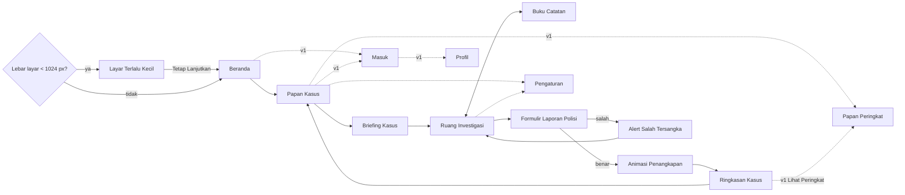

# 03 — Desain UI/UX & Visual: Detektif SQL

> **Status:** Draf v3 · 28 September 2026. Direvisi mengikuti [`00-keputusan.md`](00-keputusan.md), yang menjadi sumber kebenaran. v3 menambahkan badge "Tema Dewasa" dan pedoman visual tema gelap (A8, B6), laporan tiga nama Bab 8 (A6, B7), serta akun & Papan Peringkat v1 (A7, B8). Jika ada yang bertentangan, `00-keputusan.md` yang berlaku.
> **Nama kerja:** Detektif SQL
> **Target pemain:** mahasiswa, calon data analyst, dan gamer penggemar misteri/puzzle (dewasa).
> **Perangkat:** desktop-first. MVP menargetkan lebar layar ≥1024 px.
> **Latar:** kota fiktif **Wiralaga** dan distrik-distriknya.
> **Arah visual terpilih:** **"Berkas Malam"**, yaitu meja detektif di malam hari: UI gelap yang tenang untuk kerja lama, ditambah momen dramatis berupa kertas map manila dan stempel merah.
> **Dipakai untuk:** acuan desain dan bahan prompt Google Stitch (Bagian 7). Bagian lain berguna untuk tim frontend.

---

## Daftar Isi

0. [Cara Memakai Dokumen Ini dengan Google Stitch](#0-cara-memakai-dokumen-ini-dengan-google-stitch)
1. [Konsep Kreatif & Mood](#1-konsep-kreatif--mood)
2. [Design System](#2-design-system)
3. [Komponen](#3-komponen)
4. [Daftar Layar](#4-daftar-layar) (MVP, varian Bab 5–8, dan v1)
5. [Motion & Animasi](#5-motion--animasi)
6. [Aksesibilitas](#6-aksesibilitas)
7. [Prompt untuk Google Stitch](#7-prompt-untuk-google-stitch) ← **bagian utama**
8. [Pasca-MVP (Opsional): Tablet & Mobile](#8-pasca-mvp-opsional-tablet--mobile)
- [Lampiran A — DESIGN.md untuk Stitch](#lampiran-a--designmd-untuk-stitch)
- [Lampiran B — Data Contoh untuk Mockup](#lampiran-b--data-contoh-untuk-mockup)
- [Lampiran C — Status Keputusan](#lampiran-c--status-keputusan)

---

## 0. Cara Memakai Dokumen Ini dengan Google Stitch

1. Buka Stitch, buat proyek baru, lalu pilih mode **Web**. Khusus prompt 7.12 ("Layar Terlalu Kecil") dan prompt Pasca-MVP di Bagian 8, pilih **App/Mobile**.
2. Tempel **Master Prompt (7.1)** lebih dulu. Hasilnya berupa lembar gaya (*style sheet*) yang menjadi patokan visual.
3. *(Opsional, jika fitur design system di Stitch-mu mendukung impor DESIGN.md)*: impor isi **Lampiran A** supaya token warna dan font terkunci.
4. Tempel prompt layar **satu per satu**: 7.2–7.12 untuk MVP, 7.4b/7.7b/7.8c untuk bab lanjutan (Tema Dewasa dan Bab 8), dan 7.14–7.16 untuk akun & Papan Peringkat (v1). Setiap prompt sudah mandiri karena palet hex, font, dan gaya ditulis ulang di dalamnya.
5. Untuk perbaikan, pakai **prompt lanjutan** (7.5a–7.5g, 7.9a–7.9c, 7.13, 7.17a–7.17c). Aturannya: **satu perubahan per prompt**. Stitch cenderung merombak ulang layout kalau satu prompt memuat banyak perubahan sekaligus.
6. Semua teks di layar sudah ditulis literal dalam Bahasa Indonesia di dalam tanda kutip. Kalau Stitch menerjemahkannya ke Inggris, kirim prompt lanjutan: *"Keep every visible label exactly in Bahasa Indonesia as written in quotes."*

---

## 1. Konsep Kreatif & Mood

### 1.1 Tiga Alternatif Arah Visual

| # | Arah | Gambaran | Kelebihan | Risiko |
|---|------|----------|-----------|--------|
| A | **Berkas Malam** *(Night Files)* | Meja kerja detektif di malam hari. Panel UI gelap berwarna biru-tinta, aksen kuning kunyit seperti cahaya lampu meja, kertas map manila untuk dokumen penting, dan stempel karet merah untuk momen besar. | Nyaman untuk sesi panjang membaca tabel dan menulis kode karena mirip IDE yang sudah akrab bagi calon data analyst, tetapi tetap terasa "game" lewat kertas, stempel, dan karakter. Nuansa arsip Indonesia (map cokelat, nomor berkas, stempel) muncul alami. | Bisa terasa "serius". Perlu diimbangi animasi dan karakter yang hidup. |
| B | **Terminal Forensik Neon** | Gaya *cyber-thriller*: layar hitam, garis neon cyan dan magenta, efek *glitch*, dan HUD. | Langsung terasa "hacker" dan cocok untuk trailer. | Klise karena banyak game coding memakai gaya ini. Neon melelahkan mata saat membaca tabel lama, dan identitas lokal sulit masuk. |
| C | **Papan Kasus Siang** *(Corkboard)* | Papan gabus terang, foto polaroid, benang merah, kertas tempel, dan ilustrasi ceria. | Playful dan mudah dikenali sebagai game. | Latar bertekstur mengganggu keterbacaan tabel dan kode, dan nadanya terlalu ringan untuk pemain dewasa. Mode terang sebagai mode utama kurang nyaman untuk sesi malam. Benang merah dan polaroid juga sudah sangat umum dipakai. |

### 1.2 Rekomendasi: **A — "Berkas Malam"**

**Alasan:**
1. **Kenyamanan kerja lama.** Sekitar 80% layar berupa permukaan gelap netral berkontras terukur (lihat Bagian 6). Polanya sama dengan editor kode dan alat analisis data yang dipakai target pemain.
2. **Rasa game tanpa mengorbankan fungsi.** Drama visual (kertas manila, stempel, lampu sorot) dipakai *hanya* di momen naratif: briefing, laporan, penangkapan, dan ringkasan. Ruang kerja utama tetap bersih.
3. **Nuansa lokal yang orisinal.** Semua kasus terjadi di kota pesisir fiktif **Wiralaga**, lengkap dengan festival kuliner, posko banjir, kos-kosan, dan pelabuhan. Metafora visualnya diambil dari map berkas cokelat, stempel instansi, dan format nomor surat ala Indonesia (`No. LP/03/DID/VIII/2026`), bukan dari trope detektif Barat.
4. **Nada dewasa.** Palet yang tenang, tipografi tegas, dan cerita dengan twist cocok untuk mahasiswa dan profesional muda, tanpa terkesan kekanak-kanakan.
5. **Fleksibel.** Mode terang ("Kertas Siang") turun alami dari palet yang sama karena kertas manila sudah menjadi bagian dari sistem.

### 1.3 Prinsip Desain

| Prinsip | Artinya di UI |
|---------|---------------|
| **Data dulu, drama belakangan** | Di Ruang Investigasi, tabel dan editor selalu jadi elemen paling menonjol. Ornamen tidak boleh menutupi data. |
| **Kertas = momen penting** | Permukaan manila hanya dipakai untuk dokumen naratif: berkas briefing, formulir laporan, kartu tersangka, dan ringkasan. |
| **Stempel = keputusan** | Stempel (DITANGKAP, SELESAI, RAHASIA, BUKAN DIA) muncul hanya saat ada perubahan status besar. |
| **Satu aksen utama** | Kuning kunyit `#F2B84B` untuk aksi utama. Warna lain bersifat semantik: merah untuk salah/bahaya, toska untuk berhasil, lavender untuk bantuan. |
| **Gagal itu bagian dari penyelidikan** | Query yang gagal tidak mengurangi skor. Error SQL diterjemahkan ke bahasa Indonesia oleh Asisten Otomatis, dan pesan asli mesin tetap ditampilkan. |
| **Bantuan ditawarkan, tidak dipaksakan** | Petunjuk hanya *ditawarkan* saat pemain terlihat buntu. Petunjuk tidak pernah terbuka sendiri, dan biayanya selalu terlihat sebelum dibuka. |
| **Siap dunia kerja** | Buku Saku SQL menjelaskan beda dialek SQLite, PostgreSQL, dan MySQL. |
| **Gelap tanpa gore** | Bab akhir boleh bernada lebih gelap (lampu lebih redup, vignette lebih pekat), tetapi kekerasan selalu terjadi di luar layar: tidak ada darah, luka, senjata, atau jenazah di ilustrasi maupun animasi (B6, lihat 2.7.1). |

### 1.4 Mood Keywords

`noir modern` · `meja kerja malam` · `lampu meja kuning` · `map manila` · `stempel karet` · `arsip rahasia` · `IDE yang hangat` · `tenang tapi menegangkan` · `kota pesisir Wiralaga`

### 1.5 Identitas Instansi & Dunia Fiktif

- **Kota:** **Wiralaga**, kota pesisir menengah fiktif. Tidak ada kota atau tempat nyata yang dipakai sebagai lokasi kejahatan.
- **Distrik (pin di Papan Kasus):**
  - Sekar Arum (Bab 1)
  - Gerbang Timur (Bab 2)
  - Candrawati (Bab 3)
  - Kembangsari (Bab 4)
  - Wiyatapura (Bab 5)
  - Pesisir Baruna (Bab 6)
  - Niagaraya (Bab 7)
  - Wiralaga Tengah (Bab 8)
- **Instansi:** **Divisi Investigasi Data (DID)**, unit fiktif yang menangani "kasus-kasus berjejak digital" di Wiralaga.
- **Emblem:** segel bulat ganda. Di tengahnya ada kaca pembesar dengan lensa berisi tiga garis horizontal (baris tabel), dan teks melingkar `DIVISI INVESTIGASI DATA • WIRALAGA`. Warnanya amber `#F2B84B` di atas tinta `#0D1220`, dengan gaya garis (*line art*) 2 px.
- **Format nomor:** berkas `03/DID/VIII/2026`, laporan `No. LP/03/DID/VIII/2026`.
- **Pangkat pemain (fiktif):** Detektif Magang → Detektif Muda → Detektif Senior → Kepala Detektif → Legenda Arsip.
- **Tokoh tetap (NPC):**
  - **Bu Laras Wibisono**, Kepala Unit (50-an, rambut pendek beruban, blazer gelap, kacamata). Ia memberi briefing dan komentar penutup yang singkat dan tajam.
  - **Gilang**, Analis Data (20-an, hoodie, headset). Ia "menulis" petunjuk di panel Bantuan. Di Bab 8 step 1–7 ia dibekukan dari tim, sehingga byline petunjuk berganti menjadi Bu Laras (01-riset §5.3).
- **Kejahatan & kurva intensitas (A8, B6):**
  - Bab 1–3 (MVP): non-kekerasan (pencurian karya seni, muatan truk, dan resep).
  - Bab 4: lebih gelap tanpa kekerasan (penipuan dana korban banjir).
  - Bab 5–7: boleh memuat pembunuhan. Bab 8 menjadi puncak tergelap.
  - Kekerasan selalu terjadi di luar layar (2.7.1), dan Bab 5–8 diberi badge **"Tema Dewasa"** (3.17). Nada cerita tetap dewasa, tajam, dan penuh twist.
- **DILARANG** (supaya tidak meniru institusi nyata):
  - bintang Tribrata, Garuda, dan perisai bertuliskan instansi;
  - kata "POLRI" atau "Bhayangkara", serta pangkat resmi kepolisian (Bripda, Aiptu, AKP, Inspektur Polisi, dsb.);
  - seragam cokelat dengan emblem, plat atau livery mobil polisi nyata, dan nomor darurat asli (110);
  - logo bank, operator seluler, atau aplikasi ojek online nyata.

  Semua nama bank, toko, merek, dan orang bersifat fiktif.

---

## 2. Design System

### 2.1 Palet Warna

#### Mode Gelap — "Berkas Malam" (mode UTAMA)

| Token | Hex | Pemakaian |
|-------|-----|-----------|
| `bg-base` | `#0D1220` | Latar aplikasi (meja malam) |
| `bg-editor` | `#0A0F1B` | Latar editor SQL dan area kode |
| `surface-1` | `#141A2A` | Panel samping, top bar, modal |
| `surface-2` | `#1B2336` | Kartu, header tabel, input di atas panel |
| `surface-3` | `#232D45` | Hover, item terpilih, popover |
| `border-subtle` | `#2E3A56` | Garis pemisah dan batas kartu (dekoratif) |
| `border-strong` | `#5A6890` | Batas input, tombol outline, dan komponen interaktif (≥3:1) |
| `text-primary` | `#E9EDF5` | Teks utama |
| `text-secondary` | `#A9B2C6` | Teks pendukung, header tabel |
| `text-muted` | `#909BB2` | Meta, placeholder, nomor baris |
| `primary` (Kunyit) | `#F2B84B` | Aksi utama, step aktif, fokus, keyword SQL |
| `primary-hover` | `#F7C96E` | Hover tombol utama |
| `primary-pressed` | `#D9A13A` | Tombol utama saat ditekan |
| `on-primary` | `#1A1407` | Teks di atas amber |
| `primary-tint` | `#2F2D2E` | Sorotan baris pemain sendiri di Papan Peringkat (v1). Setara amber 12% di atas `surface-1`, jadi bukan hue baru. |
| `danger` (Merah Stempel) | `#FF5A5F` | Teks/ikon error, stempel DITANGKAP, salah tersangka |
| `danger-container` | `#C8323A` | Latar tombol bahaya (teks putih) |
| `success` (Toska) | `#34D39E` | Step selesai, query valid |
| `on-success` | `#06251A` | Teks di atas toska |
| `info` | `#6AA5FF` | Info netral, label "Alibi", catatan dialek di Buku Saku |
| `hint` (Lavender) | `#B99AFF` | Khusus panel Bantuan/petunjuk |
| `on-hint` | `#1B1030` | Teks di atas lavender |

**Kertas & stempel (dipakai di kedua mode):**

| Token | Hex | Pemakaian |
|-------|-----|-----------|
| `paper` | `#EBDDBF` | Map manila: berkas briefing, formulir laporan, kartu tersangka |
| `paper-tab` | `#E0CFA8` | Tab map, lipatan |
| `paper-line` | `#CDB98F` | Garis isian formulir, garis tinggi mugshot |
| `on-paper` | `#2A2112` | Teks tinta di atas kertas |
| `paper-muted` | `#6B5A3A` | Label/meta di atas kertas |
| `stamp-red` | `#B3261E` | Stempel merah di atas kertas |
| `stamp-green` | `#1E6B4F` | Stempel "SELESAI" / "KASUS DITUTUP" di atas kertas |

#### Mode Terang — "Kertas Siang"

| Token | Hex | Catatan |
|-------|-----|---------|
| `bg-base` | `#F5F0E6` | Krem kertas |
| `bg-editor` | `#FFFDF8` | |
| `surface-1` | `#FFFDF8` | |
| `surface-2` | `#EDE5D3` | |
| `surface-3` | `#E4D9C2` | |
| `border-subtle` | `#D8CCB2` | |
| `border-strong` | `#8C7D60` | 3,96:1 terhadap `surface-1` |
| `text-primary` | `#1A2030` | |
| `text-secondary` | `#465066` | |
| `text-muted` | `#586175` | |
| `primary` (tombol) | `#E8A838` | Teks tombol `#1A1407` |
| `primary-text` | `#8A5A00` | Amber untuk teks/ikon/fokus di atas terang |
| `primary-tint` | `#FAECD2` | Sorotan baris pemain sendiri (amber 20% di atas `surface-1`) |
| `danger` | `#B42330` | Teks putih di atas tombol ini: 6,51:1 |
| `success` | `#08704F` | |
| `info` | `#2459C9` | |
| `hint` | `#6B45C9` | |
| `focus` | `#9A5B00` | |

#### Warna Sintaks SQL

| Token | Gelap | Terang | Contoh |
|-------|-------|--------|--------|
| `sql-keyword` | `#F2B84B` (bold) | `#9A5B00` | `SELECT`, `JOIN`, `WHERE` |
| `sql-function` | `#6AA5FF` | `#2459C9` | `COUNT()`, `SUM()` |
| `sql-string` | `#34D39E` | `#0B7A57` | `'Belakang'` |
| `sql-number` | `#FF9A76` | `#B4461F` | `22`, `100` |
| `sql-column` | `#8FD3F5` | `#0F6E8C` | `k.nik_pemilik` |
| `sql-operator` | `#B99AFF` | `#6B45C9` | `=`, `BETWEEN`, `AND` |
| `sql-comment` | `#7D88A1` (italic) | `#666E7E` | `-- catatan` |
| `sql-identifier` | `#E9EDF5` | `#1A2030` | nama tabel, alias |

#### Proporsi Pemakaian Warna

- **80%** netral (bg, surface, teks)
- **12%** aksen fungsional (amber untuk aksi, lavender untuk bantuan, toska untuk berhasil)
- **8%** momen naratif (manila dan stempel merah), terutama di layar briefing, laporan, penangkapan, dan ringkasan

### 2.2 Tipografi (Google Fonts)

| Peran | Font | Alasan |
|-------|------|--------|
| **UI & teks** | **Plus Jakarta Sans** (400, 500, 600, 700) | Dirancang studio Indonesia (Tokotype) untuk identitas kota Jakarta, jadi punya cerita lokal. Sangat terbaca di ukuran kecil. |
| **Monospace (SQL & data)** | **JetBrains Mono** (400, 600) | Karakter `0/O` dan `1/l/I` jelas dibedakan, dan cocok untuk tabel. **Ligature dimatikan** secara default agar `!=`, `>=`, dan `<>` tampil persis seperti yang diketik. |
| **Display (judul, nomor bab, stempel)** | **Big Shoulders Display** (700, 800, 900) | Grotesk kondensed bergaya label arsip atau poster. Tegas untuk stempel dan nomor bab. Fallback: **Barlow Condensed**. |

**Skala tipe (desktop, MVP):**

| Token | Font | Ukuran/Line-height | Weight | Pemakaian |
|-------|------|--------------------|--------|-----------|
| `display-xl` | Big Shoulders Display | 72/72 | 800 | Hero landing, stempel besar |
| `display-lg` | Big Shoulders Display | 48/52 | 800 | "KASUS DITUTUP", judul layar dramatis |
| `display-md` | Big Shoulders Display | 32/36 | 700 | Nomor/judul bab |
| `overline` | Big Shoulders Display | 14/16, spasi huruf 0,12em, UPPERCASE | 700 | Label kategori ("DIVISI INVESTIGASI DATA") |
| `headline` | Plus Jakarta Sans | 24/32 | 700 | Judul section |
| `title` | Plus Jakarta Sans | 18/26 | 700 | Judul kartu dan panel |
| `body-lg` | Plus Jakarta Sans | 16/26 | 400 | Narasi cerita, briefing |
| `body` | Plus Jakarta Sans | 14/22 | 400 | Teks UI umum |
| `label` | Plus Jakarta Sans | 14/20 | 600 | Tombol, tab |
| `caption` | Plus Jakarta Sans | 12/16 | 500 | Meta, helper text |
| `code` | JetBrains Mono | 15/24 (bisa diatur 12–20) | 400 | Editor SQL |
| `data` | JetBrains Mono | 14/20 | 400 | Sel tabel hasil |
| `data-header` | JetBrains Mono | 13/16 | 600 | Header tabel. **Tidak di-uppercase**: tampilkan nama kolom persis seperti di database (`nik_pemilik`) supaya pemain bisa menyalinnya. |
| `paper-meta` | JetBrains Mono | 13/20 | 400 | Baris meta di kertas ("Lokasi:", "Waktu:"), memberi nuansa mesin tik arsip |

Semua angka memakai `font-variant-numeric: tabular-nums`. Skala tipe untuk mobile ada di Bagian 8 (Pasca-MVP).

### 2.3 Spasi, Grid, Breakpoint

**Skala spasi (basis 4 px):** `1`=4 · `2`=8 · `3`=12 · `4`=16 · `5`=20 · `6`=24 · `8`=32 · `10`=40 · `12`=48 · `16`=64 · `20`=80 · `24`=96

| Konteks | Nilai |
|---------|-------|
| Padding panel | 16 |
| Padding kartu | 16–20 |
| Jarak antar kartu | 12–16 |
| Jarak antar section (halaman konten) | 64–96 |
| Tinggi top bar | 56 |
| Padding sel tabel | 8×12 (rapat) · 10×16 (normal) · 14×16 (longgar) |

**Grid:**
- **Halaman konten** (Beranda, Papan Kasus, Ringkasan, Pengaturan, Buku Catatan): 12 kolom, konten maksimal 1200 px, gutter 24 px, margin minimal 32 px.
- **Ruang Investigasi**: layout aplikasi *full-bleed*. Kolom kiri 320 px, tengah fleksibel (minimal 560 px), kanan 320 px. Panel samping bisa diciutkan menjadi *rail* ikon 48 px.

**Breakpoint (desktop-first, sesuai keputusan A2):**

| Nama | Lebar | Perilaku |
|------|-------|----------|
| `lg` | 1024–1279 | Laptop kecil. Panel kanan otomatis menjadi rail, dan kliknya membuka drawer overlay 320. |
| `xl` | 1280–1535 | Layout penuh tiga kolom (acuan desain utama). |
| `2xl` | ≥1536 | Layout sama. Panel kiri dan kanan bisa melebar sampai 360. |
| *< 1024* | — | Tampil **Layar Terlalu Kecil** (4.11). Setelah "Tetap Lanjutkan", aplikasi masuk **mode sempit**: kedua panel samping menjadi drawer, editor dan hasil memakai lebar penuh, dan konten diberi lebar minimal 640 px (di bawahnya, halaman bisa digeser ke samping). |

### 2.4 Radius

| Token | Nilai | Pemakaian |
|-------|-------|-----------|
| `r-paper` | 2 px | Kertas manila (sudut tajam seperti dokumen asli) |
| `r-xs` | 4 px | Badge, `kbd`, highlight sel |
| `r-sm` | 8 px | Input, tombol ikon, tooltip |
| `r-md` | 10 px | Tombol, kartu |
| `r-lg` | 16 px | Panel, modal, drawer |
| `r-xl` | 24 px | Ilustrasi hero, kartu besar landing |
| `r-full` | 9999 px | Chip, avatar |

### 2.5 Elevasi & Bayangan

Di mode gelap, elevasi **terutama ditunjukkan lewat surface yang lebih terang**. Bayangan hanya membantu.

| Token | Nilai (gelap) | Pemakaian |
|-------|---------------|-----------|
| `e0` | tanpa bayangan, border `border-subtle` | Panel |
| `e1` | `inset 0 1px 0 rgba(255,255,255,.03), 0 1px 2px rgba(0,0,0,.35)` | Kartu |
| `e2` | `0 8px 24px rgba(0,0,0,.45)` + border | Dropdown, popover, toast |
| `e3` | `0 24px 64px rgba(0,0,0,.60)` | Modal |
| `paper` | `0 1px 0 #CDB98F, 0 18px 40px -12px rgba(0,0,0,.65)` | Kertas di atas meja |
| `glow-amber` | `0 0 0 1px #F2B84B, 0 0 24px rgba(242,184,75,.25)` | Step aktif, bab berjalan |
| `glow-red` | `0 0 0 2px #FF5A5F, 0 0 32px rgba(255,90,95,.30)` | Modal salah tersangka |
| `glow-teal` | `0 0 0 1px #34D39E, 0 0 20px rgba(52,211,158,.25)` | Konfirmasi step selesai |

Di mode terang, gunakan bayangan hangat `rgba(60,45,20,.10–.18)`.

### 2.6 Ikon

- **Set:** **Material Symbols Rounded** (Google Fonts, variabel). Setelan: weight 300, fill 0, grade 0, optical size 20/24. Status aktif atau tercapai memakai **fill 1** (misalnya bintang yang diraih). Pilihan ini dipakai karena bawaan Stitch dan cukup satu file font.
- **Ukuran:** 16 (inline), 20 (default UI), 24 (navigasi), 32–48 (ilustrasi kosong).
- **Ikon kustom (SVG, gaya garis 1,75 px):** borgol, stempel, emblem DID, klip kertas, map bertab.

| Fungsi | Nama ikon |
|--------|-----------|
| Jalankan Query | `play_arrow` |
| Simpan ke Catatan | `bookmark_add` |
| Buku Catatan | `menu_book` |
| Buku Saku SQL | `auto_stories` |
| Bantuan / Petunjuk | `lightbulb` |
| Asisten Otomatis | `troubleshoot` |
| Skema / tabel | `table_chart`, `database` |
| Primary key / foreign key | `key` / `link` |
| Terkunci / terbuka | `lock` / `lock_open` |
| Segera hadir | `schedule` |
| Selesai | `check_circle` |
| Berkas bab | `folder_open` |
| Ajukan Laporan | `approval` (ikon stempel) |
| Jeda laporan (hitung mundur) | `hourglass_top` |
| Timer | `timer` |
| Format query | `format_align_left` |
| Bersihkan editor | `ink_eraser` |
| Riwayat query | `history` |
| Salin | `content_copy` |
| Error / peringatan / info | `error` / `warning` / `info` |
| Salah tersangka | `person_off` |
| Tersangka | `person_search` |
| Pin distrik | `location_on` |
| Layar terlalu kecil | `laptop` |
| Sematkan | `push_pin` |
| Pengaturan / tema / suara | `settings` / `dark_mode` / `volume_up` |
| Pangkat | `star` (fill 1 = diraih) |
| Masuk / Keluar (v1) | `login` / `logout` |
| Papan Peringkat (v1) | `leaderboard` |
| Profil (v1) | `account_circle` |
| Status sinkronisasi (v1) | `cloud_done` (tersinkron) · `sync` (menyinkronkan) · `cloud_off` (offline / fitur online tidak tersedia) · `devices` (belum masuk, tersimpan di perangkat) |
| Skor menunggu verifikasi (v1) | `pending` |

- **Badge "Tema Dewasa"** sengaja tanpa ikon (lihat 3.17).
- **Tombol "Masuk dengan Google" (v1)** memakai logo "G" resmi dari pedoman branding Google Sign-In saat implementasi. Logo itu tidak digambar ulang. Di mockup Stitch, logo diganti lingkaran placeholder netral.

### 2.7 Ilustrasi & Karakter

**Gaya:** vektor datar **duotone-plus** dengan tiga nilai: bayangan tinta (`#0D1220` pada 60–80%), warna tengah (warna kulit alami yang beragam, pakaian dengan saturasi rendah), dan cahaya tepi (*rim light*) amber `#F2B84B` dari kiri atas seolah dari lampu meja. Garis luar 2 px `#2A2112` bila ilustrasi berada di atas kertas. Bayangan diberi tekstur **halftone** 15% agar terasa seperti hasil cetak arsip.

**Karakter tersangka dan saksi:**
- Potret setengah badan, rasio **3:4** (aset 480×640, @2x), dan proporsi semi-realis (bukan chibi) agar nuansanya dewasa dan serius.
- Ekspresi **netral** di kartu tersangka (*mugshot*). Ekspresi boleh lebih hidup di kartu saksi.
- **Keragaman Indonesia:** usia, daerah, dan gaya berpakaian beragam (batik, hijab, peci, kemeja kerja, celemek dapur atau seragam kru generik tanpa logo). **Jangan ada stereotip etnis**, dan pelaku dirotasi lintas latar di setiap bab.
- **Bingkai mugshot:** latar garis tinggi 140–200 cm (`paper-line`) dengan plat nama JetBrains Mono UPPERCASE di bawah, misalnya `RIZKY MAULANA · 03/DID/VIII/2026`.
- **Belum diketahui:** siluet `#232D45` dengan tanda `?` amber di tengah.
- **Avatar bulat** 40/64 px untuk NPC (Bu Laras dan Gilang) di bubble pesan.

**Ilustrasi pendukung:**
- foto TKP gaya polaroid duotone di briefing;
- **peta kota Wiralaga bergaya titik**, dengan garis pantai di atas, sungai, dan kumpulan titik per distrik (bukan peta detail, dan bukan peta Indonesia);
- klip kertas dan tab map sebagai ornamen.

#### 2.7.1 Tema Dewasa & Nada Bab Akhir (A8, B6)

**Kekerasan selalu terjadi di luar layar.** Aturan ini berlaku untuk ilustrasi, foto TKP, animasi, dan setiap prompt Stitch.

- **Tidak boleh ada:** darah, luka, senjata (baik diarahkan ke orang maupun tergeletak sebagai barang bukti), jenazah dalam bentuk apa pun (termasuk siluet, kantong jenazah, atau garis kapur bentuk tubuh), dan ekspresi kesakitan atau ketakutan ekstrem.
- **Foto TKP polaroid** di bab dengan pembunuhan hanya menampilkan **lokasi kosong atau benda netral**. Contohnya: pintu kantor kos yang setengah terbuka di balik pita pembatas, lorong gudang kontainer, mobil di lahan parkir kosong yang difoto dari jauh, atau ponsel di atas meja. Pita pembatas dibuat generik: amber `#F2B84B` dengan teks tinta "DILARANG MELINTAS", tanpa kata "POLISI" atau "POLICE".
- **Korban yang tewas** hanya tampil **sebagai teks** (nama + peran) di "Tokoh Terkait", tanpa potret dan tanpa ornamen duka.
- **Kartu tersangka** tetap berekspresi netral dan tanpa luka.
- **Animasi penangkapan tetap sama** di semua bab (4.7). Cipratan tinta stempel selalu berupa titik bulat kecil (≤ 6 px) di sekitar tepi stempel, tanpa bentuk tetesan atau aliran, supaya selalu terbaca sebagai tinta, bukan darah.
- **Teks** memakai kalimat baku dari 01-riset §5.1, yaitu "ditemukan tewas" dan "diperkirakan meninggal antara pukul … dan …". Tidak ada deskripsi luka atau cara membunuh.
- **Batas B6 juga berlaku untuk visual:** tanpa kekerasan seksual, tanpa anak sebagai korban atau sandera, tanpa bunuh diri, tanpa simbol SARA, dan tanpa tokoh, tempat, atau merek nyata.

**Nada visual bab akhir.** Suasana boleh sedikit lebih gelap, tetapi **tetap memakai token yang sama**: tidak ada warna baru dan tidak ada filter merah. Perubahan hanya diterapkan di permukaan naratif (Briefing, band peta di Papan Kasus, header Ringkasan, dan foto TKP). Ruang Investigasi, tabel, editor, komponen, dan kontras teks **tidak berubah**.

| Bab | Cahaya lampu meja (glow amber di Briefing) | Vignette tepi layar (`#05080F`) | Bayangan tinta ilustrasi | *Noise* kertas | Tambahan |
|---|---|---|---|---|---|
| 1–3 | 100% | 30% | 60% | 3% | — |
| 4 | 85% | 40% | 70% | 4% | — |
| 5–7 | 65% | 50% | 80% | 5% | Foto TKP mengikuti aturan di atas |
| 8 | 50%, sorot lebih sempit | 60% | 80% | 5% | Tumpukan tujuh map Bab 1–7 di belakang berkas Bab 8 (Bu Laras menyerahkan seluruh arsip) |

Semua nilai berada di dalam rentang yang sudah ada di 2.7–2.8 (bayangan tinta 60–80%, *noise* 3–5%). Warna vignette `#05080F` sama dengan overlay modal di 3.11.

### 2.8 Tekstur & Ornamen

| Ornamen | Aturan |
|---------|--------|
| *Noise* kertas | 3–5% hanya di permukaan `paper`, tidak pernah di panel data |
| Pola titik geometris (terinspirasi kawung, sangat halus) | Opasitas 4%, hanya di Beranda dan latar Papan Kasus |
| Tab map | Di kiri atas kartu berkas bab, tinggi 28 px, `paper-tab` |
| Stempel | Lihat komponen 3.12 |
| Garis rute putus-putus | Menghubungkan pin distrik di peta Wiralaga sesuai urutan bab (amber 60%) |

### 2.9 Token CSS (untuk developer)

```css
:root, [data-theme="dark"] {
  --bg-base:#0D1220; --bg-editor:#0A0F1B;
  --surface-1:#141A2A; --surface-2:#1B2336; --surface-3:#232D45;
  --border-subtle:#2E3A56; --border-strong:#5A6890;
  --text-primary:#E9EDF5; --text-secondary:#A9B2C6; --text-muted:#909BB2;
  --primary:#F2B84B; --primary-hover:#F7C96E; --primary-pressed:#D9A13A; --on-primary:#1A1407;
  --primary-tint:#2F2D2E;
  --danger:#FF5A5F; --danger-container:#C8323A; --on-danger-container:#FFFFFF;
  --success:#34D39E; --on-success:#06251A; --info:#6AA5FF;
  --hint:#B99AFF; --on-hint:#1B1030; --focus:#F2B84B;
  --paper:#EBDDBF; --paper-tab:#E0CFA8; --paper-line:#CDB98F;
  --on-paper:#2A2112; --paper-muted:#6B5A3A; --stamp-red:#B3261E; --stamp-green:#1E6B4F;
  --sql-keyword:#F2B84B; --sql-function:#6AA5FF; --sql-string:#34D39E; --sql-number:#FF9A76;
  --sql-column:#8FD3F5; --sql-operator:#B99AFF; --sql-comment:#7D88A1;
  --font-ui:"Plus Jakarta Sans",system-ui,sans-serif;
  --font-mono:"JetBrains Mono",ui-monospace,monospace;
  --font-display:"Big Shoulders Display","Barlow Condensed",sans-serif;
  --r-paper:2px; --r-xs:4px; --r-sm:8px; --r-md:10px; --r-lg:16px; --r-xl:24px;
  --dur-fast:150ms; --dur-base:220ms; --dur-slow:320ms;
  --ease-standard:cubic-bezier(.2,0,0,1); --ease-emphasized:cubic-bezier(.05,.7,.1,1);
  --ease-overshoot:cubic-bezier(.34,1.56,.64,1);
  --app-min-width:1024px;
}
[data-theme="light"] {
  --bg-base:#F5F0E6; --bg-editor:#FFFDF8;
  --surface-1:#FFFDF8; --surface-2:#EDE5D3; --surface-3:#E4D9C2;
  --border-subtle:#D8CCB2; --border-strong:#8C7D60;
  --text-primary:#1A2030; --text-secondary:#465066; --text-muted:#586175;
  --primary:#E8A838; --primary-text:#8A5A00; --on-primary:#1A1407; --primary-tint:#FAECD2;
  --danger:#B42330; --danger-container:#B42330; --success:#08704F; --info:#2459C9;
  --hint:#6B45C9; --focus:#9A5B00;
  --sql-keyword:#9A5B00; --sql-function:#2459C9; --sql-string:#0B7A57; --sql-number:#B4461F;
  --sql-column:#0F6E8C; --sql-operator:#6B45C9; --sql-comment:#666E7E;
}
```

---

## 3. Komponen

### 3.1 Tombol

| Varian | Gelap | Terang | Dipakai untuk |
|--------|-------|--------|---------------|
| **Primary** | bg `#F2B84B`, teks `#1A1407`, hover `#F7C96E`, tekan `#D9A13A` | bg `#E8A838`, teks `#1A1407` | Aksi utama (maksimal 1 per area): "Jalankan Query", "Mulai Investigasi", "Ajukan Laporan" |
| **Secondary (outline)** | transparan, border 1 px `#5A6890`, teks `#E9EDF5`, hover bg `#232D45` | border `#8C7D60` | "Simpan ke Catatan", "Lihat Cara Main", "Tetap Lanjutkan" |
| **Ghost** | teks `#A9B2C6`, hover bg `#1B2336` | teks `#465066` | "Batal", "Kembali Menyelidiki" |
| **Danger** | bg `#C8323A`, teks `#FFFFFF` | bg `#B42330` | "Reset Semua Progres", "Hapus" |
| **Hint** | border `#B99AFF`, teks `#B99AFF`, hover bg lavender 12% | `#6B45C9` | "Buka Petunjuk" |
| **Ikon** | 36×36, `r-sm`, ikon 20 | | Toolbar editor, tutup modal |

- **Ukuran:** `sm` tinggi 32 (label 13) · `md` 40 (label 14) · `lg` 48 (label 16, padding horizontal 22).
- **State:** hover · tekan (scale 0,97, 80 ms) · fokus (ring 2 px `--focus`, offset 2 px) · disabled (opasitas 40%, kursor `not-allowed`) · loading (ikon berganti spinner 16 px dan label berubah, misalnya "Menjalankan…").
- **Khusus "Jalankan Query":** Primary `md` + ikon `play_arrow` + chip `kbd` "Ctrl ↵" (di Mac: "⌘ ↵") dengan bg `rgba(26,20,7,.12)`.
- **Khusus "Ajukan Laporan" (top bar):** selalu tampil di Ruang Investigasi. Satu-satunya saat tombol ini nonaktif adalah jeda 60 detik setelah salah tuduh ke-3 dan seterusnya. Saat itu label berubah menjadi "Ajukan Laporan · 0:47" dengan ikon `hourglass_top`.

### 3.2 Input & Form

- **Text input:** tinggi 40, bg `#0D1220` (tampak cekung di atas panel), border 1 px `#5A6890`, radius 8, placeholder `#909BB2`.
  - Fokus: border `#F2B84B` + ring 3 px `rgba(242,184,75,.35)`.
  - Error: border `#FF5A5F`, helper merah dengan ikon `error`.
- **Search:** ikon `search` di kiri dan tombol hapus `close` saat ada isi.
- **Select, checkbox, toggle, slider, segmented control:** mengikuti warna yang sama. Toggle aktif berwarna amber, knob `#1A1407`.
- **Input di atas kertas (Formulir Laporan):** tanpa kotak, hanya garis bawah 2 px `#2A2112` pada 40%, teks JetBrains Mono 20 px `#2A2112`, label `paper-muted` UPPERCASE 12 px. Saat fokus: garis bawah 100% + outline 2 px `#9A5B00` dengan offset 4. Field nama tersangka memakai **`autocomplete="off"` dan tanpa dropdown saran**. Varian Bab 8 memakai tiga field bergaya sama: "DALANG", "PERANTARA 1", dan "PERANTARA 2" (4.6.1).

### 3.3 Editor SQL

- **Mesin editor yang disarankan:** CodeMirror 6 (ringan, aksesibel, dan mendukung mode SQL).
- **Tampilan:** bg `#0A0F1B`, gutter nomor baris `#7D88A1`, baris aktif `#141A2A`, seleksi `rgba(242,184,75,.22)`, kursor amber 2 px, pasangan kurung dengan outline tipis, dan warna sintaks sesuai 2.1.
- **Font:** JetBrains Mono 15/24 dengan ligature mati.
- **Placeholder:** `-- Tulis query-mu di sini, lalu tekan Ctrl + Enter`
- **Toolbar (atas):** tab query (`query_1.sql` + tombol `+` "Tab Baru", maksimal 5) · [Jalankan Query] · [Format] · [Bersihkan] · spacer · [Riwayat] · ukuran font (A−/A+).
- **Status bar (bawah, 24 px):** "Baris 7, Kolom 18 · SQLite · Mode baca saja".
- **Autocomplete:** memuat **semua sheet bab sejak awal**. Muncul di popover `e2`, dan setiap item menampilkan ikon (`table_chart` untuk tabel, `view_column` untuk kolom), nama dalam mono, dan tipe di kanan (`TEXT`, `INTEGER`, `DATETIME`). Autocomplete ini hanya untuk nama tabel dan kolom, bukan untuk nilai data.
- **Error:** garis bergelombang `#FF5A5F` di token yang salah, titik merah di gutter, dan tooltip berisi pesan Asisten.
- **Mode baca saja:** perintah `UPDATE/DELETE/DROP/INSERT` ditolak dengan pesan "Mode baca saja: arsip kasus tidak boleh diubah. Gunakan SELECT."

### 3.4 Tabel Hasil

- **Tab di atas tabel (metafora "sheet"):** `[Hasil Query]` + tab pratinjau sheet yang dibuka dari panel Skema. Tab pratinjau menampilkan 50 baris pertama dan bisa ditutup (×). Jika tab lebih dari 4, sisanya masuk menu `more_horiz`.
- **Header bar:** "Hasil · 3 baris · 0,02 dtk" di kiri. Di kanan: [Simpan ke Catatan] (secondary, `bookmark_add`), [Salin CSV] (ikon), [Perbesar] (ikon).
- **Header kolom:** sticky, bg `#1B2336`, `data-header` `#A9B2C6`, nama kolom persis seperti di DB. **Tidak bisa diurutkan dengan klik header**: pengurutan harus lewat `ORDER BY` agar pemain berlatih SQL.
- **Baris:** tinggi 40 (normal), zebra halus `#141A2A`/`#161D2E` (opsional), hover `#232D45`, dan kolom `#` nomor baris berwarna muted.
- **Sel:** `data` 14 px. Angka rata kanan (tabular). Nilai `NULL` tampil sebagai badge kecil miring "NULL" `#909BB2`. Teks panjang dipotong di lebar 320 px dengan tooltip, dan klik sel akan menyalin nilainya (toast "Disalin").
- **Nilai tampil mentah** persis seperti di DB (`2026-08-15 00:42`, `95000000`) agar bisa dipakai langsung di `WHERE`. Format ramah (Rp, tanggal Indonesia) hanya dipakai di narasi.
- **Batas tampil:** 100 baris per halaman dengan pagination "Baris 1–100 dari 5.000".
- **Scroll horizontal:** bayangan fade di tepi kanan.

### 3.5 Kartu Step / Misi

Step terbuka **berurutan**. Step N+1 terbuka setelah step N selesai.

| State | Tampilan |
|-------|----------|
| **Selesai** | Ciut satu baris: ikon `check_circle` toska, nomor, judul `#A9B2C6`, dan waktu "03:40". Tag lavender "dibantu" jika Petunjuk 4 dipakai. Klik untuk membaca ulang. |
| **Aktif** | bg `#1B2336`, border kiri 3 px `#F2B84B`, `glow-amber`. Isi: nomor (Big Shoulders 20), judul (`title`), chip konsep ("JOIN 3 tabel"), teks tugas (`body-lg`), dan kotak "Target hasil" berisi chip "Kolom: nama, peran, waktu, pintu" dan "Urut: waktu terawal". |
| **Terkunci** | Opasitas 55%, ikon `lock`, judul tetap terlihat (memancing rasa penasaran tanpa membocorkan jawaban). |

### 3.6 Sistem Bantuan: Asisten Otomatis, Buku Saku, dan Petunjuk 4 Level

Sesuai keputusan B1 di `00-keputusan.md`.

**A. Asisten Otomatis** (gratis, selalu aktif, tidak dihitung sebagai bantuan)
- Muncul di area hasil sebagai baris ber-ikon `troubleshoot` dengan label "Asisten".
- **Menerjemahkan error SQL:** pesan asli mesin tetap tampil dalam mono, lalu diikuti penjelasan bahasa Indonesia dan saran. Contoh: `no such column: k.nik` → "Kolom nik tidak ada di tabel kartu_akses. Mungkin maksudmu: k.nik_pemilik?"
- **Mendiagnosis hasil:** "Hasilmu 1.204 baris, target jauh lebih sedikit. Periksa filter waktu." atau "Kolomnya sudah benar, tapi urutannya belum sesuai target."

**B. Petunjuk bertingkat** (panel kanan, tab "Bantuan")

| Level | Label | Biaya (kumulatif, dari poin step itu) | Kapan bisa dibuka | Tampilan |
|-------|-------|---------------------------------------|-------------------|----------|
| 1 | "Petunjuk 1 · Arah" | chip "Gratis" | Kapan saja | Outline lavender |
| 2 | "Petunjuk 2 · Sheet & Kolom" | chip "−10% poin step" | Setelah Petunjuk 1 dibuka | bg lavender 8% |
| 3 | "Petunjuk 3 · Kerangka" | chip "−30% poin step" | Setelah Petunjuk 2 + (1 query gagal **atau** 2 menit) | bg lavender 14% |
| 4 | "Petunjuk 4 · Query Lengkap" | chip "−60% poin step" | Setelah Petunjuk 3 + (1 query gagal **atau** 2 menit) | bg lavender 20% + **label peringatan** amber (`warning`): "Menampilkan query lengkap · step ditandai dibantu" |

- **Biaya bersifat kumulatif.** Chip menunjukkan *total* potongan poin step itu jika dibuka sampai level tersebut, bukan tambahan. Tooltip chip: "Total potongan untuk step ini jika dibuka sampai level ini."
- **Anatomi kartu:** ikon `lightbulb` + label + chip biaya · byline "dari Gilang, Analis Data" (di Bab 8 step 1–7: "dari Bu Laras, Kepala Unit") · isi · tombol.
- **State:**
  - **Tersedia** ("amplop tertutup"): isi diganti 3 garis placeholder buram dan tombol "Buka Petunjuk".
  - **Terbuka:** isi tampil, lalu chip berubah menjadi "Dipakai · −10%" (atau −30%/−60%).
  - **Terkunci menunggu syarat:** ikon `lock` + caption "Terbuka setelah Petunjuk 2 + 1 query gagal atau 2 menit". Jika hanya waktu yang tersisa, tampil hitung mundur "Bisa dibuka dalam 1:24".
- **Isi per level:**
  1. arah investigasi tanpa sintaks;
  2. sheet dan kolom yang relevan;
  3. blok kode dengan bagian kosong `____`;
  4. query lengkap + penjelasan per baris + tombol "Salin ke Editor".
- **Penalti permanen:** potongan tidak hilang walau halaman dimuat ulang.

**C. Tawaran bantuan** (tidak pernah membuka sendiri)
- Jika pemain gagal beberapa kali atau diam lama, muncul **kartu tawaran** kecil di bawah area hasil, dan tab "Bantuan" diberi titik lavender:
  - teks "Buntu? Petunjuk 1 gratis dan tidak mengurangi poin.";
  - tombol "Buka Bantuan" dan "Nanti".
- Tawaran tidak menutupi editor, dan setelah "Nanti" ia tidak muncul lagi di step yang sama selama 3 menit.

**D. Buku Saku SQL** (lihat 3.16), gratis kapan saja.

### 3.7 Panel Skema / Sheet

- **Semua sheet bab terbuka sejak awal.** Tidak ada sheet terkunci, bertanda "rahasia", atau yang diserahkan bertahap. Di bagian atas panel ada caption kecil: "6 sheet tersedia untuk bab ini."
- **Search:** "Cari tabel atau kolom…"
- **Accordion per tabel:** ikon `table_chart` + nama (mono) + jumlah baris ("5.000 baris") + deskripsi singkat (`caption`, misalnya "Catatan tap kartu di pintu dapur"). Saat dibuka, tampil daftar kolom: nama (mono), badge tipe (`INTEGER`/`TEXT`/`DATETIME`/`REAL`), ikon `key` untuk PK, dan ikon `link` + "→ kartu_akses.id_kartu" untuk FK.
- **Aksi saat hover:** "Sisipkan" (memasukkan nama ke editor di posisi kursor) dan "Pratinjau" (membuka tab sheet di area hasil).
- **Toggle "Lihat Relasi":** diagram mini ERD, yaitu kotak tabel dengan garis antar-kunci.

### 3.8 Kartu Catatan Tersimpan

- bg `#1B2336`, radius 10, border kiri 3 px sesuai warna label:
  - **Curiga** `#FF5A5F`
  - **Alibi** `#6AA5FF`
  - **Barang Bukti** `#F2B84B`
  - **Referensi** `#909BB2`
- **Isi:** judul (`title`) · meta "BAB 3 · Step 4 · 21.37" · chip label · cuplikan SQL 2 baris (mono, di-fade) · mini tabel maksimal 3 baris · aksi "Salin ke Editor", "Lihat Hasil", dan menu `more_horiz` (Sematkan, Ubah Judul, Ubah Label, Hapus).
- **Disematkan:** ikon `push_pin` fill amber, dan kartu tampil paling atas.
- Catatan berfungsi sebagai alat berpikir pemain. Catatan **tidak** dilampirkan ke laporan (keputusan A4).

### 3.9 Badge & Progres

- **Step:** pill "Step 4/8" dengan cincin progres mini amber.
- **Kesulitan:** chip "Mudah" (toska), "Sedang" (amber), "Sulit" (merah). Selalu berupa teks, bukan warna saja.
- **Status bab:**
  - "Sedang Diselidiki" (amber)
  - "Baru!" (info)
  - "Terkunci" (muted + `lock`)
  - "Segera Hadir" (muted + `schedule`; untuk bab yang belum dirilis di MVP)
  - Stempel mini "SELESAI"
- **Tema Dewasa:** label konten untuk Bab 5–8 (lihat 3.17). Badge ini tidak memakai warna status maupun warna kesulitan.
- **Pangkat:** lencana heksagon berisi ikon `star` + nama pangkat. Bintang bab 0–3 (fill 1 = diraih).
- **Counter:** badge bulat amber di tombol Buku Catatan ("4").
- **Progres bar:** tinggi 6, track `#232D45`, isi amber (toska jika 100%).

### 3.10 Toast & Alert

| Varian | Aksen | Contoh copy | Perilaku |
|--------|-------|-------------|----------|
| Sukses | toska | "Tersimpan di Buku Catatan" + aksi "Lihat" | Hilang otomatis dalam 4 dtk |
| Info | biru | "Menyiapkan database kasus…" | 4 dtk |
| Peringatan | amber | "Menampilkan 100 dari 5.000 baris. Tambahkan LIMIT atau filter WHERE." | 6 dtk |
| Error SQL + Asisten | merah | Panel inline di area hasil: "Query gagal dijalankan" + pesan mesin mono + lokasi + baris "Asisten" + caption "Query gagal tidak mengurangi skor." | Tetap tampil sampai query berikutnya |
| Timeout | merah | "Query terlalu lama (>5 dtk) dan dihentikan. Coba tambahkan filter atau LIMIT." | Inline |
| Hasil kosong | netral | "Query berhasil, tapi tidak ada baris yang cocok. Coba longgarkan filter WHERE." | Inline |
| Diagnosis Asisten | amber | "Asisten: Hasilmu 1.204 baris, target jauh lebih sedikit. Periksa filter waktu." | Inline |
| Step selesai | toska | "Step 4 selesai! Step 5 terbuka." | Banner inline + toast |
| Biaya petunjuk | lavender | "Petunjuk 3 dibuka · poin step ini −30%" | 4 dtk |
| Tawaran bantuan | lavender | "Buntu? Petunjuk 1 gratis dan tidak mengurangi poin." | Kartu inline, tidak menutup sendiri |
| Jeda laporan berakhir | info | "Kamu bisa mengajukan laporan lagi." | 4 dtk |
| Salah tersangka | merah | Modal alert bertahap (lihat 4.8) | Harus ditutup manual |

- **Toast:** lebar 360, posisi kanan atas di bawah top bar, `e2`, bar kiri 3 px, ikon + judul + deskripsi + aksi + tutup. Toast berhenti saat di-hover.
- **Aria:** `role="status"`, atau `role="alert"` untuk error.

### 3.11 Modal

- **Lebar:** `sm` 400 · `md` 520 · `lg` 720.
- **Tampilan:** bg `#141A2A`, radius 16, `e3`, overlay `rgba(5,8,15,.72)` + blur 4 px.
- **Anatomi:** judul (`title`) + tombol tutup · isi · footer dengan aksi rata kanan (primary paling kanan).
- **Perilaku:** focus trap, Esc menutup, dan fokus kembali ke pemicu.

**Contoh — konfirmasi petunjuk berbiaya:**

| Level | Judul | Isi | Tombol |
|-------|-------|-----|--------|
| 2 | "Buka Petunjuk 2?" | "Poin step ini berkurang 10%. Potongan tetap berlaku walau halaman dimuat ulang." | "Nanti Saja" · "Buka Petunjuk 2" |
| 3 | "Buka Petunjuk 3?" | "Total potongan poin step ini menjadi 30% (sebelumnya 10%)." | "Nanti Saja" · "Buka Petunjuk 3" |
| 4 | "Tampilkan Query Lengkap?" | "Total potongan poin step ini menjadi 60%, dan step ditandai 'dibantu' di ringkasan." (label peringatan amber) | "Nanti Saja" · "Tampilkan Query" |

**Contoh — simpan catatan:**
- **Judul:** "Simpan ke Catatan"
- **Field:** "Judul catatan", label (chip), "Catatan pribadi (opsional)"
- **Pratinjau:** "3 baris · 4 kolom · snapshot maks. 200 baris"
- **Tombol:** "Batal" · "Simpan"

### 3.12 Stempel

- **Tipografi:** Big Shoulders Display 900 UPPERCASE, spasi huruf 0,06em.
- **Bingkai:** persegi panjang radius 6, border ganda (3 px + 1 px dengan jarak 3 px).
- **Tekstur:** mask *grunge* SVG yang mengikis ±20% tinta, opasitas 0,92. Di atas kertas pakai `mix-blend-mode: multiply`.

| Stempel | Warna di gelap | Warna di kertas | Rotasi | Tempat |
|---------|----------------|-----------------|--------|--------|
| **DITANGKAP** | `#FF5A5F` | `#B3261E` | −12° | Animasi penangkapan |
| **BUKAN DIA** | `#FF5A5F` | `#B3261E` | −8° | Alert salah tersangka (Bab 1–7) |
| **DITOLAK** | `#FF5A5F` | `#B3261E` | −8° | Alert salah Bab 8, di atas miniatur formulir tiga nama (4.8.1) |
| **RAHASIA** | — | `#B3261E` | −6° | Berkas briefing |
| **SELESAI** | `#34D39E` | `#1E6B4F` | +5° | Kartu bab, step |
| **KASUS DITUTUP** | `#34D39E` | `#1E6B4F` | −4° | Ringkasan |
| **DIPROSES** | `#F2B84B` | `#9A5B00` | −3° | Transisi laporan |

**Ukuran:** `sm` lebar 72 (di kartu) · `md` 160 · `lg` 420+ (animasi).

### 3.13 Top Bar & Navigasi

- **Top bar aplikasi** (tinggi 56, bg `#0D1220`, border bawah `#2E3A56`): emblem + "Detektif SQL" · tab "Papan Kasus", "Buku Catatan", "Pengaturan" · chip profil "Raka Pratama · Detektif Muda".
- **Top bar investigasi:** tombol kembali · judul bab · badge step · timer · "Buku Catatan (4)" · "Ajukan Laporan" (selalu tampil; lihat 3.1).
- **Tambahan v1 (B8), hanya di top bar aplikasi:**
  - tab **"Peringkat"** (ikon `leaderboard`) di antara "Buku Catatan" dan "Pengaturan";
  - jika belum masuk: chip profil lokal tetap tampil, ditambah tombol secondary `sm` **"Masuk"** (ikon `login`);
  - jika sudah masuk: chip avatar "Raka P. · Detektif Muda" dengan titik status sinkronisasi (3.18-G). Klik chip membuka menu "Profil", "Papan Peringkat", dan "Keluar".

  Top bar investigasi **tidak** mendapat entry point akun supaya fokus tetap ke data (lihat 4.16).

### 3.14 Kartu Berkas Bab (Chapter)

- **Terbuka:** kertas `#EBDDBF` + tab map berisi "BAB 3", radius 2, bayangan `paper`. Isi: judul (display-md, `#2A2112`), distrik + ikon `location_on`, chip kesulitan, "Konsep: INNER JOIN", "8 step", dan status/aksi di bawah.
- **Sedang diselidiki:** tambahan `glow-amber` dan bar progres.
- **Terkunci** (bab sudah rilis, bab sebelumnya belum selesai): permukaan gelap `#1B2336`, border putus-putus `#2E3A56`, ikon `lock`, judul `#909BB2`, caption "Selesaikan Bab 3 untuk membuka".
- **Segera Hadir** (belum dirilis di MVP): sama seperti terkunci, tetapi dengan ikon `schedule` dan caption "Segera hadir".
- **Tema Dewasa (Bab 5–8):** badge 3.17 + keterangan satu baris di bawah judul. Keduanya tampil di **semua state** (terbuka, sedang diselidiki, terkunci, segera hadir), supaya pemain tahu sebelum membuka bab. Warna kartu tidak berubah.

### 3.15 Kartu Tersangka (Mugshot)

- Kertas 3:4 dengan latar garis tinggi, ilustrasi potret, plat nama mono, dan nomor berkas.
- Dipakai di animasi penangkapan, alert salah (versi kecil), dan ringkasan.
- **Varian Bab 8:** label slot kecil UPPERCASE (`paper-muted`, 12 px) di atas plat nama, yaitu "DALANG" atau "PERANTARA". Kartu Dalang diskalakan 110% (4.7.1).

### 3.16 Buku Saku SQL (menggantikan "Kamus SQL")

**Posisi:** tab ketiga panel kanan Ruang Investigasi ("Skema" · "Bantuan" · "Buku Saku"). Juga bisa dibuka lewat `Ctrl/⌘ + K`. Gratis dan tidak memengaruhi skor.

**Anatomi:**
- **Pencarian:** "Cari perintah SQL…"
- **Chip topik:** "Dasar", "Filter", "JOIN", "Agregasi", "Subquery", "CTE", "Window", "Tanggal & Waktu", "Teks". Topik bab yang sedang dimainkan disorot.
- **Entri (accordion):** nama perintah (mono, `title`) · deskripsi 1 kalimat · contoh 1 baris (blok kode + tombol "Sisipkan") · kotak **"Beda dialek"** (border kiri biru `#6AA5FF`, ikon `info`), berisi baris "SQLite", "PostgreSQL", dan "MySQL" bila ada perbedaan.
- **Footer:** "Detektif SQL memakai SQLite. Di tempat kerja, kamu mungkin memakai PostgreSQL, MySQL, atau BigQuery. Catatan dialek membantu memindahkan kebiasaanmu."

**Contoh isi catatan dialek:**

| Entri | Catatan "Beda dialek" |
|-------|-----------------------|
| `INNER JOIN` | "JOIN … ON dan USING (kolom) sama di SQLite, PostgreSQL, dan MySQL." |
| `FULL OUTER JOIN` | "Ada di PostgreSQL dan SQLite ≥ 3.39. MySQL tidak punya: gabungkan LEFT JOIN dan RIGHT JOIN dengan UNION." |
| `LIKE` | "SQLite: tidak peka huruf besar/kecil untuk huruf ASCII. PostgreSQL: peka, pakai ILIKE untuk mengabaikan. MySQL: bergantung collation (default tidak peka)." |
| Gabung teks | "SQLite & PostgreSQL: nama \|\| ' ' \|\| kota. MySQL: CONCAT(nama, ' ', kota)." |
| Ambil jam | "SQLite: strftime('%H', waktu). PostgreSQL: EXTRACT(HOUR FROM waktu). MySQL: HOUR(waktu)." |
| Tanggal hari ini | "SQLite: date('now'). PostgreSQL: CURRENT_DATE. MySQL: CURDATE()." |
| Boolean | "SQLite menyimpan 0/1. PostgreSQL punya TRUE/FALSE. MySQL memakai TINYINT(1)." |

### 3.17 Badge "Tema Dewasa" (label konten, B6)

Badge ini hanya dipakai untuk **Bab 5–8** (tabel B4). Bab 1–4 tidak memakai badge. Bab 4 memang lebih gelap, tetapi tidak memuat kekerasan.

**Anatomi:** badge teks + keterangan satu baris.
- **Badge:**
  - teks "TEMA DEWASA" dalam Big Shoulders Display 700, 13/16, UPPERCASE, spasi huruf 0,08em;
  - tinggi 22, padding horizontal 8, radius `r-xs` (4), tanpa ikon.
  - Gayanya seperti label klasifikasi arsip yang dicetak terbalik (*reversed*), sehingga selalu kontras dengan permukaannya.

  | Permukaan | Latar badge | Teks badge | Kontras |
  |---|---|---|---|
  | Kertas (kartu bab terbuka, berkas briefing) | `#2A2112` (tinta) | `#EBDDBF` | 11,80:1 |
  | Gelap (kartu terkunci/segera hadir, panel kanan) | `#E9EDF5` | `#0D1220` | 15,92:1 |

  Warnanya sengaja netral (bukan merah atau amber) agar tidak tertukar dengan chip kesulitan "Sulit", status error, atau stempel.
- **Keterangan satu baris:** teks **persis dari B4**, memakai `caption` 12/16 weight 500. Warnanya `#6B5A3A` di atas kertas (4,96:1) atau `#A9B2C6` di atas gelap. Teks tidak dipotong (boleh turun ke baris kedua di kartu sempit) dan tidak disembunyikan di tooltip.

| Bab | Keterangan (literal dari B4) |
|---|---|
| 5 · Alibi Palsu di Kos Mawar | "Mengandung pembunuhan." |
| 6 · Selisih Satu Jam di Pelabuhan | "Mengandung pembunuhan dan penyelundupan." |
| 7 · Rekening Bayangan Pinjol Gelap | "Mengandung pembunuhan dan teror penagihan utang." |
| 8 · Sang Dalang | "Mengandung beberapa pembunuhan dan kejahatan terorganisasi." |

**Penempatan:**
- **Kartu berkas bab (3.14):** di bawah judul, sebelum baris distrik, di semua state.
- **Briefing (4.3):** di kepala berkas manila, di bawah judul dan sebelum baris meta. Kartu "Sebelum Mulai" diberi baris pertama "Kekerasan dalam bab ini diceritakan lewat data dan laporan, tidak ditampilkan dalam gambar."
- Badge **tidak** tampil di Ruang Investigasi, Laporan, Penangkapan, atau Ringkasan, karena pemain sudah melihatnya sebelum bab dimulai.
- **Sumber teks:** `contentWarning` di metadata chapter (02-arsitektur ADR-15), bukan teks yang ditulis ulang per layar.

**Aksesibilitas:** badge dan keterangan dibungkus satu elemen sehingga dibaca bersama ("Tema Dewasa. Mengandung pembunuhan."). Elemen ini tidak memakai `role="alert"`.

### 3.18 Komponen Akun & Papan Peringkat (v1, B8)

> **v1, setelah MVP. Tetap desktop-first.** Login bersifat **opsional**: semua bab bisa dimainkan penuh tanpa akun, dan progres tetap tersimpan di browser. Login hanya untuk sinkronisasi antar-perangkat dan ikut Papan Peringkat. Komponen ini tidak dibangun di MVP.

**A. Tombol "Masuk dengan Google"**
- Tinggi 48 (`lg`), lebar penuh kolom form, radius 10.
- Memakai varian gelap dan logo "G" resmi dari pedoman branding Google Sign-In, dengan teks "Masuk dengan Google". Logo tidak digambar ulang.
- Di mockup Stitch, logo diganti lingkaran placeholder netral.

**B. (Dihapus)** Login email/magic link tidak dipakai. Google adalah satu-satunya metode login (A9).

**C. Tautan "Main tanpa akun"**
- Tombol ghost dengan ikon `arrow_back`, selalu terlihat di layar Masuk tanpa perlu scroll.
- Mengembalikan pemain ke halaman sebelumnya tanpa mengubah progres.

**D. Tabel Papan Peringkat**
- **Kolom:**
  - "Peringkat" (rata kanan, lebar 96);
  - "Nama Tampilan" (fleksibel, Plus Jakarta Sans 14/600);
  - "Skor" (rata kanan, JetBrains Mono);
  - "Waktu" (rata kanan, JetBrains Mono, format `mm:ss` atau `j:mm:ss`).
- Tinggi baris 48, header sticky `#1B2336`, angka `tabular-nums`.
- Peringkat 1–3 memakai angka Big Shoulders Display 20 amber `#F2B84B`, tanpa medali emas/perak/perunggu (tidak menambah warna baru). Peringkat lain memakai `#A9B2C6`.
- **Tidak bisa diurutkan dengan klik.** Urutan resmi: skor tertinggi, lalu waktu tercepat sebagai penentu seri (B8).
- **Baris pemain sendiri:**
  - bg `primary-tint` `#2F2D2E`, border kiri 3 px `#F2B84B`, teks 600, dan chip outline amber "Kamu";
  - jika peringkatnya berada di luar halaman yang tampil, baris ini disematkan (sticky) di bawah tabel setelah pemisah "…".
- **Skor belum diverifikasi server:** chip "Menunggu verifikasi" (ikon `pending`, muted). Baris ini hanya terlihat oleh pemain itu sendiri sampai skornya terverifikasi.

**E. Tab "Semua" / "Tanpa Bantuan"**
- Tab dengan indikator garis bawah amber.
- Tab "Tanpa Bantuan" punya ikon `info` dengan tooltip: "Hanya penyelesaian tanpa membuka petunjuk apa pun, termasuk Petunjuk 1 yang gratis. Asisten Otomatis dan Buku Saku tidak dihitung sebagai bantuan."

**F. Toggle opt-in "Tampilkan namaku di Papan Peringkat"**
- Toggle standar (3.2), **default mati** (B8: opt-in).
- Caption berubah sesuai state (lihat 4.14).

**G. Chip status sinkronisasi**

| State (`CloudStatus`, 02-arsitektur §3.6) | Ikon | Warna ikon | Teks |
|---|---|---|---|
| Belum masuk | `devices` | `#909BB2` | "Tersimpan di perangkat ini" |
| `ok`, tersinkron | `cloud_done` | `#34D39E` | "Tersinkron · 2 menit lalu" |
| `ok`, sedang mengirim | `sync` (berputar) | `#F2B84B` | "Menyinkronkan…" |
| `offline` | `cloud_off` | `#909BB2` | "Offline · 3 perubahan menunggu" |
| `degraded` / `disabled` | `cloud_off` | `#909BB2` | "Fitur online sedang tidak tersedia" |

Di top bar, chip ini diringkas menjadi titik 8 px di avatar (toska, amber, atau abu-abu). Teks lengkapnya muncul di tooltip dan di Profil.

**H. Banner "Fitur online sedang tidak tersedia"**
- Strip selebar konten di bawah top bar, tinggi 48–64.
- bg `#1B2336`, bar kiri 3 px biru `#6AA5FF` (informasi, bukan error), ikon `cloud_off`, judul `label`, isi `body`, dan tombol tutup `close`.
- Menggunakan `role="status"`. Banner tidak pernah menjadi modal dan tidak pernah mencuri fokus.
- Copy dan aturan tampil ada di 4.15.

---

## 4. Daftar Layar

> MVP = **desktop ≥1024 px** dan **Bab 1–3** (keputusan A2 & B4). Catatan tablet/mobile ada di Bagian 8 (Pasca-MVP).
>
> **Label di bagian ini:**
> - **(Bab 5–8)** dan **(Bab 8)**: varian yang dirilis bersama babnya setelah MVP.
> - **(v1)**: fitur akun & Papan Peringkat (B8).
>
> Semuanya tetap desktop-first.

### 4.0 Alur Layar



- Garis putus-putus berlabel **v1** adalah layar akun & peringkat (4.12–4.16). Semua jalur ke sana opsional, dan tidak ada gerbang login sebelum bermain.
- **Bab 8** memakai alur yang sama dengan varian tiga nama untuk formulir, animasi, dan alert (4.6.1, 4.7.1, 4.8.1).

Buku Catatan tersedia dalam dua bentuk:
- **halaman penuh** dari top bar global, dan
- **drawer kanan** (lebar 560) saat dibuka dari Ruang Investigasi, supaya pemain tidak kehilangan konteks.

---

### 4.1 Beranda / Landing

**Tujuan:** menjelaskan konsep dalam 5 detik kepada mahasiswa, calon data analyst, dan penggemar misteri, lalu mengajak mereka mulai (target klik: "Mulai Investigasi").

**Layout desktop:**
1. Navigasi atas.
2. Hero dua kolom: teks di kiri, dan di kanan ilustrasi map manila miring dengan kartu kode di atasnya.
3. "Cara Main" berisi 3 kartu.
4. "Kenapa Detektif SQL?" berisi 4 fitur dalam grid 2×2.
5. Strip statistik.
6. CTA penutup.
7. Footer.

Latar diberi pola titik 4%. Pada lebar 1024–1279, ilustrasi hero diperkecil 85%.

| Elemen | Copy |
|--------|------|
| Navigasi | "Detektif SQL" · "Cara Main" · "Daftar Kasus" · "Tentang" · **"Main Sekarang"** |
| Overline | "DIVISI INVESTIGASI DATA · WIRALAGA" |
| Judul (H1) | "Setiap Kejahatan Meninggalkan Jejak di Data." |
| Subjudul | "Baca berkas kasus, tulis query SQL, dan tangkap tersangka sebelum jejaknya hilang. Gratis, langsung di browser." |
| CTA | **"Mulai Investigasi"** · "Lihat Cara Main" |
| Mikro-copy CTA | "Tanpa instalasi · Gratis penuh · Tanpa iklan" |
| Baris audiens | "Dibuat untuk mahasiswa, calon data analyst, dan penggemar teka-teki." |
| Kartu kode (ilustrasi) | `SELECT nama, jam_keluar FROM buku_tamu WHERE pintu = 'Samping' ORDER BY jam_keluar DESC;` |
| Tab map (ilustrasi) | "BAB 1 · SEKAR ARUM" |
| Section Cara Main | Judul "Tiga Langkah Menjadi Detektif Data" · 1 "Baca Berkas": "Pelajari kronologi, saksi, dan arahan dari Kepala Unit." · 2 "Tulis Query": "Bongkar data warga, kartu akses, kamera, dan log telepon dengan SQL." · 3 "Tangkap Tersangka": "Ajukan nama pelaku di laporan polisi. Salah tuduh ada harganya." |
| Fitur | "SQL Sungguhan": "Query yang kamu tulis adalah SQL standar, bukan bahasa buatan." · "Satu Kota, Delapan Kasus": "Wiralaga, kota pesisir fiktif dengan festival kuliner, posko banjir, kos-kosan, dan pinjol gelap." · "Bantuan Bertingkat": "Dari arah umum sampai query lengkap. Setiap petunjuk jelas biayanya." · "Siap Dunia Kerja": "Buku Saku menjelaskan beda SQLite, PostgreSQL, dan MySQL." |
| Statistik | "3 bab siap dimainkan" · "23 tantangan query" · "5 bab lagi segera hadir" |
| CTA penutup | "Berkas pertamamu sudah di meja." · **"Buka Bab 1"** |
| Footer | "© 2026 Detektif SQL" · "Semua kasus, tokoh, tempat, dan instansi dalam game ini fiktif." · "Kebijakan Privasi" · "Kontak" |
| State pemain kembali | Kartu kecil di hero: "Lanjutkan penyelidikan — BAB 3 · Step 4/8" · tombol "Lanjutkan" |
| (v1) Navigasi | Tautan "Papan Peringkat" setelah "Daftar Kasus", dan tautan ghost "Masuk" (ikon `login`) di kiri "Main Sekarang". Setelah masuk, tautan "Masuk" berganti menjadi chip avatar + nama tampilan. |
| (v1) Mikro-copy CTA | "Tanpa instalasi · Tanpa akun · Gratis penuh · Tanpa iklan" |

> MVP tidak punya tombol "Masuk". Mulai v1 (B8), login tetap **opsional** dan tidak pernah menjadi syarat untuk "Mulai Investigasi".

---

### 4.2 Pilih Chapter — "Papan Kasus"

**Tujuan:** memilih bab, melihat progres keseluruhan, dan memicu rasa penasaran pada bab yang belum terbuka.

**Layout desktop:**
1. Top bar global.
2. Header berisi judul, subjudul, progres keseluruhan, dan chip filter.
3. **Band peta Wiralaga** (tinggi 240): peta kota bergaya titik dengan garis pantai di atas dan sungai yang membelah kota. Setiap distrik berupa kumpulan titik dengan **pin**:
   - bab selesai: pin toska;
   - bab berjalan: pin amber yang berdenyut;
   - terkunci atau segera hadir: pin abu-abu.

   Pin dihubungkan garis rute putus-putus sesuai urutan bab.
4. Grid **4×2** kartu berkas bab.

Hover pin akan menyorot kartu terkait, dan sebaliknya. Pada lebar 1024–1279, grid menjadi 3 kolom.

**Aturan buka:** bab terbuka **berurutan** (Bab N+1 terbuka setelah Bab N selesai). Di MVP, Bab 4–8 berstatus "Segera Hadir". State "Terkunci" dipakai begitu bab berikutnya dirilis.

| Elemen | Copy |
|--------|------|
| Judul | "Papan Kasus" |
| Subjudul | "Pilih berkas untuk mulai menyelidiki. Bab berikutnya terbuka setelah kasus sebelumnya ditutup." |
| Progres | "2 dari 8 bab selesai" |
| Filter | "Semua" · "Sedang Diselidiki" · "Selesai" · "Belum Terbuka" |
| Label peta | "WIRALAGA" · pin distrik: "Sekar Arum", "Gerbang Timur", "Candrawati", "Kembangsari", "Wiyatapura", "Pesisir Baruna", "Niagaraya", "Wiralaga Tengah" |
| Bab 1 (selesai) | "BAB 1 · Raibnya Batik Tulis Sang Maestro" · "Sekar Arum" · "Mudah" · "Konsep: SELECT, WHERE, ORDER BY" · stempel "SELESAI" · ★★★ · "Skor 940" · tombol "Main Lagi" |
| Bab 2 (selesai) | "BAB 2 · Kurir Hantu di Gerbang Tol" · "Gerbang Timur" · "Mudah" · "Konsep: LIKE, IN, BETWEEN" · ★★☆ · "Skor 810" |
| Bab 3 (berjalan) | "BAB 3 · Sambal Juara yang Dicuri" · "Candrawati" · "Sedang" · "Konsep: INNER JOIN" · badge "Sedang Diselidiki" · "Step 4/8" · **"Lanjutkan"** |
| Bab 4 (terkunci) | "BAB 4 · Bantuan Banjir yang Tak Pernah Sampai" · "Kembangsari" · "Selesaikan Bab 3 untuk membuka" · tanpa badge |
| Bab 5 (segera hadir) | "BAB 5 · Alibi Palsu di Kos Mawar" · "Wiyatapura" · badge "TEMA DEWASA" + "Mengandung pembunuhan." · "Segera hadir" |
| Bab 6 (segera hadir) | "BAB 6 · Selisih Satu Jam di Pelabuhan" · "Pesisir Baruna" · badge "TEMA DEWASA" + "Mengandung pembunuhan dan penyelundupan." · "Segera hadir" |
| Bab 7 (segera hadir) | "BAB 7 · Rekening Bayangan Pinjol Gelap" · "Niagaraya" · badge "TEMA DEWASA" + "Mengandung pembunuhan dan teror penagihan utang." · "Segera hadir" |
| Bab 8 (segera hadir) | "BAB 8 · Sang Dalang" · "Wiralaga Tengah" · badge "TEMA DEWASA" + "Mengandung beberapa pembunuhan dan kejahatan terorganisasi." · "Segera hadir" |
| Aturan badge | Badge 3.17 hanya di Bab 5–8, di semua state kartu. Bab 1–4 tanpa badge. |
| Tooltip pin | "Candrawati — Bab 3 · Sedang Diselidiki" |
| State pemain baru | Banner: "Mulai dari Bab 1. Bab ini sekaligus tur singkat antarmuka (± 5 menit)." · "Buka Bab 1" |
| Kartu baru terbuka | Badge "Baru!" · tombol "Buka Berkas" |
| (v1) Top bar | Tab "Peringkat" dan tombol "Masuk" (3.13, 4.16) |

---

### 4.3 Briefing Kasus

**Tujuan:** menyampaikan cerita, fakta awal, dan tugas, serta mengenalkan **semua** sheet yang tersedia sebelum pemain menulis query.

**Layout desktop:**
- Latar meja gelap dengan cahaya lampu amber dari kiri atas.
- **Kiri (60%):** map manila terbuka, bertab "BAB 3", dengan klip kertas dan stempel "RAHASIA". Isinya: judul, baris meta (mono), "Kronologi", "Yang Kita Tahu", dan kotak "Tugasmu".
- **Kanan (40%):** kartu gelap berisi pesan Bu Laras, "Sheet yang Tersedia", "Tokoh Terkait", dan "Sebelum Mulai".
- **Bawah:** CTA.

Pada lebar 1024–1279, pembagiannya menjadi 55/45.

| Elemen | Copy |
|--------|------|
| Tab map | "BAB 3" · stempel "RAHASIA" · "No. Berkas 03/DID/VIII/2026" |
| Judul | "Sambal Juara yang Dicuri" |
| Meta (mono) | "Lokasi: Dapur Festival Kuliner Wiralaga, Lapangan Candrawati" · "Waktu: Jumat, 14 Agustus 2026, 22.00 – Sabtu, 02.00 WIB" · "Yang hilang: buku resep Sambal Bara milik finalis favorit" |
| Kronologi | "Sehari sebelum final Festival Kuliner Wiralaga, tim pesaing tiba-tiba menyajikan sambal yang rasanya identik dengan Sambal Bara, resep rahasia Bu Sumarni. Buku resepnya disimpan di loker dapur panitia. Dapur itu hanya bisa dimasuki dengan kartu akses." |
| Yang Kita Tahu | "• Setiap tap kartu di pintu dapur tercatat, lengkap dengan jam dan pintu yang dipakai." · "• Kamera dapur merekam wajah orang yang lewat pintu depan dan belakang." · "• Seseorang dari dalam festival punya hubungan dengan tim pesaing." |
| Tugasmu | "Temukan siapa yang mengambil resep itu dari dapur, lalu ajukan namanya di Formulir Laporan Polisi." |
| Pesan NPC | Avatar Bu Laras · "Bu Laras — Kepala Unit" · "Jangan percaya satu sumber data saja, Penyidik. Kartu, kamera, telepon: cocokkan semuanya." |
| Sheet yang Tersedia | Judul "Sheet yang Tersedia" · caption "Semua sheet terbuka sejak awal." · `penduduk` "4.000 baris" · `peserta_lomba` "64 baris" · `kartu_akses` "180 baris" · `log_akses_dapur` "5.000 baris" · `cctv_dapur` "3.000 baris" · `log_telepon` "15.000 baris" · tautan "Lihat skema" |
| Tokoh Terkait | "Sumarni Wijayanti — finalis favorit, pemilik resep (korban)" · "Wulan Pratiwi — ketua panitia (pelapor)" |
| Info bab | "8 step · Tingkat: Sedang · Konsep: INNER JOIN 2–3 tabel, alias, JOIN multi-kondisi · ± 30 menit" |
| Sebelum Mulai | "Tekan Ctrl + Enter untuk menjalankan query." · "Query yang gagal tidak mengurangi skor. Bereksperimenlah." · "Laporan bisa diajukan kapan saja, tapi step yang belum selesai tidak memberi poin." |
| CTA | **"Buka Ruang Investigasi"** · "Kembali ke Papan Kasus" |

Bab 1–4 tidak memakai badge Tema Dewasa.

#### 4.3.1 Varian Tema Dewasa (Bab 5–8)

**Yang berubah dari layout di atas:**
- Badge "TEMA DEWASA" + keterangan satu baris (3.17) tampil di bawah judul berkas.
- Kartu "Sebelum Mulai" diawali baris "Kekerasan dalam bab ini diceritakan lewat data dan laporan, tidak ditampilkan dalam gambar."
- Foto TKP dan "Tokoh Terkait" mengikuti aturan 2.7.1: hanya lokasi kosong, dan korban tewas tampil sebagai teks tanpa potret.
- Nada visual naik satu tingkat sesuai tabel 2.7.1: lampu meja lebih redup dan vignette lebih pekat.

Selebihnya, layout, token, dan komponen sama.

**Contoh Bab 5** (cerita dari 01-riset §5.3):

| Elemen | Copy |
|--------|------|
| Tab map | "BAB 5" · stempel "RAHASIA" · "No. Berkas 05/DID/X/2026" |
| Judul | "Alibi Palsu di Kos Mawar" |
| Badge | "TEMA DEWASA" · "Mengandung pembunuhan." |
| Meta (mono) | "Lokasi: Kos Mawar, Wiyatapura" · "Waktu: Selasa, 13 Oktober 2026, perkiraan 22.00–23.30 WIB" · "Korban: Harun Sasmita, pemilik kos" |
| Kronologi | "Pak Harun Sasmita, pemilik Kos Mawar, ditemukan tewas di ruang kantornya di lantai dasar. Ia diperkirakan meninggal antara pukul 22.00 dan 23.30. Ia dikenal keras kepada penghuni, dan lima penghuni punya urusan dengannya malam itu. Kelimanya mengaku berada di luar kos." |
| Yang Kita Tahu | "• Gerbang kos mencatat setiap kartu penghuni yang keluar-masuk." · "• Login WiFi, order OjekKita, CCTV distrik, dan transaksi DompetRia bisa menguji alibi mereka." · "• Hampir semua penghuni punya alasan membenci korban." |
| Tugasmu | "Uji alibi kelima penghuni, lalu ajukan nama pelaku di Formulir Laporan Polisi." |
| Foto TKP | Polaroid duotone: pintu kantor kos setengah terbuka di balik pita "DILARANG MELINTAS", tanpa orang. |
| Pesan NPC | "Bu Laras — Kepala Unit": "Semua orang di kos ini punya alasan membencinya. Alasan bukan bukti, Penyidik." |
| Sheet yang Tersedia | "9 sheet" · `laporan_kejadian` · `penghuni_kos` "60 baris" · `keterangan_saksi` "40 baris" · `akses_gerbang_kos` "10.000 baris" · `login_wifi` "40.000 baris" · `order_ojekkita` "25.000 baris" · `cctv_wiyatapura` "12.000 baris" · `transaksi_dompetria` "30.000 baris" · `penduduk` |
| Tokoh Terkait | "Harun Sasmita — pemilik Kos Mawar (korban)" (teks saja) · "Lima penghuni kos — mengaku berada di luar kos" |
| Info bab | "9 step · Tingkat: Sulit · Konsep: Subquery, NOT EXISTS, anti-join, UNION/EXCEPT · ± 45 menit" |
| Sebelum Mulai | "Kekerasan dalam bab ini diceritakan lewat data dan laporan, tidak ditampilkan dalam gambar." · lalu tiga baris standar |

**Bab 8:** sama, ditambah tumpukan tujuh map Bab 1–7 di belakang berkas (2.7.1). Selama step 1–7, pesan NPC dan byline petunjuk berasal dari Bu Laras.

---

### 4.4 Ruang Investigasi (layar utama)

**Tujuan:** tempat pemain menghabiskan 90% waktunya. Pemain membaca misi, melihat skema, menulis dan menjalankan query, membaca hasil, menyimpan bukti, meminta bantuan, dan membuka Buku Saku.

**Wireframe desktop (≥1280):**

```
+----------------------------------------------------------------------------------------------+
| <  BAB 3 · Sambal Juara yang Dicuri   [Step 4/8]  21:37   [Buku Catatan 4]  [Ajukan Laporan]  |
+----------------------+-----------------------------------------------+-----------------------+
| MISI            (320)| [query_1.sql] [+]                   [Riwayat] | [Skema][Bantuan][Buku Saku] |
| Bu Laras: "Kartu,    |  1 SELECT p.nama, k.peran, l.waktu, l.pintu   | 6 sheet tersedia      |
|  kamera, telepon:    |  2 FROM log_akses_dapur AS l                  | Cari tabel/kolom...   |
|  cocokkan semuanya." |  3 JOIN kartu_akses AS k ON k.id_kartu = l... | > penduduk      4.000 |
| (v) 1 Kenali Finalis |  4 JOIN penduduk AS p ON p.nik = k.nik_pemilik| > peserta_lomba    64 |
| (v) 2 Siapa Masuk... |  5 WHERE l.arah = 'masuk'                     | > kartu_akses     180 |
| (v) 3 Kartu Milik... |  6   AND l.waktu BETWEEN '...' AND '...'      | v log_akses_dapur 5.000 |
| [>] 4 Nama di Balik  |  7 ORDER BY l.waktu;                          |   id        INT   PK  |
|     Kartu            | [> Jalankan Query Ctrl+Enter] [Format] [Bersihkan] | id_kartu TEXT FK |
|     JOIN 3 tabel     |===================== splitter =================|   waktu     DATETIME  |
|     Tugas: ...       | [Hasil Query] [kartu_akses x]                 |   pintu     TEXT      |
| (x) 5 Kamera Tidak.. | Hasil · 3 baris · 0,02 dtk  [Simpan ke Catatan] |  arah      TEXT      |
| (x) 6 Kartu Pinjaman | # | nama            | peran   | waktu | pintu    | > cctv_dapur    3.000 |
| (x) 7 Telepon Lewat..| 1 | Wulan Pratiwi   | Panitia | 22:15 | Utama    | > log_telepon  15.000 |
| (x) 8 Satu Nama      | 2 | Ratna Sari      | Juri    | 23:05 | Utama    | [Lihat Relasi]        |
| Progres  ===-----    | 3 | Bambang Hartadi | Juri    | 00:42 | Belakang |                       |
+----------------------+-----------------------------------------------+-----------------------+
```

**Aturan layout:**
- Kolom tengah: editor mengambil 40% tinggi secara default. Splitter bisa ditarik, dengan batas minimal editor 160 px dan hasil 200 px.
- Panel kiri dan kanan bisa diciutkan (tombol `left_panel_close` / `right_panel_close`) menjadi rail ikon 48 px.
- **1024–1279 (laptop kecil):** panel kanan otomatis menjadi rail (ikon Skema, Bantuan, Buku Saku), dan kliknya membuka drawer overlay 320. Panel kiri tetap 280.
- **"Ajukan Laporan" selalu tersedia.** Tooltip-nya: "Kamu bisa melapor kapan saja. Step yang belum selesai tidak memberi poin."
- Selama jeda 60 detik (salah tuduh ke-3 dst.), tombol menjadi "Ajukan Laporan · 0:47" dan nonaktif.
- Timer bisa disembunyikan lewat Pengaturan. Timer tidak memengaruhi skor.

**Elemen & copy:**

| Area | Copy |
|------|------|
| Top bar | "BAB 3 · Sambal Juara yang Dicuri" · "Step 4/8" · "21:37" · "Buku Catatan" (badge 4) · **"Ajukan Laporan"** |
| Panel kiri: judul | "Misi" |
| Pesan NPC | "Bu Laras — Kepala Unit": "Log akses cuma tahu kartu, bukan orang. Cari tahu kartu itu milik siapa." |
| Step 1–3 (selesai) | "1 · Kenali Para Finalis" · 02:05 · "2 · Siapa Masuk Dapur Malam Itu?" · 03:12 · "3 · Kartu Milik Siapa?" · 03:40 |
| Step 4 (aktif) | "4 · Nama di Balik Kartu" · chip "JOIN 3 tabel" · Tugas: "Log akses hanya mencatat id_kartu. Gabungkan log_akses_dapur, kartu_akses, dan penduduk untuk melihat nama pemilik kartu yang masuk dapur antara pukul 22.00 dan 02.00." · Target hasil: "Kolom: nama, peran, waktu, pintu" · "Urut: waktu terawal" |
| Step 5–8 (terkunci) | "5 · Kamera Tidak Berbohong" · "6 · Kartu Pinjaman" · "7 · Telepon Lewat Tengah Malam" · "8 · Satu Nama Tersisa" |
| Progres | "Progres bab · 3 dari 8 step" |
| Editor: tab | "query_1.sql" · "+" (tooltip "Tab Baru") |
| Editor: toolbar | **"Jalankan Query"** + `Ctrl ↵` · "Format" · "Bersihkan" · "Riwayat" |
| Editor: placeholder | `-- Tulis query-mu di sini, lalu tekan Ctrl + Enter` |
| Status bar | "Baris 7, Kolom 18 · SQLite · Mode baca saja" |
| Hasil: tab | "Hasil Query" + tab pratinjau sheet yang dibuka (mis. "kartu_akses") |
| Hasil: header | "Hasil · 3 baris · 0,02 dtk" · "Simpan ke Catatan" · ikon "Salin CSV" · ikon "Perbesar" |
| Hasil: data contoh | `Wulan Pratiwi | Panitia | 2026-08-14 22:15 | Utama` · `Ratna Sari | Juri | 2026-08-14 23:05 | Utama` · `Bambang Hartadi | Juri | 2026-08-15 00:42 | Belakang` |
| Hasil: idle | "Hasil query akan muncul di sini. Tekan Jalankan Query atau Ctrl + Enter." |
| Hasil: berjalan | Skeleton 5 baris + "Menjalankan query…" |
| Banner step selesai | "Step 4 selesai! Kartu milik Bambang Hartadi dipakai lewat pintu belakang pukul 00.42. Step 5 terbuka." · tombol "Lanjut ke Step 5" |
| Error SQL + Asisten | "Query gagal dijalankan" · `no such column: k.nik` · "Baris 4, Kolom 30" · "Asisten: Kolom nik tidak ada di tabel kartu_akses. Mungkin maksudmu: k.nik_pemilik?" · caption "Query gagal tidak mengurangi skor." |
| Diagnosis Asisten | "Asisten: Hasilmu 5.000 baris, target jauh lebih sedikit. Sudahkah kamu memfilter jam kejadian?" |
| Tawaran bantuan | "Buntu? Petunjuk 1 gratis dan tidak mengurangi poin." · "Buka Bantuan" · "Nanti" |
| Panel kanan: tab | "Skema" · "Bantuan" · "Buku Saku" |
| Skema | Caption "6 sheet tersedia untuk bab ini." · search "Cari tabel atau kolom…" · aksi "Sisipkan" · "Pratinjau" · toggle "Lihat Relasi" |
| Bantuan: header | "Bantuan" · "Buka petunjuk satu per satu. Potongan dihitung dari poin step ini." |
| Petunjuk 1 · Arah (Gratis) | "Log akses hanya tahu nomor kartu. Ikuti rantainya: kartu → pemilik kartu → nama orangnya." |
| Petunjuk 2 · Sheet & Kolom (−10%) | "Pakai log_akses_dapur, kartu_akses, dan penduduk. Kolom penghubungnya: id_kartu, lalu nik_pemilik → nik." |
| Petunjuk 3 · Kerangka (−30%) | Blok kode dengan bagian kosong: `JOIN kartu_akses AS k ON ____ = ____` / `JOIN penduduk AS p ON ____ = ____` / `WHERE l.waktu BETWEEN ____ AND ____` |
| Petunjuk 4 · Query Lengkap (−60%) | Query lengkap + penjelasan per baris + "Salin ke Editor" · label "Menampilkan query lengkap · step ditandai dibantu" |
| Buku Saku | Lihat 3.16 (entri "INNER JOIN" disorot di Bab 3) |
| Menu pintasan (tombol `?`) | "Pintasan Keyboard" · daftar di Bagian 6.3 |

---

### 4.5 Buku Catatan

**Tujuan:** mengelola hasil query yang disimpan sebagai "bukti pribadi", lalu memakainya kembali di editor saat menyusun kesimpulan.

**Layout desktop (halaman):**
1. Top bar global.
2. Header dan toolbar: search, dropdown bab, chip label, dan urutan.
3. Grid kartu *masonry* 2–3 kolom di kiri (±60%) dan panel detail di kanan (±40%) untuk catatan terpilih: query lengkap, tabel hasil snapshot, catatan pribadi, dan aksi.

Pada lebar 1024–1279, grid menjadi 2 kolom dan panel detail menjadi 40%.

**Mode drawer (dari Ruang Investigasi):** lebar 560, hanya list kartu. Klik kartu akan membukanya di dalam drawer.

| Elemen | Copy |
|--------|------|
| Judul | "Buku Catatan" |
| Subjudul | "Hasil query yang kamu simpan. Pakai untuk menyusun kesimpulan sebelum melapor." |
| Search | "Cari judul, query, atau isi catatan…" |
| Filter | Dropdown "Semua Bab" · chip "Semua", "Curiga", "Alibi", "Barang Bukti", "Referensi" · urutan "Terbaru" / "Terlama" / "Per Step" |
| Kartu 1 | "Kartu Bambang dipakai 00.42" · "BAB 3 · Step 4 · 21.37" · label "Curiga" · disematkan · mini tabel: `Bambang Hartadi | Juri | 2026-08-15 00:42 | Belakang` |
| Kartu 2 | "Wulan keluar pukul 22.40" · "BAB 3 · Step 2 · 20.51" · label "Alibi" |
| Kartu 3 | "Tap kartu malam final" · "BAB 3 · Step 2 · 20.48" · label "Barang Bukti" · mini tabel 3 baris `id_kartu | waktu | pintu` |
| Kartu 4 | "Daftar finalis" · "BAB 3 · Step 1 · 19.02" · label "Referensi" |
| Aksi kartu | "Salin ke Editor" · "Lihat Hasil" · menu: "Sematkan", "Ubah Judul", "Ubah Label", "Hapus" |
| Panel detail | Section "Query" · "Hasil (snapshot 21.37)" · "Catatan pribadi": "Kartunya milik juri. Tapi siapa yang memegangnya jam 00.42?" · tombol "Jalankan Ulang" · "Salin ke Editor" |
| Kosong | Ikon `menu_book` · "Buku catatanmu masih kosong." · "Jalankan query, lalu tekan Simpan ke Catatan untuk menyimpan temuan pertamamu." |
| Konfirmasi hapus | "Hapus catatan ini?" · "Catatan yang dihapus tidak bisa dikembalikan." · "Batal" · "Hapus" |

---

### 4.6 Formulir Laporan Polisi

**Tujuan:** momen keputusan, yaitu pemain menuliskan **satu nama** tersangka (Bab 1–7). Tampilannya dibuat formal dan dramatis, tetapi sesederhana mungkin (keputusan A4 & B2). Bab 8 memakai varian tiga nama (4.6.1).

**Layout desktop:**
- Overlay penuh di atas Ruang Investigasi yang diredupkan dan di-blur.
- Kertas formulir manila di tengah, lebar 640, miring −1°, dengan klip kertas.
- Formulir **hanya berisi dua field**: Nomor Kasus (terisi otomatis) dan Nama Tersangka.
- Tombol aksi berada di luar kertas (di bawahnya).

| Elemen | Copy |
|--------|------|
| Kop | Emblem DID · "DIVISI INVESTIGASI DATA" · "Kota Wiralaga" |
| Judul | "LAPORAN POLISI" |
| Nomor | "No. LP/03/DID/VIII/2026" |
| Field 1 (terisi otomatis, read-only) | Label "NOMOR KASUS" · "03/DID/VIII/2026 · Bab 3 — Sambal Juara yang Dicuri" |
| Field 2 (utama) | Label "NAMA TERSANGKA" · placeholder "Tulis nama lengkap tersangka…" · helper "Tulis sesuai kolom nama di tabel penduduk." · **tanpa autocomplete** |
| Catatan | "Laporan yang salah mengurangi 100 poin." · "Step yang belum selesai tidak memberi poin." |
| Tanda tangan (dekoratif, bukan field) | "Penyidik: Raka Pratama" · "Wiralaga, 15 Agustus 2026" |
| Tombol | "Kembali Menyelidiki" (ghost) · **"Ajukan Laporan"** (primary + ikon `approval`) |
| Validasi kosong | "Nama tersangka wajib diisi." (tombol nonaktif selama field kosong) |
| Nama tidak ada di data | "Nama ini tidak ditemukan di tabel penduduk. Periksa ejaannya." Tidak dihitung salah tuduh (mengikuti `lookup` di 02-arsitektur). |
| Mengirim | Tombol "Mengirim laporan…" lalu stempel kecil "DIPROSES" menempel di kertas (transisi ke 4.7 atau 4.8) |

> **Pencocokan nama:** dinormalisasi (huruf besar/kecil, spasi, tanda baca), lalu dicocokkan dengan hash (B2). Nama pelaku dijamin unik di dataset bab. Red herring memakai nama mirip, bukan nama identik.

#### 4.6.1 Varian Bab 8 — Tiga Nama (B7)

**Tujuan:** pemain menyusun jaringan, yaitu satu Dalang dan dua Perantara. Laporan dinilai benar **hanya jika ketiga nama benar**. Slot Dalang harus tepat, sedangkan dua slot Perantara boleh diisi dalam urutan apa pun.

**Layout desktop:** sama dengan 4.6 (overlay, kertas manila lebar 640 miring −1°, klip kertas, tombol di luar kertas). Perbedaannya:
- Setelah Nomor Kasus ada overline "SUSUNAN JARINGAN" dan **bagan mini** bergaris tinta tipis (`paper-line`):
  - field **DALANG** selebar kertas di atas;
  - field **PERANTARA 1** dan **PERANTARA 2** berdampingan di bawahnya (masing-masing ±280), dihubungkan garis ke field Dalang.
- Ketiga field memakai gaya input kertas (3.2) dengan `autocomplete="off"`, `spellcheck="false"`, dan **tanpa dropdown saran**. Teks field Dalang 22 px, teks field Perantara 20 px.
- Kertas lebih tinggi (±760 px). Jika tinggi viewport < 820 px, kertas tidak dimiringkan, overlay bisa di-scroll, dan tombol aksi menempel (sticky) di bawah.

| Elemen | Copy |
|--------|------|
| Kop, judul | Sama dengan 4.6 |
| Nomor | "No. LP/08/DID/XII/2026" |
| Field 1 (read-only) | Label "NOMOR KASUS" · "08/DID/XII/2026 · Bab 8 — Sang Dalang" |
| Overline | "SUSUNAN JARINGAN" |
| Field DALANG | Label "DALANG" · placeholder "Nama orang di puncak jaringan…" · helper "Orang yang memberi perintah. Harus ditulis di slot ini." |
| Field PERANTARA 1 | Label "PERANTARA 1" · placeholder "Nama perantara pertama…" |
| Field PERANTARA 2 | Label "PERANTARA 2" · placeholder "Nama perantara kedua…" |
| Helper bersama (di bawah kedua Perantara) | "Dua perantara boleh ditulis dalam urutan apa pun." |
| Helper umum | "Tulis sesuai kolom nama di tabel penduduk." |
| Catatan | "Laporan dinilai benar hanya jika ketiga nama benar." · "Laporan yang salah mengurangi 100 poin." · "Step yang belum selesai tidak memberi poin." |
| Tanda tangan (dekoratif) | "Penyidik: Raka Pratama" · "Wiralaga, 4 Desember 2026" |
| Tombol | "Kembali Menyelidiki" (ghost) · **"Ajukan Laporan"** (primary + ikon `approval`) |
| Validasi kosong | "Ketiga nama wajib diisi." Tombol nonaktif sampai ketiga field terisi. |
| Nama ganda | Inline di field yang mengulang: "Setiap nama hanya boleh ditulis sekali." Tidak dihitung salah tuduh (`rejectedByForm` di 02-arsitektur). |
| Nama tidak ada di data | Inline per field: "Nama ini tidak ditemukan di tabel penduduk. Periksa ejaannya." Tidak dihitung salah tuduh. |
| Mengirim | Sama dengan 4.6 |

Validasi inline hanya memeriksa isian kosong, nama ganda, dan keberadaan nama di data. Validasi ini **tidak pernah** menilai apakah sebuah nama benar untuk slotnya.

> **Nama di mockup dan prompt Stitch: placeholder anti-spoiler.** Formulir dan penangkapan Bab 8 adalah adegan akhir game. Screenshot desain (dari Stitch, Figma, repo, atau media sosial) tidak boleh memuat jawaban asli dari 01-riset §5.3.
> - Semua mockup memakai **nama ilustratif yang sama dengan contoh di 02-arsitektur** (potongan `chapter.yaml` Bab 8): **Surya Adiwinata** (Dalang), serta **Rini Kusumawardani** dan **Yosef Bria** (Perantara).
> - Potretnya generik dan sengaja tidak meniru ciri tokoh asli (usia, gender, maupun pekerjaan).
> - Sebaiknya ketiga nama ini tidak dipakai di dataset Bab 8, supaya screenshot tidak pernah cocok dengan data.
> - Nama dan potret asli hanya dimuat dari konten bab saat runtime, setelah laporan benar.
>
> Mockup Bab 3 tetap memakai pelaku asli (Rizky Maulana) karena Bab 3 adalah bab MVP awal dengan dampak spoiler kecil. Sebaliknya, Bab 8 adalah akhir seluruh cerita.

---

### 4.7 Animasi Penangkapan (Storyboard)

**Tujuan:** memberi hadiah emosional atas jawaban yang benar. Durasi ±3,4 dtk dan **bisa dilewati** (tombol "Lewati" muncul setelah 0,6 dtk, atau tekan Esc/Spasi).

| Frame | Waktu | Visual | Audio (opsional) |
|-------|-------|--------|------------------|
| **F0 · Laporan dikirim** | 0–250 ms | Kertas formulir naik dan memudar (translateY −40, opacity 0). Layar meredup ke 90%. | Kertas bergeser |
| **F1 · Verifikasi** | 250–700 ms | Di tengah layar, teks mono mengetik "Memverifikasi laporan…" dengan kursor berkedip. | Ketikan mesin tik |
| **F2 · Sorot lampu** | 700–1300 ms | Lingkaran lampu sorot amber membesar dari 0 ke 520 px. Cahaya merah dan biru redup menyapu tepi kiri dan kanan layar 2 kali. | Dengung rendah |
| **F3 · Kartu tersangka** | 1300–1900 ms | Kartu mugshot naik dari bawah (translateY 120→0, rotasi 4°→−2°). Nama diketik huruf demi huruf: "RIZKY MAULANA". | "Swoosh" |
| **F4 · Borgol** | 1900–2300 ms | Dua sisi borgol meluncur dari kiri dan kanan, lalu mengunci di bawah kartu (scale 1,15→1). Layar bergetar 2 px. | "Klik-klak" |
| **F5 · Stempel** | 2300–2700 ms | Stempel "DITANGKAP" menghantam: scale 2,4→1, rotasi −20°→−12°, opacity 0→1, lalu *squash* 0,96→1. Layar bergetar 6 px (2 siklus) dan 8–12 cipratan tinta muncul. | "Dug!" |
| **F6 · Hasil** | 2700–3400 ms | Judul "Tersangka Berhasil Ditangkap!" naik dan memudar masuk, disusul subjudul dan tombol (stagger 80 ms). Konfeti kertas kecil (24 potong) jatuh selama 1,2 dtk. | Musik pendek kemenangan |
| **Idle** | >3,4 dtk | Stempel tetap tampil. Lampu sorot "bernapas" halus (siklus 4 dtk). | — |

**Copy akhir:**
- **Judul:** "Tersangka Berhasil Ditangkap!"
- **Subjudul:** "Kartu akses boleh dipinjam, tapi kamera tidak bisa dibohongi. Kerja bagus, Penyidik."
- **Tombol:** **"Lihat Ringkasan Kasus"** · "Putar Ulang Animasi"

**Kurangi gerakan:** F0–F4 dilewati. Frame akhir muncul dengan crossfade 200 ms dan stempel muncul lewat opacity saja, tanpa getar, sapuan lampu, atau konfeti.

#### 4.7.1 Varian Bab 8 — Tiga Tersangka

**Tujuan:** puncak game. Gaya dan urutan frame sama dengan 4.7 (B6: animasi penangkapan tetap sama). Bedanya, ada **tiga kartu**, dan stempel "DITANGKAP" menghantam **berurutan**: Perantara kiri, Perantara kanan, lalu Dalang paling akhir dan paling keras. Durasi ±4,6 dtk. Animasi bisa dilewati (tombol "Lewati" setelah 0,6 dtk, atau Esc/Spasi).

**Komposisi frame puncak:**
- Tiga kartu mugshot (3.15, varian Bab 8) berjajar di tengah:
  - Perantara kiri: 264×352, rotasi −3°;
  - Dalang di tengah: 290×387 (110%), rotasi 0°, paling depan;
  - Perantara kanan: 264×352, rotasi +3°.

  Total lebar ±880 px, jadi tetap muat di layar 1024.
- Label slot "PERANTARA" / "DALANG" / "PERANTARA" di atas plat nama.
- Lampu sorot amber melebar (diameter 900 px) sehingga mencakup ketiga kartu.
- Satu pasang borgol di bawah setiap kartu.
- Stempel `md` (lebar 160) di kedua kartu Perantara. Kartu Dalang memakai stempel lebar 280, yaitu `lg` yang dikecilkan agar muat di lebar kartu.

| Frame | Waktu | Visual | Audio (opsional) |
|-------|-------|--------|------------------|
| **F0–F2** | 0–1300 ms | Sama dengan 4.7 (kertas naik, "Memverifikasi laporan…", lampu sorot), tetapi lampu sorot membesar sampai 900 px. | Sama |
| **F3 · Tiga kartu** | 1300–2100 ms | Kartu Perantara kiri, Perantara kanan, lalu Dalang naik dari bawah (stagger 150 ms). Nama diketik di ketiga plat. | "Swoosh" halus ×3 |
| **F4 · Borgol** | 2100–2400 ms | Borgol mengunci di bawah ketiga kartu secara bersamaan. Layar bergetar 2 px. | "Klik-klak" |
| **F5a · Stempel 1** | 2400–2760 ms | "DITANGKAP" (`md`) di kartu Perantara kiri. Getar 3 px. | "Dug" |
| **F5b · Stempel 2** | 2800–3160 ms | "DITANGKAP" (`md`) di kartu Perantara kanan. Getar 3 px. | "Dug" |
| **F5c · Stempel 3** | 3300–3660 ms | Setelah jeda singkat, "DITANGKAP" (lebar 280) menghantam kartu Dalang. Getar 6 px (2 siklus), disusul cipratan tinta kecil sesuai aturan 2.7.1. | "Dug!" yang lebih berat |
| **F6 · Hasil** | 3800–4600 ms | Judul, subjudul, dan tombol masuk (stagger 80 ms), disertai 24 potong konfeti kertas. | Musik kemenangan versi panjang |
| **Idle** | >4,6 dtk | Ketiga stempel tetap tampil. Lampu sorot "bernapas" halus. | — |

**Copy akhir:**
- **Judul:** "Tiga Tersangka Berhasil Ditangkap!"
- **Subjudul:** "Tujuh kasus, satu jaringan. Kerja bagus, Penyidik."
- **Tombol:** **"Lihat Ringkasan Kasus"** · "Putar Ulang Animasi"

**Nama & potret di mockup:** placeholder anti-spoiler (lihat catatan di 4.6.1).

**Aksesibilitas:** live region mengumumkan satu kali di akhir animasi: "Tiga tersangka ditangkap. Dalang: [nama]. Perantara: [nama] dan [nama]."

**Kurangi gerakan:** langsung ke frame akhir dengan crossfade 200 ms. Ketiga stempel muncul bersamaan lewat opacity saja.

---

### 4.8 Alert Salah Tersangka (bertahap, sesuai B2)

**Tujuan:** memberi tahu bahwa jawabannya salah, dengan konsekuensi yang meningkat bertahap, tanpa membuat pemain frustrasi.

**Layout:** modal `md` (520) dengan `role="alertdialog"`, border 2 px `#FF5A5F` dan `glow-red`, di atas Ruang Investigasi yang diredupkan.

**Elemen yang selalu ada di setiap tahap:**
- **Ilustrasi:** kartu mugshot kecil orang yang dilaporkan, dengan stempel merah "BUKAN DIA".
- **Judul (display):** "TERSANGKA SALAH"
- **Pesan (wajib, literal):** **"Kamu salah menentukan tersangka, silakan cari lagi."**
- **Chip:** "−100 poin" (10% dari skor maksimum bab; skor tidak turun di bawah 0) · "Laporan salah ke-N"
- **Tombol:** **"Cari Lagi"** (primary, menutup modal dan mengembalikan fokus ke editor) · "Buka Bantuan" (secondary, membuka tab Bantuan)
- **Tutup:** ikon `close` (aria-label "Tutup")

| Tahap | Tambahan di atas elemen wajib |
|-------|-------------------------------|
| **Salah ke-1** | Tidak ada. Hanya pesan standar dan chip. |
| **Salah ke-2** | Kotak **"Kenapa bukan dia?"** (border kiri lavender `#B99AFF`, ikon `lightbulb`) berisi petunjuk evaluatif untuk nama yang dilaporkan. Contoh untuk "Bambang Hartadi": "Kartu akses memang milik orang ini, tapi kamera dapur merekam wajah orang lain pada jam yang sama." Jika nama itu tidak punya teks khusus, pakai teks generik: "Orang ini tidak berada di lokasi pada jam kejadian." |
| **Salah ke-3 dst.** | Seperti tahap ke-2, **ditambah jeda 60 detik**: cincin hitung mundur (ikon `hourglass_top`) dengan teks "Kamu bisa melapor lagi dalam 0:47" dan caption "Gunakan jeda ini untuk memeriksa ulang temuanmu." "Cari Lagi" tetap aktif. Setelah modal ditutup, tombol top bar tampil "Ajukan Laporan · 0:47" (nonaktif) sampai jeda habis, lalu muncul toast "Kamu bisa mengajukan laporan lagi." |

> Teks evaluatif ditulis per nama red herring di konten bab (lihat 02-arsitektur). Teks ini tidak pernah menyebut nama pelaku.

#### 4.8.1 Varian Bab 8 — Tidak Menyebut Jumlah Nama yang Benar (B7)

Aturan bertahap 4.8 tetap berlaku: pesan literal, −100 poin, petunjuk evaluatif di salah ke-2, dan jeda 60 detik di salah ke-3 dst. Yang berbeda hanya bagian yang bisa membocorkan **berapa** atau **nama mana** yang sudah benar.

| Elemen | Bab 1–7 (4.8) | Bab 8 |
|--------|---------------|-------|
| Ilustrasi | Mugshot kecil orang yang dilaporkan + stempel "BUKAN DIA" | Miniatur formulir tiga nama dengan baris nama yang diburamkan + stempel "DITOLAK". Tidak ada mugshot, karena mugshot akan menunjukkan siapa yang dinilai. |
| Judul | "TERSANGKA SALAH" | Sama |
| Pesan | "Kamu salah menentukan tersangka, silakan cari lagi." | Sama, literal |
| Info jumlah benar | — | **Tidak pernah ditampilkan.** Tidak ada "1 dari 3 benar", centang/silang per slot, field merah, atau getar per field. |
| Kotak salah ke-2 | "Kenapa bukan dia?" | "Kenapa laporanmu ditolak?" Isinya membahas **satu** nama yang keliru tanpa menyebut jumlah, memakai teks dari konten bab (01-riset §5.3). Contoh generik untuk mockup: "Salah satu nama di laporanmu menerima perintah, bukan memberinya." |
| Setelah ditutup | Fokus kembali ke editor | Sama. Isi ketiga field tetap tersimpan saat formulir dibuka lagi, tanpa penanda benar/salah. |

**Aksesibilitas:** setelah laporan salah, tidak ada field yang diberi `aria-invalid` atau pengumuman per field. Pembaca layar hanya mendengar pesan standar.

---

### 4.9 Ringkasan Chapter — "Kasus Ditutup"

**Tujuan:** merayakan, menunjukkan performa (skor, waktu, bantuan), memperkuat pembelajaran SQL, dan mengarahkan ke bab berikutnya.

**Layout desktop:**
1. Header berupa kertas manila berisi stempel "KASUS DITUTUP", judul bab, pelaku, dan lencana pangkat.
2. Baris 4 kartu statistik.
3. Dua kolom: rincian skor di kiri dan timeline step di kanan.
4. Chip "Konsep SQL yang kamu kuasai".
5. Kutipan Bu Laras.
6. CTA.

**Aturan skor (B5):**
- Skor maksimum 1.000, dibagi rata ke step. Bab 3 punya 8 step, jadi **125 poin per step**.
- **Waktu ditampilkan, tetapi tidak memengaruhi skor.**
- Step yang belum selesai saat tersangka benar tidak memberi poin.

| Elemen | Copy |
|--------|------|
| Stempel | "KASUS DITUTUP" |
| Judul | "BAB 3 · Sambal Juara yang Dicuri" |
| Subjudul | "Pelaku: Rizky Maulana — ditangkap 15 Agustus 2026" |
| Pangkat | Lencana "Detektif Senior" · ★★☆ · "Naik pangkat dari Detektif Muda!" |
| Statistik | "Skor" 850 / 1.000 · "Waktu" 31:08 (caption "tidak memengaruhi skor") · "Bantuan Terpakai" 2 step · "Query Dijalankan" 27 |
| Rincian skor | "Skor dasar 1.000" · "Bantuan (Step 5 · Petunjuk 3; Step 7 · Petunjuk 2) −50" · "Laporan salah (1×) −100" · **"Total 850"** |
| Catatan rincian (tooltip) | "Biaya bantuan dihitung dari poin step: 30% × 125 + 10% × 125 = 50." |
| Timeline | "1 · Kenali Para Finalis · 02:05" · "2 · Siapa Masuk Dapur Malam Itu? · 03:12" · "3 · Kartu Milik Siapa? · 03:40" · "4 · Nama di Balik Kartu · 04:18" · "5 · Kamera Tidak Berbohong · 06:02" + tag "Petunjuk 3" · "6 · Kartu Pinjaman · 04:31" · "7 · Telepon Lewat Tengah Malam · 04:47" + tag "Petunjuk 2" · "8 · Satu Nama Tersisa · 02:33" |
| Step tidak selesai (state) | Baris abu-abu: "Tidak diselesaikan · 0 poin" |
| Step dibantu (state) | Tag "dibantu" jika Petunjuk 4 dibuka |
| Konsep SQL | "Konsep SQL yang kamu kuasai" · chip "INNER JOIN", "Alias tabel", "JOIN 3 tabel", "JOIN multi-kondisi", "BETWEEN", "ORDER BY" |
| Kutipan | Bu Laras: "Orang yang paling dekat dengan dapur memang paling mudah luput dicurigai. Kerja rapi, Penyidik." |
| CTA | **"Lanjut ke Bab 4"** · "Ulangi Bab" · "Bagikan Hasil" · tautan "Lihat Buku Catatan Bab Ini" |
| Bab berikutnya belum rilis (MVP) | CTA utama menjadi "Kembali ke Papan Kasus" + info "Bab 4 · Bantuan Banjir yang Tak Pernah Sampai segera hadir." |
| Teks bagikan | "Aku menutup Bab 3 Detektif SQL dalam 31:08 dengan skor 850. Berani coba?" |
| (v1) Lihat Peringkat | Tombol outline **"Lihat Peringkat"** (ikon `leaderboard`) di baris CTA, di antara CTA utama dan "Ulangi Bab". Tombol membuka Papan Peringkat bab ini (4.13), di tab "Tanpa Bantuan" bila run ini tidak membuka petunjuk. Caption di bawahnya tergantung state (lihat baris berikut). |
| (v1) Caption peringkat | Terverifikasi: "Peringkat #184 dari 1.480 di Bab 3" · menunggu: "Skormu sedang diverifikasi…" · belum masuk: "Masuk untuk ikut Papan Peringkat. Opsional." (tautan "Masuk") · belum opt-in: "Namamu belum tampil di Papan Peringkat." (tautan "Atur di Profil") · fitur online tidak tersedia: "Skormu tersimpan dan akan dikirim saat fitur online kembali." |
| (v1) Chip Tanpa Bantuan | Chip toska "Tanpa Bantuan" di header bila tidak ada petunjuk yang dibuka (Asisten Otomatis dan Buku Saku tidak dihitung, B8). |
| (Bab 8) Subjudul | "Dalang: [nama] · Perantara: [nama], [nama] — ditangkap [tanggal]". Mockup memakai nama placeholder (4.6.1). |

---

### 4.10 Pengaturan

**Tujuan:** menyesuaikan kenyamanan kerja (tema, ukuran teks, editor, tabel, gerakan, suara) dan mengelola data.

**Layout desktop:** top bar global. Di kiri ada navigasi section vertikal (240). Di kanan ada kartu per section (maksimal 720). Footer sticky menampilkan status simpan otomatis.

| Section | Pengaturan & copy |
|---------|-------------------|
| **Tampilan** | "Tema": segmented "Gelap" / "Terang" / "Ikuti Sistem" · slider "Ukuran teks antarmuka" (90–130%, default 100%) |
| **Editor SQL** | slider "Ukuran font editor" (12–20 px, default 15) · toggle "Tampilkan nomor baris" · "Saran otomatis (autocomplete)" · "Kapitalisasi otomatis kata kunci" · "Ligature font" (default mati) · baris info "Jalankan query: Ctrl + Enter" |
| **Tabel Hasil** | segmented "Kepadatan baris": "Rapat" / "Normal" / "Longgar" · toggle "Garis zebra" · select "Baris per halaman": 50 / 100 / 200 |
| **Permainan** | toggle "Tampilkan timer" (caption "Waktu tidak memengaruhi skor") · toggle "Konfirmasi sebelum membuka petunjuk berbiaya" · toggle "Tawarkan bantuan saat aku terlihat buntu" |
| **Suara & Animasi** | toggle "Efek suara" · slider "Volume" · toggle "Musik latar" · toggle "Kurangi gerakan" (default mengikuti sistem) |
| **Akun & Data** | field "Nama penyidik" (dipakai di laporan) · "Ekspor Buku Catatan (.json)" · **danger** "Reset Semua Progres" |
| **Akun & Data (v1)** | Baris status akun di atas field. Jika belum masuk: chip `devices` "Tersimpan di perangkat ini" + caption "Login opsional, hanya untuk sinkronisasi dan Papan Peringkat." + tombol "Masuk". Jika sudah masuk: chip status sinkronisasi (3.18-G) + tautan "Buka Profil". |
| Konfirmasi reset | "Reset semua progres?" · "Semua bab, skor, dan Buku Catatan akan dihapus dari perangkat ini. Tindakan ini tidak bisa dibatalkan." · ketik "RESET" untuk konfirmasi · "Batal" · "Reset Progres" |
| Footer | "Perubahan disimpan otomatis." (ikon `check_circle` toska) |

---

### 4.11 Layar Terlalu Kecil (< 1024 px)

**Tujuan:** memberi tahu dengan sopan bahwa game dirancang untuk laptop/PC (keputusan A2 dan turunan C), **tanpa memblokir**. Pemain tetap bisa lanjut.

**Kapan muncul:** lebar viewport < 1024 CSS px saat aplikasi dibuka, termasuk saat pengguna desktop memperbesar zoom. Setelah "Tetap Lanjutkan", layar ini tidak muncul lagi selama sesi browser itu (`sessionStorage`), supaya pengguna zoom tidak terus terganggu.

**Layout:**
- Satu kolom di tengah, maksimal 480 px, di atas latar `#0D1220` dengan cahaya lampu amber dari atas.
- Di atas: emblem DID, lalu ilustrasi duotone map manila di samping laptop di atas meja.
- Di bawahnya: judul, penjelasan, info lebar layar, dan dua tombol bertumpuk selebar kolom.

| Elemen | Copy |
|--------|------|
| Judul (display-md, bukan uppercase) | **"Detektif SQL paling nyaman dimainkan di laptop atau PC"** |
| Penjelasan | "Ruang Investigasi butuh layar minimal 1024 piksel agar editor SQL, tabel hasil, dan panel skema muat berdampingan." |
| Info | Chip `laptop`: "Lebar layarmu sekarang: 390 px" |
| Tombol utama | "Salin Tautan" (primary; toast "Tautan disalin. Buka di laptop atau PC.") |
| Tombol lanjut | **"Tetap Lanjutkan"** (secondary) |
| Caption di bawah tombol | "Tampilan mungkin terpotong dan perlu digeser ke samping." |

**Setelah "Tetap Lanjutkan":** aplikasi berjalan dalam **mode sempit** (lihat 2.3). Tata letak mobile khusus termasuk Pasca-MVP (Bagian 8).

---

### 4.12 Masuk (v1)

**Tujuan:** menyediakan cara masuk yang cepat tanpa kata sandi untuk sinkronisasi dan Papan Peringkat, sambil menegaskan bahwa **login opsional** (B8).

**Rute:** `/masuk` (02-arsitektur §11). Dibuka dari tombol "Masuk" di top bar atau Beranda, dari caption di Ringkasan, atau dari Papan Peringkat.

**Layout desktop:**
- Top bar minimal (emblem + "Detektif SQL" + tombol kembali), tanpa tab.
- Latar meja `#0D1220` dengan pola titik 4% dan cahaya lampu amber.
- Di tengah ada satu kartu `#141A2A`: lebar 440, radius 16, padding 32, `e3`.
- Urutan di dalam kartu: chip, judul, penjelasan, tombol Google, daftar manfaat, "Main tanpa akun", privasi. Google adalah satu-satunya metode login (A9). Semua muat tanpa scroll di 1024×768.

| Elemen | Copy |
|--------|------|
| Chip | "Opsional" (netral) |
| Judul | "Masuk ke Detektif SQL" |
| Penjelasan | "Login tidak wajib. Semua bab bisa dimainkan penuh tanpa akun. Masuk hanya untuk menyinkronkan progres antar-perangkat dan ikut Papan Peringkat." |
| Tombol Google | "Masuk dengan Google" (3.18-A) |
| Daftar manfaat | "Yang tersinkron jika kamu masuk:" · "Progres bab & skor" · "Buku Catatan" · "Posisi di Papan Peringkat (jika kamu izinkan)" |
| Keluar tanpa login | **"Main tanpa akun"** (3.18-C) |
| Privasi | "Namamu tidak tampil di Papan Peringkat kecuali kamu menyalakannya di Profil." · tautan "Kebijakan Privasi" |
| Login Google dibatalkan/gagal | "Masuk dengan Google belum berhasil. Coba lagi, atau main tanpa akun." |
| Setelah masuk pertama kali | Langkah "Satu langkah lagi": field "Nama tampilan" (diisi awal dari "Nama penyidik") dan toggle "Tampilkan namaku di Papan Peringkat" (mati) · tombol "Simpan & Lanjutkan" · tautan "Lewati". Setelah itu muncul toast "Progres di perangkat ini sudah digabung dengan akunmu." |
| Fitur online tidak tersedia | Banner 3.18-H di atas kartu. Tombol Google nonaktif. "Main tanpa akun" menjadi tombol primary. |

---

### 4.13 Papan Peringkat (v1)

**Tujuan:** menampilkan peringkat per bab secara adil (skor dulu, waktu sebagai penentu seri) dan memperlihatkan posisi pemain sendiri.

**Rute:** `/peringkat/[slug]`. Dibuka dari tab "Peringkat" di top bar, tautan di Beranda, atau tombol "Lihat Peringkat" di Ringkasan.

**Layout desktop:**
1. Top bar global dengan tab "Peringkat" aktif. Konten maksimal 960.
2. Header: judul, subjudul, dan dropdown pemilih bab. Di kanan header ada kartu kecil "Posisimu".
3. Tab "Semua" / "Tanpa Bantuan" beserta caption aturannya.
4. Tabel (3.18-D), 50 baris per halaman. Baris pemain sendiri disorot. Bila berada di luar halaman, baris itu disematkan di bawah tabel.
5. Pagination.

Pada lebar 1024–1279, kartu "Posisimu" pindah ke atas tabel.

| Elemen | Copy |
|--------|------|
| Judul | "Papan Peringkat" |
| Subjudul | "Skor tertinggi per bab. Skor sama diurutkan dari waktu tercepat. Skor diverifikasi ulang di server." |
| Pemilih bab | "Bab 3 · Sambal Juara yang Dicuri" (hanya bab yang sudah dirilis) |
| Tab | "Semua" · "Tanpa Bantuan" |
| Caption tab Tanpa Bantuan | "Hanya penyelesaian tanpa membuka petunjuk apa pun, termasuk Petunjuk 1 yang gratis. Asisten Otomatis dan Buku Saku tidak dihitung sebagai bantuan." |
| Kolom | "Peringkat" · "Nama Tampilan" · "Skor" · "Waktu" |
| Data contoh | Lampiran B |
| Baris sendiri | Sorotan `primary-tint` + chip "Kamu" (3.18-D) |
| Kartu Posisimu | "Posisimu" · "#184 dari 1.480" · "Skor 850 · 31:08" |
| Menunggu verifikasi | Chip "Menunggu verifikasi" di baris sendiri · caption "Skormu sedang diverifikasi." |
| Belum masuk | Kartu ajakan di atas tabel: "Mau ikut peringkat? Masuk, lalu selesaikan bab ini. Login opsional." · tombol "Masuk". Tabel tetap bisa dilihat. |
| Sudah masuk, belum opt-in | Info: "Namamu belum tampil di Papan Peringkat." · tautan "Atur di Profil" |
| Belum menyelesaikan bab | "Selesaikan Bab 3 untuk masuk peringkat." |
| Run memakai petunjuk (tab Tanpa Bantuan) | "Penyelesaianmu memakai petunjuk, jadi hanya tampil di tab Semua." |
| Kosong | Ikon `leaderboard` · "Belum ada detektif di papan ini." · "Jadilah yang pertama menutup kasus ini." |
| Fitur online tidak tersedia | Banner 3.18-H + state kosong: ikon `cloud_off` · "Papan Peringkat sedang tidak tersedia." · "Game tetap bisa dimainkan. Skormu tersimpan di perangkat ini dan akan dikirim saat fitur online kembali." · tombol "Kembali ke Papan Kasus" |
| Pagination | "Baris 1–50 dari 1.480" · "Sebelumnya" · "Berikutnya" |

---

### 4.14 Profil (v1)

**Tujuan:** mengatur identitas publik (nama tampilan dan izin tampil di peringkat) serta melihat status sinkronisasi.

**Rute:** `/profil`. Dibuka dari menu chip avatar di top bar atau tautan "Buka Profil" di Pengaturan.

**Layout desktop:** top bar global. Isinya satu kolom (maksimal 720) dengan satu kartu per bagian, bergaya sama dengan Pengaturan.

| Bagian | Copy |
|--------|------|
| Header | Avatar inisial "RP" (lingkaran 64, bg `#232D45`, teks amber) · nama tampilan "Raka P." · pangkat "Detektif Muda" · "Masuk dengan Google · r•••@email.com" (email hanya terlihat oleh pemain sendiri) |
| Nama tampilan | Field "Nama tampilan" (3–24 karakter) · helper "Dipakai di Papan Peringkat. Hindari nama lengkap atau data pribadi." · tombol "Simpan" |
| Papan Peringkat | Toggle **"Tampilkan namaku di Papan Peringkat"** (default mati). Caption saat mati: "Namamu tidak tampil untuk pemain lain. Skormu tetap tersimpan." Caption saat nyala: "Nama tampilan dan skormu terlihat di Papan Peringkat bab yang sudah kamu selesaikan." |
| Sinkronisasi | Chip status (3.18-G) "Tersinkron · 2 menit lalu" · daftar centang "Progres bab", "Buku Catatan", "Skor" · tombol secondary "Sinkronkan Sekarang" · caption "Progres di perangkat ini tetap tersimpan walau kamu keluar." |
| Akun | Tombol secondary "Keluar" · tombol danger "Hapus Akun" |
| Konfirmasi hapus | "Hapus akun?" · "Akun, data online, dan namamu di Papan Peringkat akan dihapus permanen. Progres di perangkat ini tidak ikut terhapus." · ketik "HAPUS" untuk konfirmasi · "Batal" · "Hapus Akun" |
| Fitur online tidak tersedia | Chip "Fitur online sedang tidak tersedia". Field dan toggle nonaktif dengan caption "Perubahan bisa disimpan saat fitur online kembali." Tombol "Keluar" tetap aktif. |

---

### 4.15 Fitur Online Tidak Tersedia (v1)

**Tujuan:** memberi tahu dengan ramah bahwa login, sinkronisasi, atau Papan Peringkat sedang tidak berjalan (kuota free tier habis, proyek dijeda, atau pemain offline), sambil menegaskan bahwa **game tetap bisa dimainkan** (B8).

**Pemicu:** status `CloudStatus` (02-arsitektur §3.6). `offline` memakai varian offline, sedangkan `degraded`/`disabled` memakai varian tidak tersedia. Copy tidak pernah memakai istilah teknis (kuota, Supabase, server error).

| Varian | Judul | Isi |
|--------|-------|-----|
| Tidak tersedia | "Fitur online sedang tidak tersedia" | "Kamu tetap bisa bermain seperti biasa. Progres dan Buku Catatan tersimpan di perangkat ini dan akan disinkronkan saat fitur online kembali." |
| Offline | "Kamu sedang offline" | "Kamu tetap bisa melanjutkan bab yang sedang terbuka. Progres disimpan di perangkat ini dan disinkronkan saat koneksi kembali." |
| Kembali normal | — | Toast info sekali: "Fitur online kembali. Progres sudah disinkronkan." |

| Tempat | Tampilan |
|--------|----------|
| Halaman konten (Beranda, Papan Kasus, Buku Catatan, Pengaturan) | Banner 3.18-H di bawah top bar. Banner bisa ditutup dan tidak muncul lagi di sesi itu. Titik status di avatar berubah abu-abu (`cloud_off`). Hanya untuk pemain yang sudah masuk. |
| Masuk, Papan Peringkat, Profil | Banner + state khusus di 4.12–4.14. Tampil untuk semua pemain. |
| Ruang Investigasi, Laporan, Penangkapan | **Tidak ada banner atau ikon.** Permainan tidak diganggu. |
| Ringkasan | Caption di bawah "Lihat Peringkat": "Skormu tersimpan dan akan dikirim saat fitur online kembali." |

---

### 4.16 Entry Point Akun & Peringkat (v1)

| Tempat | Tampilan | Perilaku |
|--------|----------|----------|
| Top bar global, belum masuk | Tab "Peringkat" · chip lokal "Raka Pratama · Detektif Muda" · tombol secondary `sm` "Masuk" (ikon `login`) | "Masuk" membuka `/masuk` |
| Top bar global, sudah masuk | Tab "Peringkat" · chip avatar "Raka P. · Detektif Muda" dengan titik status | Klik chip membuka menu "Profil", "Papan Peringkat", "Keluar" |
| Beranda | Tautan "Papan Peringkat" + tautan ghost "Masuk" di navigasi (4.1) | — |
| Ringkasan Chapter | Tombol outline "Lihat Peringkat" + caption status (4.9) | Membuka `/peringkat/[slug]` untuk bab itu |
| Pengaturan › Akun & Data | Baris status akun + "Masuk" atau "Buka Profil" (4.10) | — |
| Top bar investigasi | **Tidak ada** | Fokus tetap ke data |

> Login tidak pernah diminta sebagai syarat: tidak ada modal login otomatis, tidak ada gerbang sebelum bab, dan tidak ada ajakan login di tengah investigasi.

---

## 5. Motion & Animasi

### 5.1 Token

| Token | Nilai | Pemakaian |
|-------|-------|-----------|
| `dur-instant` | 80 ms | Tekan tombol, hover baris |
| `dur-fast` | 150 ms | Tooltip, perubahan warna |
| `dur-base` | 220 ms | Toast, dropdown, masuknya hasil |
| `dur-slow` | 320 ms | Buka step, buka petunjuk, drawer |
| `dur-dramatic` | 500–600 ms | Kartu tersangka, lampu sorot |
| `ease-standard` | `cubic-bezier(.2,0,0,1)` | Default |
| `ease-exit` | `cubic-bezier(.3,0,1,1)` | Elemen keluar |
| `ease-emphasized` | `cubic-bezier(.05,.7,.1,1)` | Masuk dramatis, terbang ke catatan |
| `ease-overshoot` | `cubic-bezier(.34,1.56,.64,1)` | Badge memantul, kartu tersangka |
| `ease-stamp` | keyframe: 0–180 ms `cubic-bezier(.55,0,1,.45)` (jatuh), 180–260 ms squash, 260–360 ms settle | Stempel |

### 5.2 Spesifikasi Animasi Penangkapan

| # | Elemen | Properti | Durasi | Delay | Easing |
|---|--------|----------|--------|-------|--------|
| 1 | Kertas laporan | translateY 0→−40, opacity 1→0 | 250 | 0 | `ease-exit` |
| 2 | Overlay | opacity 0→0,9 | 400 | 0 | `ease-standard` |
| 3 | Teks verifikasi | ketik 28 ms/karakter, kursor berkedip 500 ms | ±450 | 250 | linear |
| 4 | Lampu sorot | radius 0→520 px (radial-gradient mask) | 500 | 700 | `ease-emphasized` |
| 5 | Cahaya tepi merah/biru | opacity 0→0,35→0, 2 siklus | 600/siklus | 700 | ease-in-out |
| 6 | Kartu tersangka | translateY 120→0, rotate 4°→−2°, opacity 0→1 | 500 | 1300 | `ease-overshoot` |
| 7 | Nama | ketik 30 ms/karakter | ±390 | 1450 | linear |
| 8 | Borgol kiri/kanan | translateX ±160→0, lalu scale 1,15→1 | 220 + 120 | 1900 | ease-in, lalu `ease-overshoot` |
| 9 | Getar layar kecil | translate ±2 px | 100 | 2240 | linear |
| 10 | Stempel | scale 2,4→1, rotate −20°→−12°, opacity 0→1, squash 0,96→1 | 360 | 2300 | `ease-stamp` |
| 11 | Getar layar besar | translate ±6 px, 2 siklus | 160 | 2480 | linear |
| 12 | Cipratan tinta | 8–12 titik, radial, scale 0→1, opacity 1→0 | 300 | 2480 | `ease-emphasized` |
| 13 | Judul, subjudul, tombol | translateY 16→0, opacity 0→1, stagger 80 | 320 | 2700 | `ease-standard` |
| 14 | Konfeti kertas | 24 potong, jatuh + rotasi acak | 1200 | 2750 | ease-in |

**Implementasi:** gunakan satu *timeline* (misalnya Motion / Framer Motion atau GSAP) agar bisa dilewati dengan lompat ke akhir. Getar layar diterapkan pada kontainer, bukan `body`.

**Varian Bab 8 (4.7.1).** Baris 1–3 dan 5 tetap sama. Baris lainnya diganti:

| # | Elemen | Properti | Durasi | Delay | Easing |
|---|--------|----------|--------|-------|--------|
| 4′ | Lampu sorot | radius 0→900 px | 500 | 700 | `ease-emphasized` |
| 6′ | Kartu Perantara kiri / Perantara kanan / Dalang | translateY 120→0, rotate 4°→(−3° / +3° / 0°), opacity 0→1; kartu Dalang scale 1,1 | 500 masing-masing | 1300 / 1450 / 1600 | `ease-overshoot` |
| 7′ | Nama di tiga plat | ketik 30 ms/karakter, serentak | ±540 | 1500 | linear |
| 8′ | Borgol ×3 | translateX ±120→0, lalu scale 1,15→1 | 200 + 100 | 2100 | ease-in, lalu `ease-overshoot` |
| 9′ | Getar kecil | translate ±2 px | 100 | 2300 | linear |
| 10a | Stempel Perantara kiri (`md`) | scale 2,4→1, rotate −20°→−12°, opacity 0→1, squash 0,96→1 | 360 | 2400 | `ease-stamp` |
| 10b | Stempel Perantara kanan (`md`) | sama | 360 | 2800 | `ease-stamp` |
| 10c | Stempel Dalang (lebar 280) | sama | 360 | 3300 | `ease-stamp` |
| 11′ | Getar layar | ±3 px setelah 10a dan 10b; ±6 px ×2 siklus setelah 10c | 100 / 100 / 160 | 2580 / 2980 / 3480 | linear |
| 12′ | Cipratan tinta | hanya setelah 10c, titik bulat ≤ 6 px (2.7.1) | 300 | 3480 | `ease-emphasized` |
| 13′ | Judul, subjudul, tombol | translateY 16→0, opacity 0→1, stagger 80 | 320 | 3800 | `ease-standard` |
| 14′ | Konfeti kertas | 24 potong | 1200 | 3850 | ease-in |

### 5.3 Micro-interaction

| Interaksi | Spesifikasi |
|-----------|-------------|
| **Query berjalan** | Tombol di-scale 0,97 (80 ms), label menjadi "Menjalankan…" dan ikon menjadi spinner. Bar indeterminate amber 2 px muncul di bawah editor. Jika eksekusi <150 ms, spinner tidak ditampilkan (anti-kedip). |
| **Hasil masuk** | Tabel fade dan naik 8 px (220 ms). Baris muncul bertahap dengan stagger 15 ms (maksimal 12 baris pertama). Angka "3 baris" dihitung naik. |
| **Error SQL** | Panel error turun 200 ms. Border editor berkedip merah sekali (400 ms). Garis bergelombang muncul di token. Baris "Asisten" fade-in 150 ms setelah panel. **Tanpa getar** supaya tidak menghukum. |
| **Step selesai** | Banner toska masuk dari atas (220 ms). Centang digambar (*stroke-dash*, 300 ms). Stempel mini "SELESAI" di kartu step (scale 1,3→1, 240 ms). Gembok step berikutnya berputar terbuka (200 ms), lalu kartu melebar (320 ms) dan glow amber berdenyut 2× (1,2 dtk). Bar progres terisi (400 ms). Suara "ting". |
| **Petunjuk dibuka** | Tutup amplop berputar (rotateX 0→180°, 300 ms). Isi bergeser keluar (240 ms). Teks berubah dari blur 6 px ke jelas (300 ms). Chip biaya ("−10%", "−30%", atau "−60%") melayang naik dan pudar di dekat badge step (600 ms). Petunjuk 1 tidak memunculkan chip. |
| **Petunjuk level berikutnya siap** | Gembok di kartu berubah menjadi `lock_open` (200 ms) dan border kartu berdenyut lavender 1× (600 ms). Tidak ada suara, dan kartu tetap tertutup. |
| **Tawaran bantuan** | Kartu tawaran naik 8 px + fade (220 ms). Titik lavender di tab "Bantuan" muncul (scale 0→1, 150 ms). Tawaran tidak pernah membuka panel sendiri. |
| **Simpan ke Catatan** | Bayangan kartu hasil mengecil dan terbang melengkung ke tombol "Buku Catatan" (450 ms, `ease-emphasized`). Badge counter memantul 1→1,25→1 (240 ms). Toast "Tersimpan di Buku Catatan". |
| **Bab terbuka (Papan Kasus)** | Gembok bergetar lalu pecah (300 ms). Kartu berbalik dari gelap ke manila (rotateY, 500 ms). Pin distrik di peta Wiralaga berdenyut 3×. |
| **Salah tersangka** | Modal masuk dengan scale 0,96→1 + opacity (200 ms). Stempel "BUKAN DIA" menghantam (scale 1,8→1, 160 ms). Modal bergetar horizontal 0/−8/8/−6/6/0 px (360 ms). Chip "−100 poin" jatuh. Di tahap ke-2 ke atas, kotak "Kenapa bukan dia?" fade-in 200 ms setelah stempel. |
| **Jeda laporan (salah ke-3 dst.)** | Cincin hitung mundur berkurang linear selama 60 dtk. Di top bar, label "Ajukan Laporan · 0:47" berganti tiap detik tanpa animasi angka (tenang). Saat habis, tombol kembali aktif dengan denyut amber 1× (600 ms), lalu muncul toast "Kamu bisa mengajukan laporan lagi." |
| **Ganti tab** | Indikator garis bawah bergeser (200 ms, `ease-standard`). |
| **Hover baris tabel / kartu** | bg berubah ke `surface-3` (80 ms). Kartu naik 2 px (150 ms). |
| **Drawer / panel ciut** | Lebar beranimasi (320 ms, `ease-standard`). Konten fade (150 ms). |
| **Sinkronisasi (v1)** | Ikon `sync` berputar (1 putaran per 1,2 dtk) selama menyinkronkan. Saat selesai, ikon berganti ke `cloud_done` dengan crossfade 150 ms. Sinkronisasi rutin tidak memunculkan toast. |
| **Papan Peringkat (v1)** | Saat halaman dibuka, tabel otomatis bergulir ke baris pemain sendiri bila baris itu ada di halaman, lalu baris berdenyut amber 1× (600 ms). Pergantian tab "Semua"/"Tanpa Bantuan" memakai crossfade tabel 150 ms. |
| **Banner fitur online (v1)** | Masuk dari atas (translateY −8→0 + fade, 220 ms). Saat ditutup, banner memudar (150 ms) dan konten naik tanpa lompatan. |

### 5.4 Kurangi Gerakan

Aktif jika `prefers-reduced-motion: reduce` **atau** toggle "Kurangi gerakan" dinyalakan.
- **Dinonaktifkan:** getar, rotasi, konfeti, sapuan lampu, stagger, animasi terbang, chip melayang, dan *smooth scroll* otomatis di Papan Peringkat (langsung melompat ke baris sendiri).
- **Diganti:** crossfade opacity maksimal 200 ms.
- **Tidak berubah:** indikator status (spinner, progres, cincin hitung mundur) tetap ada.

---

## 6. Aksesibilitas

### 6.1 Kontras (dihitung dengan rumus WCAG 2.x)

| Pasangan | Rasio | Status |
|----------|-------|--------|
| `text-primary` #E9EDF5 di `surface-1` #141A2A | 14,78:1 | AAA |
| `text-secondary` #A9B2C6 di `surface-1` | 8,15:1 | AAA |
| `text-muted` #909BB2 di `surface-3` #232D45 (kasus terburuk) | 4,90:1 | AA |
| `#1A1407` di tombol amber #F2B84B | 10,23:1 | AAA |
| Putih di tombol bahaya #C8323A | 5,29:1 | AA |
| `danger` #FF5A5F di `surface-2` #1B2336 | 5,13:1 | AA |
| `hint` #B99AFF di `surface-2` | 6,81:1 | AAA |
| `info` #6AA5FF di `surface-2` | 6,30:1 | AA |
| `sql-comment` #7D88A1 di `bg-editor` #0A0F1B | 5,39:1 | AA |
| Teks tinta #2A2112 di kertas #EBDDBF | 11,80:1 | AAA |
| `paper-muted` #6B5A3A di kertas | 4,96:1 | AA |
| Stempel merah #B3261E di kertas | 4,86:1 | AA |
| Border input #5A6890 di `surface-1` (non-teks) | 3,15:1 | AA (≥3:1) |
| Badge Tema Dewasa di kertas: #EBDDBF di #2A2112 | 11,80:1 | AAA |
| Badge Tema Dewasa di gelap: #0D1220 di #E9EDF5 | 15,92:1 | AAA |
| (v1) Baris sendiri: `text-primary` #E9EDF5 di `primary-tint` #2F2D2E | 11,65:1 | AAA |
| (v1) Chip "Kamu": amber #F2B84B di `primary-tint` | 7,64:1 | AAA |
| (v1) Banner: `text-secondary` #A9B2C6 di `surface-2` | 7,36:1 | AAA |
| **Terang:** `text-primary` #1A2030 di #F5F0E6 | 14,30:1 | AAA |
| **Terang:** `text-muted` #586175 di `surface-2` #EDE5D3 | 4,95:1 | AA |
| **Terang:** `#1A1407` di tombol #E8A838 | 8,80:1 | AAA |
| **Terang:** `success` #08704F di `surface-2` | 4,87:1 | AA |
| **Terang:** border input #8C7D60 di `surface-1` | 3,96:1 | AA (≥3:1) |

> `border-subtle` (#2E3A56, 1,53:1) **hanya untuk dekorasi**, bukan untuk menandai batas komponen interaktif. Komponen interaktif memakai `border-strong`.

### 6.2 Fokus Keyboard

- Ring fokus: `outline: 2px solid var(--focus); outline-offset: 2px` (`#F2B84B` di gelap, `#9A5B00` di terang). **Tidak pernah dihilangkan**, dan hanya tampil untuk `:focus-visible`.
- Urutan tab di Ruang Investigasi: top bar → panel Misi → editor → toolbar → hasil → panel kanan.
- **Editor menangkap Tab untuk indentasi.** Tekan **Esc** lalu **Tab** untuk keluar dari editor (pola CodeMirror). Petunjuknya muncul di status bar saat editor difokuskan: "Esc lalu Tab untuk keluar dari editor".
- Modal memakai focus trap. Fokus awal diarahkan ke aksi paling aman ("Cari Lagi", "Batal", "Nanti Saja") dan dikembalikan ke pemicu saat modal ditutup.
- Link "Lewati ke editor" tersedia di awal halaman Ruang Investigasi.

### 6.3 Pintasan Keyboard

| Pintasan | Aksi |
|----------|------|
| `Ctrl/⌘ + Enter` | Jalankan Query |
| `Ctrl/⌘ + S` | Simpan ke Catatan (mencegah dialog simpan browser) |
| `Ctrl/⌘ + Shift + F` | Format query |
| `Ctrl/⌘ + /` | Komentar baris |
| `Ctrl/⌘ + K` | Buka Buku Saku SQL |
| `Alt + 1` / `2` / `3` / `4` / `5` | Fokus ke Misi / Editor / Hasil / Skema / Bantuan |
| `Ctrl/⌘ + B` | Buka/tutup Buku Catatan |
| `?` (di luar editor) | Tampilkan daftar pintasan |
| `Esc` | Tutup modal/drawer · lewati animasi |

### 6.4 Tabel & Teks

- **Ukuran teks tabel:**
  - Rapat: 13 px, baris 32
  - **Normal: 14 px, baris 40 (default)**
  - Longgar: 15 px, baris 48

  Tidak pernah di bawah 13 px.
- **Markup:** `<table>` semantik, `<th scope="col">`, `aria-rowcount`, dan caption tersembunyi "Hasil query, 3 baris".
- Hasil diumumkan lewat `aria-live="polite"`, misalnya "Query selesai. 3 baris ditemukan." atau "Query gagal: no such column k.nik, baris 4. Asisten: mungkin maksudmu k.nik_pemilik."
- Panjang baris narasi maksimal ±70 karakter, dengan line-height 1,6 untuk `body-lg`.
- Atribut `lang="id"` di `<html>`.

### 6.5 Desktop-first dan Zoom

- MVP menargetkan ≥1024 px. Namun pengguna yang memperbesar zoom (mis. 200% di layar 1280) juga akan melihat lebar < 1024 CSS px. Karena itu **Layar Terlalu Kecil tidak pernah memblokir**, pilihan "Tetap Lanjutkan" diingat selama sesi, dan **mode sempit** (panel samping menjadi drawer) tetap bisa dipakai.
- Pengaturan "Ukuran teks antarmuka" hingga 130% tetap menjaga layout tiga kolom di ≥1280 (panel otomatis diciutkan bila perlu).
- Target klik minimal 32×32 px di desktop (di atas batas minimum WCAG 2.2 sebesar 24 px).

### 6.6 Warna, Suara, dan Lain-lain

- **Warna tidak pernah menjadi satu-satunya penanda:**
  - status step memakai ikon + teks;
  - label catatan memakai teks + warna;
  - kesulitan memakai teks;
  - biaya petunjuk memakai teks persentase;
  - pewarnaan sintaks hanya membantu, tidak wajib dipahami.
- Palet sudah diuji untuk deuteranopia/protanopia: merah stempel dan toska juga dibedakan lewat terang-gelap dan ikon (`error` vs `check_circle`).
- **Stempel dan animasi** punya padanan teks (`aria-label="Stempel: Ditangkap"`) dan diumumkan lewat live region.
- **Timer** tidak diumumkan tiap detik (`aria-live="off"`) dan bisa disembunyikan.
- **Jeda laporan 60 dtk** diumumkan hanya di awal ("Kamu bisa melapor lagi dalam 60 detik") dan di akhir ("Kamu bisa mengajukan laporan lagi").
- **Suara** tidak pernah menjadi satu-satunya umpan balik. Volume default rendah (40%), dan musik latar mati secara default.
- Pesan error memakai bahasa sehari-hari dari Asisten **plus** pesan asli mesin SQL, supaya pemain juga terbiasa membaca error sungguhan.

### 6.7 Label Konten, Laporan Tiga Nama, dan Akun (v1)

- **Badge Tema Dewasa:** berupa teks nyata (bukan gambar) dan dibaca bersama keterangannya (3.17).
- **Formulir tiga nama:**
  - setiap field punya `<label>` sendiri;
  - helper "Dua perantara boleh ditulis dalam urutan apa pun." dihubungkan ke kedua field Perantara lewat `aria-describedby`;
  - setelah laporan salah, **tidak ada** `aria-invalid` atau pengumuman per field (4.8.1).
- **Animasi tiga tersangka:** hanya satu pengumuman live region di akhir (4.7.1).
- **Papan Peringkat:**
  - memakai `<table>` semantik dengan caption tersembunyi, misalnya "Papan Peringkat Bab 3, tab Semua";
  - baris sendiri memakai `aria-current="true"` + teks tersembunyi "(kamu)";
  - tab memakai pola `tablist` / `tab` / `tabpanel`.
- **Toggle opt-in:** `role="switch"` + `aria-checked`, dengan caption sebagai `aria-describedby`.
- **Banner fitur online:** `role="status"`, tidak mencuri fokus, dan tombol tutup ber-`aria-label` "Tutup pemberitahuan".

---

## 7. Prompt untuk Google Stitch

### 7.0 Tips Singkat

- **Satu layar per prompt.** Tempel prompt apa adanya. Semua prompt ditulis dalam bahasa Inggris, dan teks UI di dalam tanda kutip berbahasa Indonesia.
- Setiap prompt layar sudah **mandiri** karena menyebut ulang palet, font, dan gaya.
- Semua prompt memakai mode **Web** (desktop), kecuali 7.12 dan prompt Bagian 8 yang memakai mode **App/Mobile**.
- Prompt **7.14–7.17** adalah fitur **v1** (akun & Papan Peringkat, setelah MVP), tetap desktop.
- Prompt Bab 8 (**7.7b, 7.8c, 7.9c**) memakai **nama placeholder anti-spoiler** (lihat 4.6.1). Jangan ganti dengan jawaban asli.
- Untuk bab bertema dewasa, jangan meminta darah, senjata, luka, atau jenazah. Jika Stitch tetap menambahkannya, kirim: *"Remove any blood, weapons, injuries or bodies; show only an empty location. Change nothing else."*
- Untuk perbaikan, pakai **prompt lanjutan** yang pendek (satu perubahan per prompt), jangan menempel ulang prompt panjang.
- Jika Stitch mengganti font, kirim: *"Use Google Fonts: Plus Jakarta Sans for UI, JetBrains Mono for code and tables, Big Shoulders Display for headings."*
- Jika Stitch menerjemahkan teks, kirim: *"Keep every visible label exactly in Bahasa Indonesia as written in quotes."*
- Hindari meminta "logo polisi", "seragam polisi", atau peta Indonesia. Gunakan emblem DID dan peta kota fiktif Wiralaga. Untuk tombol login Google, minta *placeholder* ikon netral, bukan logo asli.

### 7.1 Master Prompt — Gaya Global (tempel pertama)

```
Create a desktop design-system reference sheet for "Detektif SQL", a web detective game where players catch criminals by writing SQL queries against case databases. Audience: adults in Indonesia — university students, aspiring data analysts and mystery/puzzle gamers. All visible text is in Bahasa Indonesia, exactly as quoted. Setting: the fictional coastal city "Wiralaga".

Mood "Berkas Malam" (Night Files): a detective's desk at night. Calm, modern dark UI built for long reading and coding, with dramatic manila-paper dossier moments and red rubber stamps. Mature and original: not neon hacker, not pixel art, not childish, no real police logos or uniforms.

Colors: background #0D1220, panels #141A2A, cards #1B2336, hover #232D45, borders #2E3A56, input borders #5A6890, text #E9EDF5, secondary text #A9B2C6, amber primary #F2B84B (text on amber #1A1407), stamp red #FF5A5F, danger button #C8323A, teal success #34D39E, info blue #6AA5FF, lavender hints #B99AFF, manila paper #EBDDBF with ink #2A2112.
Fonts: Plus Jakarta Sans (UI), JetBrains Mono (SQL, table data), Big Shoulders Display bold uppercase (headings, stamps). Radius 10px buttons and cards, 16px panels, 2px paper. Icons: Material Symbols Rounded, weight 300.

Show on one page: labeled color swatches; type scale; buttons "Jalankan Query", "Simpan ke Catatan", "Batal", "Ajukan Laporan"; badges "Step 4/8", "Terkunci", "Selesai"; a small SQL editor with syntax colors; hint chips "Gratis", "−10% poin step", "−30% poin step", "−60% poin step"; a red stamp "DITANGKAP" rotated -12°; a fictional round emblem "Divisi Investigasi Data" (magnifying glass over table rows).
```

### 7.2 Beranda / Landing

```
Desktop landing page (1440px wide) for "Detektif SQL", a web game for adults where players solve crimes in the fictional Indonesian coastal city Wiralaga by writing SQL queries.

Top nav: round emblem + wordmark "Detektif SQL"; links "Cara Main", "Daftar Kasus", "Tentang"; amber button "Main Sekarang".
Hero, two columns. Left: overline "DIVISI INVESTIGASI DATA · WIRALAGA", huge headline "Setiap Kejahatan Meninggalkan Jejak di Data.", subtext "Baca berkas kasus, tulis query SQL, dan tangkap tersangka sebelum jejaknya hilang. Gratis, langsung di browser.", large amber button "Mulai Investigasi", outline button "Lihat Cara Main", caption "Dibuat untuk mahasiswa, calon data analyst, dan penggemar teka-teki." Right: a tilted manila case folder tabbed "BAB 1 · SEKAR ARUM" with a paper-clipped suspect silhouette, overlapped by a dark code card showing "SELECT nama, jam_keluar FROM buku_tamu WHERE pintu = 'Samping';" and a 3-row result table.
Section "Tiga Langkah Menjadi Detektif Data": three numbered cards "Baca Berkas", "Tulis Query", "Tangkap Tersangka".
Stats strip: "3 bab siap dimainkan", "23 tantangan query", "5 bab lagi segera hadir".
Footer: "Semua kasus, tokoh, tempat, dan instansi dalam game ini fiktif."

Style "Berkas Malam": mature, modern dark detective-desk UI with manila-paper accents, not neon. Colors: background #0D1220, panels #141A2A, cards #1B2336, borders #2E3A56, text #E9EDF5 and #A9B2C6, amber primary #F2B84B (text on it #1A1407), stamp red #FF5A5F, manila paper #EBDDBF with ink #2A2112. Fonts: Plus Jakarta Sans (UI), JetBrains Mono (code), Big Shoulders Display bold uppercase (headings). Radius 10px, panels 16px. Material Symbols Rounded icons. Keep all quoted text in Bahasa Indonesia.
```

### 7.3 Pilih Chapter — Papan Kasus

```
Desktop chapter-select screen "Papan Kasus" for the SQL detective game "Detektif SQL".

Top bar: emblem + "Detektif SQL"; tabs "Papan Kasus" (active), "Buku Catatan", "Pengaturan"; avatar chip "Raka Pratama · Detektif Muda".
Title "Papan Kasus" with progress bar "2 dari 8 bab selesai".
Wide band: dotted fictional city map "WIRALAGA" (not Indonesia), 8 district pins on a dashed route; "Candrawati" pin pulses amber.
4×2 grid of folder cards tabbed "BAB N":
Manila cards: "BAB 1 · Raibnya Batik Tulis Sang Maestro" (stamp "SELESAI", 3 stars); "BAB 2 · Kurir Hantu di Gerbang Tol" (stamp "SELESAI", 2 stars); "BAB 3 · Sambal Juara yang Dicuri" with amber glow, badge "Sedang Diselidiki", "Step 4/8", amber button "Lanjutkan".
Dark dashed locked card: "BAB 4 · Bantuan Banjir yang Tak Pernah Sampai", "Selesaikan Bab 3 untuk membuka".
Dark dashed cards with clock icon and "Segera hadir"; under each title a reversed label "TEMA DEWASA" (#E9EDF5 fill, #0D1220 text, no icon) and a caption: "BAB 5 · Alibi Palsu di Kos Mawar": "Mengandung pembunuhan."; "BAB 6 · Selisih Satu Jam di Pelabuhan": "Mengandung pembunuhan dan penyelundupan."; "BAB 7 · Rekening Bayangan Pinjol Gelap": "Mengandung pembunuhan dan teror penagihan utang."; "BAB 8 · Sang Dalang": "Mengandung beberapa pembunuhan dan kejahatan terorganisasi."

Style: background #0D1220, cards #1B2336, borders #2E3A56, text #E9EDF5 and #A9B2C6, amber #F2B84B (text #1A1407), paper #EBDDBF with ink #2A2112, green stamp #1E6B4F. Fonts: Plus Jakarta Sans, Big Shoulders Display bold uppercase. Radius 10px; paper 2px. Material Symbols Rounded. Keep quoted text in Bahasa Indonesia.
```

> Diperbarui di v3: judul Bab 4 mengikuti B4, dan kartu Bab 5–8 membawa badge "Tema Dewasa" beserta keterangan literal dari B4. Subjudul header dihapus dari prompt agar tetap ≤ 250 kata. Copy lengkapnya ada di 4.2.

### 7.4 Briefing Kasus

```
Desktop screen "Briefing Kasus" for the SQL detective game "Detektif SQL" (fictional city Wiralaga), shown before an investigation starts.

Background: dark desk #0D1220 with a soft amber desk-lamp glow from the top left.
Left 60%: an open manila case dossier (#EBDDBF, sharp corners, folder tab "BAB 3", paper clip, red rubber stamp "RAHASIA" rotated). Ink text #2A2112: title "Sambal Juara yang Dicuri"; monospace meta rows "Lokasi: Dapur Festival Kuliner Wiralaga, Lapangan Candrawati", "Waktu: Jumat, 14 Agustus 2026, 22.00 – Sabtu, 02.00 WIB", "Yang hilang: buku resep Sambal Bara milik finalis favorit"; section "Kronologi" with a short paragraph; section "Yang Kita Tahu" with three bullet clues; highlighted box "Tugasmu: Temukan siapa yang mengambil resep itu dari dapur, lalu ajukan namanya."
Right 40%, dark cards: chat bubble with avatar "Bu Laras — Kepala Unit": "Jangan percaya satu sumber data saja, Penyidik. Kartu, kamera, telepon: cocokkan semuanya."; card "Sheet yang Tersedia" with caption "Semua sheet terbuka sejak awal." listing penduduk, peserta_lomba, kartu_akses, log_akses_dapur, cctv_dapur, log_telepon with row counts; card "Tokoh Terkait": "Sumarni Wijayanti — finalis favorit (korban)", "Wulan Pratiwi — ketua panitia (pelapor)"; meta "8 step · Tingkat: Sedang · Konsep: INNER JOIN".
Bottom: amber button "Buka Ruang Investigasi", ghost button "Kembali ke Papan Kasus".

Style: modern dark UI. Panels #141A2A, cards #1B2336, borders #2E3A56, text #E9EDF5 and #A9B2C6, amber #F2B84B (text #1A1407), stamp red #B3261E on paper. Fonts: Plus Jakarta Sans, JetBrains Mono, Big Shoulders Display for titles. Radius 10px; paper 2px. Material Symbols Rounded icons. Keep quoted text in Bahasa Indonesia.
```

Bab 3 tidak memakai badge Tema Dewasa (B4). Untuk Bab 5–8, pakai 7.4b.

### 7.4b Briefing Kasus — Bab 5 (Tema Dewasa, pasca-MVP)

```
Desktop screen "Briefing Kasus" for chapter 5 of the SQL detective game "Detektif SQL". A mature-theme chapter: slightly darker mood, but all violence stays off-screen.

Background: dark desk #0D1220, dimmer amber lamp glow from the top left, heavier vignette.
Left 60%: open manila dossier (#EBDDBF, sharp corners, folder tab "BAB 5", paper clip, red stamp "RAHASIA" #B3261E). Ink text #2A2112: title "Alibi Palsu di Kos Mawar"; right under it a reversed label "TEMA DEWASA" (fill #2A2112, text #EBDDBF, 4px radius, no icon) with caption "Mengandung pembunuhan."; monospace meta "Lokasi: Kos Mawar, Wiyatapura", "Waktu: Selasa, 13 Oktober 2026, perkiraan 22.00–23.30 WIB"; section "Kronologi" with a short paragraph starting "Pak Harun Sasmita, pemilik Kos Mawar, ditemukan tewas di ruang kantornya."; box "Tugasmu: Uji alibi kelima penghuni, lalu ajukan nama pelaku." Small duotone polaroid: an empty office doorway behind amber tape "DILARANG MELINTAS"; no people, no body, no blood, no weapons.
Right 40%, dark cards: bubble "Bu Laras — Kepala Unit": "Semua orang di kos ini punya alasan membencinya. Alasan bukan bukti, Penyidik."; card "Sheet yang Tersedia" listing laporan_kejadian, penghuni_kos, keterangan_saksi, akses_gerbang_kos, login_wifi, order_ojekkita, cctv_wiyatapura, transaksi_dompetria, penduduk; card "Sebelum Mulai": "Kekerasan dalam bab ini diceritakan lewat data dan laporan, tidak ditampilkan dalam gambar."
Bottom: amber button "Buka Ruang Investigasi", ghost button "Kembali ke Papan Kasus".

Style: panels #141A2A, cards #1B2336, borders #2E3A56, text #E9EDF5 and #A9B2C6, amber #F2B84B (text #1A1407). Fonts: Plus Jakarta Sans, JetBrains Mono, Big Shoulders Display. Radius 10px; paper 2px. Material Symbols Rounded. Keep quoted text in Bahasa Indonesia.
```

Untuk Bab 6–8, ganti judul, tab, meta, keterangan badge (3.17), dan isi berkas sesuai 01-riset §5.3. Nada visual mengikuti tabel 2.7.1.

### 7.5 Ruang Investigasi (layar utama)

```
Desktop main gameplay screen "Ruang Investigasi" for the SQL detective game "Detektif SQL". IDE-like, three columns.

Top bar: "BAB 3 · Sambal Juara yang Dicuri", pill "Step 4/8", timer "21:37", button "Buku Catatan" with badge "4", amber button "Ajukan Laporan".
Left panel 320px "Misi": steps 1–3 done with teal checks; active card with amber left border "4 · Nama di Balik Kartu", chip "JOIN 3 tabel", task "Gabungkan log_akses_dapur, kartu_akses, dan penduduk: siapa pemilik kartu yang masuk dapur antara pukul 22.00 dan 02.00?"; dimmed locked steps "5 · Kamera Tidak Berbohong" to "8 · Satu Nama Tersisa".
Center: SQL editor (background #0A0F1B, line numbers) with a 7-line query joining three tables; keywords amber, strings teal, numbers coral #FF9A76. Toolbar: amber "Jalankan Query" with play icon and "Ctrl ↵", "Format", "Bersihkan". Below: results tabs "Hasil Query", "kartu_akses"; header "Hasil · 3 baris · 0,02 dtk", outline button "Simpan ke Catatan"; monospace table (nama, peran, waktu, pintu): "Wulan Pratiwi | Panitia | 2026-08-14 22:15 | Utama", "Ratna Sari | Juri | 2026-08-14 23:05 | Utama", "Bambang Hartadi | Juri | 2026-08-15 00:42 | Belakang".
Right panel 320px, tabs "Skema" (active), "Bantuan", "Buku Saku": caption "6 sheet tersedia untuk bab ini.", tables penduduk, peserta_lomba, kartu_akses, log_akses_dapur (expanded with columns and type badges), cctv_dapur, log_telepon.

Style: dark. Background #0D1220, panels #141A2A, cards #1B2336, borders #2E3A56, text #E9EDF5 and #A9B2C6, amber #F2B84B (text #1A1407), teal #34D39E. Fonts: Plus Jakarta Sans, JetBrains Mono (editor, tables). Radius 10px. Material Symbols Rounded. Keep quoted text in Bahasa Indonesia.
```

**Prompt lanjutan untuk Ruang Investigasi** (tempel di layar yang sama, satu per satu):

**7.5a — Tab Bantuan (4 level)**
```
On the Ruang Investigasi screen, switch the right panel to the "Bantuan" tab. Header "Bantuan", subtext "Buka petunjuk satu per satu. Potongan dihitung dari poin step ini." Four stacked hint cards with lavender #B99AFF accents and byline "dari Gilang, Analis Data": opened "Petunjuk 1 · Arah" with chip "Gratis" and text "Log akses hanya tahu nomor kartu. Ikuti rantainya: kartu → pemilik kartu → nama orangnya."; closed envelope-style "Petunjuk 2 · Sheet & Kolom" with chip "−10% poin step" and lavender outline button "Buka Petunjuk"; locked "Petunjuk 3 · Kerangka" with chip "−30% poin step" and caption "Terbuka setelah Petunjuk 2 + 1 query gagal atau 2 menit"; locked "Petunjuk 4 · Query Lengkap" with chip "−60% poin step" and an amber warning label "Menampilkan query lengkap · step ditandai dibantu".
```

**7.5b — Tab Buku Saku SQL**
```
On the Ruang Investigasi screen, switch the right panel to the "Buku Saku" tab (SQL pocket reference). Search field "Cari perintah SQL…", topic chips "Dasar", "Filter", "JOIN" (highlighted), "Agregasi", "Tanggal & Waktu". Expanded entry "INNER JOIN": description "Menggabungkan baris dari dua tabel yang nilainya cocok.", monospace example "SELECT * FROM a JOIN b ON a.id = b.a_id;" with small button "Sisipkan", and a box titled "Beda dialek" with a blue #6AA5FF left border: "JOIN … ON sama di SQLite, PostgreSQL, dan MySQL." and "FULL OUTER JOIN: ada di PostgreSQL dan SQLite ≥ 3.39, tidak ada di MySQL." Collapsed entries below: "LEFT JOIN", "Alias tabel", "USING". Footer caption: "Detektif SQL memakai SQLite."
```

**7.5c — Error SQL + Asisten Otomatis**
```
On the Ruang Investigasi screen, change only the results panel to an SQL error state: dark card with a red #FF5A5F left border and error icon, title "Query gagal dijalankan", monospace engine message "no such column: k.nik", location "Baris 4, Kolom 30". Below it, a row labeled "Asisten" with a troubleshoot icon: "Kolom nik tidak ada di tabel kartu_akses. Mungkin maksudmu: k.nik_pemilik?" and a small caption "Query gagal tidak mengurangi skor." In the editor, underline "k.nik" with a red wavy line and add a red dot in the line-number gutter.
```

**7.5d — Modal Simpan ke Catatan**
```
On the Ruang Investigasi screen, add a centered modal "Simpan ke Catatan" (480px wide, background #141A2A, radius 16px) over a dimmed, blurred background. Fields: input "Judul catatan" prefilled "Kartu Bambang dipakai 00.42"; label chips "Curiga", "Alibi", "Barang Bukti", "Referensi" with "Curiga" selected; textarea "Catatan pribadi (opsional)"; preview line "3 baris · 4 kolom". Footer buttons: ghost "Batal", amber "Simpan".
```

**7.5e — Banner step selesai**
```
On the Ruang Investigasi screen, add a teal #34D39E success banner at the top of the results panel: check icon, text "Step 4 selesai! Kartu milik Bambang Hartadi dipakai lewat pintu belakang pukul 00.42. Step 5 terbuka." and a small button "Lanjut ke Step 5". In the left panel, mark step 4 with a teal check and a tiny green stamp "SELESAI", and show step 5 "Kamera Tidak Berbohong" as the new active card with an amber glow.
```

**7.5f — Toast tersimpan**
```
On the Ruang Investigasi screen, add a toast in the top-right corner below the top bar: dark card #1B2336 with a teal left bar, bookmark icon, title "Tersimpan di Buku Catatan", subtext "Kartu Bambang dipakai 00.42", and text button "Lihat". The notebook button badge in the top bar now shows "5".
```

**7.5g — Tawaran bantuan (tidak membuka sendiri)**
```
On the Ruang Investigasi screen, add a small non-blocking card at the bottom of the results panel with a lavender #B99AFF left border and lightbulb icon: text "Buntu? Petunjuk 1 gratis dan tidak mengurangi poin.", lavender outline button "Buka Bantuan" and ghost button "Nanti". Add a small lavender dot on the "Bantuan" tab in the right panel. Do not open the hint panel.
```

### 7.6 Buku Catatan

```
Desktop screen "Buku Catatan" (detective notebook) for the SQL detective game "Detektif SQL", listing saved query results.

Top bar: emblem + "Detektif SQL"; tabs "Papan Kasus", "Buku Catatan" (active), "Pengaturan".
Header: title "Buku Catatan", subtext "Hasil query yang kamu simpan. Pakai untuk menyusun kesimpulan sebelum melapor." Toolbar: search "Cari judul, query, atau isi catatan…", dropdown "Semua Bab", filter chips "Semua", "Curiga", "Alibi", "Barang Bukti", "Referensi", sort "Terbaru".
Left 60%: masonry grid of note cards (#1B2336, radius 10px, 3px colored left edge per label: Curiga red #FF5A5F, Alibi blue #6AA5FF, Barang Bukti amber #F2B84B, Referensi gray #909BB2). Each card: title, meta like "BAB 3 · Step 4 · 21.37", label chip, 2-line monospace SQL snippet, mini table (max 3 rows), actions "Salin ke Editor", "Lihat Hasil", overflow menu. Cards: "Kartu Bambang dipakai 00.42" (Curiga, pinned) showing "Bambang Hartadi | Juri | 2026-08-15 00:42 | Belakang", "Wulan keluar pukul 22.40" (Alibi), "Tap kartu malam final" (Barang Bukti), "Daftar finalis" (Referensi).
Right 40%: detail panel of the selected note with full query, result table, field "Catatan pribadi" containing "Kartunya milik juri. Tapi siapa yang memegangnya jam 00.42?", buttons "Jalankan Ulang" and amber "Salin ke Editor".

Style: dark detective desk. Background #0D1220, panels #141A2A, borders #2E3A56, text #E9EDF5 and #A9B2C6, amber #F2B84B (text #1A1407). Fonts: Plus Jakarta Sans, JetBrains Mono for SQL and tables, Big Shoulders Display for the page title. Radius 10px, panels 16px. Material Symbols Rounded icons. Keep quoted text in Bahasa Indonesia.
```

### 7.7 Formulir Laporan Polisi

```
Desktop screen "Formulir Laporan Polisi" for the SQL detective game "Detektif SQL": the player names exactly one suspect.

Background: the investigation room dimmed and blurred behind a dark overlay (#0D1220 at 80%).
Center: a fictional official paper form, 640px wide, manila #EBDDBF, sharp 2px corners, subtle paper grain, rotated -1°, with a paper clip and deep shadow. Ink text #2A2112. Letterhead: round fictional emblem (magnifying glass over table rows), "DIVISI INVESTIGASI DATA", "Kota Wiralaga"; big title "LAPORAN POLISI" in Big Shoulders Display; number "No. LP/03/DID/VIII/2026".
Only two fields, with typewriter-style underlines and small uppercase labels: "NOMOR KASUS" read-only, prefilled "03/DID/VIII/2026 · Bab 3 — Sambal Juara yang Dicuri"; "NAMA TERSANGKA" large monospace input with placeholder "Tulis nama lengkap tersangka…" and helper "Tulis sesuai kolom nama di tabel penduduk." No autocomplete dropdown, no other fields.
Below the fields: small red note "Laporan yang salah mengurangi 100 poin." and gray note "Step yang belum selesai tidak memberi poin."; decorative signature line "Penyidik: Raka Pratama" and date "Wiralaga, 15 Agustus 2026".
Below the paper: ghost button "Kembali Menyelidiki" and amber button "Ajukan Laporan" with a stamp icon.

Style: dark UI #141A2A, text #E9EDF5, amber #F2B84B (text #1A1407), stamp red #B3261E on paper. Fonts: Plus Jakarta Sans, JetBrains Mono for inputs, Big Shoulders Display for headings. Material Symbols Rounded. Keep quoted text in Bahasa Indonesia.
```

### 7.7b Formulir Laporan Polisi — Bab 8, Tiga Nama (pasca-MVP)

Nama di prompt ini adalah placeholder anti-spoiler (4.6.1), bukan jawaban asli.

```
Desktop screen "Formulir Laporan Polisi" for the final chapter of the SQL detective game "Detektif SQL": the player names a mastermind and two intermediaries.

Background: the investigation room dimmed and blurred under a dark overlay (#0D1220 at 80%).
Center: a fictional official paper form, 640px wide, manila #EBDDBF, sharp 2px corners, subtle grain, rotated -1°, paper clip, deep shadow. Ink #2A2112. Letterhead: round fictional emblem (magnifying glass over table rows), "DIVISI INVESTIGASI DATA", "Kota Wiralaga"; title "LAPORAN POLISI" in Big Shoulders Display; "No. LP/08/DID/XII/2026".
Read-only field "NOMOR KASUS": "08/DID/XII/2026 · Bab 8 — Sang Dalang".
Overline "SUSUNAN JARINGAN", then a mini org chart with thin ink lines: one wide field "DALANG" on top with helper "Orang yang memberi perintah. Harus ditulis di slot ini."; below it two side-by-side fields "PERANTARA 1" and "PERANTARA 2" with shared helper "Dua perantara boleh ditulis dalam urutan apa pun." Typewriter underlines, small uppercase labels #6B5A3A, large JetBrains Mono text typed in: "Surya Adiwinata", "Rini Kusumawardani", "Yosef Bria". No autocomplete dropdowns, no other fields.
Notes: "Laporan dinilai benar hanya jika ketiga nama benar." and red "Laporan yang salah mengurangi 100 poin." Decorative signature "Penyidik: Raka Pratama", "Wiralaga, 4 Desember 2026".
Below the paper: ghost button "Kembali Menyelidiki", amber button "Ajukan Laporan" with a stamp icon.

Style "Berkas Malam": dark UI #141A2A, text #E9EDF5, amber #F2B84B (text #1A1407), stamp red #B3261E on paper. Fonts: Plus Jakarta Sans, JetBrains Mono, Big Shoulders Display. Material Symbols Rounded. Keep quoted text in Bahasa Indonesia.
```

### 7.8 Animasi Penangkapan — Frame Puncak

```
Desktop full-screen cutscene frame "Penangkapan" for the SQL detective game "Detektif SQL": the climax right after the player reports the correct suspect.

Composition: dark vignette background #0D1220, a soft amber spotlight from above, faint red and blue light glows at the far left and right edges. Center: a large mugshot card (manila #EBDDBF, sharp corners) with a height-chart background (thin horizontal lines labeled 150–190 cm), a flat duotone half-body illustration of an Indonesian man in his late 20s wearing a plain kitchen-crew apron without logos, neutral expression; monospace name plate "RIZKY MAULANA · 03/DID/VIII/2026". Metal handcuffs illustration closed across the bottom of the card. Over the card, a huge red rubber stamp rotated -12°: "DITANGKAP" in Big Shoulders Display, double border, rough ink texture, color #FF5A5F, with small ink splatters.
Below: headline "Tersangka Berhasil Ditangkap!", subtext "Kartu akses boleh dipinjam, tapi kamera tidak bisa dibohongi. Kerja bagus, Penyidik.", amber button "Lihat Ringkasan Kasus" (text #1A1407) and ghost button "Putar Ulang Animasi". Small paper-scrap confetti in the corners. Small top-right text button "Lewati".

Style: cinematic but clean and mature, no real police logos or uniforms. Text #E9EDF5 and #A9B2C6. Fonts: Plus Jakarta Sans, JetBrains Mono, Big Shoulders Display. Radius 10px buttons. Keep quoted text in Bahasa Indonesia.
```

**7.8b — Lembar Storyboard (opsional, untuk handoff ke developer)**
```
Desktop storyboard sheet titled "Storyboard · Animasi Penangkapan" for the SQL detective game "Detektif SQL". Six equal 16:9 frames in a 3×2 grid on background #0D1220, each with a caption and a timecode in JetBrains Mono:
1 "0,00 dtk — Laporan dikirim": manila form sliding up, screen darkening.
2 "0,25 dtk — Memverifikasi laporan…": typewriter text with a blinking cursor.
3 "0,70 dtk — Sorot lampu": amber spotlight opening, faint red and blue edge glow.
4 "1,30 dtk — Kartu tersangka naik": manila mugshot card with height lines, name "RIZKY MAULANA".
5 "1,90 dtk — Borgol terkunci": handcuffs snapping closed with motion lines.
6 "2,30 dtk — DITANGKAP!": huge red stamp #FF5A5F rotated -12°, ink splatter, headline "Tersangka Berhasil Ditangkap!".
Frame cards #141A2A with 16px radius and borders #2E3A56; captions #E9EDF5, timecodes amber #F2B84B. Fonts: Plus Jakarta Sans, JetBrains Mono, Big Shoulders Display. Keep quoted text in Bahasa Indonesia.
```

### 7.8c Penangkapan Tiga Tersangka — Frame Puncak Bab 8 (pasca-MVP)

Frame ini menampilkan akhir urutan stempel (4.7.1): ketiga kartu sudah distempel, dan stempel Dalang yang paling besar baru saja mendarat. Nama dan potret adalah placeholder anti-spoiler (4.6.1).

```
Desktop full-screen cutscene frame "Penangkapan" for the final chapter of the SQL detective game "Detektif SQL": the player correctly named a crime network's mastermind and two intermediaries.

Dark vignette background #0D1220, one wide soft amber spotlight over three cards, faint red and blue edge glows.
Three manila mugshot cards (#EBDDBF, sharp corners, 3:4) in a row, each with a height-chart background (thin lines labeled 150–190 cm), a flat duotone half-body portrait with neutral expression, a small uppercase slot label and a monospace name plate:
Left, tilted -3°: "PERANTARA", a woman in her 30s in a plain office blouse, "RINI KUSUMAWARDANI · 08/DID/XII/2026".
Center, 10% larger, in front: "DALANG", a man in his 50s in a dark blazer, "SURYA ADIWINATA · 08/DID/XII/2026".
Right, tilted +3°: "PERANTARA", a man in his 40s in a plain polo shirt, "YOSEF BRIA · 08/DID/XII/2026".
Closed metal handcuffs under each card. Red rubber stamp "DITANGKAP" (#FF5A5F, Big Shoulders Display, double border, rough ink, rotated -12°) on every card; the center stamp is the largest, with a few tiny round ink dots at its edges.
Below: headline "Tiga Tersangka Berhasil Ditangkap!", subtext "Tujuh kasus, satu jaringan. Kerja bagus, Penyidik.", amber button "Lihat Ringkasan Kasus" (text #1A1407), ghost button "Putar Ulang Animasi". Paper confetti in corners; top-right text button "Lewati".

Style: cinematic, clean, mature. No blood, weapons or injuries; no real police logos or uniforms. Text #E9EDF5 and #A9B2C6. Fonts: Plus Jakarta Sans, JetBrains Mono, Big Shoulders Display. Radius 10px buttons. Keep quoted text in Bahasa Indonesia.
```

### 7.9 Alert Salah Tersangka — Salah ke-1

```
Desktop modal state for the SQL detective game "Detektif SQL": the player reported the wrong suspect for the first time. Behind it, the investigation room (code editor and data table) is dimmed and blurred under a dark overlay.

Center modal, 520px wide, background #141A2A, radius 16px, 2px border in stamp red #FF5A5F with a soft red glow. Top: a small manila mugshot card (#EBDDBF) of a middle-aged man in a plain batik shirt, with a red rubber stamp "BUKAN DIA" rotated -8° and name plate "BAMBANG HARTADI". Below: title "TERSANGKA SALAH" in Big Shoulders Display, red. Body text exactly: "Kamu salah menentukan tersangka, silakan cari lagi." in #E9EDF5. A row of small chips: "−100 poin" (red outline) and "Laporan salah ke-1" (gray). Footer buttons: amber primary "Cari Lagi" (text #1A1407) and outline button "Buka Bantuan". Close icon in the top-right corner. No extra hints on this first attempt.

Style "Berkas Malam": mature, modern dark UI, background #0D1220, borders #2E3A56, secondary text #A9B2C6. Fonts: Plus Jakarta Sans (UI), JetBrains Mono (name plate), Big Shoulders Display (title, stamp). Material Symbols Rounded icons. Keep quoted text in Bahasa Indonesia.
```

**7.9a — Salah ke-2 (+ petunjuk evaluatif)**
```
On the "Tersangka Salah" modal, change the chip "Laporan salah ke-1" to "Laporan salah ke-2" and add, between the chips and the buttons, a box titled "Kenapa bukan dia?" with a lavender #B99AFF left border and lightbulb icon: "Kartu akses memang milik orang ini, tapi kamera dapur merekam wajah orang lain pada jam yang sama." Keep the exact body text "Kamu salah menentukan tersangka, silakan cari lagi." unchanged.
```

**7.9b — Salah ke-3 dst. (+ jeda 60 detik)**
```
On the "Tersangka Salah" modal, change the chip to "Laporan salah ke-3" and add below the "Kenapa bukan dia?" box a countdown row: a circular progress ring in amber #F2B84B with an hourglass icon, text "Kamu bisa melapor lagi dalam 0:47" and caption "Gunakan jeda ini untuk memeriksa ulang temuanmu." In the dimmed top bar behind the modal, show the report button disabled as "Ajukan Laporan · 0:47". Keep the button "Cari Lagi" active.
```

**7.9c — Varian Bab 8 (tanpa menyebut jumlah nama yang benar, pasca-MVP)**
```
On the "Tersangka Salah" modal, make the final-chapter version. Replace the mugshot with a small manila report sheet (#EBDDBF) whose three name lines are blurred and unreadable, stamped "DITOLAK" in red #FF5A5F rotated -8°. Keep the title "TERSANGKA SALAH", the exact body text "Kamu salah menentukan tersangka, silakan cari lagi.", and chips "−100 poin" and "Laporan salah ke-2". Add a box titled "Kenapa laporanmu ditolak?" with a lavender #B99AFF left border and lightbulb icon: "Salah satu nama di laporanmu menerima perintah, bukan memberinya." Do not show how many names are correct: no per-name checks, crosses, or red fields.
```

### 7.10 Ringkasan Chapter

```
Desktop "case closed" summary screen "Ringkasan Kasus" for the SQL detective game "Detektif SQL".

Top: a wide manila paper header (#EBDDBF, ink #2A2112) with a green rubber stamp "KASUS DITUTUP" (#1E6B4F), title "BAB 3 · Sambal Juara yang Dicuri", subtitle "Pelaku: Rizky Maulana — ditangkap 15 Agustus 2026", and a hexagon rank badge "Detektif Senior" with 2 of 3 amber stars and caption "Naik pangkat dari Detektif Muda!".
Row of 4 dark stat cards: "Skor" 850 / 1.000, "Waktu" 31:08 with caption "tidak memengaruhi skor", "Bantuan Terpakai" 2 step, "Query Dijalankan" 27.
Two columns. Left card "Rincian Skor": "Skor dasar 1.000", "Bantuan (Step 5 · Petunjuk 3; Step 7 · Petunjuk 2) −50", "Laporan salah (1×) −100", total "850". Right card "Jejak Penyelidikan": timeline of 8 checked steps with durations, from "1 · Kenali Para Finalis · 02:05" to "8 · Satu Nama Tersisa · 02:33"; steps 5 and 7 have small lavender tags "Petunjuk 3" and "Petunjuk 2".
Section "Konsep SQL yang kamu kuasai" with chips "INNER JOIN", "Alias tabel", "JOIN 3 tabel", "JOIN multi-kondisi", "BETWEEN".
Quote from "Bu Laras": "Orang yang paling dekat dengan dapur memang paling mudah luput dicurigai. Kerja rapi, Penyidik."
Buttons: amber "Lanjut ke Bab 4", outline "Ulangi Bab", ghost "Bagikan Hasil".

Style: dark. Background #0D1220, cards #1B2336, borders #2E3A56, text #E9EDF5 and #A9B2C6, amber #F2B84B (text #1A1407), lavender #B99AFF. Fonts: Plus Jakarta Sans, JetBrains Mono, Big Shoulders Display. Radius 10px. Material Symbols Rounded. Keep quoted text in Bahasa Indonesia.
```

### 7.11 Pengaturan

```
Desktop settings page "Pengaturan" for the SQL detective game "Detektif SQL".

Top bar: emblem + "Detektif SQL"; tabs "Papan Kasus", "Buku Catatan", "Pengaturan" (active).
Left vertical section nav (240px): "Tampilan" (active), "Editor SQL", "Tabel Hasil", "Permainan", "Suara & Animasi", "Akun & Data".
Right content (max 720px), one card per section:
"Tampilan": segmented control "Tema" with "Gelap" (selected), "Terang", "Ikuti Sistem"; slider "Ukuran teks antarmuka" at "100%".
"Editor SQL": slider "Ukuran font editor" at "15 px" with a live preview line "SELECT nama FROM penduduk;" in JetBrains Mono; toggles "Tampilkan nomor baris" (on), "Saran otomatis (autocomplete)" (on), "Kapitalisasi otomatis kata kunci" (off).
"Tabel Hasil": segmented "Kepadatan baris" with "Rapat", "Normal" (selected), "Longgar"; toggle "Garis zebra".
"Permainan": toggles "Tampilkan timer" with caption "Waktu tidak memengaruhi skor", "Konfirmasi sebelum membuka petunjuk berbiaya", "Tawarkan bantuan saat aku terlihat buntu".
"Suara & Animasi": toggles "Efek suara", "Musik latar", "Kurangi gerakan".
"Akun & Data": input "Nama penyidik" with value "Raka Pratama"; outline button "Ekspor Buku Catatan (.json)"; red danger button "Reset Semua Progres" (#C8323A, white text).
Sticky footer: teal check icon and "Perubahan disimpan otomatis."

Style: dark. Background #0D1220, panels #141A2A, cards #1B2336, input borders #5A6890, text #E9EDF5 and #A9B2C6, amber toggles #F2B84B. Fonts: Plus Jakarta Sans, JetBrains Mono, Big Shoulders Display for the title. Radius 10px, inputs 8px. Material Symbols Rounded. Keep quoted text in Bahasa Indonesia.
```

### 7.12 Layar Terlalu Kecil (MVP — pakai mode App/Mobile di Stitch)

```
Mobile screen (390×844) "Layar Terlalu Kecil" for the SQL detective game "Detektif SQL", shown when the browser is narrower than 1024px. The game is desktop-first; this screen politely explains that, without blocking.

Single centered column (max 480px) on a dark background #0D1220 with a soft amber desk-lamp glow from the top. Small round fictional emblem "Divisi Investigasi Data" (magnifying glass over table rows). Illustration: a manila case folder next to an open laptop on a desk, flat duotone with amber rim light.
Headline in Big Shoulders Display (sentence case, not uppercase), color #E9EDF5: "Detektif SQL paling nyaman dimainkan di laptop atau PC".
Body text #A9B2C6: "Ruang Investigasi butuh layar minimal 1024 piksel agar editor SQL, tabel hasil, dan panel skema muat berdampingan."
Info chip with laptop icon: "Lebar layarmu sekarang: 390 px".
Two full-width stacked buttons: amber primary "Salin Tautan" (text #1A1407) and outline button "Tetap Lanjutkan" (border #5A6890, text #E9EDF5). Small caption below: "Tampilan mungkin terpotong dan perlu digeser ke samping."

Style "Berkas Malam": mature, calm dark UI. Cards #1B2336, borders #2E3A56. Fonts: Plus Jakarta Sans (UI), Big Shoulders Display (headline). Radius 10px buttons. Touch targets at least 44px. Material Symbols Rounded icons. Keep quoted text in Bahasa Indonesia.
```

### 7.13 Prompt Lanjutan Umum (satu perubahan per prompt)

**Ubah ke mode terang**
```
Switch this screen to light mode "Kertas Siang": background #F5F0E6, panels #FFFDF8, cards #EDE5D3, borders #D8CCB2, input borders #8C7D60, text #1A2030 and #465066, amber buttons #E8A838 with text #1A1407, amber text and icons #8A5A00, red #B42330, teal #08704F, lavender #6B45C9. Keep the layout, fonts, and all Bahasa Indonesia text unchanged.
```

**Perbaiki font**
```
Use Google Fonts consistently: Plus Jakarta Sans for all UI text, JetBrains Mono for SQL code and every data table cell, Big Shoulders Display (bold, uppercase) only for page titles, chapter numbers and rubber stamps. Change nothing else.
```

**Kunci bahasa**
```
Keep every visible label, button, placeholder and message exactly in Bahasa Indonesia as written in quotes. Do not translate anything to English. Change nothing else.
```

**Rapatkan tabel**
```
Make the results data table denser: 32px row height, 13px JetBrains Mono, sticky header on #1B2336, right-aligned numbers, row-number column "#" in muted gray #909BB2. Change nothing else.
```

**Versi laptop kecil (1024 px, MVP)**
```
Create a 1024×768 version of this screen: collapse the right panel into a 48px icon rail with icons for "Skema", "Bantuan" and "Buku Saku", narrow the left "Misi" panel to 280px, and give the editor and results the remaining width. Keep all colors, fonts and Bahasa Indonesia text.
```

### 7.14 Masuk (v1)

```
Desktop sign-in page "Masuk" (v1) for the SQL detective game "Detektif SQL". Logging in is optional: the whole game is playable without an account.

Minimal top bar: emblem + "Detektif SQL", back icon button. Background: dark desk #0D1220 with a faint 4% dot pattern and a soft amber desk-lamp glow.
Center: one card, 440px wide, #141A2A, radius 16px, deep shadow, 32px padding.
Small neutral chip "Opsional". Title "Masuk ke Detektif SQL". Text #A9B2C6: "Login tidak wajib. Semua bab bisa dimainkan penuh tanpa akun. Masuk hanya untuk menyinkronkan progres antar-perangkat dan ikut Papan Peringkat."
Full-width 48px button "Masuk dengan Google" with a neutral round placeholder where the provider logo goes (do not draw any real logo). This is the only sign-in method: no email field, no password.
Small list "Yang tersinkron jika kamu masuk:" with teal check icons: "Progres bab & skor", "Buku Catatan", "Posisi di Papan Peringkat (jika kamu izinkan)".
Clearly visible text button with a back arrow: "Main tanpa akun".
Footer caption: "Namamu tidak tampil di Papan Peringkat kecuali kamu menyalakannya di Profil." and link "Kebijakan Privasi".

Style "Berkas Malam": mature, calm dark UI. Borders #2E3A56, text #E9EDF5, amber #F2B84B (text #1A1407), teal #34D39E. Fonts: Plus Jakarta Sans (UI), Big Shoulders Display (title). Radius 10px buttons. Material Symbols Rounded. Keep quoted text in Bahasa Indonesia.
```

### 7.15 Papan Peringkat (v1)

```
Desktop leaderboard page "Papan Peringkat" (v1) for the SQL detective game "Detektif SQL".

Top bar: emblem + "Detektif SQL"; tabs "Papan Kasus", "Buku Catatan", "Peringkat" (active), "Pengaturan"; avatar chip "Raka P. · Detektif Muda" with a small teal sync dot.
Content max 960px. Header: title "Papan Peringkat", subtext "Skor tertinggi per bab. Skor sama diurutkan dari waktu tercepat. Skor diverifikasi ulang di server.", dropdown "Bab 3 · Sambal Juara yang Dicuri". Right: small card "Posisimu", "#184 dari 1.480", "Skor 850 · 31:08".
Tabs with amber underline: "Semua" (active), "Tanpa Bantuan" with an info icon; caption "Tanpa Bantuan: tanpa membuka petunjuk apa pun, termasuk Petunjuk 1. Asisten Otomatis dan Buku Saku tidak dihitung."
Table with sticky header #1B2336 and columns "Peringkat", "Nama Tampilan", "Skor", "Waktu"; numbers right-aligned in JetBrains Mono; ranks 1–3 in amber Big Shoulders Display. Rows: 1 "nona_query" 1.000 18:42; 2 "Detektif Kopi" 1.000 21:05; 3 "lumpia_404" 975 19:57; 4 "sari.analyst" 950 24:13; 5 "bagas_joins" 950 26:30; 6 "tukang_select" 925 22:48. Then a divider "…" and a pinned row 184 "Raka P." 850 31:08 highlighted as the player: background #2F2D2E, amber 3px left border, bold text, amber outline chip "Kamu".
Footer: "Baris 1–50 dari 1.480", buttons "Sebelumnya", "Berikutnya".

Style: dark. Background #0D1220, panels #141A2A, borders #2E3A56, text #E9EDF5 and #A9B2C6, amber #F2B84B (text #1A1407). Fonts: Plus Jakarta Sans, JetBrains Mono, Big Shoulders Display. Radius 10px, panels 16px. Material Symbols Rounded. Keep quoted text in Bahasa Indonesia.
```

### 7.16 Profil (v1)

```
Desktop profile page "Profil" (v1) for the SQL detective game "Detektif SQL".

Top bar: emblem + "Detektif SQL"; tabs "Papan Kasus", "Buku Catatan", "Peringkat", "Pengaturan"; avatar chip "Raka P. · Detektif Muda" (active) with a small teal sync dot.
Single column, max 720px, one dark card per section:
Header card: round avatar with initials "RP" (#232D45, amber text), display name "Raka P.", rank "Detektif Muda", caption "Masuk dengan Google · r•••@email.com".
Card "Nama Tampilan": input with value "Raka P.", helper "Dipakai di Papan Peringkat. Hindari nama lengkap atau data pribadi.", small button "Simpan".
Card "Papan Peringkat": toggle "Tampilkan namaku di Papan Peringkat" switched on (amber track), caption "Nama tampilan dan skormu terlihat di Papan Peringkat bab yang sudah kamu selesaikan."
Card "Sinkronisasi": status chip with teal cloud-check icon "Tersinkron · 2 menit lalu"; checklist "Progres bab", "Buku Catatan", "Skor"; outline button "Sinkronkan Sekarang"; caption "Progres di perangkat ini tetap tersimpan walau kamu keluar."
Card "Akun": outline button "Keluar" and red danger button "Hapus Akun" (#C8323A, white text).

Style: dark. Background #0D1220, panels #141A2A, cards #1B2336, input borders #5A6890, text #E9EDF5 and #A9B2C6, amber #F2B84B (text #1A1407), teal #34D39E. Fonts: Plus Jakarta Sans, JetBrains Mono, Big Shoulders Display for the page title "Profil". Radius 10px, inputs 8px. Material Symbols Rounded. Keep quoted text in Bahasa Indonesia.
```

Mockup ini menampilkan pemain yang sudah mengaktifkan opt-in. Default toggle tetap **mati** (4.14).

### 7.17 Prompt Lanjutan v1 (satu perubahan per prompt)

**7.17a — Entry point di top bar** (tempel di layar Papan Kasus 7.3)
```
On the "Papan Kasus" screen, update only the top bar for the v1 account feature: add a tab "Peringkat" with a leaderboard icon between "Buku Catatan" and "Pengaturan", and to the right of the avatar chip "Raka Pratama · Detektif Muda" add a small outline button "Masuk" with a login icon (border #5A6890, text #E9EDF5). Change nothing else.
```

**7.17b — Banner "Fitur online sedang tidak tersedia"** (tempel di layar Papan Kasus 7.3)
```
On the "Papan Kasus" screen, add a friendly full-width banner directly below the top bar: dark card #1B2336 with a 3px blue #6AA5FF left bar, cloud-off icon, title "Fitur online sedang tidak tersedia", text "Kamu tetap bisa bermain seperti biasa. Progres dan Buku Catatan tersimpan di perangkat ini dan akan disinkronkan saat fitur online kembali.", and a close icon. Put a small gray dot on the avatar chip. Keep every chapter card and the "Lanjutkan" button fully active. Change nothing else.
```

**7.17c — Tombol "Lihat Peringkat" di Ringkasan** (tempel di layar Ringkasan 7.10)
```
On the "Ringkasan Kasus" screen, add an outline button "Lihat Peringkat" with a leaderboard icon between the amber primary button and "Ulangi Bab", with a small caption under it: "Peringkat #184 dari 1.480 di Bab 3". Change nothing else.
```

---

## 8. Pasca-MVP (Opsional): Tablet & Mobile

> **BUKAN MVP.** Keputusan A2: desktop-first. MVP hanya mendukung ≥1024 px, ditambah Layar Terlalu Kecil (4.11) dan mode sempit. Bagian ini disimpan sebagai arsip desain dan **hanya dikerjakan jika ada waktu setelah MVP**.

### 8.1 Breakpoint Tambahan

| Nama | Lebar | Catatan |
|------|-------|---------|
| `md` | 768–1023 | Tablet: panel kiri dan kanan menjadi drawer, editor dan hasil ditumpuk. |
| `sm` | < 768 | Mobile: tab bar bawah dengan 5 item. |

### 8.2 Skala Tipe Mobile

`display-xl` 44/46 · `display-lg` 36/40 · `display-md` 26/30 · `headline` 20/28. Token lain sama dengan desktop. Padding panel 12, margin halaman 16.

### 8.3 Adaptasi per Layar

| Layar | Tablet (768–1023) | Mobile (< 768) |
|-------|-------------------|----------------|
| Beranda | Hero ditumpuk, ilustrasi diskalakan 80% | Kartu 1 kolom. CTA utama lebar penuh dan sticky di bawah setelah hero di-scroll lewat. |
| Papan Kasus | Grid 2 kolom, peta lebih pendek | Peta diganti deretan chip distrik yang bisa di-scroll horizontal. Kartu menjadi list 1 kolom. |
| Briefing | Berkas lebar penuh, kartu kanan pindah ke bawah | Sama, dengan CTA sticky di bawah. |
| Ruang Investigasi | Kedua panel menjadi drawer. Bar misi ringkas di atas editor: "Step 4 · Nama di Balik Kartu ▾". | Tab bar bawah "Misi" · "Skema" · "Query" · "Hasil" · "Catatan", tombol pill mengambang "Jalankan", baris chip keyword di atas keyboard, pindah otomatis ke tab "Hasil" setelah query dijalankan, dan tabel dengan kolom pertama beku. Buku Saku dibuka dari tab "Skema". |
| Buku Catatan | Grid 2 kolom, detail sebagai drawer | List 1 kolom, detail sebagai halaman penuh. |
| Formulir Laporan | Kertas lebar 90% | Kertas lebar penuh tanpa rotasi, tombol sticky di bawah. |
| Alert Salah Tersangka | Modal 520 | *Bottom sheet* lebar penuh. |
| Ringkasan | Statistik 2×2 | Semua ditumpuk. |
| Pengaturan | Nav section di atas (tab) | List section, dan tap section membuka halaman detail. |

### 8.4 Komponen Khusus Mobile

- **Tab bar bawah:** tinggi 64, ikon 24 + label 11, item aktif amber.
- **Pill "Jalankan":** `r-full`, tinggi 48, mengambang di kanan bawah di atas tab bar.
- **Baris chip keyword:** `SELECT` `FROM` `WHERE` `JOIN` `ON` `AND` `=` `'` `*` `;`, bisa di-scroll horizontal.
- **Toast:** muncul di atas tab bar, bukan di kanan atas.
- **Tabel:** kolom pertama dibekukan.
- **Target sentuh:** ≥44×44 px.

### 8.5 Wireframe Mobile Ruang Investigasi

```
Mobile (390)
+------------------------------+
| <  BAB 3  [4/8] 21:37    [4] |
| Step 4 · Nama di Balik...  v |
|------------------------------|
| 1 SELECT p.nama, k.peran ... |
| 2 FROM log_akses_dapur AS l  |
| 3 JOIN kartu_akses AS k ...  |
|                              |
|             ( > Jalankan )   |
| [SELECT][FROM][WHERE][JOIN]..|
|------------------------------|
| Misi  Skema  Query  Hasil  Catatan |
+------------------------------+
```

### 8.6 Prompt Stitch Pasca-MVP (mode App/Mobile)

**8.6a — Ruang Investigasi (mobile, Pasca-MVP)**
```
Mobile screen (390×844) "Ruang Investigasi" for the SQL detective game "Detektif SQL", with the "Query" tab active.

Top app bar: back icon, title "BAB 3", pill "Step 4/8", timer "21:37", notebook icon button with badge "4".
Collapsible mission strip below: "Step 4 · Nama di Balik Kartu" with chevron and link "Lihat misi".
Middle: SQL editor filling the space (background #0A0F1B, JetBrains Mono 14px, line numbers) with a 7-line query joining log_akses_dapur, kartu_akses and penduduk; keywords amber #F2B84B, strings teal #34D39E.
Above the bottom area: a horizontally scrolling row of keyword chips "SELECT", "FROM", "WHERE", "JOIN", "ON", "AND", "=", "'", "*", ";".
Floating amber pill button "Jalankan" with play icon at bottom right (text #1A1407).
Bottom tab bar with 5 items (icon + label): "Misi", "Skema", "Query" (active, amber), "Hasil" (badge "3"), "Catatan".

Style "Berkas Malam": dark. Background #0D1220, panels #141A2A, cards #1B2336, borders #2E3A56, text #E9EDF5 and #A9B2C6. Fonts: Plus Jakarta Sans (UI), JetBrains Mono (code), Big Shoulders Display (titles). Radius 10px; pills fully rounded. Touch targets at least 44px. Material Symbols Rounded icons. Keep quoted text in Bahasa Indonesia.
```

**8.6b — Papan Kasus (mobile, Pasca-MVP)**
```
Mobile screen (390×844) "Papan Kasus" for the SQL detective game "Detektif SQL", set in the fictional city Wiralaga.

Top app bar: emblem, "Detektif SQL", avatar with rank "Detektif Muda".
Title "Papan Kasus" and progress bar "2 dari 8 bab selesai".
Horizontally scrolling district chips with pin icons: "Sekar Arum", "Gerbang Timur", "Candrawati" (highlighted amber), "Kembangsari", "Wiyatapura".
Vertical list of folder cards: manila card (#EBDDBF, ink #2A2112, folder tab) "BAB 3 · Sambal Juara yang Dicuri" first with amber glow, badge "Sedang Diselidiki", "Step 4/8", full-width amber button "Lanjutkan"; then manila card "BAB 2 · Kurir Hantu di Gerbang Tol" with green stamp "SELESAI" and 2 stars; then dark locked card "BAB 4 · Bantuan Banjir yang Tak Pernah Sampai" with lock icon and caption "Selesaikan Bab 3 untuk membuka".
Bottom tab bar: "Kasus" (active), "Catatan", "Pengaturan".

Style: dark detective desk. Background #0D1220, cards #1B2336, borders #2E3A56, text #E9EDF5 and #A9B2C6, amber #F2B84B (text #1A1407), green stamp #1E6B4F. Fonts: Plus Jakarta Sans, Big Shoulders Display bold uppercase for chapter numbers. Radius 10px; paper 2px. Material Symbols Rounded icons. Keep quoted text in Bahasa Indonesia.
```

---

## Lampiran A — DESIGN.md untuk Stitch

Sejak pembaruan Maret 2026, Stitch mendukung format **DESIGN.md** (spesifikasi terbuka di `github.com/google-labs-code/design.md`) untuk mengimpor dan mengekspor design system. Jika opsi impor tersedia di proyekmu, salin blok di bawah ini ke file `DESIGN.md` lalu impor. Jika tidak tersedia, abaikan saja karena prompt di Bagian 7 sudah mandiri.

```markdown
---
version: alpha
name: Berkas Malam — Detektif SQL
description: Dark detective-desk UI with manila paper and rubber-stamp accents for an SQL detective game for adults, set in the fictional Indonesian city Wiralaga. Bahasa Indonesia UI. Desktop-first (min 1024px). Chapters 5-8 carry a "Tema Dewasa" content label; violence always stays off-screen. Optional accounts and per-chapter leaderboards arrive in v1.
colors:
  background: "#0D1220"
  editor: "#0A0F1B"
  surface: "#141A2A"
  surface-raised: "#1B2336"
  surface-hover: "#232D45"
  outline: "#2E3A56"
  outline-strong: "#5A6890"
  on-surface: "#E9EDF5"
  on-surface-variant: "#A9B2C6"
  muted: "#909BB2"
  primary: "#F2B84B"
  primary-hover: "#F7C96E"
  on-primary: "#1A1407"
  primary-tint: "#2F2D2E"
  danger: "#FF5A5F"
  danger-container: "#C8323A"
  on-danger-container: "#FFFFFF"
  success: "#34D39E"
  on-success: "#06251A"
  info: "#6AA5FF"
  hint: "#B99AFF"
  on-hint: "#1B1030"
  paper: "#EBDDBF"
  on-paper: "#2A2112"
  paper-muted: "#6B5A3A"
  stamp-red: "#B3261E"
  stamp-green: "#1E6B4F"
typography:
  display-xl:
    fontFamily: Big Shoulders Display
    fontSize: 72px
    fontWeight: 800
    lineHeight: 72px
  display-md:
    fontFamily: Big Shoulders Display
    fontSize: 32px
    fontWeight: 700
    lineHeight: 36px
  headline:
    fontFamily: Plus Jakarta Sans
    fontSize: 24px
    fontWeight: 700
    lineHeight: 32px
  title:
    fontFamily: Plus Jakarta Sans
    fontSize: 18px
    fontWeight: 700
    lineHeight: 26px
  body:
    fontFamily: Plus Jakarta Sans
    fontSize: 14px
    fontWeight: 400
    lineHeight: 22px
  label:
    fontFamily: Plus Jakarta Sans
    fontSize: 14px
    fontWeight: 600
    lineHeight: 20px
  code:
    fontFamily: JetBrains Mono
    fontSize: 15px
    fontWeight: 400
    lineHeight: 24px
  data:
    fontFamily: JetBrains Mono
    fontSize: 14px
    fontWeight: 400
    lineHeight: 20px
  badge:
    fontFamily: Big Shoulders Display
    fontSize: 13px
    fontWeight: 700
    lineHeight: 16px
    letterSpacing: 0.08em
  caption:
    fontFamily: Plus Jakarta Sans
    fontSize: 12px
    fontWeight: 500
    lineHeight: 16px
  report-input:
    fontFamily: JetBrains Mono
    fontSize: 20px
    fontWeight: 400
    lineHeight: 28px
rounded:
  paper: 2px
  xs: 4px
  sm: 8px
  md: 10px
  lg: 16px
  full: 9999px
spacing:
  xs: 4px
  sm: 8px
  md: 16px
  lg: 24px
  xl: 32px
  2xl: 64px
components:
  button-primary:
    backgroundColor: "{colors.primary}"
    textColor: "{colors.on-primary}"
    typography: "{typography.label}"
    rounded: "{rounded.md}"
    height: 40px
    padding: 0 16px
  button-primary-hover:
    backgroundColor: "{colors.primary-hover}"
  button-danger:
    backgroundColor: "{colors.danger-container}"
    textColor: "{colors.on-danger-container}"
    rounded: "{rounded.md}"
  input:
    backgroundColor: "{colors.background}"
    textColor: "{colors.on-surface}"
    rounded: "{rounded.sm}"
    height: 40px
  card:
    backgroundColor: "{colors.surface-raised}"
    textColor: "{colors.on-surface}"
    rounded: "{rounded.md}"
    padding: 16px
  panel:
    backgroundColor: "{colors.surface}"
    rounded: "{rounded.lg}"
  sql-editor:
    backgroundColor: "{colors.editor}"
    textColor: "{colors.on-surface}"
    typography: "{typography.code}"
  data-table-cell:
    textColor: "{colors.on-surface}"
    typography: "{typography.data}"
    height: 40px
  paper-document:
    backgroundColor: "{colors.paper}"
    textColor: "{colors.on-paper}"
    rounded: "{rounded.paper}"
  hint-card:
    backgroundColor: "{colors.surface-raised}"
    textColor: "{colors.hint}"
    rounded: "{rounded.md}"
  pocket-reference-dialect-note:
    backgroundColor: "{colors.surface-raised}"
    textColor: "{colors.info}"
    rounded: "{rounded.sm}"
  badge-mature-on-paper:
    backgroundColor: "{colors.on-paper}"
    textColor: "{colors.paper}"
    typography: "{typography.badge}"
    rounded: "{rounded.xs}"
    height: 22px
    padding: 0 8px
  badge-mature-on-dark:
    backgroundColor: "{colors.on-surface}"
    textColor: "{colors.background}"
    typography: "{typography.badge}"
    rounded: "{rounded.xs}"
    height: 22px
    padding: 0 8px
  badge-mature-note:
    textColor: "{colors.paper-muted}"
    typography: "{typography.caption}"
  report-name-field:
    backgroundColor: "{colors.paper}"
    textColor: "{colors.on-paper}"
    typography: "{typography.report-input}"
    rounded: "{rounded.paper}"
  leaderboard-row:
    backgroundColor: "{colors.surface}"
    textColor: "{colors.on-surface}"
    typography: "{typography.data}"
    height: 48px
  leaderboard-row-self:
    backgroundColor: "{colors.primary-tint}"
    textColor: "{colors.on-surface}"
    typography: "{typography.data}"
    height: 48px
  sync-status-chip:
    backgroundColor: "{colors.surface-raised}"
    textColor: "{colors.on-surface-variant}"
    typography: "{typography.label}"
    rounded: "{rounded.full}"
    height: 28px
  online-unavailable-banner:
    backgroundColor: "{colors.surface-raised}"
    textColor: "{colors.on-surface}"
    typography: "{typography.body}"
    rounded: "{rounded.md}"
    padding: 12px 16px
---

## Overview
"Berkas Malam" (Night Files): a detective's desk at night. Calm, modern dark UI for long sessions of reading tables and writing SQL; manila paper and red rubber stamps appear only at narrative moments (briefing, police report, arrest, case summary). Audience: adults (university students, aspiring data analysts, mystery gamers). All UI copy is Bahasa Indonesia. Every case happens in the fictional coastal city Wiralaga; the investigating agency is fictional ("Divisi Investigasi Data"); never use real police symbols or real cities as crime scenes. Chapters 1-3 are non-violent, chapter 4 is darker without violence, and chapters 5-8 may involve murder that always happens off-screen. Later chapters may feel darker (dimmer desk lamp, heavier vignette, deeper ink shadows) using the same tokens only.

## Colors
80% neutral ink-navy surfaces, one functional accent (turmeric amber #F2B84B) for primary actions and focus, semantic red for errors and stamps, teal for success, lavender reserved for hints, blue for info, SQL dialect notes and the "online features unavailable" banner. Manila paper #EBDDBF only for in-story documents. The "Tema Dewasa" label is deliberately neutral (reversed ink or reversed light), never red or amber. The player's own leaderboard row uses primary-tint #2F2D2E (amber 12% over the panel) with a 3px amber left edge.

## Typography
Plus Jakarta Sans for UI, JetBrains Mono (ligatures off) for SQL and every table cell, Big Shoulders Display bold uppercase for chapter numbers, big titles and stamps. Table headers keep the exact lowercase column names from the database.

## Layout
Desktop-first, minimum 1024px; below that a "Layar Terlalu Kecil" screen offers "Tetap Lanjutkan". Content pages: 12-column grid, 1200px max. Investigation room: full-bleed, 320px left panel (mission steps), flexible center (editor over results), 320px right panel with tabs Skema, Bantuan, Buku Saku. All data sheets of a chapter are visible from the start. v1 account pages are desktop content pages: sign-in as one centered 440px card, leaderboard up to 960px, profile up to 720px. Mobile layouts are post-MVP.

## Elevation & Depth
Elevation is shown mainly by lighter surfaces; shadows are soft and dark. Paper documents cast a deep shadow as if lying on a desk.

## Shapes
10px buttons and cards, 16px panels and modals, 8px inputs, 2px paper documents with a folder tab.

## Components
Primary amber buttons, outline secondary buttons, SQL editor, dense data table, step cards (done, active, locked), four-level hint cards (Arah free, Sheet & Kolom −10%, Kerangka −30%, Query Lengkap −60% with warning label), automatic assistant row that translates SQL errors, Buku Saku SQL pocket reference with SQLite vs PostgreSQL/MySQL dialect notes, schema accordion, saved-note cards with colored label edge, toasts, modals, a two-field police report form (case number, suspect name), rubber stamps (DITANGKAP, SELESAI, RAHASIA, BUKAN DIA, DITOLAK, KASUS DITUTUP).
Content label: "TEMA DEWASA" badge (Big Shoulders Display 13px, 4px radius, no icon) plus a one-line caption with the exact text from the chapter list, shown on chapter cards and briefings for chapters 5-8 only.
Final chapter: a police report variant with three name fields "DALANG", "PERANTARA 1", "PERANTARA 2" laid out as a mini org chart, without autocomplete; a wrong-report alert that never reveals how many names are correct (report thumbnail stamped "DITOLAK"); an arrest scene with three mugshot cards stamped "DITANGKAP" one after another, the mastermind last and largest.
Accounts and leaderboard (v1, optional login): "Masuk dengan Google" button (the only sign-in method), "Main tanpa akun" link, leaderboard table (Peringkat, Nama Tampilan, Skor, Waktu) with tabs "Semua" and "Tanpa Bantuan" and a highlighted own row, opt-in toggle "Tampilkan namaku di Papan Peringkat" (off by default), sync status chip, and a friendly "Fitur online sedang tidak tersedia" banner that never blocks play.

## Do's and Don'ts
Do keep data tables and the editor visually dominant in the investigation room. Do pair every status color with an icon and text. Do show hint costs before opening. Do keep login optional everywhere and keep the game fully playable when online features are down. Don't auto-open hints; only offer them. Don't use neon glows, pixel art, childish styling, or textures behind data. Don't imitate real police logos, uniforms, ranks, or emergency numbers, and don't redraw real brand logos (use a neutral placeholder for the Google sign-in logo in mockups). Don't show blood, injuries, weapons, or bodies; crime-scene photos show only empty places. Don't reveal how many names are correct in the final-chapter report. Don't put real final-chapter answers in mockups; use placeholder names.
```

---

## Lampiran B — Data Contoh untuk Mockup

Dipakai konsisten di semua layar dan prompt. Semua tokoh, tempat, merek, dan kejadian **fiktif**. Daftar bab mengikuti B4 di `00-keputusan.md`, dan detail tabel mengikuti `01-riset.md` §5.

**Daftar bab (MVP = Bab 1–3):**

| Bab | Judul | Distrik Wiralaga | Kesulitan | Konsep SQL | Step | Badge "Tema Dewasa" (B4) | Status di MVP |
|-----|-------|------------------|-----------|------------|------|--------------------------|---------------|
| 1 | Raibnya Batik Tulis Sang Maestro | Sekar Arum | Mudah | SELECT, WHERE, ORDER BY, LIMIT | 7 | — | Rilis |
| 2 | Kurir Hantu di Gerbang Tol | Gerbang Timur | Mudah | LIKE, IN, BETWEEN, IS NULL, DISTINCT, fungsi string | 8 | — | Rilis |
| 3 | Sambal Juara yang Dicuri | Candrawati | Sedang | INNER JOIN 2–3 tabel | 8 | — | Rilis |
| 4 | Bantuan Banjir yang Tak Pernah Sampai | Kembangsari | Sedang | Agregasi, GROUP BY, HAVING | 9 | — (lebih gelap, tanpa kekerasan) | Segera hadir |
| 5 | Alibi Palsu di Kos Mawar | Wiyatapura | Sulit | Subquery, NOT EXISTS, anti-join, UNION/EXCEPT | 9 | "Mengandung pembunuhan." | Segera hadir |
| 6 | Selisih Satu Jam di Pelabuhan | Pesisir Baruna | Sulit | CASE, fungsi tanggal, CTE | 10 | "Mengandung pembunuhan dan penyelundupan." | Segera hadir |
| 7 | Rekening Bayangan Pinjol Gelap | Niagaraya | Sulit | Window function | 10 | "Mengandung pembunuhan dan teror penagihan utang." | Segera hadir |
| 8 | Sang Dalang | Wiralaga Tengah | Sulit | Self-join, multi-CTE, recursive CTE | 12 | "Mengandung beberapa pembunuhan dan kejahatan terorganisasi." | Segera hadir |

**Sinopsis singkat** (ringkasan 01-riset §5.3, untuk teaser dan mockup; teks cerita final tetap mengikuti konten bab):

| Bab | Sinopsis singkat |
|-----|------------------|
| 1 | Sehari sebelum pameran, kain batik tulis karya maestro fiktif hilang dari Galeri Sekar Arum. CCTV sempat mati 40 menit, dan buku tamu digital mencatat semua yang keluar-masuk. |
| 2 | Truk ekspedisi berisi ponsel baru dibajak. Saksi hanya ingat sebagian plat nomor dan rentang jam truk itu lewat gerbang tol. |
| 3 | Resep rahasia peserta favorit Festival Kuliner Wiralaga bocor ke pesaing sehari sebelum final. |
| 4 | Banjir besar merendam Kembangsari. Posko relawan mengumpulkan donasi miliaran rupiah, tetapi warga mengaku hanya menerima mi instan dan selimut. |
| 5 | Pemilik Kos Mawar di Wiyatapura ditemukan tewas di ruang kantornya. Lima penghuni punya urusan dengannya malam itu, dan kelimanya mengaku berada di luar kos. |
| 6 | Di puncak arus mudik antarpulau, petugas pemeriksa kargo Pelabuhan Baruna ditemukan tewas sehari setelah menahan satu kontainer "kopi spesial". |
| 7 | Ratusan warga Niagaraya ditagih aplikasi pinjaman ilegal untuk pinjaman yang tak pernah mereka ajukan. Orang dalam yang berjanji menyerahkan bukti ditemukan tewas sebelum sempat datang. |
| 8 | Saksi kunci ditemukan tewas di rumah aman DID. Semua jejak dari Bab 1–7 ternyata mengarah ke satu jaringan. Siapa di puncaknya, dan siapa dua tangan kanannya? |

**Sheet Bab 3 (semua terbuka sejak awal):**

| Tabel | Kolom (usulan untuk mockup; skema final mengikuti 02-arsitektur) |
|-------|-------------------------------------------------------------------|
| `penduduk` (4.000 baris) | `nik` TEXT PK · `nama` TEXT · `jenis_kelamin` TEXT · `tanggal_lahir` DATE · `pekerjaan` TEXT · `alamat` TEXT · `kota` TEXT |
| `peserta_lomba` (64 baris) | `id` INTEGER PK · `nik` TEXT FK → penduduk.nik · `nama_tim` TEXT · `menu` TEXT · `babak` TEXT |
| `kartu_akses` (180 baris) | `id_kartu` TEXT PK · `nik_pemilik` TEXT FK → penduduk.nik · `peran` TEXT · `aktif` INTEGER |
| `log_akses_dapur` (5.000 baris) | `id` INTEGER PK · `id_kartu` TEXT FK → kartu_akses.id_kartu · `waktu` DATETIME · `pintu` TEXT · `arah` TEXT |
| `cctv_dapur` (3.000 baris) | `id` INTEGER PK · `kamera` TEXT · `waktu` DATETIME · `nik_terdeteksi` TEXT FK → penduduk.nik · `keterangan` TEXT |
| `log_telepon` (15.000 baris) | `id` INTEGER PK · `nik_penelepon` TEXT FK · `nik_penerima` TEXT FK · `waktu` DATETIME · `durasi_detik` INTEGER |

**Step Bab 3:**

| # | Judul | Konsep |
|---|-------|--------|
| 1 | Kenali Para Finalis | WHERE (ulangan) |
| 2 | Siapa Masuk Dapur Malam Itu? | BETWEEN, filter waktu |
| 3 | Kartu Milik Siapa? | JOIN 2 tabel |
| 4 | Nama di Balik Kartu | JOIN 3 tabel, alias |
| 5 | Kamera Tidak Berbohong | JOIN + filter |
| 6 | Kartu Pinjaman | JOIN multi-kondisi (kartu + rentang waktu) |
| 7 | Telepon Lewat Tengah Malam | JOIN dengan alias ganda ke penduduk |
| 8 | Satu Nama Tersisa | Gabungan |

**Query contoh (Step 4):**

```sql
SELECT p.nama, k.peran, l.waktu, l.pintu
FROM log_akses_dapur AS l
JOIN kartu_akses AS k ON k.id_kartu = l.id_kartu
JOIN penduduk AS p ON p.nik = k.nik_pemilik
WHERE l.arah = 'masuk'
  AND l.waktu BETWEEN '2026-08-14 22:00' AND '2026-08-15 02:00'
ORDER BY l.waktu;
```

**Tokoh Bab 3:**
- **Pemain:** "Raka Pratama"
- **NPC:** Bu Laras Wibisono (Kepala Unit), Gilang (Analis Data)
- **Korban:** Sumarni Wijayanti (finalis favorit, pemilik resep Sambal Bara)
- **Pelapor:** Wulan Pratiwi (ketua panitia)
- **Red herring:**
  - Bambang Hartadi (juri, pemilik kartu yang dipakai)
  - Ratna Sari (juri yang anaknya ikut lomba, terbukti berada di panggung)
- **Pelaku:** Rizky Maulana (kru dapur, peminjam kartu). Nama ini unik di dataset (B2).

**Data mockup Bab 8 (placeholder anti-spoiler, lihat 4.6.1):**

| Slot | Nama di mockup | Potret di mockup |
|------|----------------|------------------|
| Dalang | Surya Adiwinata | Pria 50-an, blazer gelap |
| Perantara 1 | Rini Kusumawardani | Perempuan 30-an, blus kantor polos |
| Perantara 2 | Yosef Bria | Pria 40-an, kaos polo polos |

- Nomor: `No. LP/08/DID/XII/2026`.
- Contoh petunjuk salah ke-2 (generik): "Salah satu nama di laporanmu menerima perintah, bukan memberinya."
- Jawaban asli ada di 01-riset §5.3 dan **tidak** dipakai di mockup mana pun.

**Data mockup Papan Peringkat (v1, Bab 3, tab "Semua"):**

| Peringkat | Nama Tampilan | Skor | Waktu |
|-----------|---------------|------|-------|
| 1 | nona_query | 1.000 | 18:42 |
| 2 | Detektif Kopi | 1.000 | 21:05 |
| 3 | lumpia_404 | 975 | 19:57 |
| 4 | sari.analyst | 950 | 24:13 |
| 5 | bagas_joins | 950 | 26:30 |
| 6 | tukang_select | 925 | 22:48 |
| … | … | … | … |
| 184 | Raka P. (pemain, disorot) | 850 | 31:08 |

- Total pemain di papan: 1.480.
- Nama tampilan contoh berupa *handle* fiktif, bukan nama lengkap orang.
- Pemain: nama tampilan "Raka P.", email tersamar "r•••@email.com", opt-in menyala, status "Tersinkron · 2 menit lalu".

---

## Lampiran C — Status Keputusan

Rujukan utama: [`00-keputusan.md`](00-keputusan.md). Tabel ini hanya merangkum dampaknya pada desain.

| Topik | Status | Keputusan / usulan desain | Rujukan |
|-------|--------|---------------------------|---------|
| Target pemain | **Diputuskan** | Dewasa: mahasiswa, calon data analyst, gamer misteri. Copy dan nada disesuaikan. | A1 |
| Perangkat | **Diputuskan** | Desktop-first ≥1024 px, Layar Terlalu Kecil + "Tetap Lanjutkan". Mobile masuk Pasca-MVP (Bagian 8). | A2, C |
| Model bisnis | **Diputuskan** | Gratis penuh, tanpa iklan. Tidak ada layar pembayaran. | A3 |
| Isi laporan polisi | **Diputuskan** | Bab 1–7: hanya Nomor Kasus (otomatis) + Nama Tersangka, tanpa autocomplete. Bab 8: lihat baris D1. | A4, B2 |
| Sheet | **Diputuskan** | Semua sheet terbuka sejak awal. Step dan bab tetap terbuka berurutan. | A5, B4 |
| Sistem bantuan | **Diputuskan** | Asisten Otomatis + Buku Saku + 4 level petunjuk (Gratis/−10%/−30%/−60%, kumulatif), ditawarkan tanpa dibuka sendiri. | B1 |
| Salah tuduh | **Diputuskan** | −100 poin per salah tuduh. Bertahap: ke-1 teks standar, ke-2 + petunjuk evaluatif, ke-3 dst. + jeda 60 dtk. | B2 |
| Latar | **Diputuskan** | Kota fiktif Wiralaga, peta kota bergaya titik dengan pin distrik. | B3 |
| Daftar bab | **Diputuskan** | 8 bab (B4), MVP Bab 1–3. Judul Bab 4 "Bantuan Banjir yang Tak Pernah Sampai". Judul, konsep, dan keterangan Tema Dewasa di semua layar dan prompt mengikuti B4 (Lampiran B). | B4 |
| Skor & waktu | **Diputuskan** | 1.000 per bab dibagi rata ke step. Waktu ditampilkan, tanpa bonus waktu. | B5 |
| Validasi nama tidak ada di data | Usulan desain | Pesan inline, tidak dihitung salah tuduh (mengikuti `lookup` di 02-arsitektur). | 02-arsitektur |
| Laporan Bab 3 | **Diputuskan** | Satu nama (peminjam kartu). Pemberi perintah terungkap di epilog. Sudah selaras dengan 01-riset §5.3. | A4 |
| Persentase penalti petunjuk | **Diputuskan** | Gratis/−10%/−30%/−60% (kumulatif). Sudah selaras dengan 02-arsitektur. | B1 |
| D1 · Bab 8: tiga nama di laporan | **Diputuskan** | Varian formulir dengan field "DALANG", "PERANTARA 1", dan "PERANTARA 2" dalam bagan mini, tanpa autocomplete. Alert salah tidak menyebut jumlah nama yang benar (miniatur formulir + stempel "DITOLAK"). Animasi penangkapan memakai tiga kartu dengan stempel "DITANGKAP" berurutan. Dirilis bersama Bab 8 (pasca-MVP). Lihat 4.6.1, 4.7.1, 4.8.1, 7.7b, 7.8c, 7.9c. | A6, B7 |
| D2 · Akun & leaderboard | **Diputuskan** | v1, desktop-first, login opsional. Mencakup layar Masuk (Google saja, A9, + "Main tanpa akun"), Papan Peringkat per bab (tab "Semua"/"Tanpa Bantuan", baris sendiri disorot), Profil (nama tampilan, opt-in default mati, status sinkronisasi), banner "Fitur online sedang tidak tersedia", serta entry point di top bar, Beranda, dan Ringkasan. Lihat 3.18, 4.12–4.16, 7.14–7.17. | A7, B8 |
| D3 · Kejahatan lebih gelap | **Diputuskan** | Badge "Tema Dewasa" + keterangan literal B4 di kartu kasus dan briefing Bab 5–8. Kekerasan selalu di luar layar: tanpa gore, jenazah, senjata, atau luka di ilustrasi, dan foto TKP hanya menampilkan lokasi kosong. Nada bab akhir sedikit lebih gelap dengan token yang sama. Lihat 2.7.1, 3.17, 4.3.1, 7.3, 7.4b. | A8, B6 |
| Warna badge Tema Dewasa | Usulan desain | Label netral terbalik (tinta di kertas, terang di gelap), tanpa ikon, supaya tidak tertukar dengan chip "Sulit", error, atau stempel. | B6 |
| Nama di mockup Bab 8 | Usulan desain | Placeholder anti-spoiler (Surya Adiwinata, Rini Kusumawardani, Yosef Bria), sama dengan contoh ilustratif di 02-arsitektur. Jawaban asli tidak pernah muncul di screenshot desain. | B7 |
| Stempel "DITOLAK" | Usulan desain | Khusus alert salah Bab 8, menggantikan mugshot + "BUKAN DIA" yang bisa membocorkan nama mana yang dinilai. | B7 |
| Sorotan baris sendiri | Usulan desain | Token `primary-tint` (amber 12% di atas panel) + border kiri amber + chip "Kamu". | B8 |
| Banner fitur online | Usulan desain | Warna info biru (bukan error). Tidak pernah tampil di Ruang Investigasi, Laporan, atau Penangkapan. | B8 |
| Audio | Usulan desain | Efek suara nyala (volume 40%), musik mati secara default. | — |
